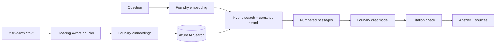

# ☁️ Azure Handbook RAG

A small end-to-end retrieval-augmented generation app. It answers questions about a folder of documents, with citations, using **Azure AI Search** for retrieval and **Azure AI Foundry** for embeddings and answers.



**Role focus:** AI Engineer · **Stack:** Python 3.11+, Azure AI Search, Azure AI Foundry, Microsoft Entra ID, Bicep, FastAPI, pytest

> **Status:** tested offline and with the real Azure SDK clients against simulated responses. It has not yet been deployed to a live Azure subscription, and the Bicep template has not been compiled.

Design decisions and limitations are in [docs/ARCHITECTURE.md](docs/ARCHITECTURE.md).

## Try it without Azure

```bash
python3 -m venv .venv
```
```bash
.venv/bin/pip install -e ".[dev]"
```
```bash
.venv/bin/azure-rag --offline serve
```

Open http://127.0.0.1:8000. Offline mode uses word matching and returns the best passage unchanged. It shows the flow, but it does not use a language model.

## Run it on Azure

You need an Azure subscription where you can create resources and role assignments (Owner, or Contributor plus User Access Administrator), and quota for `gpt-5.4-mini` and `text-embedding-3-small`.

**Cost:** the Basic search service is billed hourly even when idle. Models are billed per token. Delete the resource group when you finish.

```bash
brew install azure-cli
```
```bash
az login
```
```bash
az group create --name rg-azure-rag --location swedencentral
```
```bash
az deployment group create --resource-group rg-azure-rag --name main --template-file infra/main.bicep --parameters principalId="$(az ad signed-in-user show --query id -o tsv)"
```
```bash
cp .env.example .env
```
```bash
az deployment group show --resource-group rg-azure-rag --name main --query properties.outputs
```

Copy the three endpoints into `.env`. Role assignments can take several minutes to apply, so a 403 at first usually means wait and retry. Then:

```bash
.venv/bin/azure-rag ingest
```
```bash
.venv/bin/azure-rag ask "How many days of annual leave can I carry over?"
```
```bash
.venv/bin/azure-rag eval
```
```bash
.venv/bin/azure-rag serve
```

Use your own files with `azure-rag --docs path/to/folder ingest`. Ingestion makes the index match that folder, so it deletes chunks that are no longer there. Use a different `SEARCH_INDEX` for each collection, and whenever you change `EMBEDDING_DIMENSIONS`.

Delete everything:

```bash
az group delete --name rg-azure-rag
```

## Code

| File | Does |
|---|---|
| `src/azure_rag/chunking.py` | Splits documents |
| `src/azure_rag/search.py` | Index and hybrid query |
| `src/azure_rag/foundry.py` | Embeddings and answers |
| `src/azure_rag/pipeline.py` | Ingest, retrieve, answer, check citations |
| `src/azure_rag/evaluate.py` | Evaluation |
| `src/azure_rag/cli.py`, `web.py` | Command line and web page |
| `infra/main.bicep` | All Azure resources and roles |

## Tests

```bash
.venv/bin/pytest
```

The Azure tests run the real SDK clients against fake HTTP responses, so they need no account.

## License

MIT
