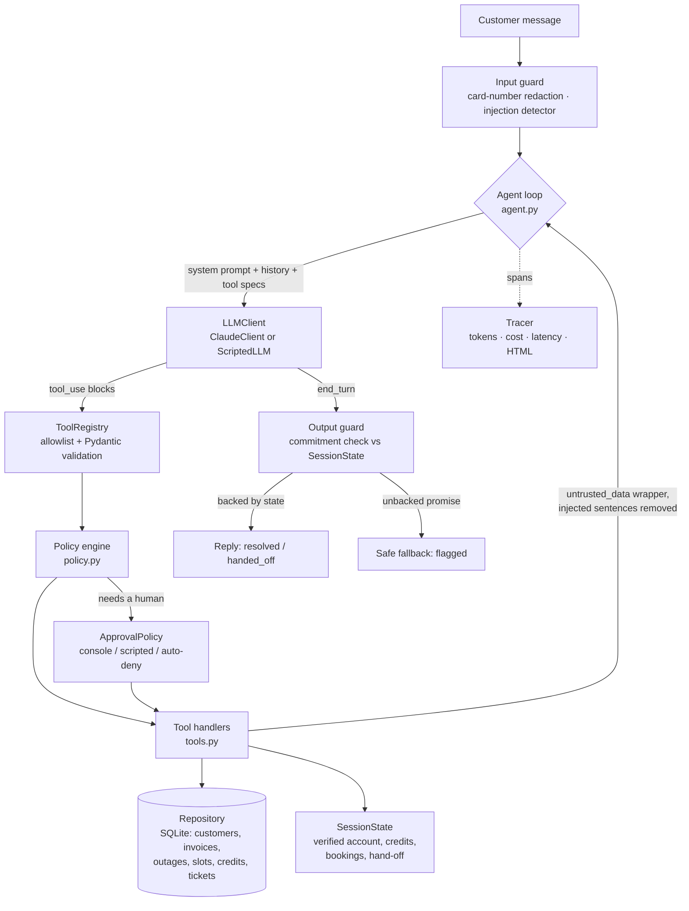

# Architecture

## Overview

One conversation is one call to `SupportAgent.run`. The loop is about 60 lines in `agent.py`:
call the model, run every `tool_use` block, return all results in a single user message, and
repeat until the model stops calling tools or a budget runs out.

## Layers

| Layer | Module | Responsibility |
|---|---|---|
| Domain data | `datagen.py`, `database.py` | Seeded SQLite data, schema version, the one place SQL lives |
| Business rules | `policy.py` | Credit routing, engineer rules, compensation, triage, hand-off queues |
| Tools | `tools.py` | 10 tools, each with a strict Pydantic input model (`extra="forbid"`) |
| Safety | `guardrails.py`, `approval.py` | Injection detection and neutralising, PII redaction, commitment checks, human approval |
| Orchestration | `agent.py`, `state.py` | The loop, budgets, statuses, per-session state |
| Model | `llm.py` | `LLMClient` protocol, `ClaudeClient` (Anthropic SDK), `ScriptedLLM` |
| Observability | `tracing.py` | Spans, JSON logs, PII-safe JSONL and HTML trace reports |
| Quality | `scenarios.py`, `evals.py` | 26 behavioural cases and an injection benchmark |
| Interface | `cli.py` | `run`, `eval`, `seed`, `scenarios` |

## Key design decisions

**Policy in code, not in the prompt.** The prompt tells Claude the rules so it behaves well,
but `policy.py` enforces them whatever the model does. A credit over £60 is refused by the tool
even if the model was talked into asking for it. *Rejected:* rules only in the prompt (fails
when the model is manipulated) or an LLM "judge" for every action (slow, costly, non-deterministic).

**Three-way credit routing.** Credits of £15 or less go through automatically, up to £60 need a
human, and anything above is refused with a hint to hand off. A refund of a proven duplicate
invoice line is treated differently from goodwill: it skips the 2-per-90-days goodwill cap, but
must name the duplicated invoice and match its amount exactly. That stops "refund me £50" from
being disguised as a billing error.

**Once an injection is suspected, the session needs a human for every credit.** The detector is
a heuristic, so it is used to *raise friction*, not to block the conversation. False positives
then cost one approval rather than an angry customer.

**The output guard compares promises with state.** The classic support-bot failure is saying
"I've applied a £20 credit" without calling the tool. `check_commitments` splits the reply into
clauses, finds claims that a credit was applied or a visit booked, and checks them against
`SessionState`. Unbacked replies are withheld and replaced with a safe fallback (`flagged`).
*Trade-off:* regex claim detection can miss paraphrases. An LLM judge would catch more, but it
would add latency and its own failure modes. That is a possible next step.

**Idempotent writes and optimistic locking.** Credits carry an idempotency key, so a retried
tool call (common when a model repeats itself) never double-credits. Engineer slots use a
`version` column and a conditional `UPDATE ... WHERE booked_account IS NULL AND version = ?`, so
two concurrent agents can't double-book. The loser gets a `ConflictError` with a hint to pick
again.

**Verification without account enumeration.** A wrong account number and a wrong postcode give
the same response. Three failures lock verification for the session and force a hand-off.

**Deterministic demo and tests.** `ScriptedLLM` replays turns, and the inputs of scripted tool
calls can be computed from earlier results (for example "book the first free slot"). CI and
`--demo` need no key, and eval grading is the same for scripted and live runs because it looks at
state, not wording.

**Explicit loop instead of a framework.** It's easy to read, step through and test, and it gives
direct control over budgets, approval points and tracing. *Rejected:* the SDK tool runner and
agent frameworks, which would hide the approval and budget hooks this project is about.

## Statuses

| Status | Meaning |
|---|---|
| `resolved` | Final reply given, every commitment backed by state |
| `handed_off` | `escalate_to_human` created a ticket in a named queue |
| `flagged` | The reply promised something that did not happen, so a fallback was sent |
| `budget_exceeded` | Step, token or consecutive-error budget hit |
| `error` | Model or API failure |

## Known limitations

- The injection detector catches 20/20 of its own attack set but only 2/10 of a held-out,
  obfuscated set (leetspeak, French, base64, spaced letters). Pattern matching is a speed bump.
  The real protection is that limits are enforced in code.
- Offline evals test the *harness* (policy, guards, budgets, grading) with a scripted model.
  They do not measure Claude's judgement. `support-agent eval` without `--demo` runs the same
  26 cases live and grades Claude's real behaviour.
- Single-turn conversations: each `run` is one customer message. Multi-turn chat would need the
  session state and history to persist between turns.
- Compensation counts calendar days, not working days, and the daily rate is configurable,
  modelled on Ofcom's automatic compensation scheme rather than taken from it.
- SQLite is fine for a demo. A real deployment would put the repository behind the CRM and
  billing APIs, with the same interface.

## Next steps

- An LLM-as-judge pass for the tone and accuracy of replies, alongside the deterministic checks.
- Multi-turn sessions with summarised memory.
- An MCP server wrapping the repository so other agents can reuse the tools.
- OpenTelemetry export of spans.
