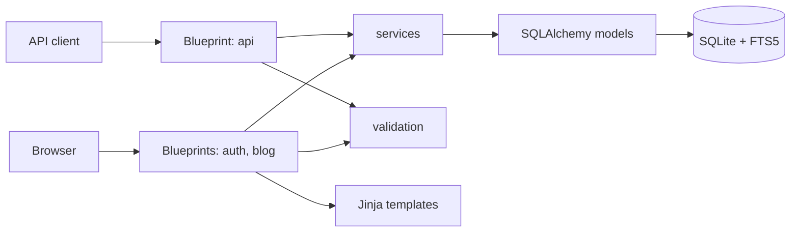

# Architecture

MVC: `models.py` is the model, `templates/` the view, and the three blueprints are controllers. Rules live in `services.py` and `validation.py`, so the pages and the API cannot drift apart.

## Schema

`user` 1–n `post` n–n `tag` (through `post_tag`), `post` 1–n `comment`, `user` 1–n `api_token`. Third normal form, with foreign keys enforced. `post_fts` is an external-content FTS5 index kept current by triggers.

## Decisions

| Decision | Why |
|---|---|
| API ignores cookies | It is exempt from CSRF checks, so cookie sign-in there would be a hole |
| Unknown usernames still run bcrypt | Response times do not reveal which accounts exist |
| Hidden drafts return 404 | 403 would confirm the draft exists |
| Passwords over 72 bytes refused | bcrypt would ignore the rest or fail |
| Each search word is quoted | User input can never be FTS5 query syntax |
| Tokens stored as SHA-256 | They are 256-bit random values, so a slow hash adds nothing |
| `session_version` in the session | Changing it signs a user out everywhere |

| OWASP area | Control |
|---|---|
| Broken access control | Role checks and per-object checks, tested per role |
| Injection | Bound parameters, quoted search, escaping, Markdown allow-list, CSP |
| Authentication failures | bcrypt, rate limits, session reset on sign-in |
| Misconfiguration | No production start without a key, security headers, non-root container |

## Limits

- Rate limits are held in memory, so run one worker process or set `RATELIMIT_STORAGE_URI` to Redis.
- Limiting by account lets someone slow down another person's sign-in for 15 minutes.
- Signing in does not require a verified email, and there is no password reset.
- SQLite allows one writer at a time.
