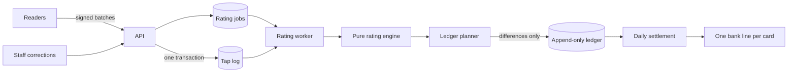

# 🚇 Contactless Fare Engine

Tap a bank card on a train or bus and someone has to work out, days later, what the trip cost. This service takes the taps, rebuilds the journeys, applies daily and weekly caps, and keeps a ledger that stays right when taps arrive late, twice or not at all. The city, its stations and its fares are invented.

## 🏛 Architecture



Design decisions and trade-offs: [docs/ARCHITECTURE.md](docs/ARCHITECTURE.md).

**Role focus:** Software Engineer · **Stack:** C# / .NET 10, ASP.NET Core minimal APIs, EF Core + SQLite (migrations, WAL), HMAC request signing, background worker, xUnit, Docker

## 🧩 The problem

Readers on buses lose signal, so taps can reach the server days late and in any order. Networks retry, so the same tap can arrive three times. Riders forget to tap out. Meanwhile the bank has already been told to collect Monday's fares. The operator needs a price that:

- does not depend on the order taps arrived in,
- never goes above the published caps,
- can be corrected after the money has moved, with a full history of why.

## ✨ Features

- **Journeys from taps:** missed taps, over-long journeys, change of mind, walking interchanges, pass-back, free bus transfers
- **Caps:** bus, zone and weekly caps, choosing whichever costs the rider least; dated tariffs, so old weeks re-rate at old prices
- **Auto-completion:** a regular commuter's forgotten tap is filled in, at most twice a week and only with clear evidence
- **British time:** service days start at 04:30 and stay correct through both clock changes; bank holidays are off-peak
- **Exactly-once effects:** idempotent taps, a durable job queue with revisions, append-only adjustments, idempotent settlement
- **Security:** signed reader batches, hashed staff keys, agent and finance roles, audited corrections
- **Failure handling:** back-off and parking for jobs that fail, which block settlement until someone looks

## 🚀 Quick start

Needs the .NET 10 SDK.

```bash
dotnet run -c Release --project src/FareEngine.Simulator -- 2000 4 42
```

That plays four weeks of taps through the real database and checks the result. To run the API (OpenAPI at `/openapi/v1.json`), set a reader secret and a staff key hash in the environment:

```bash
Auth__Readers__gate1=choose-a-secret dotnet run --project src/FareEngine.Api
```

| Endpoint | Who | What |
|---|---|---|
| `POST /v1/taps` | Readers (HMAC) | Upload up to 500 taps; safe to retry |
| `GET /v1/cards/{token}/weeks/{monday}` | Agent | Journeys, prices and the reason for each |
| `GET /v1/cards/{token}/ledger` | Agent | Money movements, paged |
| `POST /v1/cards/{token}/corrections` | Agent | Add a missed tap, with a reason |
| `POST /v1/settlements/{date}` | Finance | Close a day |
| `GET /v1/queue` | Finance | Backlog and parked jobs |

## 📟 Example output

2,000 cards, four weeks including a clock change and Easter, on an Apple M2:

```text
Simulating 2,000 cards for 4 weeks (seed 42)

Delivered             145,110 taps, in the order they arrived
  stored once         140,968
  retries ignored       4,142
Journeys
  auto-completed        1,012
  incomplete              390 charged the maximum fare
Money
  single fares      £269,710.60
  charged           £256,975.20  (4.7 % saved by caps)
  collected         £258,666.00  over 34 settled days
  refunded            £1,690.80
Ledger
  entries              42,327  of which 1,541 adjustments for late taps
Checks
  ledger differs from a clean rating   0 of 7,848 card weeks
  card days above the widest daily cap 0
  settled equals charged               yes
Speed
  ingest                7,836 taps per second
  rate                  1,837 card weeks per second (50,491 ratings)
```

The first check is the important one. The ledger was built day by day from taps in the wrong order, then compared with rating every tap at once in the right order.

## 🏗 Project structure

```text
src/FareEngine.Domain/        journeys, caps, tariffs, ledger planning (no dependencies)
src/FareEngine.Application/   EF Core, ingestion, rating jobs, settlement
src/FareEngine.Api/           endpoints, reader signatures, staff keys
src/FareEngine.Simulator/     seeded riders, end-to-end run and checks
tests/FareEngine.Tests/       unit, property-style, concurrency and API tests
```

## 🎯 Skills demonstrated

- Separating a pure domain core from persistence, so correctness can be tested without a database
- Idempotency, durable queues and append-only money, tested under concurrent retries
- Finding a pricing rule (marginal cost under the caps) that keeps earlier days stable
- Time zones, effective dating and boundary cases
- Secure API design: request signing, constant-time comparison, least-privilege roles

## 🧪 Running tests

96 tests:

```bash
dotnet test
```

## 📄 License

MIT
