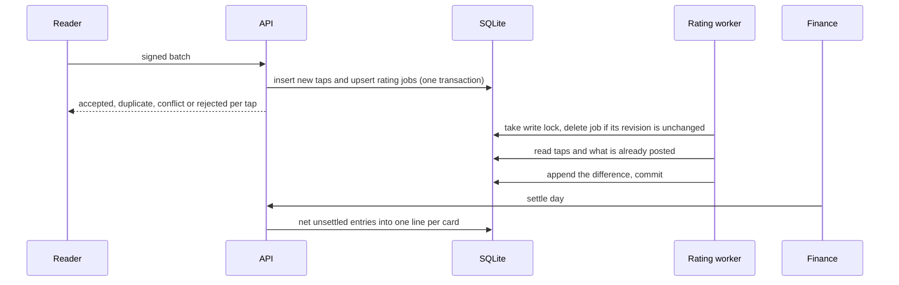

# Architecture

## Layers

| Layer | Knows about | Does not know about |
|---|---|---|
| Domain | Taps, journeys, fares, caps | Databases, HTTP, the current time |
| Application | Transactions, jobs, settlement | HTTP |
| API | Signatures, keys, JSON | Fare rules |
| Simulator | All of the above, through the same services | |

## Decisions

### Re-rate the week instead of updating running totals
A late tap can merge two incomplete journeys, move a free transfer or trigger a cap. Patching totals for each case is where fare systems go wrong. Instead, a week is a pure function of its taps, and the ledger is brought into line by posting the difference. The cost is repeated work: 50,491 ratings for 7,848 card weeks in the simulation. At about 25 journeys a week that is affordable.

**Rejected:** storing a running cap total per card. It is faster, but every late tap becomes a special case.

### Charge each journey what it adds
A cap covers a group of journeys, so something must decide which of them is cheaper. Each journey is charged `cost(journeys so far) - cost(journeys before it)`.

- Charges are never negative and never above the single fare (tested on random weeks).
- They add up exactly to the capped total, with no rounding to share out.
- A new tap at the end of the week does not reprice Monday, so settled days usually stay settled.

**Rejected:** spreading the saving across the week in proportion. It is fairer between operators, but reaching the weekly cap on Friday would rewrite four settled days. Operator shares here therefore favour whoever carried the rider before the cap was reached. A real revenue-sharing agreement may need a second, proportional calculation.

### Weeks are independent
Auto-completion looks for evidence only inside the week being rated. A longer history would fill in more taps, but then correcting one week could change the next four. One exception remains: evidence later in a week can refund a maximum fare charged earlier in it, which is the point.

Taps are read for a day either side of the week. A test compares this with reading everything.

### A job table with revisions, not a message broker
Jobs commit with the taps that caused them, so neither can be lost alone. Each request raises `Revision`. A worker deletes the job only if the revision is the one it read, so a tap that arrives during rating is never missed. An in-memory signal wakes the worker, but nothing depends on it.

SQLite's `BEGIN IMMEDIATE` takes the write lock before the first read, which is what makes "read what is posted, append the difference" safe. On PostgreSQL the same code would need a row lock or an advisory lock per card week.

### Journeys in progress
A journey still under way is not charged. Its job is queued again for the moment it would expire. Settlement allows these but refuses to run while any job is due, retrying or parked: collecting a wrong amount is worse than collecting late.

### Signed batches
Readers sign their id, a timestamp and the exact bytes. Old timestamps are refused. A replay inside the five-minute window does no harm, because taps are idempotent, so no nonce store is needed. Unknown readers are checked against a dummy secret to keep timing even.

### Cap search
The weekly cost is the cheapest of: no weekly cap, or one weekly cap (bus, or zones 1 to n) with the remaining journeys day-capped. Daily cost works the same way within a day. Combinations of two weekly caps are never useful because each wider cap includes the narrower ones.

## Index

`Taps (CardToken, OccurredAtMs)` serves the only hot read. On 400,000 rows in an in-memory SQLite table, the lookup went from 17,310 to 28 microseconds.

## Known limits

- SQLite allows one writer. Ingestion and rating share it, so throughput is bounded by one machine.
- Re-rating reads a whole week even when nothing relevant changed.
- The card token is treated as opaque. Tokenisation and card data are outside this service.
- Refusals after settlement (a declined card) are not modelled.
- Corrections add taps. Removing a wrong tap would need a tombstone.

## Next steps

Debt recovery for declined cards, a proportional operator settlement, and per-card locking on PostgreSQL.
