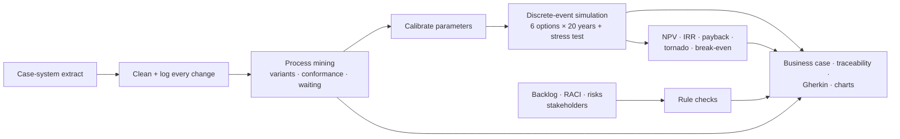
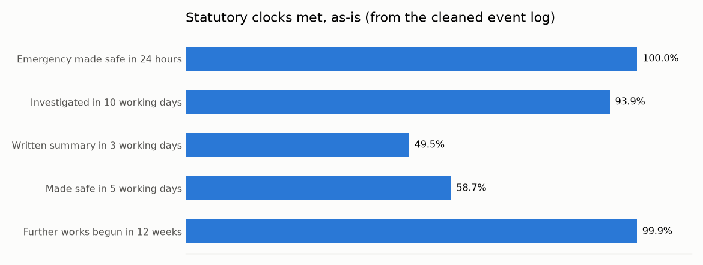
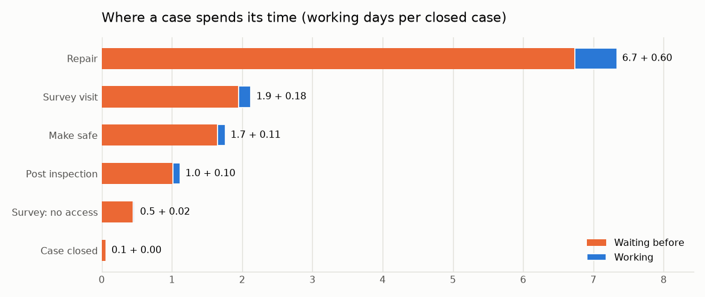
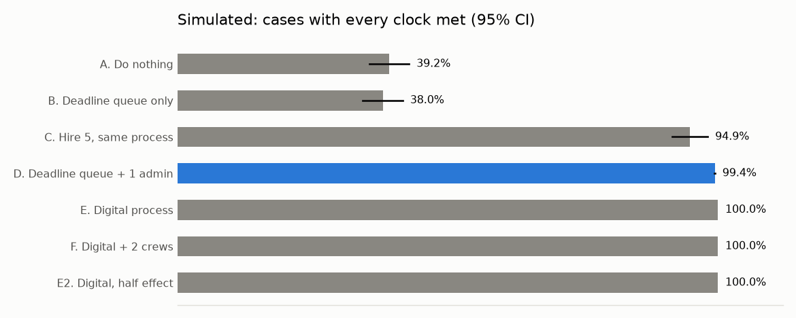
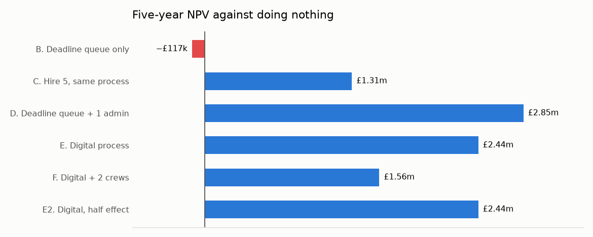
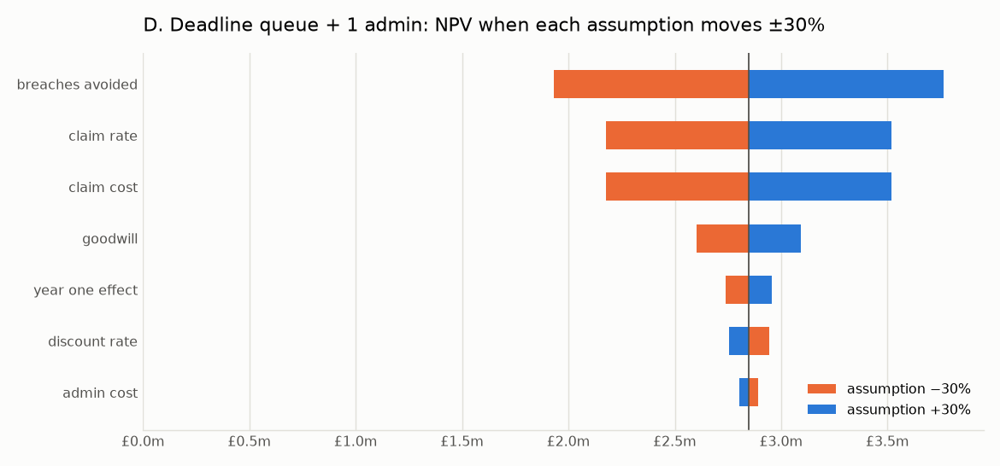
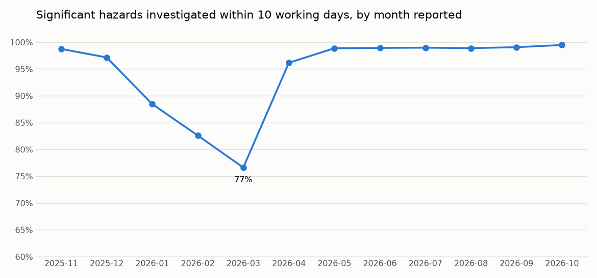

# 🏠 Damp & Mould Repairs Business Case

A business-analysis toolkit and full business case for a fictional housing association facing the
new statutory clocks on damp and mould. It **mines 47,406 messy event-log rows** to find what
really happens, calibrates a **discrete-event simulation** of the repairs process from that log,
tests six options on identical simulated cases, and turns the results into an NPV case and a
traceable backlog. The finding is not the obvious one: one more administrator and a reordered work
queue beat hiring five people *and* beat a digital programme.

## 🏛 Architecture



Design decisions, trade-offs and limitations are in [docs/ARCHITECTURE.md](docs/ARCHITECTURE.md).
The deliverables are [docs/BUSINESS_CASE.md](docs/BUSINESS_CASE.md),
[docs/REQUIREMENTS.md](docs/REQUIREMENTS.md) and
[docs/acceptance.feature](docs/acceptance.feature).

**Role focus:** Business Analyst · **Stack:** Python 3.11+, NumPy, pandas, matplotlib, pytest +
Hypothesis, TOML, Mermaid, Gherkin

## 🧩 The problem

From October 2025 social landlords in England must investigate significant damp and mould hazards
within 10 working days, send a written summary within 3, make the home safe within 5 more and
handle emergencies in 24 hours (simplified here; not legal advice). The association deals with
about 6,100 cases a year and misses these limits often. The director has been offered two answers,
hire more people or buy a digital platform, and wants to know which to approve.

## ✨ Features

- **Event-log cleaning** that accounts for every row and never invents missing times.
- **Process mining:** directly-follows map with waits, variants, conformance against policy, and
  waiting versus working time.
- **One definition of a breach**, shared by the log and the simulation. Open cases past their limit
  count, so a backlog cannot hide breaches.
- **Calibration** of service times, no-access, rework, parts and arrivals from the log; tests check
  the hidden values are recovered.
- **Discrete-event simulation** on a UK working-day calendar with priority queues, seasonal demand
  and common random numbers. Checked against the Pollaczek-Khinchine queueing formula.
- **Financial model:** five-year NPV, IRR, payback, tornado, break-even, optimism bias. Freed
  capacity is kept apart from cash.
- **Traceable content:** 13 stories → pain points → KPIs → simulated verdict; RACI, MoSCoW balance
  and coverage are validated in code.

## 🚀 Quick start

```bash
pip install -e ".[dev]"
damp-case mine                     # clean and mine the extract
damp-case options                  # simulate and compare the options
damp-case what-if --crews 20 --deadline-queue
damp-case report                   # regenerate docs/ (about a minute)
damp-case extract                  # write the raw log to data/event_log.csv
```

## 📊 Key insights

Real output on the seeded extract (`damp-case report`, 20 replications per option).

| Option | All clocks met (95% CI) | Breached cases a year | Mean working days | NPV |
|---|---|---|---|---|
| A. Do nothing | 39.2% (35.6% to 42.9%) | 1,864 | 14.8 | – |
| B. Deadline queue only | 38.0% (34.3% to 41.7%) | 1,901 | 15.2 | −£117k |
| C. Hire 5, same process | 94.9% (91.6% to 98.1%) | 160 | 6.6 | £1.31m |
| **D. Deadline queue + 1 admin** | **99.4% (99.4% to 99.5%)** | **18** | **15.2** | **£2.85m** |
| E. Digital process | 100.0% | 0 | 13.1 | £2.44m |
| F. Digital + 2 crews | 100.0% | 0 | 5.5 | £1.56m |

1. **Two queues cause the breaches.** In the log only 49.5% of written summaries and 58.7% of
   make-safe jobs are on time, against 93.9% of investigations. Summaries wait for one
   administrator; make-safe jobs queue behind routine repairs.
2. **Fixing one queue alone looks useless.** Deadline ordering lifts make-safe but total compliance
   does not move (39.2% to 38.0%), since nearly every case then fails on its summary.
3. **Recommendation: option D.** It is £404k better than the digital programme and breaks even at
   £27 per breached case, against £410 assumed. Digital adds convenience (failed visits 1,471 to
   410) and 3.3 surveyors of capacity, so it deserves its own phase 2 decision.
4. **It does not make repairs faster.** Waiting is reordered, not removed (14.8 to 15.2 days). Only
   more crews shorten it, and tenants should be told so.
5. **No option is safe at 15% more demand.** D falls to 83.3%, E to 84.0% and F to 92.6%. Doing
   nothing falls to 15.6%. Crew capacity is the next constraint, so demand needs watching weekly.
6. **Winter shows first.** On-time investigation falls to 77% for cases reported in March.








## 🏗 Project structure

```text
src/damp_mould_repairs_business_case/
  calendar.py  model.py      working time, hazards, clocks, parameters
  datagen.py  eventlog.py    the extract and its cleaning
  mining.py                  discovery, conformance, compliance, calibration
  simulation.py              event engine, case flow, options, statistics
  finance.py                 cash flows, NPV, IRR, sensitivity
  content/  content.py       backlog, RACI, risks and their rules
  pipeline.py  report.py  cli.py
tests/                       85 tests
docs/                        generated deliverables and charts
```

## 🎯 Skills demonstrated

- **Process analysis:** as-is from evidence, to-be design, bottleneck and conformance analysis
- **Options appraisal:** like-for-like comparison, stress test, break-even, honest non-cashable
  benefits
- **Requirements:** MoSCoW, user stories, Gherkin, end-to-end traceability to measured KPIs
- **Stakeholders and governance:** analysis, RACI, scored risk register
- **Recommending against the expensive option** when the evidence says so

## 🧪 Running tests

```bash
pytest -q
ruff check . && ruff format --check .
```

85 tests, including property tests for the calendar and IRR, a queueing-theory check on the
simulator, recovery of hidden parameters, and rules that must reject bad content.

## 📄 License

MIT
