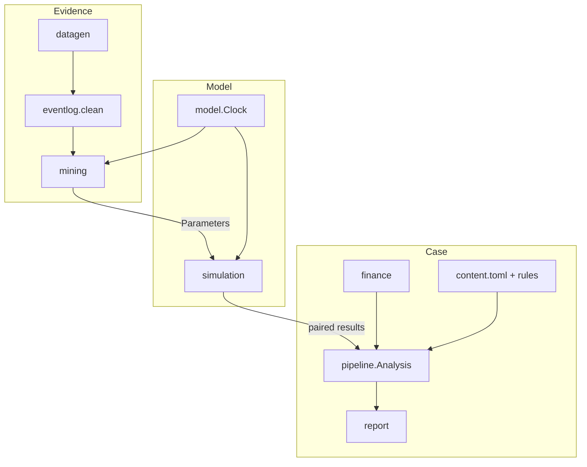

# Architecture

## Key decisions

**Mine the process before designing the fix.** Interviews would have produced the policy diagram.
The log shows 6.5% of cases departing from it, and that waiting is many times larger than working.

**One clock rule for log and simulation.** `CaseRecord.outcome` is used for both, so observed and
simulated compliance mean the same thing. It returns "unknown" while a case is inside its limit and
"breached" once an open case passes it. Counting only finished cases would flatter a process with a
growing backlog.

**Discrete-event simulation instead of averages.** Teams run near 95% utilisation, where a small
change in load produces a large change in waiting. A spreadsheet of average times shows enough
capacity and misses the problem. Rejected: a queueing formula, which cannot handle priorities,
rework and seasonality together (it is used as a test instead).

**Working-time axis.** Everything runs in working minutes and converts to dates only at the edges.
That makes statutory working-day limits exact. Cost: a 24-hour emergency is approximated as one
working day, and out-of-hours cover is not modelled.

**Common random numbers.** All randomness for a case is drawn up front, so every option sees the
same cases. Differences are paired, which gives much tighter intervals for the same run time.

**Calibrate from the log.** The generator's parameters differ from the defaults and the analysis
must recover them. One trap found on the way: the parallel written summary sat between other steps
and biased the parts lead time from 7.5 to 9.0 days until it was excluded from sequence measures.

**Cash and capacity are separate.** Freed surveyor time is reported but valued at nothing, since no
post is removed. The benefit is a single line, breaches avoided × expected cost, with its
break-even shown, so a sceptical reader can replace one number.

**Content as validated data.** Stories, RACI and risks live in TOML. Loading fails if a pain point
has no story, a Must-have set exceeds 60% of effort, or an activity lacks one accountable role.

## Limitations

- The data is synthetic and produced by the same engine as the model, so calibration is easier than
  it would be in reality. Structural error (steps that the model lacks) is not tested.
- The model reproduces the direction and size of today's problem but not every figure: the log's
  49.5% of on-time summaries lies above the simulated interval for an average year.
- Results near 100% mean "no modelled cause of breach remains", not a guarantee.
- Staff are interchangeable and never absent. Travel and geography are inside the service times.
- Deadline ordering assumes the contractor accepts it, and desk assessment assumes photo quality.
- Financial inputs are illustrative and must be replaced by Finance.
- 24-hour emergencies and the 12-week limit are simplified.

## Next steps

Out-of-hours emergencies, staff absence, location-aware scheduling, and a rolling forecast of
demand against crew capacity, as the stress test shows that to be the next constraint.
