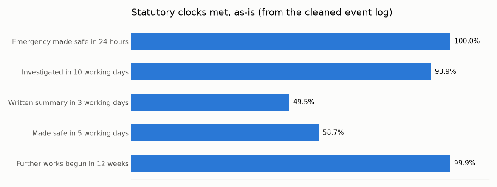
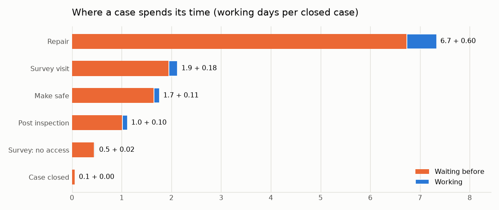
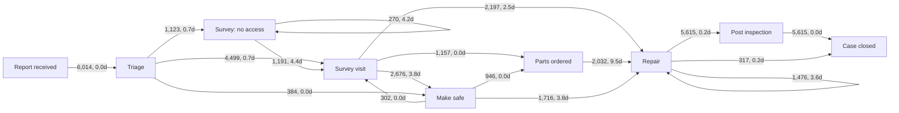
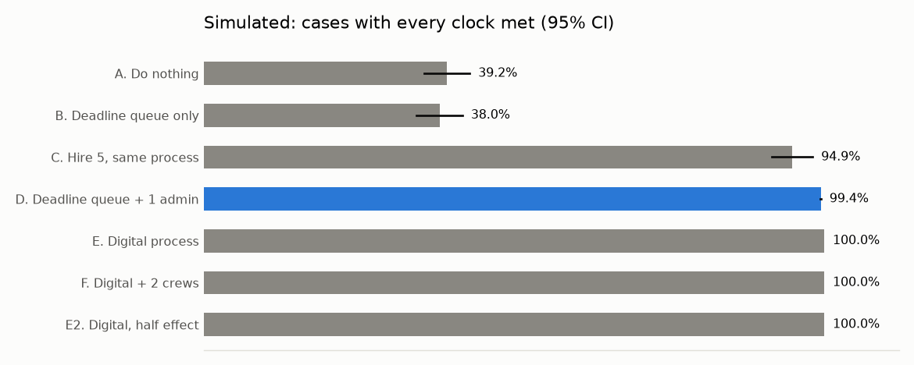
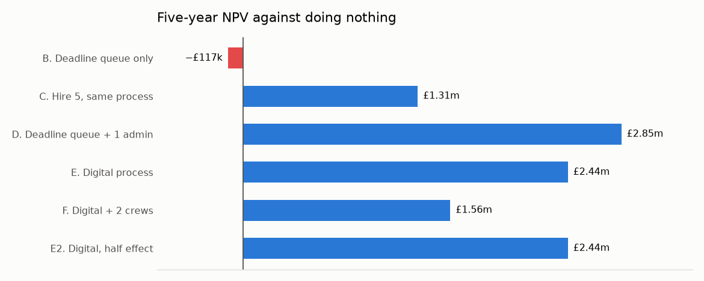
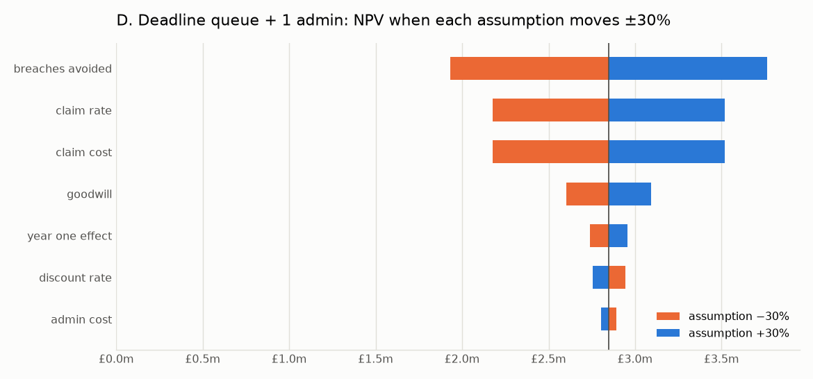
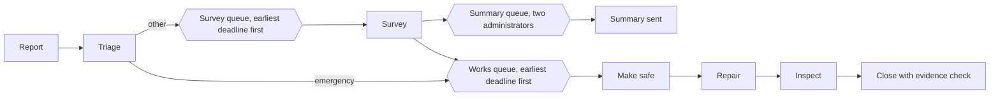

# Business case: damp and mould repairs

Generated by `damp-case report`. Synthetic data for a fictional housing association;
statutory limits are simplified and this is not legal advice.

## Executive summary

**Recommendation: approve option D. Deadline queue + 1 admin.** Two queues cause most breaches: make-safe jobs wait behind routine repairs, and written summaries wait for one administrator. Fixing both is simulated to raise cases meeting every clock from 39% to 99.4%, avoiding 1,846 breached cases a year (95% CI 1,717 to 1,974). Five-year NPV is £2.85m.

**The full digital programme is not justified on compliance alone.** It reaches 100.0%, but its NPV is £2.44m, which is £404k less. What it adds is fewer failed visits (1,471 to 410 a year) and about 3.3 full-time surveyors of capacity, not counted as a saving because no post is removed. Treat it as phase 2, with its own decision.

The case rests on the cost of a breached case, assumed to be £410. The recommended option breaks even at £27. It does not shorten the end-to-end time (14.8 to 15.2 working days): it reorders waiting so that hazards are dealt with first. Only more crews shorten the wait.

## Current state

6,101 cases over a year. Step-level fitness to policy is 99.2%, but only 93.5% of cases follow it throughout.

| Clock | Cases | Met | Breached |
|---|---|---|---|
| Emergency made safe in 24 hours | 386 | 100.0% | 0 |
| Investigated in 10 working days | 2,692 | 93.9% | 164 |
| Written summary in 3 working days | 3,039 | 49.5% | 1,535 |
| Made safe in 5 working days | 2,676 | 58.7% | 1,104 |
| Further works begun in 12 weeks | 2,628 | 99.9% | 2 |

Policy departures:

| Departure | Cases |
|---|---|
| Repair → Case closed | 317 |
| Report received → Survey visit | 66 |
| Report received → Survey: no access | 16 |
| Report received → Make safe | 2 |

## Data cleaning log

| Step | Rows |
|---|---|
| rows received | 47,406 |
| rows from test or malformed cases removed | 6 |
| activity names standardised | 2,231 |
| start and end swapped back | 131 |
| exact duplicates removed | 562 |
| missing start times (end time used for ordering) | 975 |
| rows from cases without a report removed | 0 |
| rows kept | 46,838 |

## Does the model reproduce today?

| Measure | Event log | Calibrated simulation (95% CI) |
|---|---|---|
| met_emergency | 1.000 | 1.000 (1.000 to 1.000) |
| met_investigate | 0.939 | 0.943 (0.933 to 0.953) |
| met_summary | 0.495 | 0.389 (0.351 to 0.427) |
| met_make_safe | 0.587 | 0.519 (0.482 to 0.556) |
| met_repair | 0.999 | 1.000 (0.999 to 1.000) |
| mean_days | 13.484 | 14.795 (13.829 to 15.761) |
| no_access_visits | 1,493.000 | 1,471.150 (1,451.640 to 1,490.660) |

The log is one possible year and the interval is for the *average* year, so some log
values fall outside it. Teams close to full capacity make queues very sensitive to luck.

## Options

| Option | All clocks met (95% CI) | Breached cases a year | Mean working days | NPV | IRR | Payback |
|---|---|---|---|---|---|---|
| A. Do nothing | 39.2% (35.6% to 42.9%) | 1,864 | 14.8 | – | – | – |
| B. Deadline queue only | 38.0% (34.3% to 41.7%) | 1,901 | 15.2 | −£117k | – | – |
| C. Hire 5, same process | 94.9% (91.6% to 98.1%) | 160 | 6.6 | £1.31m | – | – |
| D. Deadline queue + 1 admin | 99.4% (99.4% to 99.5%) | 18 | 15.2 | £2.85m | 714% | 0.2 years |
| E. Digital process | 100.0% (100.0% to 100.0%) | 0 | 13.1 | £2.44m | 160% | 0.9 years |
| F. Digital + 2 crews | 100.0% (100.0% to 100.0%) | 0 | 5.5 | £1.56m | 102% | 1.3 years |
| E2. Digital, half effect | 100.0% (100.0% to 100.0%) | 0 | 13.7 | £2.44m | 160% | 0.9 years |

## Stress test: 15% more demand

| Option | All clocks met | Breached cases | Mean working days | Open at year end |
|---|---|---|---|---|
| A. Do nothing | 15.6% | 2,980 | 40.7 | 1,043 |
| B. Deadline queue only | 14.2% | 3,028 | 44.1 | 1,099 |
| C. Hire 5, same process | 43.5% | 1,997 | 17.3 | 206 |
| D. Deadline queue + 1 admin | 83.3% | 592 | 44.1 | 1,099 |
| E. Digital process | 84.0% | 572 | 35.1 | 1,029 |
| F. Digital + 2 crews | 92.6% | 263 | 16.8 | 176 |

## Future state

## Stakeholders

| Stakeholder | Interest | Influence | Need | Engagement |
|---|---|---|---|---|
| Tenants and tenant panel | high | medium | A safe home, a clear date and no repeated visits | Panel reviews letters and booking texts; two co-design sessions |
| Director of Property Services | high | high | Compliance at an affordable cost | Sponsor; fortnightly steering group |
| Head of Compliance | high | high | Evidence that stands up to the Ombudsman and the Regulator | Approves clock definitions and the audit trail |
| Surveyors | high | medium | Professional judgement respected; fewer wasted journeys | Pilot group; set the rules for desk assessment |
| Repairs contractor | medium | high | Stable schedules and fair targets | Contract variation workshop before the deadline queue goes live |
| Customer contact team | medium | low | Simple scripts and one screen | Floor-walkers in go-live week |
| Finance | medium | high | Cashable benefits separated from released capacity | Signs off assumptions and the benefits tracker |
| IT and data protection | low | medium | Supported integration; lawful handling of photos of homes | DPIA and integration design reviews |

## RACI

| Activity | Director | Product owner | Compliance | Surveying | Contractor | IT | Finance |
|---|---|---|---|---|---|---|---|
| Agree clock definitions | I | R | A | C | I | I | I |
| Design deadline queue rules | I | A | C | R | R | C |   |
| Approve desk assessment criteria | I | C | A | R |   |   |   |
| Vary repairs contract | A | R | C | I | C |   | C |
| Build and integrate | I | A | C | C | I | R | I |
| Data protection impact assessment | I | C | A | I |   | R |   |
| Track benefits | I | R | C | I | I |   | A |
| Go / no-go decision | A | R | C | C | C | C | C |

## Risks

| Id | Risk | Score | Mitigation | Owner |
|---|---|---|---|---|
| R4 | Phase 2: tenants without smartphones are left behind | 16 | Phone and in-person routes keep the same clocks; take-up reported by age and disability | Product owner |
| R1 | Phase 2: desk assessment misses a serious hazard | 15 | Exclude vulnerable tenants and any health flag; 8% assumed to need a visit; monthly sample re-survey | Compliance |
| R2 | Contractor resists deadline-ordered work | 12 | Contract variation agreed before build; four-week parallel run | Director |
| R3 | Simulated gains do not appear because real jobs bring problems the model leaves out | 12 | Four-week pilot with a stage gate; break-even needs only a fraction of the modelled gain | Product owner |
| R6 | A severe winter exceeds the modelled peak | 12 | Stress-tested at 15% more demand; surge crews on call-off; weekly forecast against capacity | Director |
| R5 | Phase 2: photos of homes handled unlawfully | 8 | DPIA, retention limit, location data stripped on upload | IT |

## Assumptions

| Assumption | Value |
|---|---|
| discount rate | 0.035 |
| claim rate | 0.04 |
| claim cost | 7,500.0 |
| goodwill | 110.0 |
| implementation | 185,000.0 |
| change and training | 45,000.0 |
| optimism bias | 0.2 |
| annual licences | 58,000.0 |
| annual support | 22,000.0 |
| surveyor cost | 52,000.0 |
| crew cost | 98,000.0 |
| admin cost | 33,000.0 |
| year one effect | 0.5 |

