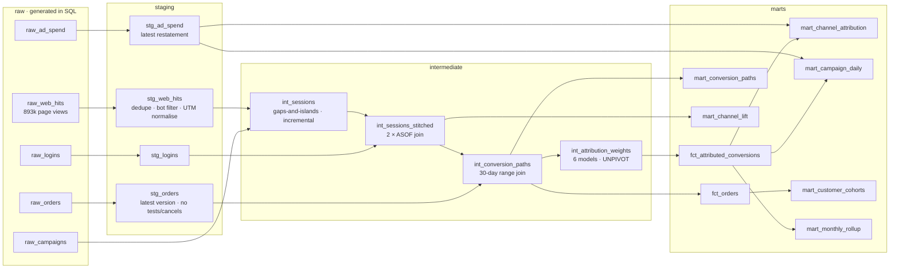
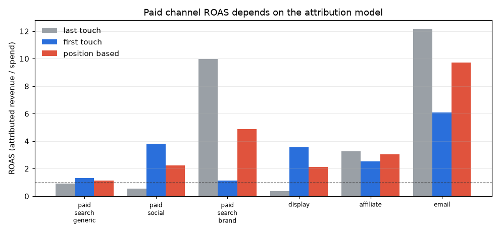
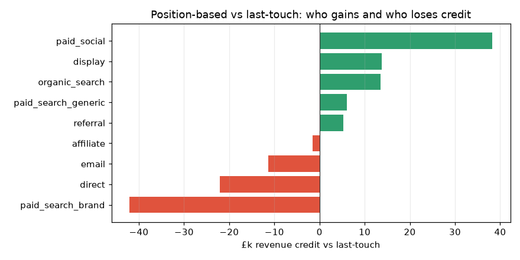
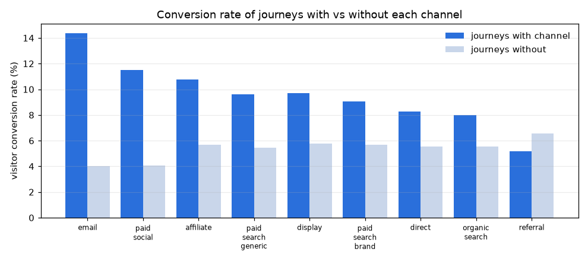
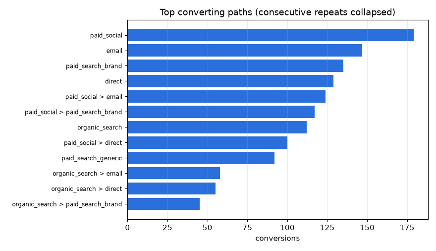
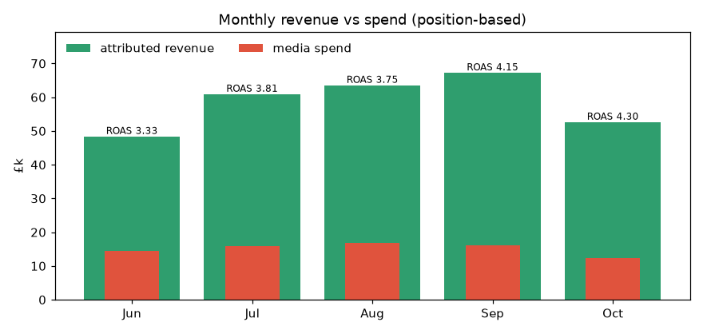
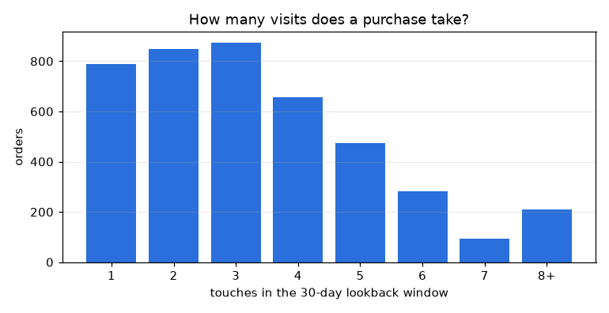

# 🧭 E-commerce Marketing Attribution

A SQL-first analytics project, built with dbt on DuckDB, that answers the question every
e-commerce marketing team argues about: **which channels actually earn the sales?** The data
comes from a fictional UK homeware brand. dbt generates five months of messy raw feeds in SQL:
893k page views with no session id, sign-ins, orders and ad-platform spend. It then rebuilds
visits through **sessionisation** and links devices to customers with **ASOF-join identity
stitching**. Every order is credited under **six attribution models** and compared with
£75.9k of media spend. A **with/without lift analysis** and **acquisition cohorts** cover what
attribution cannot see. 79 tests guard it all: 69 data tests and 10 dbt unit tests.

## 🏛 Architecture



The model DAG, design decisions, trade-offs and limitations are in
[docs/ARCHITECTURE.md](docs/ARCHITECTURE.md).

**Role focus:** Data Analyst · **Stack:** SQL (dbt-core 1.12 + DuckDB): window functions,
gaps-and-islands, ASOF and range joins, recursive CTE, ROLLUP, QUALIFY, UNPIVOT. SQLFluff, dbt
unit tests, matplotlib for charts

## 🧩 The problem

The marketing team reports paid social at a **ROAS of 0.56** and display at **0.35**. Under
last-click attribution, which is the default in most ad and analytics tools, both look like
money pits, and the finance director wants to cut them. Brand search looks like a hero at
**9.97**. The question for analytics: is that true, or an artefact of giving all the credit to
the last click? Where should the next pound go?

## ✨ Features

- **Data generated in SQL** with `range()` and `hash()`. The output is deterministic, scales with one `var`, and needs no seeds or downloads, so `dbt build` alone creates everything.
- **Realistic mess:** inconsistent UTMs (`'Facebook '`, `fb`, `CPC`, `paid-social`), 0.5% duplicate hits, crawler traffic, idle gaps inside visits, webhook re-sends, QA test orders, cancellations, refunds, restated ad spend, and shared household devices.
- **Sessionisation (gaps-and-islands).** A session breaks on a 30-minute timeout or a new campaign or referrer entrance. A running sum numbers the islands. The model is incremental (`delete+insert`) with a one-day re-sessionisation window.
- **Identity stitching with two ASOF joins:** the latest sign-in at or before the session, else the next sign-in after it. Shared iPads credit whoever was signed in at the time.
- **Conversion paths from a range join.** Touches come from the 30-day lookback window and must fall after the customer's previous order, so repeat purchases are not credited to old touches.
- **Six attribution models** in one long table via `UNPIVOT`: first touch, last touch, last non-direct, linear, time decay (7-day half-life) and position-based (40/20/40).
- **Marts:** a channel × model scorecard (ROAS, CPA, shift vs last-touch), a daily campaign mart with running and 7-day `RANGE` window ROAS, top converting paths, a with/without channel lift table with z-scores, first-touch cohorts with cumulative revenue per customer (month spine from a recursive CTE), and a month/group/channel `ROLLUP`.
- **Tests:** 69 data tests (generic, custom generic and singular) and 10 unit tests. Custom generic tests are `weights_sum_to_one`, `non_negative` and `unique_combination_of_columns`. Singular tests reconcile revenue across models, spend across marts, and sessionisation against generator ground truth.
- **Exposures** for the monthly budget review and the paid media dashboard. Metric definitions live in model `meta`.

## 🚀 Quick start

```bash
cd ecommerce-marketing-attribution
python3.12 -m venv .venv && source .venv/bin/activate
pip install -r requirements.txt
dbt build --profiles-dir .                    # generate data, build 25 models, run 79 tests
sqlfluff lint models tests analyses           # zero violations
duckdb target/warehouse.duckdb -c "from marts.mart_channel_attribution where model = 'position_based'"
pip install -r scripts/requirements-charts.txt && python scripts/make_charts.py
dbt build --profiles-dir . --vars '{visitor_count: 240000}'   # 4x volume
```

## 📊 Key insights

Every table below is real output, queried from the built marts.

**The business, June-October 2026** (`fct_orders`, `int_sessions_stitched`):
```text
 orders  revenue  avg_touches  median_days  first_order_share
   4225 292706.0         3.39          3.3              0.899

identity_source  sessions
      anonymous    127834
      signed_in     13771
    back_filled     11847
```

**Attributed revenue (£) by channel and model** (`mart_channel_attribution`):
```text
            channel  first_touch  last_non_direct  last_touch  linear  position_based  time_decay
  paid_search_brand       9324.0          82417.0     82417.0 31765.0         40364.0     38009.0
             direct      24264.0           9267.0     65916.0 42396.0         43892.0     45696.0
              email      27909.0          67593.0     55951.0 48947.0         44551.0     51254.0
     organic_search      52871.0          40136.0     27857.0 42755.0         41419.0     40959.0
paid_search_generic      35141.0          32731.0     23926.0 30905.0         30009.0     30023.0
          affiliate      14534.0          23903.0     18847.0 18121.0         17360.0     18352.0
        paid_social      86673.0          26638.0     12857.0 52697.0         51069.0     46406.0
            display      27892.0           7504.0      2764.0 18692.0         16553.0     16513.0
           referral      14098.0           2516.0      2170.0  6428.0          7489.0      5494.0
```

**ROAS by paid channel and model:**
```text
            channel  spend_gbp  last_touch  first_touch  linear  time_decay  position_based
paid_search_generic    26651.0        0.90         1.32    1.16        1.13            1.13
        paid_social    22822.0        0.56         3.80    2.31        2.03            2.24
  paid_search_brand     8264.0        9.97         1.13    3.84        4.60            4.88
            display     7833.0        0.35         3.56    2.39        2.11            2.11
          affiliate     5738.0        3.28         2.53    3.16        3.20            3.03
              email     4590.0       12.19         6.08   10.66       11.17            9.71
```




**Do journeys that include a channel convert more?** (`mart_channel_lift`, all 60k visitors, including non-buyers):
```text
            channel  journeys_with  conversion_rate_with  conversion_rate_without  relative_lift  z_score
              email          14137                0.1439                   0.0402           3.58     43.9
        paid_social          19207                0.1152                   0.0408           2.82     34.6
          affiliate           9298                0.1076                   0.0567           1.90     18.3
paid_search_generic          14777                0.0961                   0.0543           1.77     17.9
            display          10455                0.0970                   0.0578           1.68     14.8
  paid_search_brand          13829                0.0904                   0.0569           1.59     14.1
             direct          20615                0.0825                   0.0553           1.49     12.9
     organic_search          22358                0.0798                   0.0556           1.44     11.7
           referral           5352                0.0519                   0.0658           0.79     -3.9
```



**Top converting paths** (`mart_conversion_paths`):
```text
                   channel_path  conversions  share_of_conversions  avg_order_value_gbp  median_days_to_convert
                    paid_social          179                0.0424                62.11                    0.01
                          email          147                0.0348                68.70                    0.02
              paid_search_brand          135                0.0320                67.85                    0.01
                         direct          129                0.0305                71.84                    0.02
            paid_social > email          124                0.0293                65.73                    2.03
paid_social > paid_search_brand          117                0.0277                62.01                    1.98
                 organic_search          112                0.0265                68.62                    0.02
           paid_social > direct          100                0.0237                64.92                    1.96
            paid_search_generic           92                0.0218                58.72                    0.02
         organic_search > email           58                0.0137                52.26                    2.03
```

**Monthly ROLLUP** (`mart_monthly_rollup`, position-based):
```text
  month  revenue_gbp  conversions  spend_gbp  roas
2026-06     48384.68        685.0   14545.26  3.33
2026-07     60917.69        852.0   15970.88  3.81
2026-08     63537.65        931.0   16935.25  3.75
2026-09     67238.61        952.0   16206.74  4.15
2026-10     52627.18        805.0   12239.33  4.30
  TOTAL    292705.81       4225.0   75897.46  3.86
```

**Scenario:** move 20% of generic search budget into paid social
(`analyses/budget_reallocation_scenario.sql`):
```text
            channel  current_spend_gbp  spend_change_gbp  revenue_change_gbp
paid_search_generic            26651.0           -5330.0             -6023.0
              email             4590.0               0.0                 0.0
  paid_search_brand             8264.0               0.0                 0.0
          affiliate             5738.0               0.0                 0.0
            display             7833.0               0.0                 0.0
        paid_social            22822.0            5330.0             11940.0
```





### Findings and recommendations

1. **Last-click undervalues paid social by about 4×.** Last-touch credits paid social with
   £12.9k (ROAS 0.56). Position-based gives £51.1k (ROAS 2.24) and first-touch £86.7k (ROAS
   3.80). Journeys with paid social convert at 11.5% against 4.1% without it (2.8×, z = 34.6),
   and paid social is the first step of 4 of the top 8 paths. **Do not cut it on last-click
   evidence.**
2. **Brand search is efficient but over-credited.** Its ROAS halves from 9.97 (last touch) to
   4.88 (position-based). It mostly closes journeys that other channels started, which is
   still worth paying for at £8.3k of spend.
3. **Generic search is the weakest paid line.** It is the largest budget (£26.7k), and its ROAS
   stays between 0.90 and 1.32 under every model. Moving 20% (£5.3k) into paid social is
   worth about **+£5.9k of revenue** over five months at average returns. That is the
   candidate for a geo holdout test.
4. **Display is a prospecting channel.** ROAS is 0.35 under last-touch but 2.11 under
   position-based, with a 1.68× lift. Judge it on first and assisted touches, not last.
5. **Email has the highest lift (3.6×) and the highest ROAS under every model.** Growing the
   list, for example through paid-social lead capture, compounds both channels.
6. **Purchases take time.** The average order follows 3.4 visits, the median one takes 3.3
   days from first touch, and 81% of orders have more than one touch. Any single-touch model throws most of the journey away.

**Caveats.** Attribution redistributes credit; it does not measure incrementality. The lift
table is observational and confounded by intent: engaged visitors both see more channels and
buy more. Use both to choose what to test, not as the test. Referral's negative lift
(0.79×, z = −3.9) is an example of selection effects. ROAS here is average, not marginal.

### Performance

| Volume | Page views | Sessions | Orders | Attribution rows | `dbt build` (98 nodes, wall) |
|---|---|---|---|---|---|
| 1× (`visitor_count: 60000`) | 893,093 | 153,452 | 4,225 | 85,878 | 8 s |
| 4× (`visitor_count: 240000`) | 3,573,444 | 614,638 | 17,098 | 347,700 | 12 s |

`EXPLAIN ANALYZE` on the lookback join (`analyses/explain_touchpoint_join.sql`) shows DuckDB
running a **hash join on `customer_id`**. The two time inequalities become residual
predicates, and dynamic min/max filters are pushed into the session scan. The query returns
14,413 touches in **10.9 ms**. Joining on the time range alone would need an IE join or a
nested loop, so the equality key matters.

## 🏗 Project structure

```
ecommerce-marketing-attribution/
├── dbt_project.yml · profiles.yml · requirements.txt · .sqlfluff
├── macros/          # rnd(), channel_grouping(), UTM normalisers, pence_to_pounds(), custom generic tests
├── models/
│   ├── generated/   # raw_* feeds + gen_sessions ground truth, all generated in SQL
│   ├── staging/     # dedupe, bot filtering, normalisation, latest-version logic (+ unit tests)
│   ├── intermediate/# sessionisation, ASOF identity stitching, range-join paths, 6 attribution models
│   └── marts/       # facts, scorecards, paths, lift, cohorts, rollup, exposures
├── tests/           # 6 singular reconciliation tests
├── analyses/        # budget scenario, EXPLAIN ANALYZE query
├── scripts/         # make_charts.py
└── docs/            # ARCHITECTURE.md, charts/
```

## 🎯 Skills demonstrated

- **Advanced analytical SQL:** gaps-and-islands sessionisation, ASOF joins, inequality range joins, `QUALIFY` de-duplication, `UNPIVOT`, `ROLLUP` with `grouping_id()`, named and `RANGE` windows, a recursive CTE, `arg_min`/`arg_max`, list functions, and a two-proportion z-test in SQL.
- **Marketing analytics:** attribution models and their biases, ROAS and CPA, path analysis, incrementality reasoning, cohort LTV and budget scenarios, with recommendations a CMO can act on.
- **Analytics engineering:** a layered dbt project, incremental models, exposures, documented columns, SQLFluff-clean code, and deterministic synthetic data that scales with one variable.
- **Data quality:** 79 tests, including reconciliation that proves no revenue or spend is created or lost between layers, and unit tests pinning down tricky logic (session timeouts, shared-device stitching, lookback boundaries, the exact weights of each model).
- **Communication:** a problem framed for stakeholders, honest caveats, and a quantified recommendation.

## 🧪 Running tests

```bash
pip install -r requirements.txt
sqlfluff lint models tests analyses
dbt build --profiles-dir .
```

## 📄 License

MIT. See [LICENSE](LICENSE).
