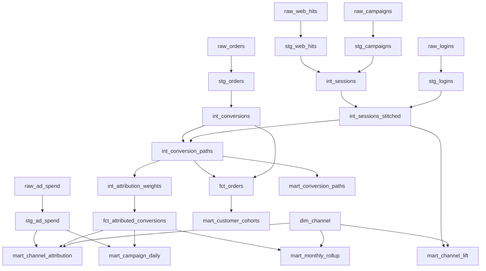

# Architecture: E-commerce Marketing Attribution

## Layers

| Layer | Materialisation | Purpose |
|---|---|---|
| `generated` (schema `raw`) | table | Raw feeds created in SQL with `range()` and `hash()`: deterministic and scalable through `var('visitor_count')`. `gen_sessions` is the hidden ground truth and is never read by staging. |
| `staging` | view | One model per source. De-duplicate (`QUALIFY`), filter bots and test orders, normalise UTMs, convert pence to pounds, keep the latest restatement. No joins. |
| `intermediate` | table / incremental | Business logic: sessionisation, identity stitching, conversion paths, attribution weights. |
| `marts` | table | Analyst- and dashboard-facing facts and scorecards with documented grains and metric definitions. |

## Key design decisions and trade-offs

### Generate the data in SQL, inside dbt
**Chosen:** every raw table is a dbt model built from `range()` and `hash(key, salt)`, so
`dbt build` alone produces the whole project, in CI and on a laptop, at any scale.
**Rejected:** CSV seeds, which would be limited to a few MB, frozen at one scale, and would bloat
the repo. Also rejected: a Python generator, which would add a second toolchain to a SQL project.
**Cost:** the generator is the most complex SQL in the project. It is isolated in the
`generated` folder, tagged `generator`, and staging never reads `gen_sessions`.

### Sessionise from page views (gaps-and-islands)
The tracking feed has no session id, as with most server-side and warehouse-native analytics.
A hit starts a new session when it is the visitor's first, when it comes more than 30 minutes
after the previous hit, or when it carries UTMs or an external referrer (a new entrance). A
running `sum()` of that flag numbers the islands. A singular test checks that the rebuilt
sessions match the generator's ground truth within 1%. The 0.4% gap is direct return visits
within 30 minutes, which are merged by design, exactly as GA does.

**Session id:** `md5(anonymous_id | start | min(hit_id))`. A start-time-only key collided
when two islands began in the same second. The uniqueness test caught that collision during
development.

### Incremental sessionisation with a re-processing window
`int_sessions` is `incremental` with `delete+insert` on `session_id`. Each run re-sessionises
hits from one day before the latest session already built, so sessions near the old
high-water mark are rebuilt with the same deterministic id.
**Trade-off:** a session that started *before* the re-processing window but continued into it
would be rebuilt as a partial session. A 1-day window against a 30-minute timeout makes that
vanishingly rare. A fully correct alternative re-processes every visitor with new hits, at the
cost of scanning their whole history. A full refresh is cheap at this scale (8 s), so CI always
builds from scratch.

### Identity stitching with ASOF joins
**Chosen:** two `ASOF LEFT JOIN`s on the device's sign-in history. The first finds the latest
sign-in at or before the end of the session, meaning who was using the device. The second
falls back to the next sign-in after the session, back-filling anonymous browsing that led to
a sign-in.
**Rejected:** a static "device → first customer seen" map. On shared household devices it
gives the second person's purchases to the first person's touches. The unit test
`identity_stitching_credits_whoever_was_signed_in` pins down the shared-iPad case.
**Limitation:** a device with no sign-in stays anonymous (127,834 of 153,452 sessions). Those
visits still count in the lift analysis, as visitors, but can never be credited to an order.

### Lookback window bounded by the previous order
Touches are credited within 30 days before an order *and* after the customer's previous order.
Without the second bound, a returning customer's second purchase would re-credit the paid social
ad that won their first one. The unit test `paths_respect_lookback_and_previous_order` covers it.

### All models in one long table
`int_attribution_weights` computes every model's weight as a column, then `UNPIVOT`s into
`(order, touch, model, weight)`. Adding a model is one expression. Every mart filters or groups by
`model`, and one generic test, `weights_sum_to_one`, proves every model hands out exactly one
conversion per order. A singular test reconciles attributed revenue to order revenue for every
model.

### Attribution + lift, not attribution alone
Rule-based attribution only redistributes credit among touches that happened. It cannot say
what would have happened without a channel. `mart_channel_lift` adds the evidence attribution
lacks: conversion rates for visitor journeys with and without each channel, including the 56k
journeys that never bought, with a two-proportion z-score. It is observational and confounded
by intent, and the README says so. Together the two tables pick which budget shift to test with
a geo holdout. Neither replaces the test.

### House model: position-based
The daily campaign mart and the rollup use position-based (40/20/40) as the reporting model.
It credits both the opener and the closer, which matches how journeys on this site behave: social
and display open, while brand search, direct and email close. It is easy to explain to
stakeholders, and its channel ranking sits between first-touch and last-touch. Time decay was
the runner-up. It undervalues openers when journeys are long, and the median journey here is
3.3 days.

## Testing strategy

| Kind | Count | Examples |
|---|---|---|
| Generic data tests | 63 | `unique`, `not_null`, `accepted_values`, `relationships`, custom `non_negative`, `unique_combination_of_columns`, `weights_sum_to_one` |
| Singular tests | 6 | revenue reconciles for every model, spend reconciles staging → daily → rollup, no touch after conversion, sessionisation vs ground truth, bots/test orders excluded, every order has a touch |
| Unit tests | 10 | UTM normalisation and bot and duplicate removal, latest webhook wins, restatement wins, sessionisation timeout and new entrance, shared-device ASOF stitching, lookback boundaries, the exact weights of all six models on a 4-touch path |

## Performance notes

- At 4× volume (3.57M page views, 615k sessions) the full build plus all tests takes 12 s of wall
  time. DuckDB's vectorised window functions make the sessionisation scan cheap.
- The lookback join runs as a **hash join on `customer_id`**, with the time inequalities as
  residual predicates and dynamic min/max filter pushdown into the session scan (10.9 ms). The
  equality key is what keeps this from becoming an inequality join over every session.

## Known limitations and next steps

- **No data-driven model yet.** Markov removal effects or Shapley values would learn credit from
  the paths, including non-converting journeys. The long table and `mart_channel_lift` are the
  inputs both would need.
- **ROAS is average, not marginal.** Budget moves should be sized from response curves (media mix
  modelling) or tested with geo holdouts. The scenario analysis assumes constant returns and is
  labelled that way.
- **No cross-device stitching without a sign-in.** Probabilistic matching was deliberately left
  out for privacy reasons.
- **Snapshotting campaign settings (SCD2)** would let ROAS be read against the bid strategy and
  budget that applied on each day.
