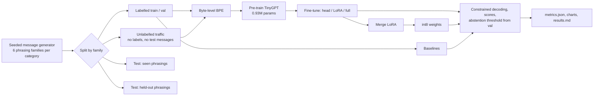
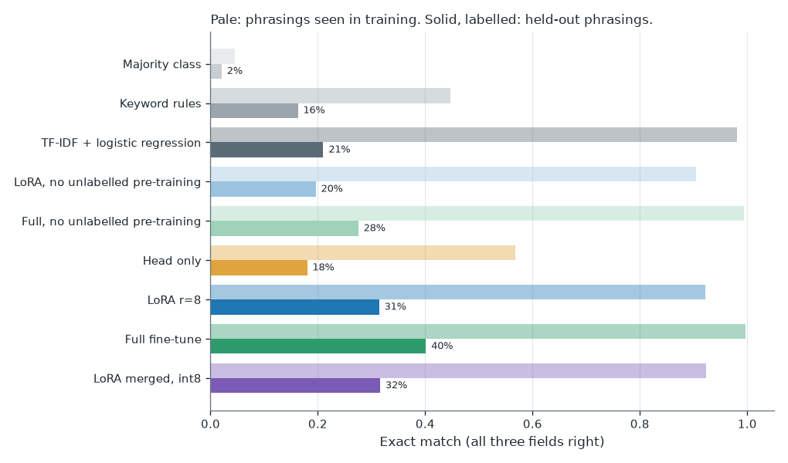
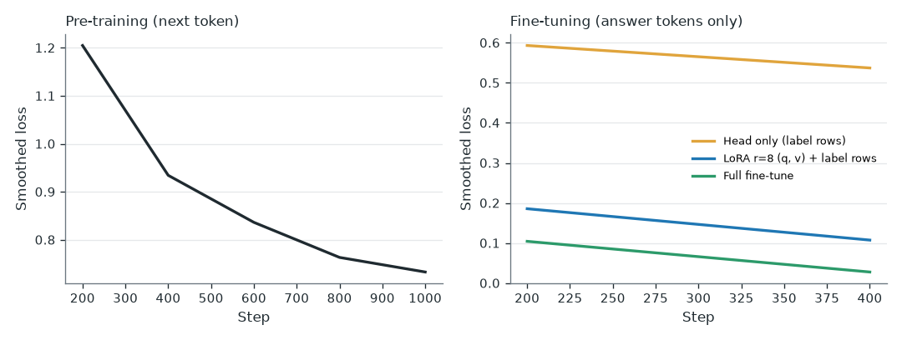
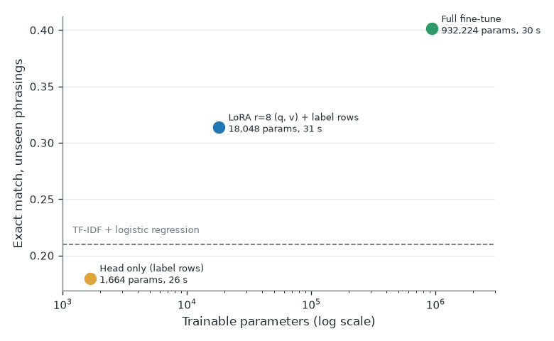
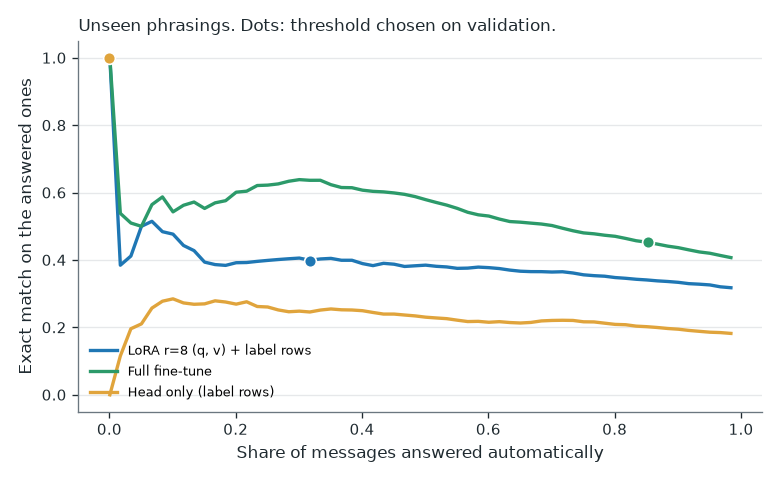
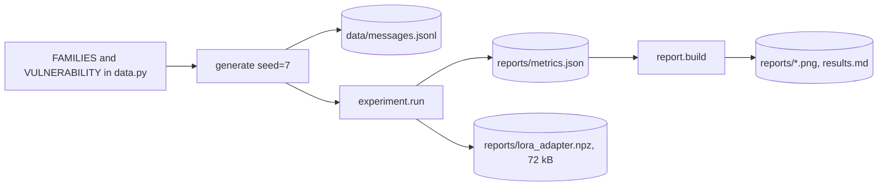

# 🔌 Energy Message Triage: LoRA on a Tiny Transformer

A small GPT-style language model, built from a config and trained from scratch on a laptop CPU, then fine-tuned three ways (head only, LoRA, full) to triage customer messages for Fenwick Energy, an invented UK energy supplier. Each message gets a **category**, an **urgency** and a **vulnerable customer** flag. The models are compared against keyword rules and TF-IDF + logistic regression on messages written in **phrasings that never appeared in training**. That test showed every model, including the strong classical baseline, falling from about 95% to below 40%. Pre-training on *unlabelled* customer traffic was the one change that clearly helped.

## 🏛 Architecture



Design decisions, trade-offs and limitations: [docs/ARCHITECTURE.md](docs/ARCHITECTURE.md).

**Role focus:** Machine Learning Engineer · **Stack:** Python, PyTorch (optional extra), hand-written byte-level BPE, LoRA, constrained decoding, int8 quantisation, scikit-learn, NumPy, matplotlib, pytest + Hypothesis

## 🧩 The problem

An energy supplier's inbox gets thousands of messages a day. A few of them really matter: a gas smell, a prepayment meter run dry in winter, a customer on home oxygen. Those have to reach the right team fast, and vulnerable customers must be flagged, because the regulator expects suppliers to know who they are. The questions here:

1. Can a small, cheap model do this triage well enough to route messages automatically?
2. How much does LoRA give up against full fine-tuning, for 2% of the trainable parameters?
3. Does any of it hold up when customers phrase things in ways the training data never saw?
4. Can the model know when to hand a message to a person?

## ✨ Features

- **Data with a deliberate distribution shift:** 19,200 seeded messages across 8 categories, with typos, lower-case rants, £ amounts, account numbers and sign-offs. Two of the six phrasing families per category, and a third of the vulnerability phrases, are held out entirely. A leakage check fails the run if any of them reach training.
- **Model trained from scratch:** byte-level BPE (700 merges, digits split), then a 4-layer, 4-head, d=128 decoder with pre-norm, causal attention and a tied head (0.93M parameters). No downloaded weights.
- **Three fine-tunes from one base:** head only (the 14 label-token rows, 1,664 parameters), LoRA rank 8 on q and v plus the label rows (18,048), and full (932,224)
- **Answers as label tokens:** `<category:…> <urgency:…> <vulnerable:…>`. Constrained decoding makes every output valid, and the unconstrained valid rate is reported alongside.
- **Deployment steps measured:** the LoRA adapter (72 kB) is merged into the weights (100% prediction agreement), then quantised to int8 per channel (3.8 MB down to 1.0 MB)
- **Abstention:** a confidence threshold chosen on validation to reach 97% exact match, applied unchanged to both test sets, with coverage, accuracy and calibration error reported
- **Ablation:** the same LoRA and full fine-tunes on a base pre-trained without the unlabelled traffic
- **Reproducible:** one command rebuilds `reports/` from a seeded run, and charts and tables are generated only from `metrics.json`

## 🚀 Quick start

```bash
pip install -e ".[dev,torch]"     # torch is optional; without it you get data, baselines and reports
energy-triage run --quick --out /tmp/quick   # 5-second smoke test
energy-triage run                 # the full experiment, about 6 minutes on a laptop CPU
energy-triage triage "There's a smell of gas near the meter."
```

## 📊 Key results

From `energy-triage run` (seed 7, Apple M2, 4 CPU threads). Pre-training took 72 s and each fine-tune about 30 s. The whole run, including a second pre-training for the ablation and every evaluation, took 339 s.

| Model | Trainable params | Train time | Exact match (seen) | Exact match (unseen) | Category macro-F1 (unseen) | Vulnerable recall (unseen) | High-urgency recall (unseen) |
|---|---:|---:|---:|---:|---:|---:|---:|
| majority | – | 0.0 s | 4.5% | 2.1% | 0.027 | 0.0% | 0.0% |
| keyword rules | – | 0.0 s | 44.7% | 16.3% | 0.625 | 6.5% | 46.1% |
| TF-IDF + logistic regression | – | 2.5 s | 98.1% | 21.0% | 0.425 | 24.6% | 50.0% |
| LoRA, pre-trained without unlabelled traffic | 18,048 | 31.5 s | 90.5% | 19.6% | 0.342 | 55.8% | 49.7% |
| Full, pre-trained without unlabelled traffic | 932,224 | 32.9 s | 99.4% | 27.5% | 0.462 | 27.7% | 52.4% |
| Head only (label rows) | 1,664 | 25.6 s | 56.8% | 18.0% | 0.393 | 42.3% | 56.1% |
| LoRA r=8 (q, v) + label rows | 18,048 | 30.7 s | 92.2% | 31.4% | 0.597 | 85.4% | 52.4% |
| Full fine-tune | 932,224 | 30.3 s | 99.7% | **40.1%** | 0.597 | 80.0% | 63.9% |
| LoRA merged, int8 | none (post-training) | – | 92.3% | 31.6% | 0.597 | 85.4% | 52.1% |



What the numbers say:

1. **Seen phrasings are easy and say little.** TF-IDF gets 98.1%, so a random split of this data would make any model look finished.
2. **Held-out phrasings break everything.** The best model gets 40.1% exact match. TF-IDF drops to 21.0% and finds only 24.6% of vulnerable customers written in new ways.
3. **Unlabelled traffic is what helps.** Pre-training on 5,649 unlabelled messages (351 more were dropped because they duplicated a test message) raised held-out exact match from 19.6% to 31.4% for LoRA and from 27.5% to 40.1% for full fine-tuning. LoRA's vulnerable-customer recall went from 55.8% to 85.4%. TF-IDF has no way to use unlabelled text.
4. **LoRA vs full:** LoRA trains 2% of the parameters, in the same time, and gets 31.4% against 40.1% on held-out phrasings, but with the highest vulnerable recall of any model. The adapter is 72 kB per task.
5. **int8 is free here:** merged and quantised, the model shrinks 3.8× and scores the same (31.6% against 31.4%).
6. **The abstention threshold fails under shift.** Chosen on validation to give 97% accuracy, it answers 86% of seen-phrasing messages at 97.2%. On held-out phrasings it still answers 32% of messages, and gets only 39.8% of those right. Calibration error rises from 0.05 to 0.30. Validation data from the old distribution cannot warn you about a new one. Monitoring for drift has to come from somewhere else.



<p>


</p>

The failure is easy to see with the shipped CLI, which uses the TF-IDF model and the threshold the experiment chose (0.41):

```text
$ energy-triage triage "Nothing in the house has power and my dad uses a stairlift." \
    "Can I get a copy of my last statement for my accountant?" \
    "The readout on my new meter flashes a warning symbol"
category=billing; urgency=medium; vulnerable=no         confidence 0.51 -> answer
    Nothing in the house has power and my dad uses a stairlift.
category=billing; urgency=low; vulnerable=no            confidence 0.97 -> answer
    Can I get a copy of my last statement for my accountant?
category=moving_home; urgency=medium; vulnerable=no     confidence 0.67 -> answer
    The readout on my new meter flashes a warning symbol
```

The first message is a power cut at a vulnerable customer's home. The model calls it a billing query and is confident enough to send it there.

## 🔁 Data flow



## 🏗 Project structure

```text
src/energy_triage_lora/
  labels.py      schema, label tokens, parsing model output
  data.py        seeded generator, phrasing families, held-out and unlabelled splits
  tokenizer.py   byte-level BPE trained from scratch
  baselines.py   majority, keyword rules, TF-IDF + logistic regression
  metrics.py     exact match, macro-F1, recalls, calibration error, coverage curve, threshold
  quantize.py    per-channel int8 (NumPy)
  config.py      model, training and LoRA settings; quick() for tests
  model.py       TinyGPT, LoRALinear (with merge), label-row training     [torch]
  train.py       batching, pre-training, fine-tuning, constrained decoding [torch]
  experiment.py  the end-to-end run and metrics.json
  report.py      charts and results table from metrics.json
  cli.py         energy-triage data | run | report | triage
reports/         metrics.json, charts, results.md, the LoRA adapter
data/sample.jsonl  50 example messages (the full set is regenerated from the seed)
tests/           41 tests: data and leakage, tokenizer, metrics, quantisation, baselines, CLI, model
```

## 🎯 Skills demonstrated

- Designing an evaluation that catches memorisation: held-out phrasing families, a leakage check, and seen and unseen results reported side by side
- Parameter-efficient fine-tuning from first principles: LoRA layers with zero-initialised B, merging verified to change no predictions, new-token embeddings trained through a gradient mask, and weight decay kept off frozen rows
- Building and training a transformer and a BPE tokenizer from scratch inside a five-minute CPU budget, with seeding and logged curves
- Getting a model ready to deploy: constrained decoding, an adapter size per task, int8 quantisation with its accuracy cost measured, and abstention with calibration
- Honest reporting: baselines beside every model, an ablation, keyword rules restricted to seen phrasings, and a headline finding that the best model is still not good enough

## 🧪 Running tests

```bash
pytest -q        # 41 tests; the 10 model tests need torch and are skipped without it
ruff check . && ruff format --check .
```

## 📄 License

MIT. Fenwick Energy and every customer, supplier and place here are invented.
