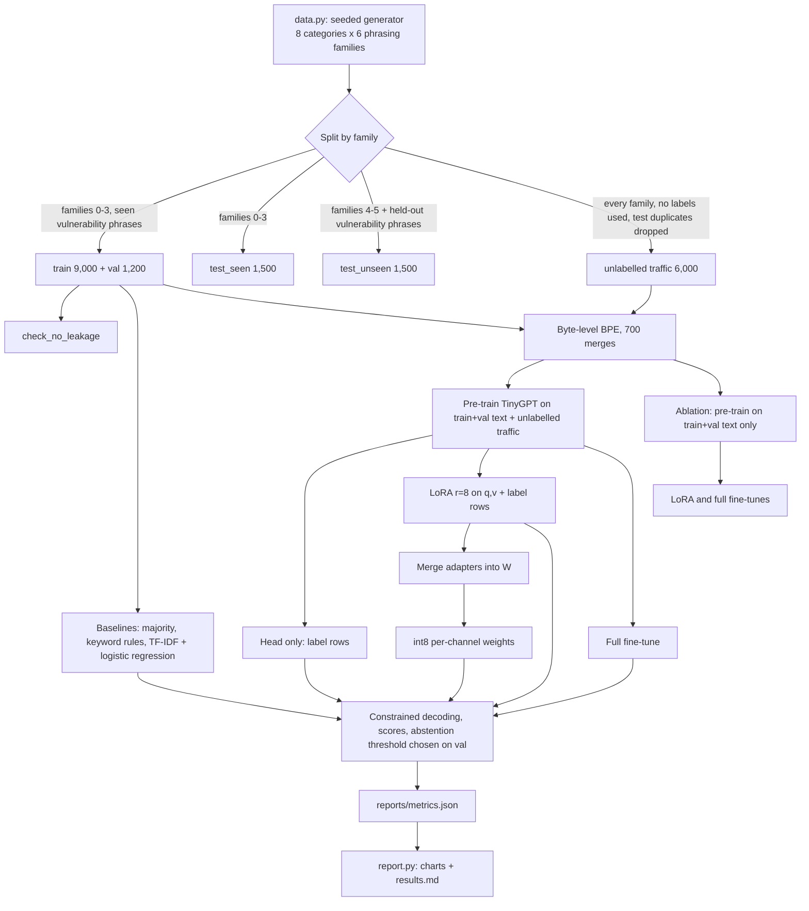

# Architecture

## Pipeline

## Modules

| Module | Responsibility | Needs torch |
|---|---|---|
| `labels.py` | The schema, label tokens, parsing model output (with `LabelError`) | no |
| `data.py` | Seeded synthetic messages, phrasing families, held-out splits, JSONL | no |
| `tokenizer.py` | Byte-level BPE trained from scratch, special tokens, save/load | no |
| `baselines.py` | Majority, keyword rules, TF-IDF + logistic regression with confidence | no |
| `metrics.py` | Exact match, macro-F1, vulnerable and high-urgency recall, ECE, coverage curve, threshold | no |
| `quantize.py` | Per-channel symmetric int8, in NumPy | no |
| `config.py` | Frozen dataclasses for model, training and LoRA; a `quick()` config for tests | no |
| `model.py` | TinyGPT (pre-norm, causal SDPA, tied head), `LoRALinear` with merge, label-row training | yes |
| `train.py` | Batching, pre-training, three fine-tuning methods, constrained and free decoding | yes |
| `experiment.py` | The end-to-end run, abstention, merge check, quantisation, `metrics.json` | optional |
| `report.py`, `cli.py` | Charts and table from `metrics.json`; `data`, `run`, `report`, `triage` commands | no |

Everything except `model.py` and `train.py` works without torch, which is an optional extra. CI installs only `.[dev]`, so the torch tests are skipped there with `pytest.importorskip` and the rest still run.

## Design decisions

### Hold out phrasings, not just rows
A random split of templated data mostly tests whether a model can recognise templates. Each category has six phrasing families. Two are never used for training, validation or pre-training, and a third of the vulnerability phrases are held out too. `check_no_leakage` fails the run if any held-out family reaches training. The seen test set is reported beside the unseen one, so the gap between them is visible.

### Labels as three special tokens, decoded under a constraint
The model generates `<category:…> <urgency:…> <vulnerable:…> <eos>` after a `<sep>`. Constrained decoding only allows field *k*'s tokens at slot *k*, so every answer is valid by construction. The confidence is the product of the three renormalised probabilities. The same model decoded without the constraint is reported as a valid-output rate, which shows what the constraint is buying.

- *Rejected:* free-text output (`category=billing; …`) parsed afterwards. It uses more tokens, can fail to parse, and gives no clean confidence.
- *Rejected:* a separate classification head. It works, but it would no longer be fine-tuning a language model, which is the point of the exercise.

### Three ways to fine-tune, one base model
- **Head only:** the 14 label-token embedding rows, about 1.8k parameters. Because the output head is tied to the embeddings, this is a linear probe on the pre-trained features.
- **LoRA:** rank-8 adapters on the query and value projections of every block, plus the label rows. B starts at zero, so step 0 is exactly the base model (tested). After training the adapters are merged into W (`merge_agreement` checks predictions are unchanged), so inference costs the same as the base model.
- **Full:** every weight.

Pre-training never saw the label tokens, so their rows start random. Every method trains those rows and nothing else in the embedding. A gradient hook zeroes the other rows, and embeddings are kept out of weight decay so the frozen rows really stay frozen (AdamW decays a parameter even when its gradient is zero).

### Pre-training on unlabelled traffic
Next-token prediction teaches the model how customers write: greetings, sign-offs, account numbers, typos. The pre-training text is the labelled train and validation messages (labels removed) plus 6,000 unlabelled messages standing in for a live inbox. That inbox includes the new phrasings, because real traffic always contains phrasings you have no labels for yet. No labels are used, and any unlabelled message whose text exactly matches a test message is dropped (351 of them), so no test example is ever seen.

This was the result that mattered. The first run pre-trained on labelled text only, and every model, TF-IDF included, collapsed to 13 to 25% exact match on held-out phrasings. Adding the unlabelled traffic is the realistic fix: labels are expensive and new phrasings arrive first as unlabelled text. It is kept as an ablation, so both numbers are always reported.

### Byte-level BPE, digits split
No character is ever unknown, because unmatched text falls back to bytes. Digits are pre-split, so account numbers and meter readings don't create one-off tokens that use up the vocabulary.

### Abstention chosen on validation
The confidence threshold is the lowest one at which validation exact match reaches 97%. It is applied unchanged to both test sets. Below it, a message goes to a person. Coverage and accuracy at that threshold are reported, along with expected calibration error, because a threshold is only as good as the model's calibration.

### int8 after merging
Per-output-channel symmetric quantisation of every 2-D weight, with biases and norms kept in float32. It is simulated (dequantised back to float for inference) so the accuracy cost can be measured exactly. Real int8 kernels would also bring the speed-up.

## Trade-offs and limitations

- **Synthetic data:** the messages come from templates. Real messages are longer, messier and more ambiguous, and labels would come from agents with their own disagreements (simulated here as 2% urgency noise in training only).
- **Tiny model:** about 0.9M parameters. Each pre-training takes about 70 s and each fine-tune about 30 s on a laptop CPU, and the full run with its ablation takes about 6 minutes. The comparisons between methods are the point, not the absolute numbers.
- **Single seed:** results are from one seed. With more time, five seeds and confidence intervals per method would show which differences are real.
- **Constrained decoding hides some errors:** a constrained model always answers. That's why the unconstrained valid rate and the abstention policy are both reported.
- **Metric choice:** vulnerable-customer recall is reported separately because exact match treats a missed vulnerable customer the same as a wrong category, and the business does not.
