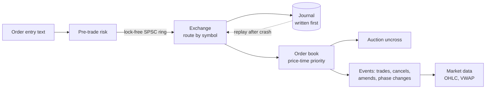

# 📈 Equities Matching Engine

The order book and matching engine for Thamesgate MTF, an invented UK share-trading venue, written from scratch in C++20. It matches buy and sell orders by price, then by arrival time, at about **10.8 million commands a second on one core** (median 83 ns per command). It supports limit, market, IOC, fill-or-kill, post-only and iceberg orders, and has self-trade prevention, opening and closing auctions, and a price collar that pauses trading for a volatility auction when the price moves too far. A write-ahead journal with checksums rebuilds the exact same book after a crash. The only dependency beyond the standard library is GoogleTest, for the tests.

## 🏛 Architecture



The design decisions, their trade-offs (including a benchmark where my chosen data structure lost) and the known limitations are in [docs/ARCHITECTURE.md](docs/ARCHITECTURE.md).

**Role focus:** Software Engineer · **Stack:** C++20, CMake presets, GoogleTest, AddressSanitizer + UBSan, clang-format, std::jthread, lock-free atomics

## 🧩 The problem

A stock exchange's core job sounds simple: when a buyer's price meets a seller's, trade them. Doing it well is hard:
- **Fair:** the best price always goes first, and at the same price, whoever arrived first.
- **Fast:** latency in microseconds, with no pauses.
- **Exactly reproducible:** a regulator can ask why a trade happened, and after a crash the venue must come back with every order in the same queue position.
- **Safe:** a fat-finger sell should not crash the price 20% in a second, and a firm's own orders should not trade with each other.

## ✨ Features

- **Order types:** limit, market, iceberg (shows a peak, and each refresh goes to the back of the queue); time in force Day, IOC and FOK; post-only.
- **Price-time priority:** a sorted price ladder per side, with orders at each level kept in arrival order in an intrusive linked list over a free-list pool. Each order node is 64 bytes (one cache line), cancels are O(1), and after warm-up the hot path does not allocate.
- **Self-trade prevention:** cancel the resting order, the incoming order, or both. Fill-or-kill applies the same rules, so it never counts liquidity it would refuse.
- **Amend rules as on European venues:** reducing size in place keeps queue priority; raising size or changing price loses it, and the amended order may trade straight away.
- **Auctions:** call phase, an indicative uncross price, and an uncross that maximises volume, then minimises surplus, then follows market pressure, then the reference price. Market orders left over are cancelled.
- **Volatility protection:** a 5% dynamic price collar. A trade outside it pauses continuous trading and starts an auction. Halting the market and resuming through an auction are supported too.
- **Tick sizes:** a MiFID II-style table where the tick grows with price (0.01p below £1, up to 1p above £50). Prices are integers in 0.01p units, so there is no floating point anywhere in matching.
- **Pre-trade risk gateway:** maximum quantity, maximum value in £, a fat-finger price band and an open-order limit per firm, kept outside the deterministic book.
- **Write-ahead journal:** `seq|command|CRC-32` written before each command is applied. A torn final record from a crash is dropped and reported; corruption or a sequence gap in the middle is refused.
- **Threaded pipeline:** the gateway thread passes commands to a `std::jthread` matching thread through a lock-free SPSC ring with explicit back-pressure.
- **Synthetic market:** a deterministic order-flow generator (random-walk mid price, orders bunched near the best prices, about 30% cancels, amends, icebergs and blocks) that learns from the engine's events which orders are still live. It uses SplitMix64, so sessions are identical on GCC, Clang and Apple clang.

## 🚀 Quick start

```bash
cmake --preset release && cmake --build --preset release
./build/release/tmatch demo                                    # scripted trading day
./build/release/tmatch run examples/closing-auction.txt        # your own commands
./build/release/tmatch simulate --orders 1000000 --seed 42 --journal session.journal
./build/release/tmatch replay --journal session.journal        # rebuild from the journal
make bench                                                     # latency and throughput
make test                                                      # Debug + ASan/UBSan + ctest
```

The order-entry protocol is one line per command: `NEW sym=TGX id=17 owner=3 side=B type=LMT tif=DAY px=1234.50 qty=500`, `AMD sym=TGX id=17 px=1234.00 qty=300`, `CXL sym=TGX id=17`, `AUCTION` / `UNCROSS` / `HALT` / `RESUME sym=TGX`.

## 📟 Example output

All output below is real, from this machine (Apple M2, release build).

**Opening auction**: six orders collect during the call phase, then uncross at the price that trades the most shares (6,000 at 1235.00p; at 1236.00p only 5,000 would trade):

```text
> UNCROSS sym=TGX
    AUCTION TRADE #1 1000 @ 1235.00p buy #5 / sell #3
    AUCTION TRADE #2 1500 @ 1235.00p buy #1 / sell #3
    AUCTION TRADE #3 2500 @ 1235.00p buy #1 / sell #4
    AUCTION TRADE #4 1000 @ 1235.00p buy #2 / sell #4
    PHASE AUCTION -> CONTINUOUS at 1235.00p
```

**An iceberg, post-only, fill-or-kill and self-trade prevention:**

```text
> NEW sym=TGX id=7 owner=7 side=S type=ICE px=1235.50 qty=3000 peak=500
> NEW sym=TGX id=8 owner=8 side=S px=1235.50 qty=400
> NEW sym=TGX id=9 owner=9 side=B px=1235.50 qty=1200 tif=IOC
    TRADE #5 500 @ 1235.50p buy #9 / sell #7      <- iceberg peak
    TRADE #6 400 @ 1235.50p buy #9 / sell #8      <- refreshed peak went behind #8
    TRADE #7 300 @ 1235.50p buy #9 / sell #7
> NEW sym=TGX id=10 owner=2 side=B px=1236.00 qty=100 post=1
    REJECTED #10 (post-only order would take liquidity)
> NEW sym=TGX id=11 owner=2 side=B px=1235.50 qty=99999 tif=FOK
    REJECTED #11 (fill-or-kill not fully fillable)
> NEW sym=TGX id=12 owner=7 side=B px=1235.50 qty=300 stp=CI
    CANCELLED #12 300 (self-trade prevention)
```

**Volatility auction**: a 9,000-share market sell eats the book down to 1233.00p, then the next bid (1170.00p, 5.3% away) is outside the collar. Trading pauses, buyers arrive, and the remaining 5,600 shares clear at 1215.00p instead of 1170.00p:

```text
> NEW sym=TGX id=16 owner=6 side=S type=MKT qty=9000
    TRADE #8 2000 @ 1235.00p buy #2 / sell #16
    TRADE #9 800 @ 1233.50p buy #14 / sell #16
    TRADE #10 600 @ 1233.00p buy #13 / sell #16
    PHASE CONTINUOUS -> AUCTION at 1170.00p
> NEW sym=TGX id=17 owner=8 side=B px=1215.00 qty=6000
> NEW sym=TGX id=18 owner=9 side=S px=1225.00 qty=1500
> UNCROSS sym=TGX
    AUCTION TRADE #11 5600 @ 1215.00p buy #17 / sell #16
    PHASE AUCTION -> CONTINUOUS at 1215.00p

TGX: 11 trades (5 in auctions), volume 16200 shares
  open 1235.00p  high 1235.50p  low 1215.00p  last 1215.00p  VWAP 1227.98p
invariants: ok
```

**A million-command session, journaled and replayed.** The two state hashes match, so the rebuilt book has every order in the same queue position:

```text
$ tmatch simulate --orders 1000000 --seed 42 --journal session.journal
generated 1000000 commands in 163 ms, matched in 865 ms (1.16 M commands/s), 1323678 events
book: 49867 resting orders on 64 bid / 94 ask levels, phase CONTINUOUS
TGX: 306219 trades (0 in auctions), volume 182894200 shares
  open 1234.00p  high 1246.50p  low 1218.00p  last 1225.00p  VWAP 1232.36p
  traded value GBP 2253909286
  accepted 632716, rejected 6494, cancelled 318099 (7434 by self-trade prevention), amended 60150, phase changes 0
state hash 441fb63f8f1fe20e
invariants: ok

$ tmatch replay --journal session.journal
replayed 1000000 commands in 2119 ms
state hash 441fb63f8f1fe20e
```

Without the journal, the same session matches in 112 ms (8.9M commands a second). The text journal costs about 7×, which is the first thing I would change (see the limitations in the architecture doc).

## ⏱ Benchmark

`make bench`, 2M generated commands (10% warm-up), collar off, Apple M2, release build:

| Measurement | Result |
|---|---|
| Throughput, one core, no per-command timer | **10.8M commands/s** (93 ns each) |
| Latency per command (timed with `steady_clock`) | p50 **83 ns** · p90 125 ns · p99 291 ns · p99.9 1.0–1.1 µs |
| Gateway thread → SPSC ring → matching thread | 6.5M commands/s |
| Price levels, 2M adds/removes near the touch | sorted vector 98–102 ms, `std::map` 83–90 ms |

That last row is a result against my own design: in isolation, `std::map` was faster. The architecture doc explains why I kept the vector anyway and what would settle the question.

## 🏗 Project structure

```
equities-matching-engine/
├── include/lob/       # public headers: types, order_book, price_ladder, order_pool, auction,
│                      #   tick_table, command, journal, risk, exchange, spsc_ring, order_flow
├── src/               # implementation (11 files)
├── apps/main.cpp      # tmatch CLI: demo, simulate, replay, run
├── bench/             # latency/throughput benchmark
├── tests/             # 83 GoogleTest cases (unit, parametrised, property, concurrency, recovery)
├── examples/          # a closing auction as a command file
├── docs/ARCHITECTURE.md
├── CMakeLists.txt · CMakePresets.json · Makefile · .clang-format
```

## 🎯 Skills demonstrated

- **Low-latency data structures:** an intrusive FIFO over a free-list pool, cache-line-sized nodes, a vector-based price ladder, and no allocation on the hot path once warmed up.
- **Concurrency done properly:** a lock-free SPSC ring with acquire/release ordering and cached indices, `std::jthread` with `std::stop_token`, and explicit back-pressure, tested under sanitizers.
- **Domain modelling:** real exchange rules (price-time priority, iceberg refresh, STP modes, amend priority, MiFID-style ticks, auction uncross tie-breaks, volatility collars) with every rule covered by a test.
- **Reliability engineering:** write-ahead logging, CRC-32, torn-write recovery, deterministic replay checked by a state hash, and an invariant checker run after every command in property tests.
- **Measured, honest performance work:** p50 to p99.9 latency, throughput, and a benchmark that went against my own choice, reported as it came out.
- **Modern C++:** `std::variant` events, `std::span`, `[[nodiscard]]`, a `Result` type in place of exceptions on parse paths, RAII throughout, no raw `new`/`delete`, and strict warnings (`-Wconversion -Wsign-conversion -Werror`).

## 🧪 Running tests

```bash
cmake --preset dev && cmake --build --preset dev && ctest --preset dev   # 83 tests, ASan + UBSan
/tmp/daily-projects-venv/bin/clang-format --dry-run --Werror $(find include src apps tests bench -name '*.[ch]pp')
```

## 📄 License

MIT. See [LICENSE](LICENSE). Thamesgate MTF and the TGX share are invented; nothing here is a real venue or real market data.
