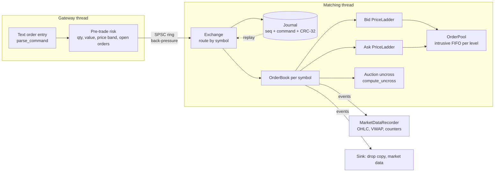

# Architecture: Thamesgate MTF matching engine

Thamesgate MTF is an invented UK trading venue. This document explains how its matching engine is put together, why, and what it does not do yet.

## Components

| Module | File | Responsibility |
|---|---|---|
| Types and events | `types.hpp` | Integer prices (0.01p), order types, events as a `std::variant` |
| Tick table | `tick_table.hpp` | MiFID-style price-banded tick sizes, validation |
| Order pool | `order_pool.hpp` | Free-list allocator of order nodes with 32-bit links |
| Price ladder | `price_ladder.hpp` | One side of the book: sorted levels, best at the back |
| Order book | `order_book.hpp` | Matching, STP, icebergs, amends, collars, auctions, invariants |
| Auction | `auction.hpp` | Pure uncross price calculation |
| Commands | `command.hpp` | Text protocol parse/format, exact round trip |
| Journal | `journal.hpp` | Write-ahead command log with CRC-32 and torn-tail recovery |
| Risk | `risk.hpp` | Gateway checks kept outside the deterministic book |
| Exchange | `exchange.hpp` | Multi-symbol routing, journaling, `MatchingThread` |
| SPSC ring | `spsc_ring.hpp` | Lock-free bounded queue between gateway and matcher |
| Order flow | `order_flow.hpp` | Deterministic synthetic sessions with event feedback |

## Key design decisions

### 1. Integer prices in hundredths of a penny
UK shares are quoted in pence, and the smallest tick in the table is 0.01p. Storing prices as `int64_t` in that unit makes every comparison exact. Floating point was rejected: `1234.5 + 0.05` does not equal `1234.55` in binary, and a matching engine that sometimes thinks two equal prices differ is broken. The cost is converting at the edges (`parse_price`, `format_price`), which is tested.

### 2. One thread owns each book (no locks on the hot path)
The book is a single-threaded state machine. Concurrency lives at the edge: a gateway thread does parsing and risk checks, then pushes commands through a single-producer/single-consumer ring to the matching thread. This is how most real venues work (one sequencer per partition), because:
- matching must be deterministic, so commands need a total order anyway;
- a mutex around the book would serialise everything and add latency jitter;
- determinism makes replay and testing possible (decision 4).

The trade-off is that one symbol cannot use more than one core. Scaling out means partitioning symbols across matching threads, which `Exchange` would support by running one per partition.

### 3. Sorted vector of levels plus intrusive lists, not `std::map<Price, std::list<Order>>`
Each side is a `std::vector<PriceLevel>` sorted so the best price is at the back. Orders at a level form a doubly linked FIFO through 32-bit indices into an `OrderPool`; an `unordered_map<OrderId, NodeIndex>` gives O(1) cancel lookup.

- The best level is `levels_.back()`: no tree walk on every match.
- Inserts happen near the touch, so `vector::insert` moves few elements.
- Nodes are recycled through a free list, so after warm-up adding and removing orders does not allocate.
- 32-bit indices rather than pointers keep a node at exactly 64 bytes (one cache line, checked by a `static_assert`) and survive pool growth.

**Measured honestly:** an isolated micro-benchmark (2M level add/remove operations within ±40 ticks, `tmatch_bench`) gives the sorted vector **98–102 ms** against **83–90 ms** for a `std::map<Price, Qty>`. The map wins that test. The two are not doing the same work (the ladder also maintains the per-level order queues), but the measurement does not justify the vector on its own. The real argument for it is the matching path (best level by `back()`), and the next step is to put a map-based ladder behind the same interface and benchmark the whole engine with each.

### 4. Write-ahead command journal, replayed for recovery
Every command that reaches a book is appended to the journal **before** it is applied, as `seq|command|crc32`. Because matching is deterministic, replaying the journal rebuilds the exact state, and a test checks this by comparing `state_hash()` (FNV-1a over every resting order in queue order). Recovery rules:
- a final record with no newline was cut off by a crash. It was never acknowledged, so it is dropped and reported (`torn_tail_bytes`);
- a bad CRC, a sequence gap or an unparseable record in the middle is an **error**, because skipping it would replay a different market.

I chose a text journal over a binary one so that it can be read with `grep` and edited by hand in a test. The cost is size (77 MB for 1M commands) and speed: journaling cuts `simulate` from 8.9M to about 1.2M commands per second. A binary format with group commit (decision 7 under limitations) is the obvious next step.

Risk rejects are not journaled. They are gateway decisions that never change book state, so replaying them would only add noise.

### 5. Price collar that triggers a volatility auction
A trade more than `collar_bps` (default 5%) from the reference price stops continuous trading. The reference is fixed for the whole command, so a large order cannot creep past the collar one level at a time. Day orders, market orders included, then wait in the auction, and the uncross discovers a fair price. In the demo, a 9,000-share market sell that would have hit 1170p instead clears at 1215p once buyers arrive. IOC/FOK orders are refused during an auction because "immediate" has no meaning there.

### 6. Auction uncross as a pure function
`compute_uncross(bids, asks, reference)` takes aggregated interest and applies the usual European rules in order: maximum volume, minimum surplus, market pressure, closest to reference, then lower price. It has no book dependencies, so it is unit-tested with hand-calculated cases. A property test checks across 40 random auctions that the engine trades exactly the indicative volume at the indicative price and never leaves a crossed book.

### 7. Self-trade prevention follows the incoming order
The incoming order's STP mode decides: cancel the resting order and keep matching, cancel the incoming order, or cancel both. `fillable()` (used by FOK) applies the same rules, so a fill-or-kill order is never accepted on the strength of liquidity it would refuse to trade with.

## Testing strategy

- **Unit tests** for every order type, time in force, STP mode, amend rule, validation reject, tick band and price format.
- **Hand-calculated auction cases** for each tie-break rule.
- **Property tests:** five 4,000-command random sessions, with `check_invariants()` after every command (links, level totals, index, priority order, no crossed book), no self-trades, and per-order quantity conservation (submitted = traded + cancelled + resting) worked out from the event stream alone.
- **Concurrency tests:** a 500k-item SPSC producer/consumer run, a threaded pipeline that must reach the same state hash as the single-threaded run, and back-pressure with a stalled consumer.
- **Recovery tests:** CRC known vector, torn tail, corruption in the middle, sequence gap, full replay equality.
- Everything runs under AddressSanitizer and UndefinedBehaviorSanitizer (`cmake --preset dev`).

## Known limitations and next steps

1. **No market-data protocol.** Events are C++ structs. A real venue would publish ITCH-style binary incremental feeds and snapshots with sequence numbers for gap recovery.
2. **Text journal, no group commit.** The journal is buffered by `ofstream` and flushed when it closes. It is not `fsync`ed per command, so a power cut can lose acknowledged orders. Production needs a binary journal with batched `fsync` (group commit) or replication to a standby before acknowledging.
3. **One matching thread.** Symbols are not yet partitioned across cores.
4. **Simplified rules.** There are no stop orders, minimum execution sizes, order expiry times, or closing price crossing session (CPX). STP is not applied in auctions, and the tick table is a simplified version of the real MiFID II liquidity bands.
5. **Latency figures come from a laptop** (Apple M2, `steady_clock` around each call, so the timer adds overhead), not from an isolated, pinned core.
