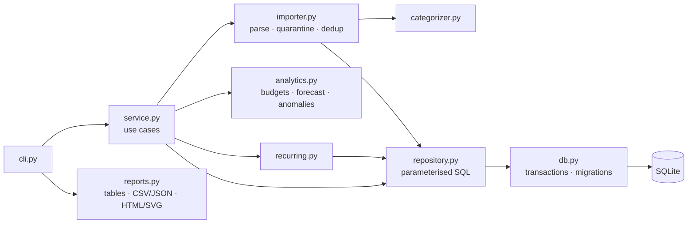

# 💸 Expense Tracker

A personal finance command-line app that imports messy bank statements from different banks, cleans and auto-categorises every transaction, and tracks spending against monthly budgets. It forecasts month-end spend, shows trends and flags unusual purchases with robust statistics. Re-importing overlapping statements never creates duplicates, every import is atomic and audited, and the database schema upgrades itself in place.

**Role focus:** Software Engineer · **Stack:** Python 3.11+ (standard library only at runtime), SQLite (WAL, migrations, window functions), pytest + Hypothesis, ruff, Docker, GitHub Actions

## 🏛 Architecture



Layered design: the CLI never touches SQL, and analytics are pure functions with no I/O. [docs/ARCHITECTURE.md](docs/ARCHITECTURE.md) covers the data model, the import sequence diagram, nine design decisions with the trade-offs considered, and known limitations.

## 🧩 The problem

Bank apps show transactions, not answers. People want to know: *Am I going to blow my food budget this month? What did I spend on transport over the last six months? Was that £312 train ticket a one-off?* Getting there from raw bank exports is hard. Every bank uses a different CSV layout, descriptions are full of noise like `CARD PAYMENT TO TESCO STORES 2231*1234`, statements overlap, and exports contain corrupt rows. This tool turns those exports into a clean, deduplicated ledger and answers those questions.

## ✨ Features

**Ingestion**
- Imports CSV statements in different bank layouts: a single signed `Amount` column, or separate `Paid out`/`Paid in` columns, with header aliases detected automatically
- Parses UK date formats (`2026-11-03`, `03/11/2026`, `3 Nov 2026`) and amounts like `£1,234.56`, `-4.20` and `(4.20)`
- **Idempotent:** content hashing means re-importing the same or an overlapping statement adds nothing twice, while genuinely identical same-day purchases are kept
- **Atomic:** a file either fully imports or not at all; every run is logged in an audit table
- Bad rows are rejected with line number and reason, and can be written to a quarantine CSV

**Categorisation**
- Cleans merchant names (`CARD PAYMENT TO TESCO STORES 2231*1234` → `Tesco Stores`)
- Categories are chosen in this order: your regex rules, then what you filed that merchant under before (learned with a SQL window function), then built-in rules for common UK merchants

**Budgets and analytics**
- Monthly budgets per category, with roll-over to the next month
- Month-end projection, with an "at risk" warning *before* you overspend
- Monthly trend with month-over-month change and a 3-month rolling average
- Anomaly detection: a robust z-score (median/MAD) on log amounts, compared with the merchant's own history or the category's
- Recurring expenses (weekly, monthly or yearly) that keep their day of the month across month ends and are safe to run repeatedly

**Engineering**
- Integer-pence money, so all arithmetic and SQL `SUM`s are exact
- Versioned schema migrations; v1.0 databases (money stored as text) upgrade in place with no data loss
- Configuration from environment variables, structured JSON logging, and distinct exit codes for each error type
- Filtering, sorting and pagination; CSV and JSON export; a self-contained HTML report with SVG charts
- Seeded data generator and a 100k-row benchmark; Dockerfile and Makefile included

## 🚀 Quick start

```bash
cd expense-tracker-cli
python -m venv .venv && source .venv/bin/activate
pip install -e ".[dev]"

expense generate-data data                      # two overlapping sample statements
expense import data/bank_a_statement.csv --quarantine rejected.csv
expense import data/bank_b_statement.csv
expense budget food 450 --month 2026-10
expense summary --month 2026-10
expense anomalies
expense report report.html --month 2026-10      # open in a browser
```

Or run `make demo` to do all of the above. With Docker:

```bash
docker build -t expense-tracker .
docker run --rm -v "$PWD/data:/data" expense-tracker summary
```

| Environment variable | Default | Purpose |
|---|---|---|
| `EXPENSE_DB` | `~/.expense_tracker.db` | database file (or use `--db`) |
| `EXPENSE_CURRENCY` | `£` | currency symbol for output |
| `EXPENSE_LOG_LEVEL` | `WARNING` | `DEBUG`, `INFO`, `WARNING`, `ERROR` |
| `EXPENSE_LOG_JSON` | off | `1` for one JSON object per log line |
| `EXPENSE_ANOMALY_THRESHOLD` | `3.5` | robust z-score above which an expense is flagged |

## 📟 Example output

Real output from the sample data (`expense generate-data`, seed 42):

```text
$ expense import data/bank_a_statement.csv --quarantine rejected.csv
Imported bank_a_statement.csv: 909 rows read, 883 new expenses, 0 duplicates skipped, 21 credits ignored, 5 rejected
  line 166: Unrecognised date '31/02/2025'
  line 179: missing description
  line 645: missing description
  line 819: Invalid amount: 'N/A'
  line 910: Unrecognised date '31/02/2025'
Rejected rows written to rejected.csv

$ expense import data/bank_b_statement.csv          # different bank layout, overlaps by 2 months
Imported bank_b_statement.csv: 826 rows read, 673 new expenses, 133 duplicates skipped, 17 credits ignored, 3 rejected

$ expense add 38.20 -m "CARD PAYMENT TO TESCO STORES 2231*4417" -d 2026-11-18
Added #1690: £38.20 on food (auto: history) at Tesco Stores (2026-11-18)

$ expense summary --month 2026-10
Summary for 2026-10

Category      | Spent     | Budget  | Used | Projected | Status
--------------+-----------+---------+------+-----------+-------
housing       | £1,592.00 | -       | -    | £1,592.00 |
food          | £571.65   | £450.00 | 127% | £571.65   | OVER
transport     | £208.16   | £160.00 | 130% | £208.16   | OVER
utilities     | £186.50   | -       | -    | £186.50   |
shopping      | £73.39    | £60.00  | 122% | £73.39    | OVER
entertainment | £57.60    | £70.00  | 82%  | £57.60    |
health        | £57.24    | -       | -    | £57.24    |
TOTAL         | £2,746.54 |         |      | £2,746.54 |
⚠️  food: spent £571.65 of £450.00 (over by £121.65)
⚠️  transport: spent £208.16 of £160.00 (over by £48.16)
⚠️  shopping: spent £73.39 of £60.00 (over by £13.39)

$ expense trend --months 6 --month 2026-10
Month   | Total     | vs prev | 3-mo avg
--------+-----------+---------+----------
2026-05 | £2,734.23 | -       | £2,734.23
2026-06 | £3,052.13 | +11.6%  | £2,893.18
2026-07 | £2,850.43 | -6.6%   | £2,878.93
2026-08 | £2,781.79 | -2.4%   | £2,894.78
2026-09 | £2,600.93 | -6.5%   | £2,744.38
2026-10 | £2,746.54 | +5.6%   | £2,709.75

$ expense anomalies
ID   | Date       | Category  | Merchant        | Amount  | Typical | Score
-----+------------+-----------+-----------------+---------+---------+------
237  | 2025-03-11 | food      | Deliveroo       | £186.50 | £25.04  | 8.3
1691 | 2026-11-12 | transport | Trainline       | £94.00  | £7.01   | 7.5
860  | 2025-12-17 | health    | Boots           | £154.00 | £12.74  | 5.6
1272 | 2026-04-23 | shopping  | Currys Pc World | £899.00 | £22.98  | 5.3
640  | 2025-09-11 | shopping  | John Lewis      | £640.00 | £22.98  | 4.8
625  | 2025-09-01 | transport | Trainline.Com   | £312.40 | £45.06  | 4.6
1347 | 2026-05-29 | food      | Deliveroo       | £60.90  | £25.04  | 3.7

$ expense bench --rows 100000
Benchmark: 100,119 statement rows (97,477 expenses)

Step             | Seconds
-----------------+--------
import           | 1.510
reimport_noop    | 1.358
month_summary    | 0.000
trend            | 0.029
merchant_history | 0.050
anomalies        | 0.303

Import throughput: 66,299 rows/sec
```

The sample data has five large one-off purchases planted in it (Currys £899, John Lewis £640, Trainline £312.40, Deliveroo £186.50, Boots £154). Anomaly detection finds all five. A sample HTML report is in [docs/sample-report.html](docs/sample-report.html).

## 🛠 Commands

| Command | Description |
|---|---|
| `expense add AMOUNT [CATEGORY] [-m MERCHANT] [-n NOTE] [-d DATE]` | Record an expense; leave out the category to auto-categorise from the merchant |
| `expense list [--month] [-c] [--merchant] [--min] [--max] [--source] [--sort] [--page] [--page-size]` | Search with filters and pagination |
| `expense delete ID` | Delete an expense |
| `expense budget CATEGORY AMOUNT [--month]` | Set or update a budget |
| `expense budget-rollover [--month]` | Copy last month's budgets forward (never overwrites) |
| `expense import FILE [--quarantine FILE]` | Import a bank statement |
| `expense imports` | Import audit log |
| `expense recurring add NAME AMOUNT CATEGORY --start DATE [--frequency] [--end]` | Add a recurring expense |
| `expense recurring list` / `expense recurring run [--until]` | List rules and create any recurring expenses that are due |
| `expense rule PATTERN CATEGORY [--priority]` | Add an auto-categorisation regex |
| `expense summary [--month]` | Spending vs budget with month-end projection |
| `expense trend [--months] [--month]` | Monthly totals, change and rolling average |
| `expense anomalies [--month]` | Unusually large expenses |
| `expense export FILE.csv\|FILE.json [--month]` | Export |
| `expense report FILE.html [--month]` | Self-contained HTML report with charts |
| `expense generate-data DIR [--seed]` / `expense bench [--rows]` | Sample data and benchmark |
| `expense db-info` | Database path, schema version and row count |

Exit codes: `0` success, `2` validation error, `3` not found, `4` bad statement file, `5` database newer than the tool.

## 🏗 Project structure

```text
expense-tracker-cli/
├── src/expense_tracker/
│   ├── models.py         # validated domain dataclasses, date/month helpers
│   ├── money.py          # integer-pence parsing/formatting
│   ├── db.py             # connections, explicit transactions, versioned migrations
│   ├── repository.py     # all SQL: filters, pagination, aggregations, upserts
│   ├── importer.py       # CSV header detection, validation, quarantine, idempotent import
│   ├── categorizer.py    # merchant normalisation and rule/history categorisation
│   ├── recurring.py      # schedule expansion and idempotent materialisation
│   ├── analytics.py      # budget status, forecast, trend, anomaly detection
│   ├── reports.py        # text tables, CSV/JSON export, HTML report with SVG charts
│   ├── service.py        # application use cases (the API the CLI calls)
│   ├── cli.py            # argparse interface
│   ├── config.py · logging_setup.py · errors.py
│   └── datagen.py · bench.py
├── tests/                # 95 tests (unit, integration, property-based), 94% coverage
├── docs/ARCHITECTURE.md  # design decisions, trade-offs, limitations
├── Dockerfile · Makefile · pyproject.toml
```

## 🎯 Skills demonstrated

- **Software architecture:** layered design (interface → application → domain → infrastructure), repository pattern, pure functions for business logic, dependency injection for testability
- **Databases and SQL:** schema design with constraints and indexes, versioned migrations that upgrade existing data in place, explicit transactions, `ON CONFLICT` upserts, `INSERT OR IGNORE` deduplication, window functions (`ROW_NUMBER() OVER (PARTITION BY …)`), safe parameterised queries including escaped `LIKE` patterns
- **Data engineering patterns:** idempotent ingestion with content hashing, atomic batch loads, quarantining invalid records, audit logging, handling schema differences between sources
- **Applied statistics:** robust outlier detection (median/MAD modified z-score on log scale) with measured false-positive reduction, run-rate forecasting, rolling averages
- **Correctness:** exact integer money handling, month-end date arithmetic, idempotent scheduling
- **Testing:** 95 pytest tests with fixtures and parametrisation, Hypothesis property-based tests, end-to-end CLI tests, migration tests against a real v1 database, failure-injection tests for atomicity, 94% coverage, warnings treated as errors
- **Production readiness:** environment-based config, structured JSON logging, distinct exit codes, benchmark with real numbers, Docker image running as a non-root user, CI on every push

## 🧪 Running tests

```bash
make test        # or: pytest
make coverage    # pytest --cov=expense_tracker --cov-report=term-missing
make lint        # ruff check + ruff format --check
```

## 📄 License

MIT
