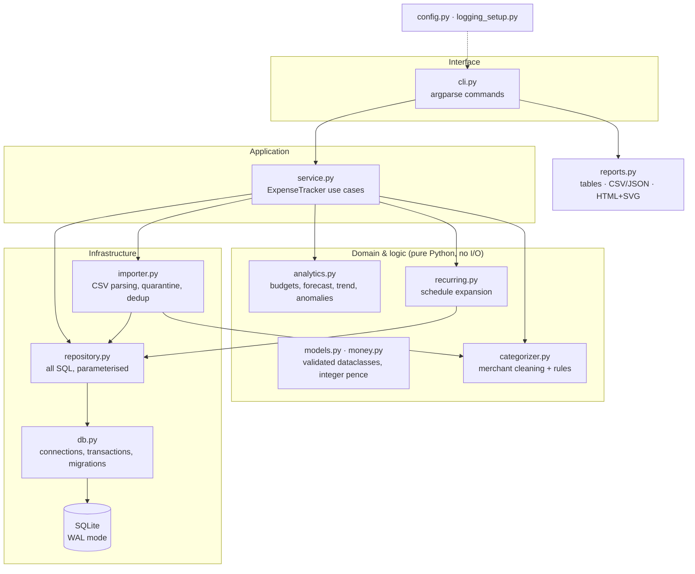
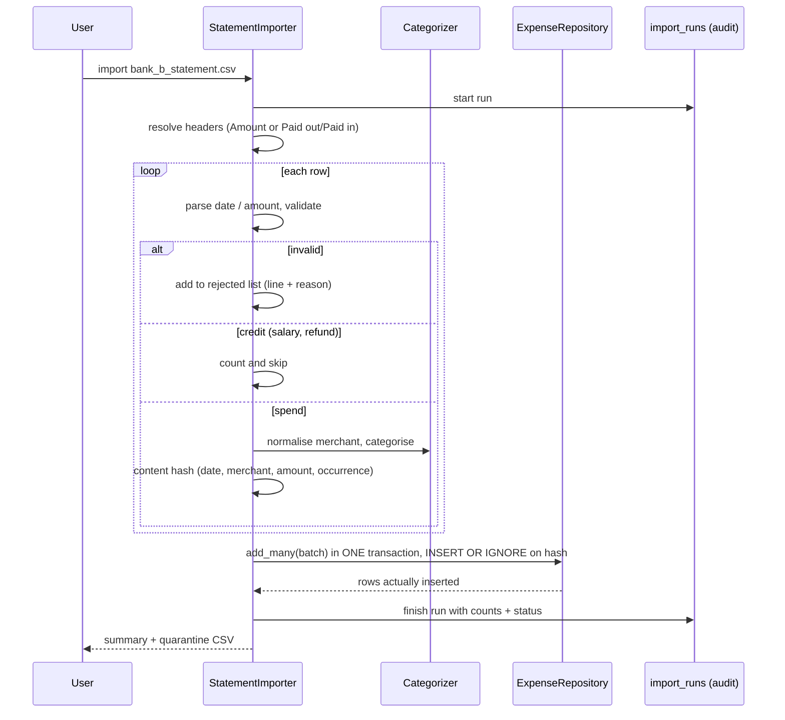

# Architecture

## Overview

Expense Tracker is a layered Python application with no runtime dependencies beyond the
standard library. Each layer only talks to the one below it, so the CLI could be swapped for
a REST API or UI without touching business logic, and SQLite could be swapped for PostgreSQL
without touching analytics.

### Statement import flow

## Data model

| Table | Purpose | Notes |
|---|---|---|
| `expenses` | every expense | `amount_pence INTEGER CHECK (> 0)`, `source` (manual/import/recurring), `import_hash UNIQUE`, indexes on date, (category, date) and merchant |
| `budgets` | monthly budget per category | composite primary key `(month, category)`; upsert with `ON CONFLICT` |
| `recurring_rules` | rent, subscriptions… | frequency weekly/monthly/yearly, optional end date |
| `category_rules` | user regex → category | lower `priority` wins |
| `import_runs` | audit log of every import | status running/succeeded/failed and row counts |

The schema version is stored in `PRAGMA user_version` and upgraded by ordered migrations.

## Key design decisions and trade-offs

**1. Money as integer pence, not floats or Decimal-in-the-database.**
Floats can't represent 0.10 exactly, and SQLite has no decimal type, so storing `Decimal` as
TEXT (what v1 did) makes `SUM()` in SQL wrong or forces aggregation into Python. Integer pence
make SQL aggregation exact and fast. *Trade-off:* the tool assumes a currency with 2 decimal
places; supporting e.g. JPY or BHD would need a minor-unit exponent per currency.

**2. Idempotent import via content hashing, not "last imported date" watermarks.**
A watermark breaks when statements overlap or arrive out of order, and banks often export
overlapping ranges. Hashing *(date, normalised merchant, amount, occurrence number within the
file)* means re-importing anything is safe. The occurrence number keeps two genuinely identical
purchases on the same day (two £6.80 tube fares). *Trade-off:* if a bank changes how it
writes a merchant's description between exports, normalisation usually absorbs it, but a
material change would create a duplicate. Considered and rejected: bank transaction IDs
(most UK CSV exports don't include them).

**3. Whole import in one transaction.**
Either the entire file lands or nothing does, so a crash halfway can never leave a partial
statement that would then be "deduplicated" against on retry. *Trade-off:* a very large file
holds a write lock for the duration (about 1.5 s per 100k rows, see the benchmark), which is
acceptable for a single-user tool.

**4. Bad rows are quarantined, not fatal.**
Real exports contain junk (blank amounts, `31/02`, `N/A`). Failing the whole import for one
bad row is hostile; silently dropping it loses money. Rejected rows are reported with line
numbers and reasons, written to a quarantine CSV on request and counted in the audit log.

**5. Anomaly detection: robust z-score on log amounts, per merchant where possible.**
- *Median/MAD instead of mean/std:* a £899 purchase inflates the standard deviation enough to
  hide itself; median-based statistics aren't affected by the outliers being looked for.
- *Log scale:* spending is right-skewed and multiplicative. On a linear scale, ordinary
  variation in bigger purchases dominates; on a log scale "3× the usual" means the same for a
  coffee and a weekly shop.
- *Measured effect on the sample data:* plain per-category z-scores flagged about 70 expenses;
  switching to merchant baselines cut that to 26, and the log scale to 6, while still
  catching all 5 planted one-off spikes.
- *Merchant baseline, category fallback:* £46 is normal for Trainline but extreme compared
  with £7 TfL fares in the same category. Merchants with fewer than 8 transactions are
  compared with their whole category, so one-off big purchases are still caught.
- *Zero-MAD fallback:* fixed-price subscriptions have MAD = 0. The code falls back to the
  scaled mean absolute deviation, so a Netflix price rise is still flagged.

**6. Categorisation precedence: user rules → learned history → built-in rules → other.**
Learned history (the category a merchant was most often filed under, computed with a SQL
window function) beats built-in keyword rules, so manual corrections stick, while explicit user
rules always win.

**7. Recurring occurrences are computed from the start date, not chained.**
`start + n months` clamped to month end means a rule starting on 31 January produces
28 Feb, 31 Mar, 30 Apr rather than drifting to the 28th forever. Materialisation reuses the
same `import_hash` uniqueness (`recurring:<rule>:<date>`), so it's idempotent and safe to run
from cron.

**8. Explicit transactions with autocommit connections.**
Python's `sqlite3` implicit transaction handling is surprising (DDL behaviour changed between
versions). Connections run in autocommit mode and every multi-statement unit uses an explicit
`BEGIN IMMEDIATE … COMMIT/ROLLBACK` context manager; nested use joins the outer transaction.

**9. Standard library only at runtime.**
The tool installs anywhere Python 3.11+ exists. *Trade-off:* the charts are hand-built SVG
rather than matplotlib/Plotly, and CLI parsing uses argparse rather than Typer/Click.

## Performance

`expense bench` (Apple M-series laptop, Python 3.14, in-memory SQLite):

| Step | 100k rows |
|---|---|
| Import (parse, validate, categorise, hash, insert) | 1.51 s (~66k rows/s) |
| Re-import of the same file (all duplicates) | 1.36 s |
| Monthly category totals (SQL `GROUP BY`) | < 1 ms |
| Monthly trend | 29 ms |
| Merchant category history (window function) | 50 ms |
| Anomaly detection over all expenses | 303 ms |

## Known limitations and next steps

- Single currency per database; multi-currency would need FX rates and a minor-unit table.
- Merchant normalisation is regex-based; a learned model or bank merchant IDs would handle
  rarer formats better.
- Month-end projection is linear, so it over-projects in months with a big early bill like
  rent. A next step is to project only discretionary spend and add known recurring items
  exactly.
- No multi-user support or authentication: it's a local, single-user tool. A FastAPI layer
  over `ExpenseTracker` would be the natural extension.
- Open Banking (TrueLayer/Plaid) ingestion instead of CSV exports.
