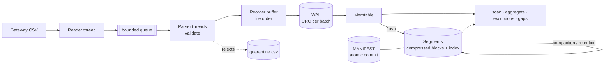

# 🏭 Factory Telemetry Historian

A crash-safe, compressed time-series store for factory sensor data, written in C++20 from the
file format up. It ingests messy gateway CSV through a multi-threaded validating pipeline, makes
every acknowledged batch durable in a write-ahead log, compresses readings **6.1x** (2.63 bytes
per sample against 16 raw) and answers hourly roll-ups mostly from block statistics without
decompressing anything. Recovery is tested by cutting the log at every byte and flipping a bit
in every byte of a segment file.

## 🏛 Architecture



File formats, crash-ordering rules, trade-offs and limitations are in
[docs/ARCHITECTURE.md](docs/ARCHITECTURE.md).

**Role focus:** Data Engineer · **Stack:** C++20, CMake, GoogleTest, POSIX mmap/fsync,
AddressSanitizer/UBSan/ThreadSanitizer. No third-party runtime dependencies.

## 🧩 The problem

A press shop in the Midlands logs six sensors per machine every second. Twenty machines produce
about 10 million readings a day. Gateways lose their network and replay minutes of data late,
resend lines, and emit junk (dead clock batteries, `ERR#7`, 16-bit overflow temperatures). The
maintenance team needs to keep years of history on a small plant server, trust it after a power
cut, and quickly answer questions such as "when did press 5 overheat last night?"

## ✨ Features

- **Lossless block compression.** Delta-of-delta timestamps, plus two value codecs tried per
  block: Gorilla XOR, and a scaled-integer delta for sensors that report exact decimals. The
  smaller one wins. Round trips are bit-exact, including NaN payloads and `-0.0`.
- **Durability.** Per-batch CRC-checked WAL, fsync before acknowledgement, atomic manifest
  commits, orphan clean-up. A torn tail is dropped; damage *before* acknowledged data is a hard
  error instead of silent loss.
- **Late and duplicate data.** Last write wins by arrival order, whether the older copy is in
  memory, in a newer segment or already compacted.
- **Index pushdown.** Blocks that fall inside one bucket and overlap nothing are answered from
  min/max/sum/count in the index. Overlapping blocks are detected and merged, so duplicates are
  never counted twice.
- **Compaction and retention.** Size-tiered over adjacent segments, running without blocking
  readers or writers. `--expire-before` drops old history.
- **Ingestion pipeline.** Reader, N parsers and an ordered writer, with ticket-based
  back-pressure that bounds memory. Bad lines are quarantined with line number and reason.
- **Analysis.** Excursions with hysteresis and minimum duration, gap detection and
  time-weighted means.
- **Operations.** Single-process lock, `verify` (full checksum scrub), `stats`, recovery report.

## 🚀 Quick start

```bash
cmake --preset release && cmake --build --preset release
H=build/release/historian
$H simulate --out telemetry.csv --machines 8 --seconds 21600   # seeded, deterministic
$H ingest --db plant.db --in telemetry.csv --quarantine rejects.csv
$H stats --db plant.db
$H query --db plant.db --series press-05/temp_c --bucket 3600
$H excursions --db plant.db --series press-05/temp_c --trip 85 --reset 80 --min-seconds 300
$H compact --db plant.db --full && $H verify --db plant.db
```

## 📟 Example output

Real output on an Apple M2 from the commands above:

```text
$ simulate
lines=1041192 late=23414 duplicates=3962 corrupted=978 dropped=548
$ ingest
lines=1041192 accepted=1040214 rejected=978 in 0.21s (5.00M lines/s)
  quarantined field_count     163
  quarantined bad_timestamp   163
  quarantined bad_machine     163
  quarantined unknown_sensor  163
  quarantined bad_value       163
  quarantined out_of_range    163
$ stats
series=48 segments=3 samples=1036252 bytes=2728502
bytes/sample=2.633 (16 raw, 6.1x smaller) blocks=1104 scaled-delta=920 xor=184
$ query --series press-05/temp_c --bucket 3600
bucket                      count        min       mean        max       last
2026-11-02T00:00:00.000Z     3599      35.40      59.24      67.60      35.40
2026-11-02T01:00:00.000Z     3600      35.10      59.18      67.90      35.50
2026-11-02T02:00:00.000Z     3599      34.20      61.40      69.20      34.40
2026-11-02T03:00:00.000Z     3598      34.80      81.16     109.10      45.70
2026-11-02T04:00:00.000Z     3599      46.00      82.71     111.50      57.80
2026-11-02T05:00:00.000Z     3597      58.10      82.87     109.70      70.30
blocks: 17 from index, 5 decoded, 0 pruned (0.119 ms)
$ excursions --trip 85 --reset 80 --min-seconds 300
2026-11-02T03:10:30.016Z -> 2026-11-02T03:26:39.011Z    16.1 min  peak 104.20
2026-11-02T03:41:13.008Z -> 2026-11-02T03:53:29.005Z    12.3 min  peak 109.10
2026-11-02T04:11:39.019Z -> 2026-11-02T04:30:07.007Z    18.5 min  peak 111.50
2026-11-02T04:44:49.019Z -> 2026-11-02T04:54:24.000Z     9.6 min  peak 103.20
2026-11-02T05:15:32.011Z -> 2026-11-02T05:33:45.006Z    18.2 min  peak 109.70
2026-11-02T05:45:53.016Z -> 2026-11-02T05:55:53.015Z    10.0 min  peak 103.80
```

1,040,214 accepted minus 3,962 duplicate sends is exactly the 1,036,252 samples stored.

### Benchmark (`build/release/historian_bench`, 2.6M lines, 104 MB CSV)

| Measure | Result |
|---|---|
| Ingest with 1 / 2 / 4 parsers | 4.79 / 4.81 / 4.43M lines/s |
| XOR codec only | 4.914 bytes/sample |
| Adaptive codec | **2.627 bytes/sample** (47% smaller) |
| Full scan, decompressing | 48.4M samples/s |
| Aggregate, 60 s buckets | 0.582 ms per series (0% of blocks from index) |
| Aggregate, 1 h buckets | 0.122 ms per series (77% from index) |
| Aggregate, 24 h buckets | 0.001 ms per series (100% from index) |
| Durable append, 1,000-sample batches | 6.41M samples/s * |

More parsers do not help. Parsing is cheap enough that the single ordered writer (WAL encoding
and memtable) is the limit, and at four parsers the hand-off costs more than it saves.

\* macOS `fsync` does not flush the drive's own cache, so expect far less on a Linux server with
a real disk flush.

## 🏗 Project structure

```text
include/historian/  public headers
src/
  bitstream, bytes, codec      bit packing, CRC-32, block compression
  file                         RAII descriptors, mmap, atomic replace, lock
  wal, memtable, segment       write path and immutable files
  manifest, store              commit point, recovery, queries, compaction
  csv, ingest, bounded_queue   validation and the threaded pipeline
  analysis, simulator          excursions, gaps, seeded plant data
apps/main.cpp       CLI
bench/              benchmark program
tests/              93 tests
```

## 🎯 Skills demonstrated

- **Data ingestion:** back-pressure, ordering guarantees, quarantine with reasons, late and
  duplicate handling, idempotent replays
- **Storage internals:** columnar compression, statistics pushdown, LSM-style compaction
- **Reliability:** WAL, crash-ordering, checksums, fault-injection tests, and failing loudly on
  corruption
- **Modern C++:** RAII, `std::span`, ranges, `std::jthread`, semaphores,
  snapshot reads via `shared_ptr`, warnings as errors, sanitizers in CI
- **Performance work:** measured decisions, including the optimisation that did not pay off

## 🧪 Running tests

```bash
cmake --preset dev && cmake --build --preset dev && ctest --preset dev   # ASan + UBSan
make tsan                                                                # ThreadSanitizer
```

93 tests: codec round trips over random bit patterns, decoder fuzzing and truncation, a
randomised comparison of the store with a reference `std::map`, concurrent readers during flush
and compaction, WAL truncation at every byte, single-bit corruption of every segment byte, and
the full simulated plant end to end.

## 📄 License

MIT
