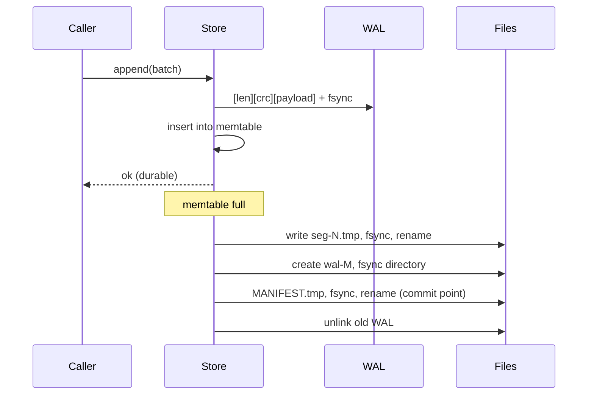

# Architecture

## Files

| File | Content |
|---|---|
| `wal-N.log` | Records `[u32 length][u32 crc32][payload]`. One record is one batch; series names are stored once per record. |
| `seg-N.hsg` | Blocks of up to 1,024 samples, then an index, then a 20-byte footer (index offset, length, CRC, magic). |
| `MANIFEST` | Live segments oldest to newest, WAL floor, next id, CRC. Replaced atomically. |
| `LOCK` | `flock` so two processes cannot open the same store. |

## Crash safety

The manifest rename is the only commit point.

| Crash happens | State on reopen |
|---|---|
| During a WAL append | The CRC fails on the tail; earlier batches are recovered whole |
| After the segment, before the manifest | The segment is an orphan and is deleted; the WAL is replayed |
| After the manifest, before the WAL unlink | The WAL is below the floor and is deleted, not replayed over newer data |
| During compaction | Inputs are still listed; the output is an orphan |
| During recovery itself | Nothing committed, so recovery simply runs again |

A torn record is accepted only if no later WAL holds data. Otherwise acknowledged batches sit
behind the damage, and opening fails rather than hiding the loss. After a failed write or fsync
the WAL refuses more appends, since a retry could place good records after a torn one.

## Key decisions

**Two value codecs, chosen per block.** XOR compression suits full-precision floats, but plant
sensors send decimals such as 61.5, whose binary mantissas look random. If every value in a block
is an exact decimal at some scale up to 10^-6, deltas of the scaled integers are used instead. The
check is bitwise, so the codec stays lossless. Cost: the encoder does both. Gain: 4.914 to 2.627
bytes per sample. General-purpose compression (zstd) was rejected to avoid a dependency and to
keep 1,024-sample blocks independently decodable.

**Last write wins by arrival, not by timestamp.** Segment order in the manifest is the ordering.
Compaction may therefore merge only *adjacent* segments; merging 1 and 3 around 2 could move an
old value above a newer one. Rejected: a sequence number per sample (8 bytes against 2.6).

**Pushdown only for blocks that overlap nothing.** Statistics from overlapping blocks would count
replaced samples. Sorting blocks by start time and growing overlap clusters makes the check
O(n log n) per query. Heavily overlapping data falls back to decoding, until compaction fixes it.

**Snapshot reads.** A query takes a shared lock just long enough to copy the segment list
(`shared_ptr`) and the relevant memtable range. Files unlinked by compaction stay readable through
their mapping. Rejected: a read lock held during decoding, which lets one long query stall ingest.

**Tickets for back-pressure.** Bounded queues alone do not bound memory: if one parser is slow, the
reorder buffer keeps every batch that finishes after it. A semaphore ticket is held from read to
store instead, which also means queue pushes never block and shutdown cannot deadlock.

**`Result`/`Status` instead of exceptions.** I/O failure and corruption are expected outcomes, and
`[[nodiscard]]` makes ignoring one a compile error. `value() &&` returns by value because returning
a reference let a range-for loop over a temporary dangle (found by AddressSanitizer).

## Limitations and next steps

- Flush runs under the writer lock, so one append in 500,000 samples pays for it. An immutable
  memtable plus a flush thread would remove the pause.
- Single writer, single node, one value type (double).
- Full compaction holds one whole series in memory at a time. A k-way streaming merge would not.
- A full memtable snapshot range is copied per query; large unflushed ranges cost memory.
- Sums answered from the index and from samples can differ in the last bits of a double.
- POSIX only (mmap, flock, fsync). On macOS `F_FULLFSYNC` would be needed for true durability.
