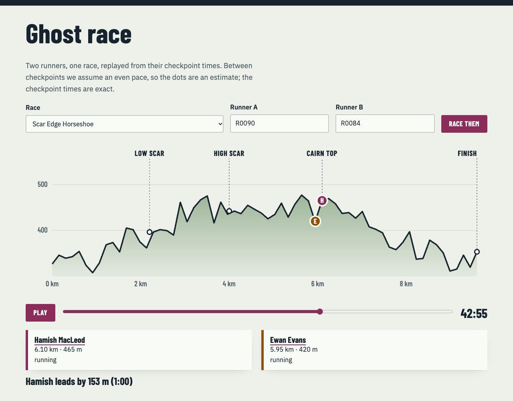
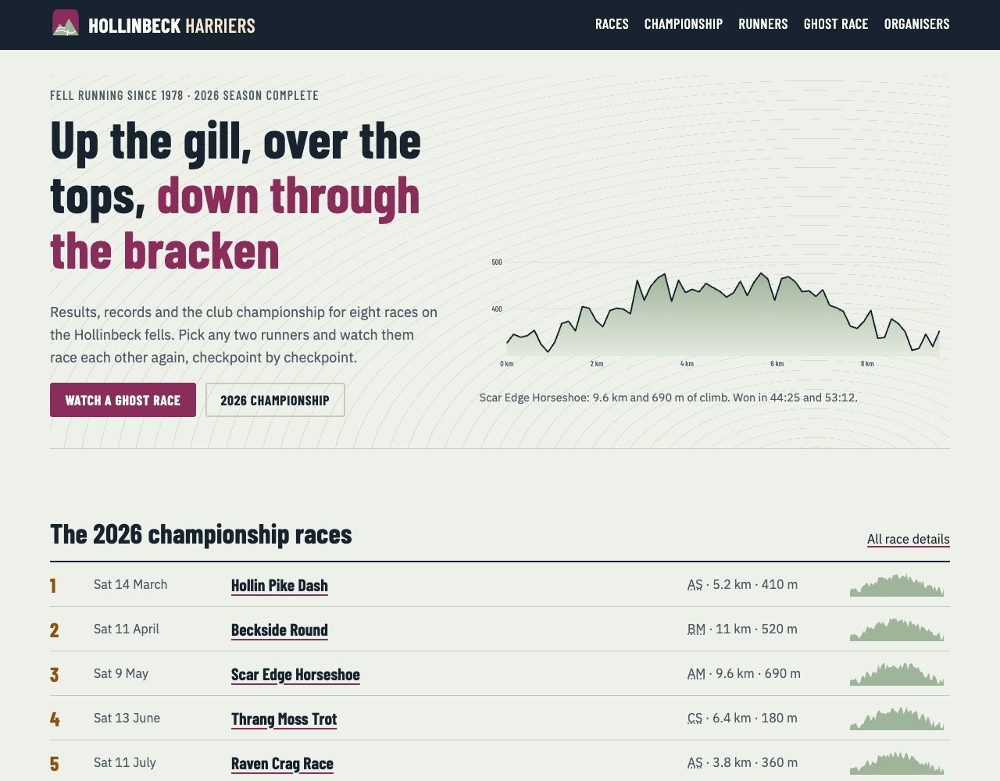
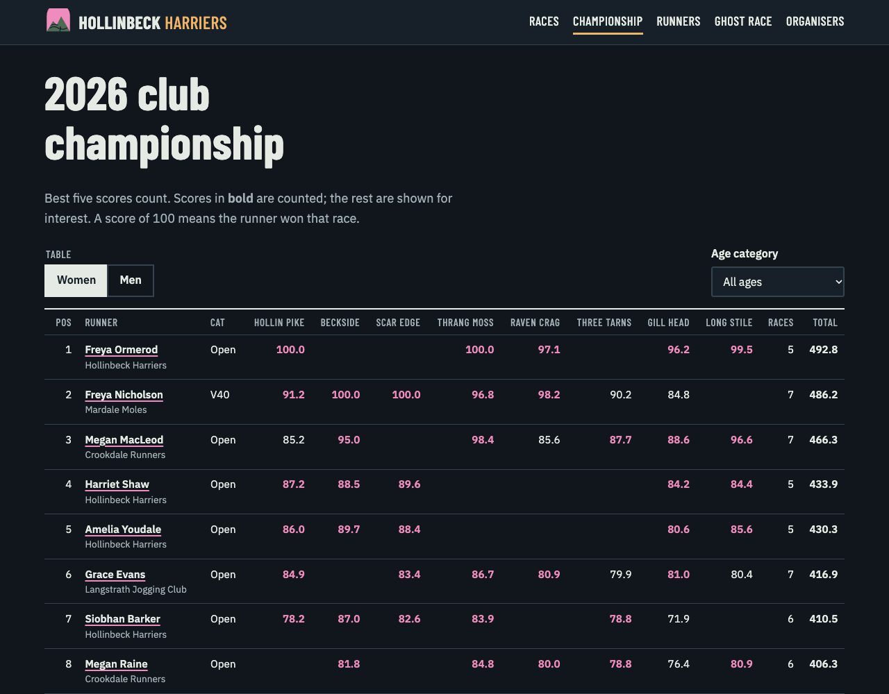
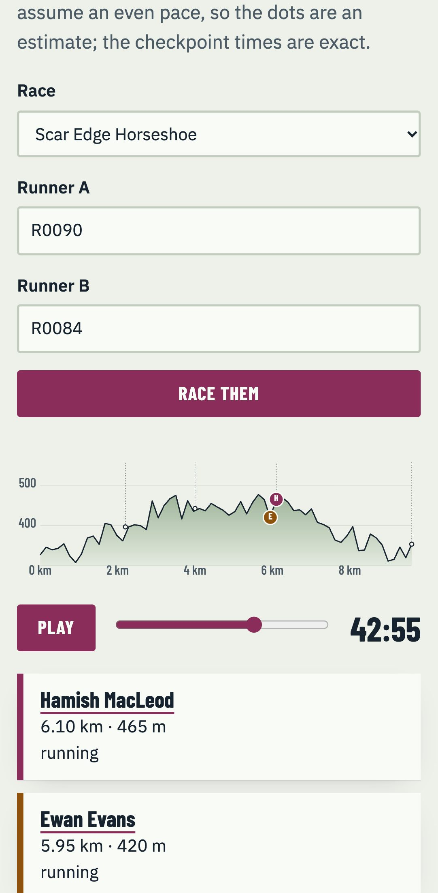
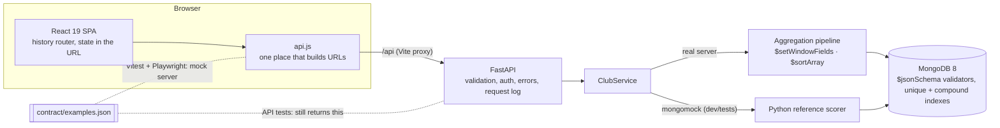

# 🏃 Hollinbeck Harriers: Fell Race Results

A full-stack website for an invented fell running club. It covers eight championship races, three seasons and 420 runners. Visitors browse results sheets, follow a best-five-of-eight championship by age category, look up any runner's history, and replay two runners' race as a **ghost race**: their dots move over the hill profile as you drag the clock. That shows the climber leading at the summit and the descender catching them in the bracken. Organisers paste in results with checkpoint splits. The FastAPI + MongoDB back end validates every row, refuses stale corrections and makes repeated uploads harmless.



| | |
|---|---|
|  |  |
|  | |

## 🏛 Architecture



There is more in [docs/ARCHITECTURE.md](docs/ARCHITECTURE.md): why the scoring exists twice, the idempotent upload design, the contract file and the trade-offs.

**Role focus:** Front-End Engineer · **Stack:** React 19, JavaScript, SCSS, SVG, Vite, Vitest + Testing Library, Playwright + axe · Python, FastAPI, Pydantic, MongoDB 8 (PyMongo, aggregation pipelines, validators), mongomock, pytest + Hypothesis, Docker

## 🧩 The problem

Fell race results are usually a PDF of names and times. Club members want more. *Where am I in the championship if my worst two races drop out? Where did I lose that minute to my rival: on the climb or on the way down?* Organisers want to send results in without a spreadsheet wrangler, and without double-counting when the upload is retried on a poor signal at the finish field.

## ✨ Features

**Website**
- **Ghost race.** Choose a race and two runners, then drag or play the race clock. The dots move along the SVG elevation profile, a live line says who leads and by how much (metres and seconds), and a checkpoint table and plain-English story show where the race was won.
- **Results sheets** with checkpoint splits, paging, a women/men filter, DNFs at the foot, and course records. Tick any two rows to send them to the ghost race.
- **Championship tables.** Best five of eight, with counted scores highlighted, age-category ranking (V40 to V70), and a filter that lives in the URL and so survives a reload or a shared link.
- **Runner pages.** A full history with personal bests marked, and a "where in the field" strip across three seasons.
- **Organiser upload.** Paste `R0123, 14:47, 29:12` or `R0123, 17:15, DNF`. Every line is checked before sending, with line-numbered messages. The receipt shows what was added, corrected, unchanged or refused.
- **Accessibility and layout:** works from 360 px wide, keyboard operable with a skip link, visible focus and focus moved to the heading on each page change. Reduced motion is respected (the clock steps instead of gliding), there are light and dark themes, and loading, empty and error states throughout. Axe reports no violations on any page, in light or dark, on desktop or phone.
- **Design:** lichen-green ground, slate ink, heather and bracken for the two runners, contour-line texture, *Barlow Condensed* for race-signage headings and *IBM Plex Sans* for text. There is no UI kit; everything is drawn in SVG.

**API**
- `GET /api/races`, `/races/{slug}`, `/races/{slug}/results` (paged, filtered), `/standings`, `/records`, `/runners?q=`, `/runners/{id}`, `/ghost`, and `POST /races/{slug}/results`, all documented in OpenAPI.
- **Idempotent uploads:** the same `upload_id` replayed returns the stored receipt and writes nothing. A reused id for a different race is a 409.
- **Conditional updates:** a correction replaces a result only if its `version` is higher. The filter `{version: {$lt: v}}` plus the unique index means a late, older correction cannot overwrite a newer one, with no read-then-write race.
- **Per-row validation:** unknown runner, wrong number of splits, a DNF with a finish time, times that go backwards, and "implausibly fast" (under 2:00/km, which catches minutes typed as seconds).
- **MongoDB used for what it is good at:** `$jsonSchema` validators, a unique `(race, season, runner)` index, a compound `(race, season, sex, time_s)` index that serves sorted result pages without an in-memory sort, an anchored-prefix name index, and versioned migrations.
- **Production basics:** bearer-token auth (hashed, constant-time compare), one error body shape, JSON logs with request id and latency (`x-request-id`, `server-timing`), settings from the environment, a Dockerfile and docker-compose with MongoDB 8.

## 🚀 Quick start

```bash
# API: seeded, in-memory MongoDB (mongomock), on :8000
cd api && python3 -m venv .venv && .venv/bin/pip install -e ".[dev]"
.venv/bin/fell-results serve

# Web: on :5173, proxying /api to :8000
cd web && npm ci && npm run dev
```

The demo organiser token for the in-memory API is `hollinbeck-demo-organiser`. It is refused as soon as `MONGO_URL` points at a real database; set `FELL_ORGANISER_TOKENS` there.

Against a real MongoDB 8: `FELL_ORGANISER_TOKENS=choose-one docker compose up`.

## 📊 Example output

Real responses from the seeded API (`contract/examples.json`, seed 2026):

```text
2026 championship, women (166 scored)          2026 championship, men (236 scored)
1  Freya Ormerod     Open  492.8  (5 races)    1  Jack Fell     Open  497.4  (6 races)
2  Freya Nicholson   V40   486.2  (7 races)    2  Jack Mounsey  Open  496.3  (6 races)
3  Megan MacLeod     Open  466.3  (7 races)    3  Mark Patel    Open  478.9  (5 races)

Ghost race, Scar Edge Horseshoe 2026: Hamish MacLeod (R0090) v Ewan Evans (R0084)
             Low Scar   High Scar   Cairn Top   Finish
  Hamish        14:47       29:14       42:55   1:04:48
  Ewan          14:46       29:33       43:58   1:04:46
  Ewan leads by 1 s at Low Scar.
  Hamish takes the lead by 19 s at High Scar.
  Ewan takes the lead by 2 s at the finish.      (he gains 65 s on the descent)
```

```json
POST /api/races/raven-crag-race/results   (one new finisher, one DNF, one unknown runner)
{"upload_id": "raven-2026-late-entries", "race": "raven-crag-race", "season": 2026,
 "inserted": 2, "updated": 0, "unchanged": 0,
 "rejected": [{"row": 3, "runner_id": "R9999", "reason": "unknown runner id"}], "replayed": false}
```

The seeded data has 3,545 results. Fields run from 127 finishers (Thrang Moss Trot) to 220 (Gill Head Gallop), with 2–5% retirements, longest on Three Tarns. Winning times run from 20:46 (Thrang Moss, men) to 1:44:14 (Three Tarns, women).

## 🏗 Project structure

```text
fell-race-results/
├── api/                         FastAPI + MongoDB (own pyproject.toml, Dockerfile, .ci-databases)
│   ├── src/fell_results/
│   │   ├── app.py               routes, auth dependency, OpenAPI
│   │   ├── service.py           queries, paging, ghost data, idempotent uploads
│   │   ├── standings.py         scoring: aggregation pipeline + Python reference
│   │   ├── db.py                connection, $jsonSchema validators, indexes, migrations, seeding
│   │   ├── models.py            Pydantic contract and upload validation
│   │   ├── seed.py              deterministic club, courses and runners with climb/descent skill
│   │   ├── errors.py · observability.py · config.py · cli.py
│   └── tests/                   73 pytest tests (10 need a real MongoDB; CI runs them)
├── web/                         React 19 + Vite + SCSS
│   ├── src/api.js               every URL the site requests, plus useApi()
│   ├── src/router.jsx           history router with query-string state
│   ├── src/lib/                 ghost-race geometry, time formats, paste parser
│   ├── src/components/          ElevationProfile (SVG), layout, states
│   ├── src/pages/               Home, Races, Race, Championship, Runners, Runner, Ghost, Submit
│   ├── src/styles/              tokens, base, layout, components
│   ├── tests/                   41 Vitest tests against the contract
│   └── e2e/                     Playwright: axe on 9 pages × 2 themes × 2 devices, journeys
├── contract/examples.json       recorded API responses shared by both sides' tests
├── docs/                        ARCHITECTURE.md, screenshots
├── docker-compose.yml · Makefile
```

## 🎯 Skills demonstrated

- **Front-end craft:** a designed, multi-page site with its own identity, hand-drawn SVG data graphics, responsive layouts built with CSS grid, design tokens with light and dark themes, and no UI library.
- **Accessibility as a test, not a hope:** axe-core runs on every page in both themes on desktop and phone. There is a skip link, focus management on route changes, properly labelled form errors, `aria-live` for the race readout, and reduced-motion support.
- **State in the URL:** filters, paging and ghost-race selections are shareable links. A small history router is built on `useSyncExternalStore`.
- **Data-heavy UI logic as tested pure functions:** interpolating position along a course, the inverse time-at-distance, gap in metres and seconds, and the generated race story.
- **Contract testing across the stack:** one JSON file the API must keep returning and the front end uses as its mock server, so the two cannot drift silently.
- **Back-end engineering:** idempotency keys, conditional updates against a unique index, per-row validation, auth, consistent errors, structured logs and migrations.
- **MongoDB depth:** window functions in an aggregation pipeline, `$sortArray`/`$slice` for best-N scoring, validators, index-backed sorting proven with `explain()`, and exact integer arithmetic so the database and Python agree to the last digit.

## 🧪 Running tests

```bash
cd api && .venv/bin/pytest -q                 # 63 pass here; 10 MongoDB tests skip without MONGO_URL
MONGO_URL=mongodb://localhost:27017 .venv/bin/pytest -q -m mongo   # pipeline v reference, explain(), validators, races
cd api && .venv/bin/ruff check . && .venv/bin/ruff format --check .
cd web && npm run lint && npm test && npm run build
cd web && npm run e2e                         # add PW_CHANNEL=chrome to use an installed Chrome
```

CI runs the API tests a second time against real MongoDB 8 and MySQL 8.4 services (the `api/.ci-databases` marker), and runs the web job with Playwright.

## 📄 License

MIT. See [LICENSE](LICENSE). Hollinbeck Harriers, its fells and its runners are invented.
