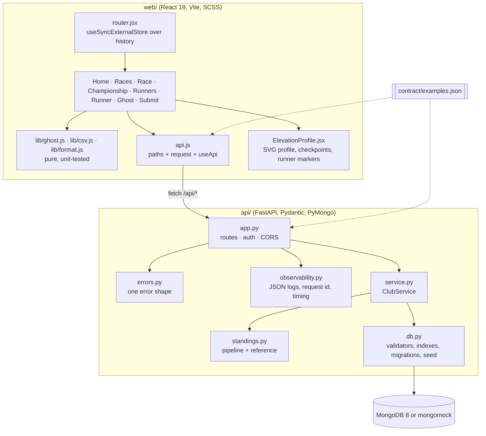

# Architecture

## Overview

### Collections

| Collection | Shape | Indexes / rules |
|---|---|---|
| `races` | slug, name, FRA category, km, climb, month, blurb, checkpoints, profile (64 points) | `_id` = slug |
| `runners` | name, `name_lower`, sex, birth year, club | `$jsonSchema`; `name_lower` (anchored prefix search) |
| `results` | race, season, runner id, denormalised name/sex/category/club, status, `time_s`, cumulative `splits`, `version` | `$jsonSchema`; unique `(race, season, runner_id)`; `(race, season, sex, time_s)`; `(season, status)`; `(runner_id, season)` |
| `uploads` | upload id, race, season, organiser, timestamp, stored receipt | unique `upload_id` |
| `meta` | `{_id: "schema", version}` | migration version |

Results copy the runner's name, sex, club and **category at the time of the race**. A runner who turns 40 must not change last season's V40 table, and every read path then avoids a `$lookup`. The cost is that a name correction has to be written into the results too. Names change rarely, so that is acceptable.

## Key design decisions

### 1. Scoring written twice, on purpose
`standings.pipeline()` is a MongoDB aggregation: `$setWindowFields` (winner time and `$rank` per race and sex), `$group` per runner, `$sortArray` + `$slice` for the best five, `$map` to flag counted races. That keeps 3,500 documents next to the data instead of shipping them to Python. mongomock cannot run window functions, so `standings.compute()` implements the same rules in Python. It is used in development and tests, and it doubles as an executable specification. The test `test_aggregation_pipeline_matches_python_reference` runs both on real MongoDB in CI for every season and requires identical output.
**Rejected:** scoring only in Python (simpler, but moves every result over the wire on each request), and only in the pipeline (untestable without a server, and opaque to review).

### 2. Integer tenths, not floats
Points are `floor((1000 × winner + time/2) / time)` tenths, and totals are sums of tenths divided by 10. MongoDB's `$round` rounds half to even on doubles and `$sum` uses compensated summation, so float arithmetic would let the database and Python disagree in the last digit. Integers make the cross-check exact.

### 3. Idempotent, conditional uploads without transactions
CI's MongoDB is a standalone server, and multi-document transactions need a replica set. So the upload is built to be safe without one:
- **Idempotency key.** `upload_id` is unique in `uploads`. A replay returns the stored receipt. If two identical requests race, both writes are idempotent, and the one that loses the insert of the receipt returns the winner's receipt (tested with six concurrent threads on real MongoDB).
- **Conditional update.** Each row is `update_one({race, season, runner, version: {$lt: v}}, {$set: …}, upsert=True)`. A newer version matches and updates. An equal or older version misses the filter, the upsert then hits the unique index, and the row is reported as *unchanged*. There is no read-then-write window.
- **Per-row outcome.** Rows are written one by one instead of with one `bulk_write`, so the receipt can say exactly which rows were added, corrected or unchanged. With at most 500 rows per upload this costs milliseconds.
**Trade-off:** a crash part-way through leaves some rows written and no receipt. Re-sending the same upload is the recovery path, and it is safe because every row write is idempotent.

### 4. Load first, then index
`prepare()` seeds an empty database before running migrations. Building an index once over loaded data is the normal bulk-load order and cheaper on a real server. On mongomock it is the difference between 5.6 s and 0.2 s at startup, because its unique-index check is quadratic. The migrations are idempotent and record the schema version in `meta`.

### 5. Result pages are sorted and paged by the database
Finishers come from `find(...).sort(time_s).skip().limit()`, served in index order by `(race, season, sex, time_s)`. A test checks `explain()` for that index and for no SORT stage. DNFs, a handful per race, are appended in Python, ordered by how far the runner got. Positions count finishers only, as on a printed results sheet.
**Known limit:** `skip()` gets slower on deep pages. Fields of about 200 make that irrelevant here; keyset paging on `(time_s, runner_id)` is the next step for big-city races.

### 6. One JSON contract shared by both halves
`fell-results export-contract` records the exact responses for every URL the website requests (and one upload) into `contract/examples.json`:
- the API test suite asserts the API still returns those bytes;
- Vitest replaces `fetch` with them, and Playwright routes `/api/**` to them;
- `paths` in `web/src/api.js` is tested to build exactly the recorded URLs.

So a back-end change that would break the site fails a test on one side or the other. **Trade-off:** any intended change to an endpoint means re-recording the file (one command), and the front-end browser tests only cover data in the file. Requests outside it get a realistic 404, which the tests use to exercise error states.

### 7. A small router instead of a routing library
Eight routes and query-string state did not justify a dependency. `useSyncExternalStore` subscribes to `popstate` plus a custom navigation event, so every component reads the same URL with no context provider. `useQueryParam` writes with `replaceState`, so changing filters does not fill the back button. Focus moves to each page's `<h1>` after navigation, but not on first load.

### 8. The ghost race is an honest estimate
Runners are only timed at checkpoints. Between them the site assumes an even pace, and the page says so. The gap is shown two ways: metres, which is intuitive, and seconds measured at the trailing runner's position (how long ago the leader passed this spot), which is what runners actually quote. The geometry (`distanceAt`, `timeAtDistance`, `gapAt`, `legTable`, `storyline`) is pure and unit-tested, including retirements, where the runner stops at their last checkpoint.
**Rejected:** interpolating on elevation-adjusted pace (Naismith's rule). It looks cleverer, but it would invent detail the data does not have.

### 9. Synthetic data with a reason to exist
Each runner has a general ability plus separate climbing and descending skill. Leg times are built from the horizontal distance, the ascent and the descent in each leg of the profile. So the ghost race has real stories to show: Hamish MacLeod leads Ewan Evans by 63 s at Cairn Top and loses by 2 s at the finish. Everything is seeded (`random.Random(2026)`), so the contract is reproducible byte for byte.

## Security notes

- Organiser tokens are compared as SHA-256 digests with `hmac.compare_digest` against every configured token, so there is no early exit. The demo token works only with the in-memory database; with `MONGO_URL` set and no `FELL_ORGANISER_TOKENS`, uploads are refused.
- All inputs are validated twice: Pydantic at the edge (patterns, ranges, unknown fields refused, duplicates in one upload refused) and `$jsonSchema` in the database for anything that bypasses the API.
- CORS is limited to the dev origins by default. The browser normally talks to the same origin through the Vite proxy.

## Known limitations and next steps

- No per-organiser permissions (any valid token can upload to any race). Next: tokens scoped to races, and an audit view of `uploads`.
- Standings are recomputed on every request. Next: cache by `(season, sex)` and invalidate on upload, or `$merge` into a materialised collection.
- Runner search is first-name prefix plus a surname substring scan. Next: an Atlas Search or `$text` index once the runner list grows.
- No rate limiting on the upload endpoint. Next: a token-bucket middleware keyed by organiser.
- The site needs JavaScript. Next: server-render the results sheets for search engines and low-end phones.
