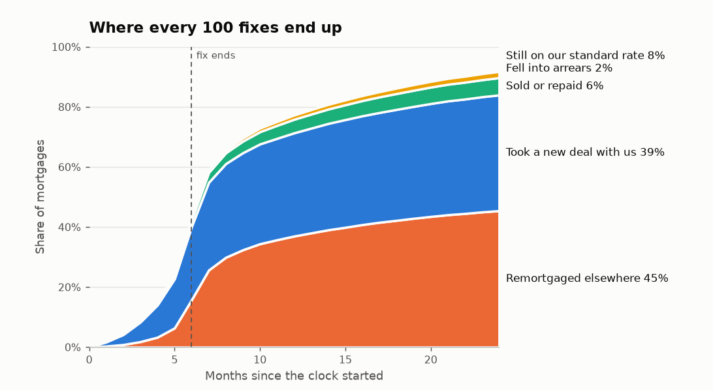
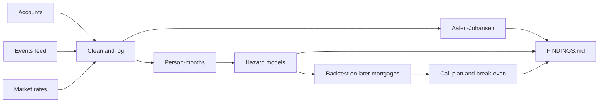
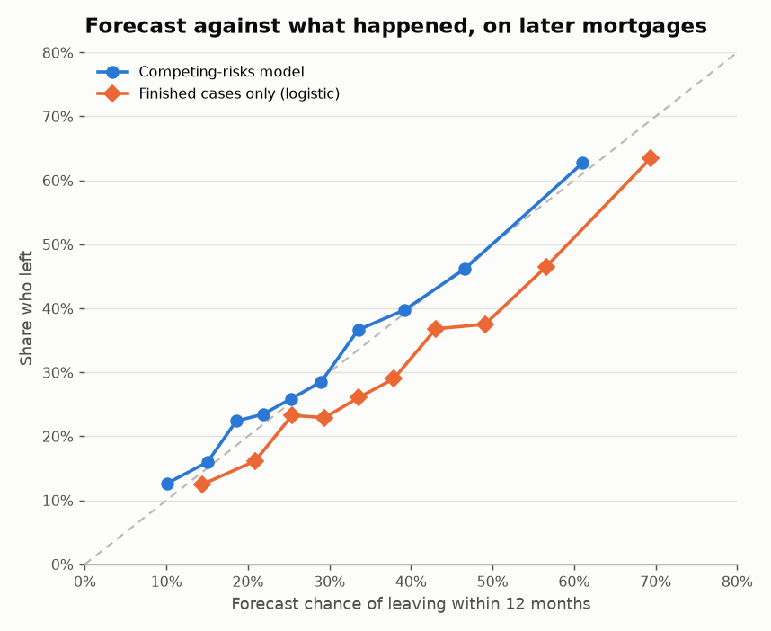
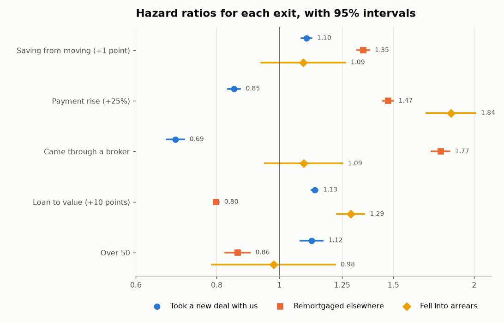

# 🏦 Fixed-Rate Mortgage Exits

When a fixed-rate mortgage ends, the customer takes a new deal, moves to another lender, sells, or falls behind. This analysis measures each outcome properly, forecasts who will leave, and works out which calls are worth making. The data are synthetic, so the methods can be checked against the truth.



## 🏛 Architecture



Design decisions and trade-offs: [docs/ARCHITECTURE.md](docs/ARCHITECTURE.md). Full results: [docs/FINDINGS.md](docs/FINDINGS.md).

**Role focus:** Data Analyst · **Stack:** Python, pandas, NumPy, statsmodels, matplotlib, pytest + Hypothesis

## 🧩 The problem

A lender reports that 74% of customers leave when their fix ends. The number comes from a standard survival curve, and it is wrong: it treats customers who took a new deal as missing. The lender needs the real figure, who is likely to go, and whether calling them pays.

## ✨ Features

- **Competing risks written out:** Aalen-Johansen with delayed entry and Aalen's variance, checked by hand and by simulation
- **Person-month hazard models** with changing rates, read as hazard ratios
- **Honest backtest:** trained as of one date, marked on mortgages that started later, with censoring weights and bootstrap intervals
- **Three baselines** beside the model, including the quick regression people usually fit
- **Call plan:** break-even save rates and sensitivity, with assumptions kept apart from findings
- **Cleaning log:** mixed date and LTV formats, pence, cancelled applications, late systems, acquired loans
- The report is generated, so every number in it comes from the run

## 🚀 Quick start

```bash
pip install -e ".[dev]"
```
```bash
mortgage-exits run
```

## 📊 Key insights

```text
42,706 mortgages, 384,009 person-months
Left for another lender within 24 months: 45.4% (44.9% to 45.9%); ignoring competing risks: 73.5%
Gone before the fix ends: 35% of leavers
Brier score on later mortgages (lower is better):
  Same rate for everyone            0.2215
  Finished cases only (logistic)    0.1988
  Lookup table (shock x channel)    0.2035
  Competing-risks model             0.1940
AUC 0.687. Calling a fifth, by chance x balance, reaches 45% of lost margin.
```

- **45% leave, not 74%.** The usual shortcut overstates every exit.
- **35% of leavers have gone before the fix ends**, so a letter on the day is too late for them.
- **The model ranks no better than the quick regression** (AUC 0.687 against 0.686). Its gain is in the level: the regression forecasts 38% leaving when 31% did; the model says 30%.
- **Balance alone gets most of the way.** Chance times balance reaches 45% of lost margin with a fifth of the calls; balance alone reaches 40%.
- **If calls save 6% of leavers, calling nearly everyone pays.** The save rate is an assumption, so the first recommendation is a randomised trial.





## 🏗 Project structure

```text
src/mortgage_exits/
  datagen.py      simulated book with known effects and real-world mess
  cleaning.py     raw tables to one row per mortgage, with a log
  survival.py     Kaplan-Meier, Aalen-Johansen, bootstrap
  hazards.py      person-months, cause-specific models, forecasts
  evaluation.py   temporal split, censoring weights, Brier, AUC, calibration
  value.py        call plan, gains, break-even, sensitivity
  charts.py, report.py, cli.py
tests/            unit, simulation, property and end-to-end tests
```

## 🎯 Skills demonstrated

- Choosing the estimator that answers the question, and showing what the wrong one costs
- Censoring, delayed entry and leakage handled on purpose, with tests for each
- Reporting a small gain as small
- Separating findings from planning assumptions
- Turning a forecast into a decision with a break-even

## 🧪 Running tests

72 tests, including a check that the 95% intervals cover the truth and that known effects are recovered:

```bash
pytest -q
```

## 📄 License

MIT
