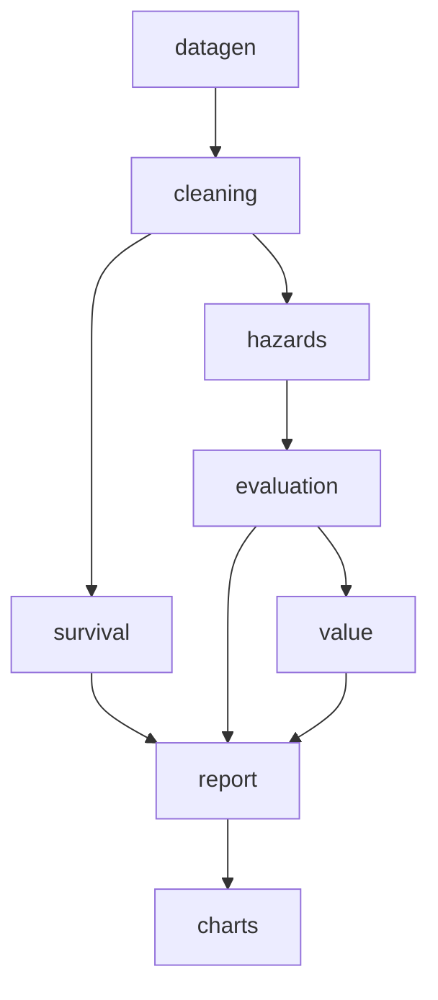

# Architecture

## Decisions

### The clock starts six months before the fix ends
Customers can lock in a new rate then, and a third of leavers go before the end. Starting at the end of the fix would remove them and make the book look more loyal than it is.

### Competing risks, not one survival curve
One minus Kaplan-Meier for "left" estimates a world in which nobody can take a new deal. Aalen-Johansen gives the share that actually leaves. It is written out here, rather than imported, because the available Python packages do not all support delayed entry with variance, and because it is 40 lines. Tests compare it with hand calculations, with the binomial when nothing is censored, and with 300 simulated samples for coverage.

### Delayed entry
Acquired loans are visible only from the day they were bought. A test simulates a half-acquired book, where ignoring this is out by more than five points. In the bundled data the effect is under one point, and the report says so.

### Monthly hazards with a complementary log-log link
Events are recorded by month, which would give a Cox model thousands of ties. The discrete model handles them, takes changing rates naturally, and its coefficients are still log hazard ratios. Arrears are rare, so their baseline uses three bins rather than twelve.

**Rejected:** Fine-Gray. It models the cumulative incidence directly, but its ratios are hard to explain and time-varying covariates are awkward. Combining cause-specific hazards gives the same curves.

### Two feature sets
The explanatory model uses the market rate in each month. The forecast uses only what is known on day one, because tomorrow's rate is not.

### Backtest by date
Training stops at the split: mortgages still open are censored then, and a test changes every later event to prove none can leak in. Test outcomes cut off by the extract are handled with inverse probability of censoring weights, checked against a known answer. Acquired loans are left out of the test because no day-one forecast would have existed.

### Economics kept apart
Margins, call costs and the save rate are assumptions in `config.py`. The report shows break-even rates so a reader can substitute their own.

## Known limits

- The simulator follows the form of the model, so recovery of effects is a check on the code, not evidence about real customers.
- Independent censoring is assumed. That is safe for an extract date, less so for other losses.
- Weights use one censoring curve for everyone.
- A transfer ends follow-up, so a later departure is not counted.
- Intervals for hazard ratios ignore uncertainty in imputed LTV and age (about 3% of rows).

## Next steps

A randomised call trial with an uplift model, refitting on a schedule with drift checks, and scenario forecasts for rate paths.
