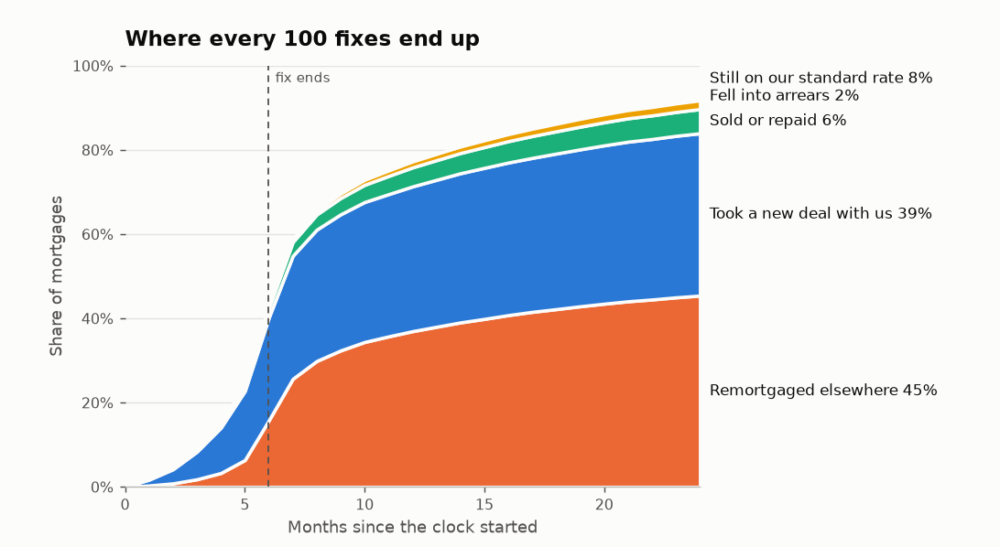
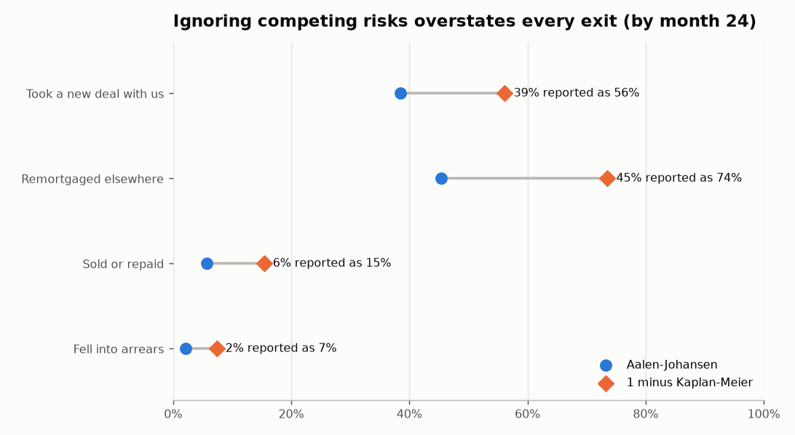
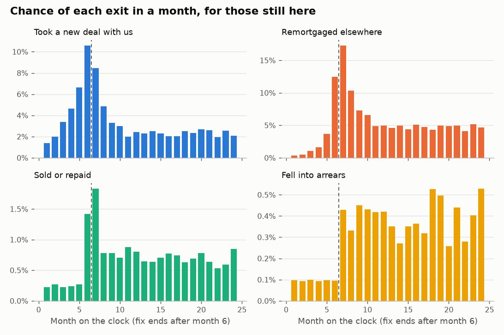
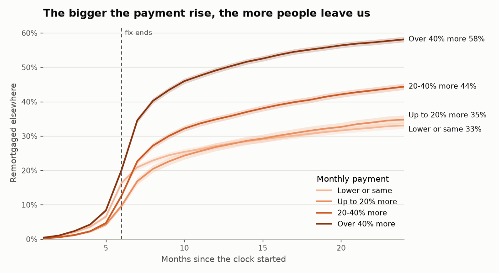
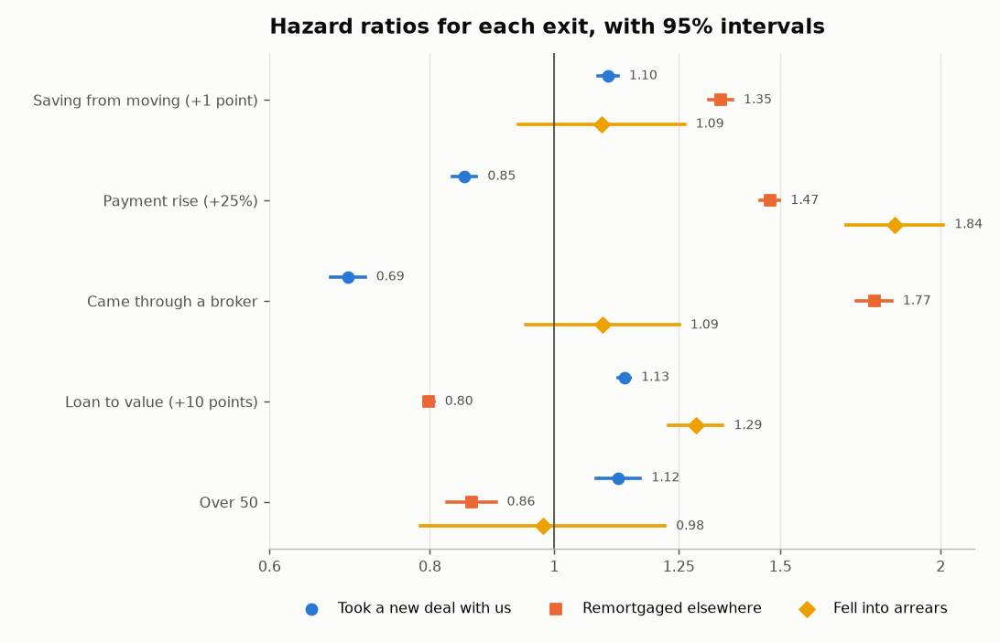
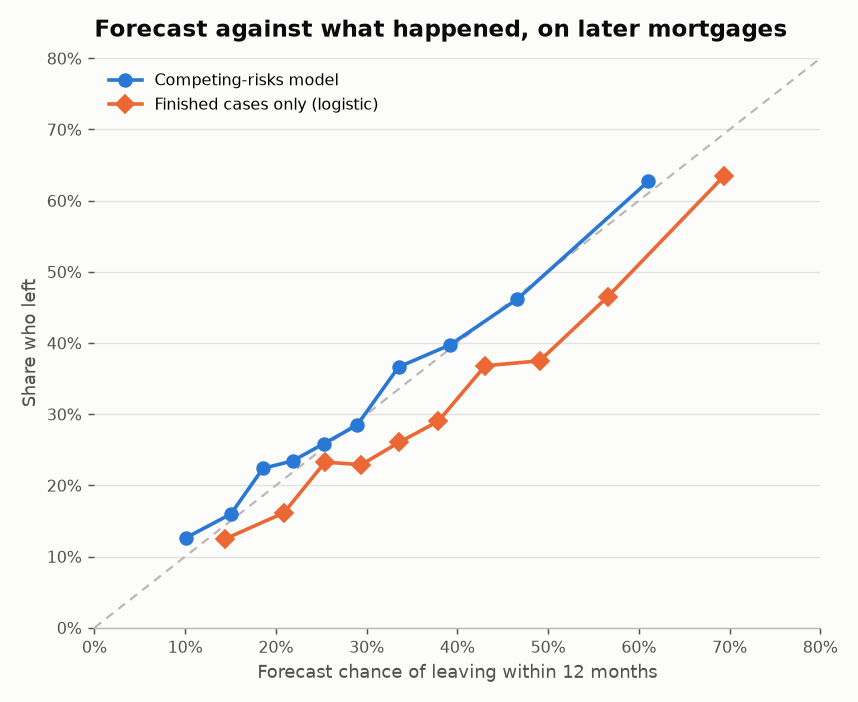
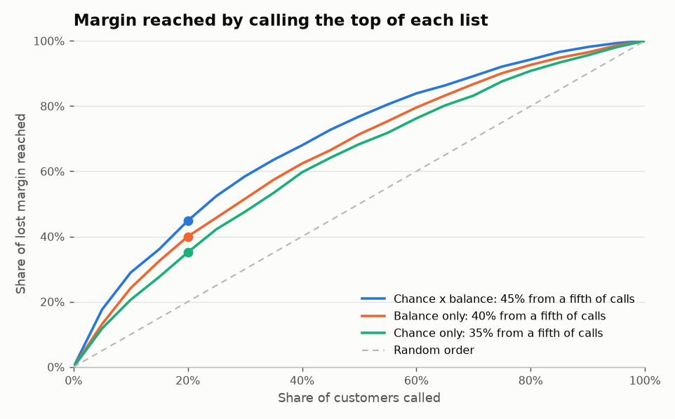
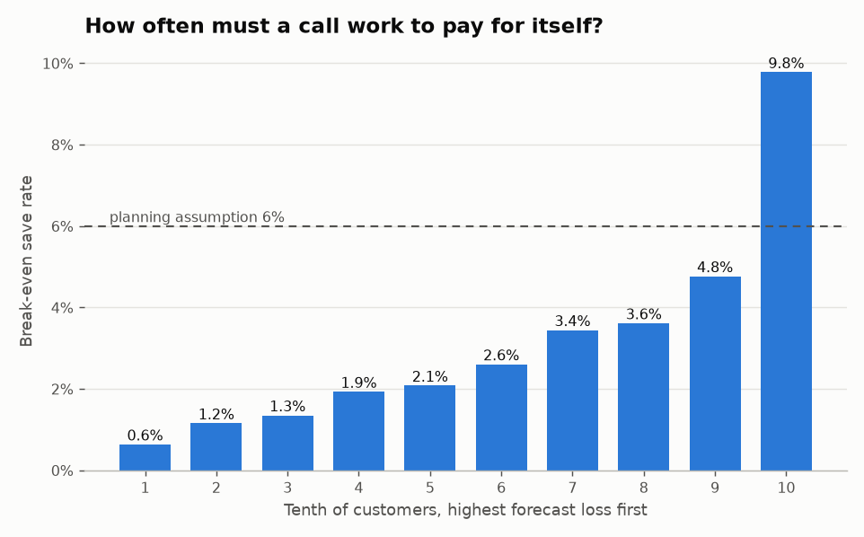

# Findings

42,706 mortgages and 384,009 months at risk. Synthetic data.

## 1. 45% remortgage elsewhere within 24 months, not 74%

| Exit | Share | Low | High | Wrongly, as 1-KM |
|---|---|---|---|---|
| Took a new deal with us | 38.5% | 38.1% | 39.0% | 56.2% |
| Remortgaged elsewhere | 45.4% | 44.9% | 45.9% | 73.5% |
| Sold or repaid | 5.7% | 5.5% | 6.0% | 15.4% |
| Fell into arrears | 2.1% | 1.9% | 2.2% | 7.4% |

Treating the other exits as missing data answers a question nobody asked: how many would leave if taking a new deal, selling and arrears were impossible.

## 2. 35% of those who leave have gone before the fix ends

15.8% of all mortgages leave inside the six-month window. A letter sent on the day the fix ends reaches none of them.

## 3. People facing bigger payment rises leave more

33% of those whose payment would not rise leave, against 58% of those facing a rise of over 40%. With other factors held still, each 25% rise multiplies the monthly chance of leaving by 1.47 (1.45 to 1.50), and of arrears by 1.84.

## 4. Broker customers leave more

+17.2 points (+16.3 to +18.3) compared with direct customers, unadjusted. This is an association. Customers choose how they apply.

## 5. The forecast holds up, and beats the quick model

Built on 35,977 mortgages as they stood on 01 April 2025, and marked on 5,762 whose clocks started later. Forecast: leaving within 12 months.

| Forecast | Brier | Low | High | AUC | Mean forecast | Observed |
|---|---|---|---|---|---|---|
| Same rate for everyone | 0.2215 | 0.2189 | 0.2237 | 0.500 | 39.2% | 31.4% |
| Finished cases only (logistic) | 0.1988 | 0.1946 | 0.2028 | 0.686 | 38.0% | 31.4% |
| Lookup table (shock x channel) | 0.2035 | 0.1982 | 0.2077 | 0.634 | 31.1% | 31.4% |
| Competing-risks model | 0.1940 | 0.1883 | 0.1991 | 0.687 | 30.0% | 31.4% |

| Model beats | Brier gain | Low | High |
|---|---|---|---|
| Same rate for everyone | 0.0276 | 0.0239 | 0.0309 |
| Finished cases only (logistic) | 0.0049 | 0.0031 | 0.0067 |
| Lookup table (shock x channel) | 0.0095 | 0.0073 | 0.0118 |

Ranking is the same as a logistic regression on finished cases (AUC 0.687 against 0.686). The gain is in the level: that regression forecasts 38% on average and 31% happened, because dropping unfinished cases drops people who stayed. The gain in Brier score is 0.0049 (0.0031 to 0.0067).

## 6. Rank calls by chance times balance

With time to call one customer in five, chance times balance reaches 45% of the margin that was lost. Balance alone reaches 40% and chance alone 35%. Most of the benefit comes from the balance, which is free.

| Tenth | Accounts | Left | Margin lost each | Break-even save rate | Net per call, £ |
|---|---|---|---|---|---|
| 1 | 577 | 51% | £3,463 | 0.6% | 186 |
| 2 | 576 | 41% | £1,906 | 1.2% | 92 |
| 3 | 576 | 39% | £1,630 | 1.3% | 76 |
| 4 | 576 | 32% | £1,141 | 1.9% | 46 |
| 5 | 576 | 33% | £1,058 | 2.1% | 41 |
| 6 | 576 | 29% | £845 | 2.6% | 29 |
| 7 | 576 | 26% | £639 | 3.4% | 16 |
| 8 | 576 | 25% | £609 | 3.6% | 15 |
| 9 | 576 | 21% | £461 | 4.8% | 6 |
| 10 | 577 | 16% | £225 | 9.8% | -9 |

The top tenth pays for itself if 0.6% of would-be leavers are kept. The bottom tenth needs 9.8%.

| Save rate | Calls | Net, planned calls, £ | Net, call everyone, £ |
|---|---|---|---|
| 1% | 616 | 6,988 | -57,739 |
| 2% | 2,217 | 43,432 | 11,286 |
| 4% | 4,157 | 157,780 | 149,336 |
| 6% | 4,953 | 292,656 | 287,386 |
| 10% | 5,507 | 565,075 | 563,487 |

## Recommendations

1. **Start at month 1, not at the end of the fix.** 35% of the loss is over by then.
2. **Work down the chance-times-balance list** as far as call time allows. If time is unlimited and calls save 6%, the model adds little over calling everyone, as the last table shows.
3. **Run it as a randomised trial.** The save rate is an assumption (6%). A control group is the only way to learn it.
4. **Send large payment rises to the affordability team first.** The same customers are most likely to fall into arrears, so a sales call alone is the wrong first contact.
5. **Stop reporting 1 minus Kaplan-Meier.** It overstates losses by 28 percentage points.

## Caveats

- Hazard ratios are associations. The data are simulated, so they can be checked against the truth, and the tests do that. Real data would have confounders nobody wrote down.
- Delayed entry moved the share taking a new deal by -0.7 points when ignored. That is small here because only 9% of mortgages were acquired.
- The forecast uses the market rate on day one. If rates move sharply, calibration will drift.
- Economics: 1.05% margin a year for 2 years, £22 a call. Change them in `config.py`.

## Cleaning log

| Rule | Rows |
|---|---|
| Market rate missing for a month: interpolated | 4 |
| Account row repeated: dropped | 342 |
| Fix end date unreadable: dropped | 0 |
| LTV written as a percentage or a share: converted | 12,737 |
| LTV missing: set to the median for the channel | 670 |
| Balance recorded in pence: divided by 100 | 299 |
| Age missing or impossible: set to the median | 607 |
| Region spelling: tidied | 2,166 |
| Event repeated in the feed: dropped | 765 |
| Application cancelled, so nothing happened: dropped | 4,271 |
| Event for an unknown account: dropped | 153 |
| Event after the mortgage had already gone: dropped | 1,137 |
| Never at risk while we could see it: dropped | 0 |
| Mortgages in the study | 42,706 |
