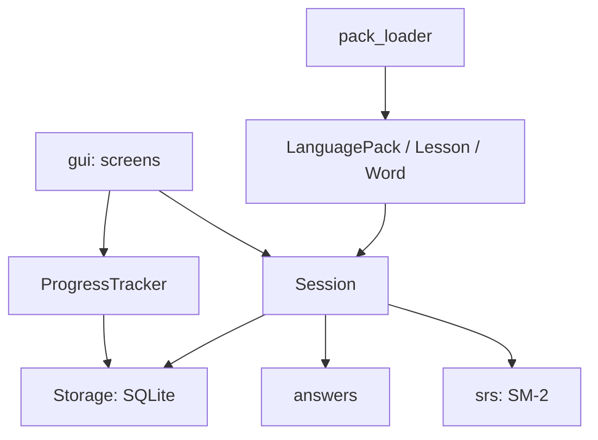

# Architecture

| Class | One responsibility |
|---|---|
| `User` | Who is learning, and their daily limit |
| `Lesson`, `LanguagePack` | Vocabulary, immutable |
| `Session` | One sitting: choose, mark, repeat |
| `ProgressTracker` | Analytics, read-only |
| `Storage` | The only class that knows SQL |

## Decisions

- **The scheduler is a pure function** of card, grade and date, so it is easy to test exhaustively.
- **Only the first answer in a sitting changes the schedule.** Otherwise retyping a word just shown would look like remembering it.
- **Retention excludes first sightings**, since there is nothing to retain yet.
- **Weak areas use Laplace smoothing**, so a word missed 1 time in 3 does not outrank one missed 30 in 40.
- **Word ids include the pack id**, so packs cannot share progress by accident.
- **The card and its review are saved in one transaction.**

## Limits

- Practice goes one way, from English to the target language.
- Changing a word's id in a pack loses its progress.
- The schedule uses standard SM-2 settings and is not fitted to each learner.
