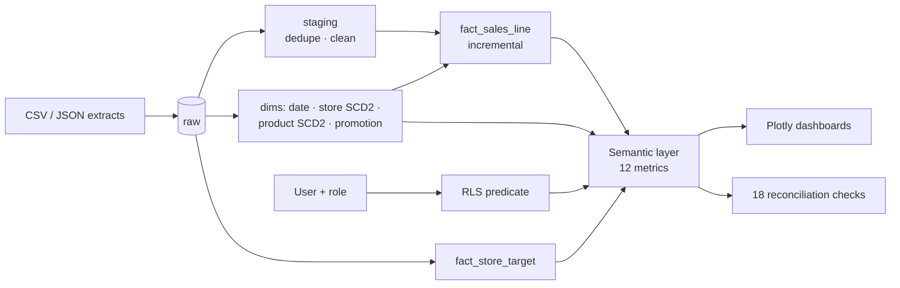
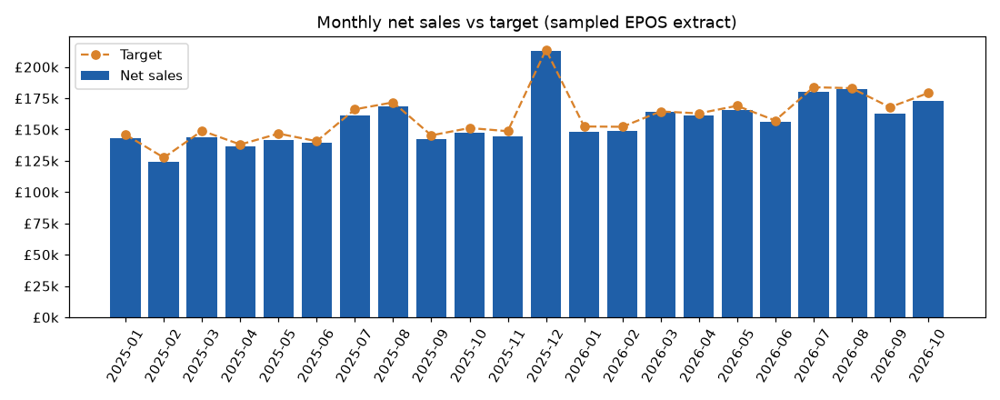
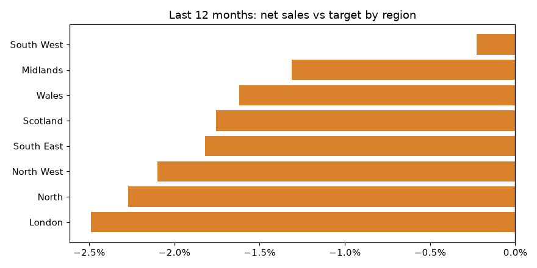
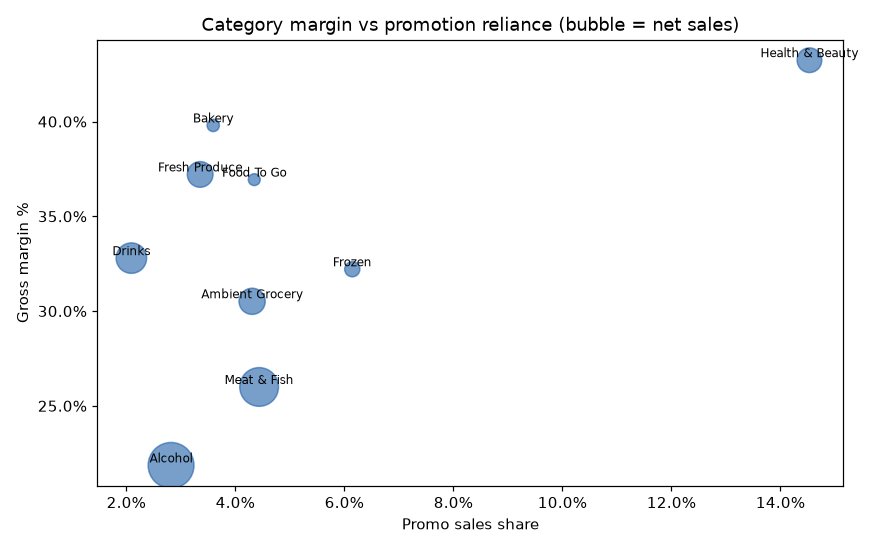
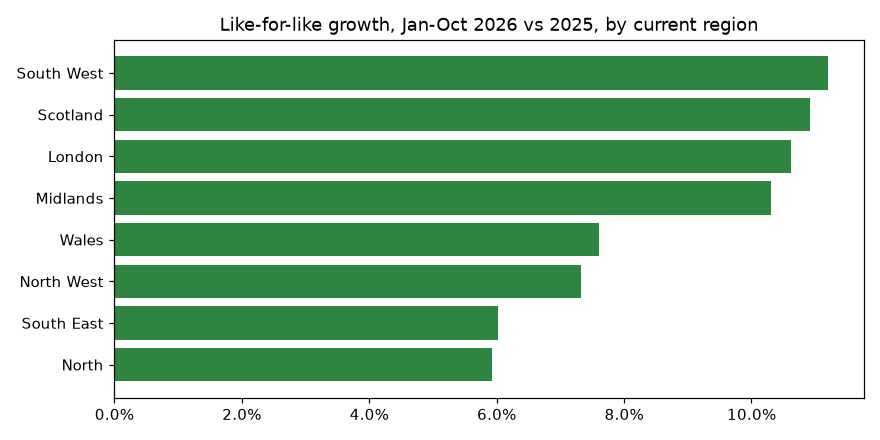
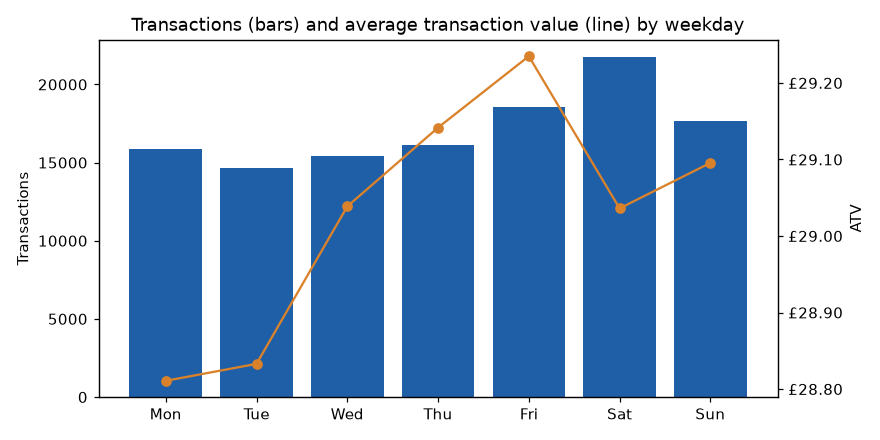
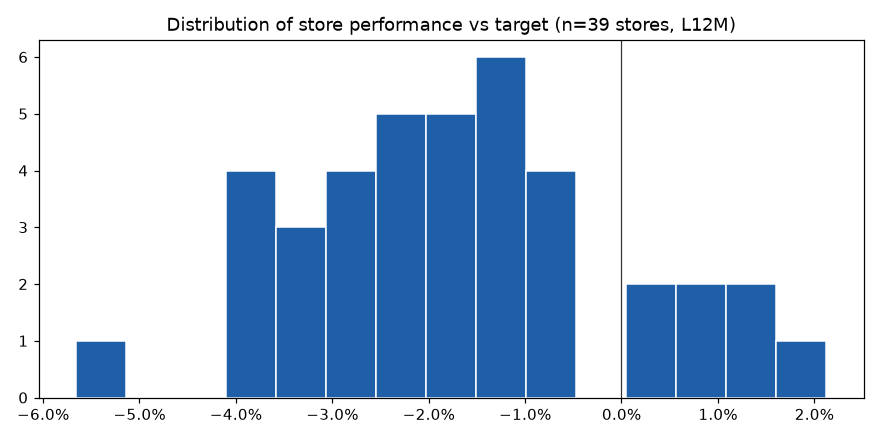

# 🛒 Grocery Retail BI Mart

A dimensional BI mart for **Harvest & Co**, a fictional chain of 40 UK grocery stores. Messy
source extracts (426k EPOS lines with duplicates, returns, late-arriving tills and unknown
products) are turned into a DuckDB star schema. Store and product dimensions are tracked as
SCD Type 2, and facts load incrementally. On top sit a documented semantic layer of 12 KPIs,
row-level security for executives, regional managers and store managers, and four-page
interactive Plotly dashboards rendered per user. A validation suite reconciles every headline
number on the dashboard back to source.

## 🏛 Architecture



The model, design decisions, trade-offs and limitations are in
[docs/ARCHITECTURE.md](docs/ARCHITECTURE.md).

**Role focus:** BI Developer · **Stack:** Python 3.11+, DuckDB (SQL: CTEs, window functions,
SCD2, point-in-time joins), pandas, Plotly, matplotlib, pytest + Hypothesis, Docker

## 🧩 The problem

Harvest & Co's trading team argues about the numbers every Monday. Finance's "sales" doesn't
match the regional managers' spreadsheets. The April 2026 region realignment broke every
year-on-year comparison. Gross margin moves whenever list prices change, and nobody can say
which stores are behind target. The business wants **one trusted set of KPI definitions**,
history that stays right when stores and products change, and dashboards where each manager
sees only their own stores. And they need proof that the dashboard ties back to the till data.

## ✨ Features

- **Star schema in DuckDB:** `fact_sales_line` (till-line grain) and `fact_store_target` (store
  x month), with conformed `dim_date`, `dim_store`, `dim_product`, `dim_promotion` and a
  promotion-product bridge.
- **SCD Type 2** built from monthly snapshots by attribute-hash comparison (`lag`/`lead`).
  It captures store refits, manager moves, the region realignment, price rises and a category
  reorganisation.
- **Incremental, idempotent fact loads:** a `loaded_at` watermark plus a `line_id` anti-join,
  with point-in-time joins so late-arriving lines land on the right historical version. A
  batch log records rows and late arrivals.
- **Documented SQL models** with declared dependencies and a topological build order, in the
  style of dbt, with cycle detection.
- **Reporting view** `v_store_month`: CTEs plus window functions for actual vs target, YoY via
  `lag(12)`, fiscal YTD running totals, rank within region and a like-for-like flag.
- **Semantic layer:** 12 metrics (net sales, GM%, ATV, units per basket, promo share,
  discount rate, return rate, loyalty share, target, vs target...), 16 allowlisted dimensions,
  drill-across between facts, and like-for-like growth.
- **Row-level security:** executive, regional and store roles, injected into every query. A
  manager's region is resolved from the *current* store hierarchy.
- **Dashboards:** 4 linked pages per user (overview KPI cards, regions and store drill-down
  with a dropdown, category treemap and promo scatter, trading patterns). RAG colouring vs
  target.
- **Validation:** 18 checks covering row and £ reconciliation raw → staging → fact → semantic
  layer → dashboard, an RLS partition and isolation check, SCD2 integrity and point-in-time
  correctness. The build fails on any error.

## 🚀 Quick start

```bash
pip install -e ".[dev]"
bi-mart build          # generates seeded sources, builds the warehouse in 3 incremental batches
bi-mart validate       # 18 reconciliation checks -> docs/VALIDATION.md
bi-mart dashboard      # dashboard/<user>/overview.html for ceo, rm_north_west, sm_s105
bi-mart charts         # PNGs in docs/charts
bi-mart catalog        # metric definitions, dimensions, models, users
bi-mart query net_sales atv --by region --user rm_london_se --date-from 2026-01-01
```

Pre-rendered dashboards are committed: open [dashboard/ceo/overview.html](dashboard/ceo/overview.html)
or the regional manager's view in [dashboard/rm_north_west/](dashboard/rm_north_west/) (Plotly
loads from its CDN).

## 📊 Key insights

All numbers are real output from the code, on the seeded sample extract.

**Build** (`bi-mart build`):

```text
Raw rows: {"stores_snapshot": 841, "products_snapshot": 9240, "store_targets": 841, "sales_lines": 426194, "promotions": 26}
Models built (dependency order): mart.bridge_promotion_product, mart.dim_date, mart.dim_product, mart.dim_promotion, mart.dim_store, mart.fact_store_target, mart.v_store_month, stg.sales_lines
  batch 1: loaded_at > 1900-01-01 00:00 -> 338,154 rows (6,648 late-arriving)
  batch 2: loaded_at > 2026-06-29 02:00 -> 63,843 rows (1,304 late-arriving)
  batch 3: loaded_at > 2026-09-29 02:00 -> 22,077 rows (569 late-arriving)
Fact rows: 424,074 · timings (s): {'land_raw': 0.337, 'models': 0.019, 'facts': 0.532, 'total': 0.888}
```

**Dashboards per user, with RLS applied** (`bi-mart dashboard`):

```text
ceo             -> dashboard/ceo/ (4 pages) · L12M net sales £2,000,720, vs target -1.7%, LFL +8.8%
rm_north_west   -> dashboard/rm_north_west/ (4 pages) · L12M net sales £438,248, vs target -2.1%, LFL +7.3%
sm_s105         -> dashboard/sm_s105/ (4 pages) · L12M net sales £52,852, vs target -1.1%, LFL +18.2%
```

**Last 12 months by region** (`bi-mart query net_sales vs_target_pct gross_margin_pct atv --by region --date-from 2025-11-01 --date-to 2026-10-31`):

```text
    region net_sales vs_target_pct gross_margin_pct    atv
    London  £208,606         -2.5%            30.0% £29.46
  Midlands  £310,887         -1.3%            30.0% £29.44
     North  £150,477         -2.3%            30.1% £29.77
North West  £438,248         -2.1%            30.0% £29.08
  Scotland  £273,976         -1.8%            30.1% £29.34
South East  £274,518         -1.8%            30.0% £28.94
South West  £293,648         -0.2%            30.0% £29.43
     Wales   £50,361         -1.6%            30.0% £28.66
```

**The North regional manager sees pre-realignment history** under the old region names
(`--user rm_north --by region_as_was`, Jan–Jun 2026):

```text
region_as_was net_sales gross_margin_pct
        North   £36,334            29.4%
    Yorkshire   £33,339            30.5%
```

**RLS isolation:** the North West manager filtering on London (`--user rm_north_west --filter region=London`):

```text
(no rows visible to this user)
```

What the numbers say:

- Every region is **behind target over the last 12 months** (-0.2% South West to -2.5% London,
  -1.7% overall), yet **like-for-like sales are up 8.8%** (Jan–Oct 2026 vs 2025). The gap is in
  the targets, not in trading.
- **Health & Beauty** combines the highest gross margin (~43%) with the heaviest promotional
  reliance (~15% of sales on promotion). **Alcohol** is the biggest category at the lowest
  margin (~22%) with little promotion. That points to reviewing H&B promo depth before cutting
  any Alcohol prices.
- Saturday is the peak trading day by transactions, while basket value stays flat across the
  week, so the weekend uplift comes from footfall, not bigger baskets.








### Validation report (`bi-mart validate`)

| Check | Result | Expected | Actual |
|---|---|---|---|
| raw -> staging: one row per distinct line_id | ✅ | 424074 | 424074 |
| staging -> fact: row counts match | ✅ | 424074 | 424074 |
| staging -> fact: no dropped lines | ✅ | 0 | 0 |
| net sales: staging = fact | ✅ | £3,449,217.99 | £3,449,217.99 |
| net sales: fact = semantic layer | ✅ | £3,449,217.99 | £3,449,217.99 |
| dashboard L12M net sales = source | ✅ | £2,000,720.46 | £2,000,720.46 |
| dashboard all-time net sales = source | ✅ | £3,449,217.99 | £3,449,217.99 |
| dashboard L12M transactions = source | ✅ | 69029 | 69029 |
| targets: source = semantic layer | ✅ | £3,516,959.50 | £3,516,959.50 |
| RLS: regional views partition the executive total | ✅ | £3,449,217.99 | £3,449,217.99 |
| RLS: North West manager sees exactly the North West stores | ✅ | 8 | 8 |
| SCD2 dim_store: exactly one current row per key | ✅ | 0 | 0 |
| SCD2 dim_store: versions contiguous, no gaps or overlaps | ✅ | 0 | 0 |
| SCD2 dim_product: exactly one current row per key | ✅ | 0 | 0 |
| SCD2 dim_product: versions contiguous, no gaps or overlaps | ✅ | 0 | 0 |
| point-in-time: every sale joins the store version valid on its date | ✅ | 0 | 0 |
| unknown-product lines below 1% (mapped to sk -1) | ✅ | < 1.00% | 0.30% |
| gross margin % within a plausible grocery range (15-45%) | ✅ | 15-45% | 30.2% |

**18/18 checks passed.**

## 🏗 Project structure

```text
grocery-retail-bi-mart/
├── src/grocery_retail_bi/
│   ├── datagen.py      # seeded, messy source extracts (snapshots, EPOS, promos, targets)
│   ├── models.py       # documented SQL models, SCD2, fact DDL/incremental insert, DAG order
│   ├── warehouse.py    # land raw, build models, watermark loads, batch log, timings
│   ├── semantic.py     # metric + dimension catalog, SQL compiler, drill-across, LFL
│   ├── security.py     # users, roles, RLS predicates
│   ├── dashboard.py    # 4-page Plotly dashboards per user
│   ├── validation.py   # 18 reconciliation / integrity checks
│   ├── charts.py       # matplotlib PNGs for docs
│   └── cli.py          # bi-mart
├── tests/              # 51 tests: models, warehouse, semantic/RLS (+ Hypothesis), dashboard
├── dashboard/          # rendered dashboards for 3 users
├── docs/               # ARCHITECTURE.md, VALIDATION.md, charts/
└── data/README.md      # sources are generated, not committed
```

## 🎯 Skills demonstrated

- **Dimensional modelling:** fact grain decisions, conformed dimensions, unknown members, a
  bridge table, and facts at two grains joined by drill-across.
- **Slowly changing dimensions:** SCD2 from snapshots, contiguous validity windows,
  point-in-time fact keys, and restated vs as-was hierarchies.
- **Advanced SQL:** CTEs, window functions (`lag`, `lead`, `rank`, running totals),
  `QUALIFY`, `FILTER` aggregates, idempotent incremental inserts.
- **Semantic layer / KPI governance:** one definition per metric, ratio-of-sums correctness,
  a dimension allowlist, a metric catalog.
- **Security:** row-level security by role, injection-safe filters, tested isolation.
- **Dashboard delivery:** multi-page interactive dashboards with drill-down, RAG status and
  per-audience views.
- **Data quality and trust:** automated reconciliation from source to dashboard, with tests
  that show tampering is caught.

## 🧪 Running tests

```bash
pytest -q          # 51 passed
ruff check . && ruff format --check .
```

## 📄 License

MIT. See [LICENSE](LICENSE).
