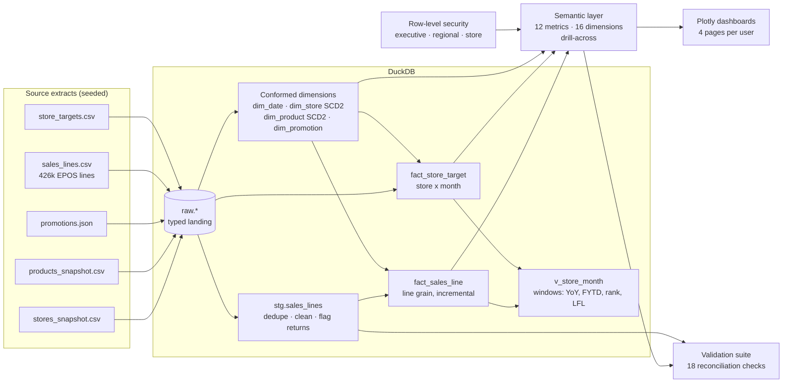

# Architecture

## Dimensional model

| Table | Grain | Keys | Notes |
|---|---|---|---|
| `fact_sales_line` | one till line | `line_id` (natural PK), `date_key`, `store_sk`, `product_sk`, `promo_sk` | additive measures: quantity, net, discount, cost, margin |
| `fact_store_target` | store x month | `month_key`, `store_sk` | finance targets, different grain to sales |
| `dim_store` | store version | `store_sk` | SCD2 on name, town, region, format, manager, size |
| `dim_product` | product version | `product_sk` | SCD2 on category, brand, list price, unit cost; `-1` = Unknown |
| `dim_promotion` | promotion | `promo_sk` | `0` = No promotion |
| `dim_date` | day | `date_key` (yyyymmdd) | ISO week, March-start fiscal year |
| `bridge_promotion_product` | promotion x product | | many-to-many promotion coverage |

## Key design decisions and trade-offs

**SCD2 built from snapshots by hash comparison.** The source systems give monthly snapshots,
not change logs. Each model hashes the tracked attributes, keeps the rows where the hash differs
from the previous snapshot (`lag()`), and derives `valid_from`/`valid_to` with `lead()`. That
handles A→B→A changes correctly. *Rejected:* SCD1 overwrite, which would restate a store's
format and a product's price history and break margin by format.

**Point-in-time joins at load time.** Each fact line gets the surrogate key of the version valid
on its *sale date*, including late-arriving lines loaded weeks later. A validation check proves
no fact row sits outside its version's validity window.

**Incremental fact load with a watermark and an anti-join.** Batches load
`loaded_at ∈ (watermark, cutoff]`, and `NOT EXISTS` on `line_id` makes reruns idempotent.
A test proves a 3-batch incremental build equals a full build to the penny. *Trade-off:* the
watermark is on load time, not sale time. That is what makes late-arriving lines safe, at the
cost of needing `loaded_at` from the source.

**Two region attributes, chosen deliberately.** `region` is the store's *current* region, so
history is restated to today's hierarchy. That's what managers want after the April 2026
realignment merged North East and Yorkshire into "North". `region_as_was` is the version at the
time of sale, for audit. RLS keys on the current region, so a manager inherits the full history
of their stores. One consequence: the store that closed in September 2025 still reports under
"North East", because its last version predates the realignment.

**Semantic layer as the only path to numbers.** Dashboards, the CLI and validation all call
`semantic.query()`. Ratios are defined as ratios of sums (gross margin % is
`SUM(margin)/SUM(sales)`, never an average of store percentages), and a test enforces this.
Metrics on different facts are queried separately and joined on conformed dimensions
(drill-across). Dimensions not shared by both facts (such as `category` for targets) are
rejected rather than silently giving a fan-out.

**RLS injected in the compiler, values always bound.** The user's predicate is added to every
query's `WHERE`. Filter values are bind parameters, never string-formatted, and dimension names
come from an allowlist, so `region = "x') OR TRUE --"` returns nothing. *Rejected:* separate
pre-filtered tables per manager, which would duplicate data and drift.

**Static Plotly HTML instead of a BI server.** The dashboards are portable, need no
infrastructure, and are reviewable in git. Each user gets their own rendered copy with RLS
applied at build time. *Trade-off:* filters are limited to client-side interactions
(dropdown drill-down, hover, zoom). A Streamlit or Power BI front end would add live slicing.

**Unknown member and imputed cost.** Lines with product codes missing from the master map to
`product_sk = -1` instead of being dropped (sales must still reconcile). Their cost is imputed
at 70% of sales and flagged with `is_cost_imputed`.

## Performance (MacBook, DuckDB 2.0.1)

From `bi-mart build` on the full extract: landing 426k raw lines took 0.34 s, the 8 models took
0.02 s, and 3 incremental fact batches took 0.53 s, for **0.89 s end to end**. Rendering
dashboards for three users and running the 18 validation checks each take about 2 s.

## Known limitations

- The sales extract is a *sample* of baskets (about 120k over 22 months), so absolute £ values
  are small. Ratios and trends are what matter.
- Targets are synthetic (actual × noise), so "vs target" variances are narrow.
- YoY in `v_store_month` uses `lag(12)` over months with sales. A store with a month of zero
  sales would misalign; production would join to a store × month spine.
- RLS is simulated in the application layer. A production warehouse would enforce it in the
  database (row access policies) as well.

## Next steps

Store × month spine for gap-free windows; a Streamlit app on the same semantic layer;
basket-level market-basket analysis using the promotion bridge; database-native RLS.
