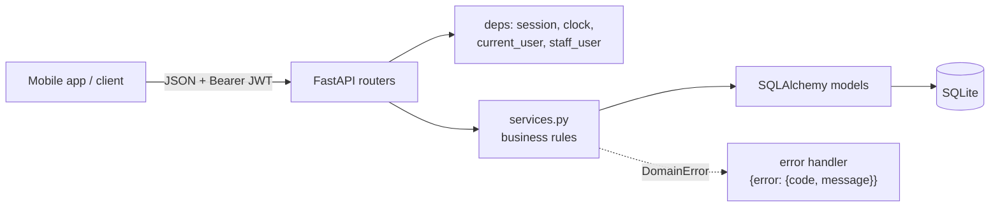

# 🏋️ Gym Class Booking API

[](https://github.com/Atharv1414/daily-projects/actions/workflows/tests.yml)


## Business problem

A three-studio gym runs about 100 classes a fortnight. Evening spin and HIIT sell out in minutes,
members who cancel at the last minute leave bikes empty, and the front desk keeps a paper waitlist
that nobody checks. This REST API replaces that process. Members book through the app. When a class
is full they join a first-come, first-served waitlist, and the next person in line moves up as soon
as a place frees. Cancelling within two hours of the start counts as a strike, and three strikes in
30 days pause a member's bookings. Staff manage the timetable and can see how full each class type is.

## 🎯 Skills demonstrated

- **REST API design.** Resource-oriented routes, correct status codes (201, 200 replay, 401, 403, 404, 409, 422), pagination and filtering, and one consistent error format with machine-readable codes.
- **Authentication and authorisation.** Salted PBKDF2 password hashing, JWT bearer tokens with expiry, and role-based access for members and staff.
- **Domain modelling and business rules.** A booking state machine covering capacity, a FIFO waitlist with automatic promotion, late-cancellation strikes and room-clash checks.
- **Reliability patterns.** Idempotency keys for safe retries, a partial unique index as a backstop against race conditions, and `SELECT … FOR UPDATE` on the capacity check.
- **Clean architecture.** Routers, then a service layer, then the ORM, with dependency injection for the database session, settings and an injectable clock.
- **Testing.** 39 pytest tests, 99% coverage, driving the real HTTP stack through FastAPI's `TestClient` on in-memory SQLite.

## Features

| Area | What it does |
|---|---|
| Accounts | Register, log in (JWT), `GET /me`; emails are case-insensitive and unique |
| Timetable | Staff create, edit and cancel classes; overlapping classes in the same room are rejected |
| Browsing | Upcoming classes with live `spots_left` and `waitlist_length`; filter by type, date range and availability; paginated |
| Booking | Confirmed if a place is free, otherwise waitlisted (max 10); one active booking per class; 14-day booking horizon |
| Waitlist | First in, first out. Moves up automatically on a cancellation or when staff raise capacity |
| Cancellation | Cancelling less than 2h before the start counts as a strike. 3 strikes in 30 days suspend booking until they expire |
| Retries | `Idempotency-Key` header makes `POST …/bookings` safe to retry |
| Reporting | `GET /reports/utilisation`: fill rate, sell-outs, waitlist demand and late cancellations per class type |
| Docs | Interactive OpenAPI / Swagger UI at `/docs` |

## Architecture



The booking state machine, the full rule table and the design trade-offs are in
[docs/architecture.md](docs/architecture.md).

## Quick start

```bash
git clone https://github.com/Atharv1414/daily-projects.git && cd daily-projects/gym-class-booking-api
pip install -e .

gym-booking demo            # scripted walkthrough on an in-memory database
gym-booking seed            # fill ./gym_booking.db with a synthetic 13-day timetable
gym-booking serve           # http://127.0.0.1:8000/docs
```

Set `GYM_BOOKING_SECRET_KEY` before running `serve` anywhere other than your laptop.
`GYM_BOOKING_DATABASE_URL` accepts any SQLAlchemy URL.

## Example output

`gym-booking demo` creates a two-place spin class, has three members book it, and then moves the
clock to 90 minutes before the start. This is real output:

```text
Clock: Tue 01 Dec 2026 08:00

POST   /classes                         -> 201
       {"id": 1, "title": "Spin Express", "starts_at": "2026-12-01T18:00:00", "capacity": 2, "spots_left": 2}
POST   /auth/register + /auth/login x3  -> 201, 200

POST   /classes/1/bookings (Aisha)      -> 201
       {"id": 1, "status": "confirmed", "waitlist_position": null}
POST   /classes/1/bookings (Aisha retry) -> 200  (Idempotent-Replay)
       {"id": 1, "status": "confirmed", "waitlist_position": null}
POST   /classes/1/bookings (Ben)        -> 201
       {"id": 2, "status": "confirmed", "waitlist_position": null}
POST   /classes/1/bookings (Chloe)      -> 201
       {"id": 3, "status": "waitlisted", "waitlist_position": 1}
POST   /classes/1/bookings (Ben again)  -> 409
       {"error": {"code": "already_booked", "message": "You already hold booking 2 for this class"}}
GET    /classes/1                       -> 200
       {"capacity": 2, "booked": 2, "spots_left": 0, "waitlist_length": 1}

Clock: 16:30 (90 minutes before the class)

GET    /me (token from 08:00)           -> 401
       {"error": {"code": "unauthorized", "message": "Access token has expired"}}
POST   /auth/login x4 (fresh tokens)    -> 200
DELETE /bookings/2 (Ben)                -> 200
       {"late": true, "strikes_in_window": 1, "promoted_booking_id": 3}
GET    /me/bookings (Chloe)             -> 200
       [{"id": 3, "class_id": 1, "class_title": "Spin Express", "starts_at": "2026-12-01T18:00:00", "status": "confirmed", "waitlist_position": null, "created_at": "2026-12-01T08:00:00", "promoted_at": "2026-12-01T16:30:00", "cancelled_at": null}]
GET    /classes/1/roster                -> 200
       Aisha Khan     confirmed
       Chloe Okafor   confirmed
GET    /classes (no token)              -> 401
       {"error": {"code": "unauthorized", "message": "Missing bearer token"}}
```

What happened: Aisha's retried request returned her original booking rather than creating a second
one. Chloe joined the waitlist. Ben cancelled inside the two-hour window, so he got a strike and
Chloe was moved up into his place. The 08:00 tokens had expired by 16:30, so everyone logged in again.

`gym-booking report` seeds 120 members and 97 classes from a fixed random seed, then calls the
utilisation endpoint:

```text
Seeded 120 members, 97 classes, 1374 booking requests, 31 late cancellations

class_type sessions capacity confirmed   fill  full waitlist late_cxl
hiit             13      208       203  97.6%    10       14        2
spin             22      440       409  93.0%    12       53       18
yoga             22      396       298  75.3%     4        1        5
boxing            9      144        95  66.0%     0        0        2
pilates          22      308       149  48.4%     0        0        4
strength          9      108        47  43.5%     0        0        0

Overall fill rate: 74.9%
```

### Key results (synthetic data, seed 42)

- **Evening HIIT and spin are capacity-constrained.** HIIT is 97.6% full and spin 93.0%, with 22 of 35 sessions sold out and 67 members still waitlisted. These are the classes to add sessions for.
- **Strength (43.5%) and pilates (48.4%) are under-used.** Moving a mid-day pilates slot to a second evening spin would put studio time where the demand is.
- **Late cancellations cluster where demand is highest.** 18 of the 31 are in spin, which is why waitlist promotion matters: each of those bikes went to the next member in line instead of standing empty.

## API reference

| Method | Path | Who | Description |
|---|---|---|---|
| POST | `/auth/register` | public | Create a member account |
| POST | `/auth/login` | public | Email + password → JWT |
| GET | `/me` | any user | Current profile |
| GET | `/classes` | any user | Upcoming classes: `class_type`, `from`, `to`, `available_only`, `limit`, `offset` |
| GET | `/classes/{id}` | any user | One class with live availability |
| POST | `/classes` | staff | Schedule a class |
| PATCH | `/classes/{id}` | staff | Change coach, room or capacity (extra places go to the waitlist) |
| DELETE | `/classes/{id}` | staff | Cancel a class and all its bookings |
| GET | `/classes/{id}/roster` | staff | Confirmed attendees, then the waitlist in order |
| POST | `/classes/{id}/bookings` | member | Book or join the waitlist (optional `Idempotency-Key`) |
| DELETE | `/bookings/{id}` | owner / staff | Cancel; response shows `late`, strikes and who was promoted |
| GET | `/me/bookings` | member | My bookings (`include_past=true` for history) |
| GET | `/reports/utilisation` | staff | Fill rate by class type for a date range |
| GET | `/health` | public | Liveness check |

## Commands

| Command | Description |
|---|---|
| `gym-booking serve [--host --port]` | Run the API with uvicorn |
| `gym-booking seed [--members N]` | Seed the configured database (staff login is printed) |
| `gym-booking demo` | End-to-end booking walkthrough, in memory |
| `gym-booking report [--members N]` | Seed in memory and print the utilisation report |

## Project structure

```text
gym-class-booking-api/
├── src/gym_booking/
│   ├── __init__.py          # package docstring and version
│   ├── __main__.py          # CLI: serve | seed | demo | report
│   ├── main.py              # create_app() application factory
│   ├── config.py            # Settings (business rules + env vars)
│   ├── clock.py             # injectable clock (utc_now, FixedClock)
│   ├── database.py          # engine + session factory
│   ├── models.py            # User, GymClass, Booking (+ partial unique index)
│   ├── schemas.py           # Pydantic request/response models
│   ├── security.py          # PBKDF2 hashing, JWT issue/verify
│   ├── deps.py              # FastAPI dependencies and role guards
│   ├── errors.py            # DomainError hierarchy + JSON error handler
│   ├── services.py          # booking, waitlist, strikes, reporting logic
│   ├── seed.py              # seeded synthetic timetable and demand
│   ├── demo.py              # scripted walkthrough and report printer
│   └── routers/             # auth, classes, bookings, reports
├── tests/                   # 39 pytest tests (API, services, security, CLI)
├── docs/architecture.md     # state machine, rules, design decisions
├── pyproject.toml
├── LICENSE
└── README.md
```

## Development

```bash
pip install -e ".[dev]"
ruff check . && ruff format --check .
pytest                      # 39 tests, coverage report included
```

The tests use an in-memory database and a `FixedClock`, so time rules such as late cancellation,
token expiry and strike expiry are tested by moving the clock forward instead of sleeping.

## License

MIT. See [LICENSE](LICENSE).
