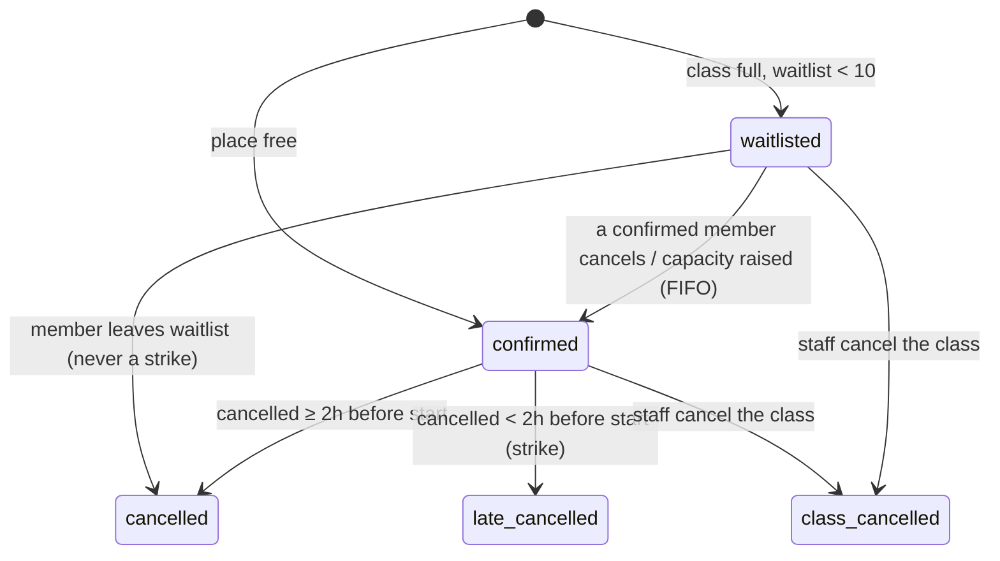

# Architecture and design notes

## Layers

```
HTTP request
   │
   ▼
routers/        FastAPI routes: parse input, call one service function, shape the response
   │  deps.py   dependencies: DB session, settings, clock, current user / staff guard
   ▼
services.py     business rules (capacity, waitlist, strikes, idempotency), no HTTP types
   │
   ▼
models.py       SQLAlchemy 2.0 ORM models  ──►  SQLite (any SQLAlchemy URL works)
```

Errors raised in the service layer are `DomainError` subclasses carrying an HTTP status and a
stable `code`. One exception handler turns them into `{"error": {"code", "message"}}`, so clients
can branch on `code` (`class_full`, `already_booked`, `booking_suspended`, …) instead of parsing text.

## Booking lifecycle



## Business rules

| Rule | Default | Where |
|---|---|---|
| Bookings open N days before the class | 14 | `Settings.booking_horizon_days` |
| Late-cancellation window | 2 hours | `Settings.late_cancel_window_hours` |
| Strikes that suspend booking | 3 in 30 days | `Settings.strike_limit`, `strike_lookback_days` |
| Waitlist length per class | 10 | `Settings.max_waitlist` |
| One active booking per member per class | — | service check + partial unique index |
| No overlapping classes in one room | — | `services._room_clash` |

## Design decisions

- **Injectable clock.** Every time rule reads `app.state.clock`, so tests and the demo can move
  time forward ("it is now 16:30") without sleeping or mocking `datetime`. JWT expiry is checked
  against the same clock.
- **Idempotency keys.** Mobile clients retry on flaky networks. `POST /classes/{id}/bookings`
  accepts an `Idempotency-Key` header; a repeat returns the original booking with `200` and
  `Idempotent-Replay: true` instead of creating a second booking. Reusing a key for a different
  class is a `409`. Keys are unique per user (database constraint).
- **Defence in depth on double booking.** The service checks for an existing active booking and a
  partial unique index (`status IN ('CONFIRMED','WAITLISTED')`) catches a concurrent request that
  slips past the check; the `IntegrityError` becomes a clean `409 already_booked`.
- **Row locking.** Capacity checks load the class with `SELECT … FOR UPDATE`. On PostgreSQL this
  serialises concurrent bookings for the same class; on SQLite it is a no-op because SQLite already
  allows a single writer.
- **Password storage.** PBKDF2-HMAC-SHA256 with a per-user 16-byte salt and 600,000 iterations
  (OWASP 2023 guidance), compared in constant time. Standard library only, no native build step.
- **Login errors are generic.** Wrong email and wrong password give the same message so the API
  does not reveal which accounts exist.

## Known limitations

- Waitlist promotion is immediate; a production gym might offer the place and wait for acceptance.
- No refresh tokens or token revocation; access tokens are short-lived (60 minutes) instead.
- `create_all` builds the schema at start-up; a real deployment would use Alembic migrations.
- No rate limiting on `/auth/login`; put the API behind a gateway that provides it.
