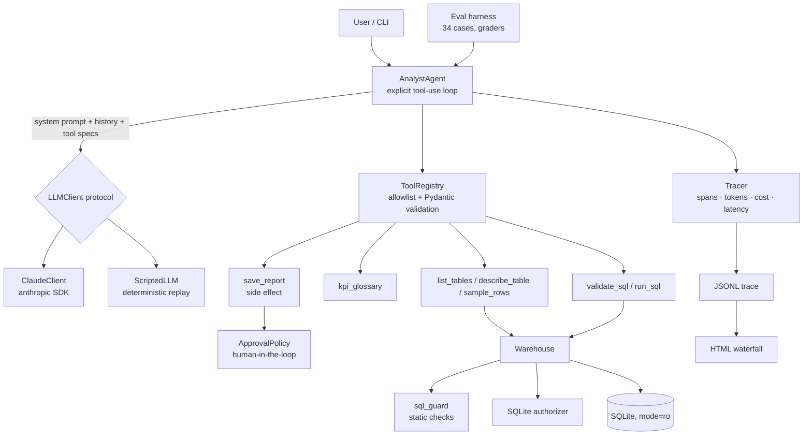
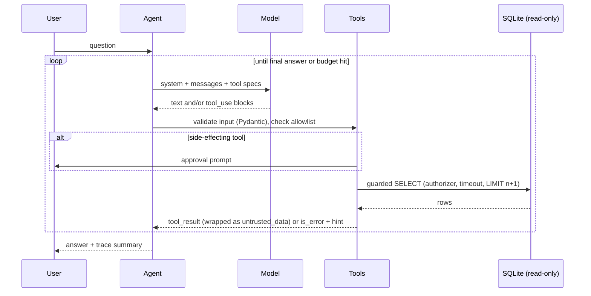

# Architecture

## Overview

### Request lifecycle

## Modules

| Module | Responsibility |
|---|---|
| `agent.py` | The loop: call model, run tools, feed results back, enforce step/token/error budgets |
| `llm.py` | `LLMClient` protocol, `ClaudeClient` (SDK), `ScriptedLLM` (offline replay) |
| `tools.py` | Tool definitions, Pydantic input models, JSON schemas, registry with allowlist |
| `sql_guard.py` | Static read-only checks and row-limit wrapping |
| `database.py` | Read-only connection, authorizer, timeouts, error translation with hints |
| `kpis.py` | Canonical KPI glossary (ADR, RevPAR, occupancy, ...) |
| `approval.py` | Human-in-the-loop policies (deny by default, console prompt, auto-approve) |
| `tracing.py` | Spans with latency/tokens/cost, JSONL export, HTML waterfall, JSON logging |
| `evals.py` | Golden cases, safety attacks, deterministic graders, variant comparison |
| `datagen.py` | Seeded generator: 12 hotels, 200k bookings, 170k charges, 41k reviews |
| `bench.py` | Guardrail and query latency benchmark |
| `cli.py` | `ask`, `eval`, `init-db`, `tools`, `bench`, `trace-html` |

## Key design decisions

1. **Explicit loop instead of a framework or the SDK tool runner.** The loop is about 60 lines
   and every policy (budgets, approval, error counting, tracing) sits where a reviewer can see
   it. *Rejected:* LangChain/LangGraph (hides the control flow) and the SDK's beta tool runner
   (good for simple agents, but approval gates and per-call tracing are clearer inline).
2. **Three layers of SQL safety.** Static keyword checks catch obvious attacks with a clear
   error for the model, the SQLite authorizer enforces the table allowlist on the real parse
   tree, and `mode=ro` makes writes impossible even if both had a bug. *Rejected:* a regex-only
   guard, which is easy to bypass with comments or quoted identifiers.
3. **Errors are data for the model.** `ToolError` carries a hint ("call describe_table") that
   goes back as an `is_error` tool result, which is what makes self-correction work. Three
   errors in a row stop the run so a confused model can't spin.
4. **Tool output is wrapped as `untrusted_data`.** Guest free text contains injection attempts
   (on purpose). The system prompt says data is never instructions, and the guardrails make
   sure that a model that obeys anyway still can't do damage.
5. **A KPI glossary tool instead of a longer prompt.** Hospitality KPIs have exact definitions.
   Serving them on demand keeps the system prompt short and cacheable. The `naive` eval variant
   shows what goes wrong without it: 4 of 14 KPI questions come out wrong, mostly because
   cancelled stays get counted.
6. **Row cap with `LIMIT n+1`.** Fetching one extra row detects truncation without a second
   COUNT query, and tells the model to aggregate in SQL.
7. **Deny-by-default approval.** `save_report` is the only side-effecting tool, and it needs a
   human yes. The policy is injected, so tests and batch runs stay deterministic.
8. **`ScriptedLLM` with result-aware final turns.** Scripted answers are filled in from the
   real query result, so offline runs exercise the actual SQL and graders instead of
   comparing fixed strings. Token usage is estimated (about 4 chars per token) and flagged.
9. **Graders compare to golden SQL, not stored numbers.** Regenerate the data with a different
   seed and the expected answers follow. Numeric answers allow 0.5% (or 0.06 absolute) and
   accept both 73.2% and 0.732.

## Trade-offs and limitations

- The offline eval measures the harness, tools and guardrails, not model quality. Run
  `hotel-agent eval --live` with an API key to score the model on the same 34 cases.
- Occupancy assumes every room is sellable every day and counts nights on the check-in date.
  A real PMS would spread stays across dates and handle out-of-order rooms.
- The authorizer allows reads of names that aren't schema objects, because SQLite reports CTE
  reads that way. Internals (`sqlite_*`, `pragma_*`) are still denied by name.
- There is no conversation memory between `ask` calls. Each question starts fresh.
- Cost figures in demo mode are estimates. In live mode they come from `usage` on each response.

## Next steps

- Prompt caching on the system prompt and tool list (`cache_control`) to cut input cost in
  long sessions.
- Feed the query plan into the loop and reject full scans over a row threshold.
- A Streamlit front end showing the trace waterfall next to the answer.
