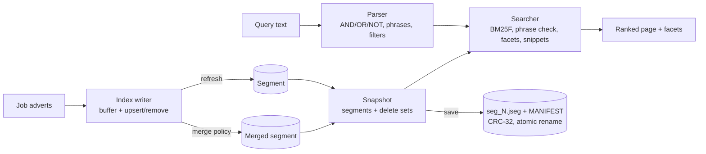

# 🔎 Job Board Search Engine

A search engine for a UK job board, written from scratch in C++20. It indexes 100,000 job adverts in under two seconds, answers typical queries in about 1 ms, and ranks "Data Engineer" in a title above a passing mention in the body. Under the hood: a positional inverted index with block-compressed postings and skip tables, BM25F ranking, a query language with phrases, prefixes, exclusions and filters, immutable segments with a merge policy, lock-free reads through snapshots, and crash-safe files with checksums. No libraries are used beyond the standard library (GoogleTest for tests).

## 🏛 Architecture



The full design, trade-offs and limitations are in [docs/ARCHITECTURE.md](docs/ARCHITECTURE.md).

**Role focus:** Software Engineer · **Stack:** C++20, CMake presets, GoogleTest, AddressSanitizer + UBSan, clang-format, std::jthread

## 🧩 The problem

A recruitment board lives or dies on search. Candidates type things like `senior data engineer python`, `"class 1 licence" -temporary` or `nurse location:leeds`, and expect the right adverts first, in milliseconds, with counts by city and salary band down the side. At the same time recruiters keep posting, editing and closing adverts, so the index changes all day. Searches must never see half an update, and a crash must never leave a broken index on disk.

## ✨ Features

- **Text analysis:** lower-casing, stop words that still keep their place (so `"head of data"` is a real phrase), a light English stemmer (`developers` → `developer`, `nursing` → `nurs`), and tech terms such as `C++` and `C#` survive as words.
- **Compressed postings:** doc-id deltas, term frequencies and positions stored as varints in blocks of 128, each with a skip entry. `advance()` jumps whole blocks, which phrase matching uses to leapfrog from the rarest term.
- **BM25F ranking:** title matches weigh 3× a body match before length normalisation, and term statistics are global across segments, so a score never depends on which segment an advert sits in (there is a test for this).
- **Query language:** implicit AND, `OR`, `-word` / `NOT`, brackets, `"phrases"`, `title:` / `body:` fields, `engin*` prefixes, and filters `salary>=45k`, `location:leeds`, `contract:permanent`, `remote:yes`, `days:7`. Errors give a byte position; there are limits on length, clauses and nesting.
- **Results:** relevance, newest or salary order with a total tie-break (pages never overlap), facets over all matches (location, contract, salary band) and highlighted snippets around the densest group of matching words.
- **Near-real-time index:** `upsert` / `remove` / `refresh`, like Lucene. Removing an advert that is already indexed takes effect at once through a copy-on-write delete set.
- **Segments and merges:** size-tiered merging keeps the segment count bounded, and segments that are more than 30% deleted are rewritten.
- **Snapshots:** readers copy one `shared_ptr` and then search with no locks. A search running during a refresh, delete or merge keeps a consistent view (tested with 4 reader threads against a live writer).
- **Durable storage:** immutable segment files, a manifest written to a temp file and renamed over the old one, CRC-32 on every file, and bounds-checked decoding, so a flipped byte or a cut-off file is refused rather than misread.
- **Synthetic corpus:** 14 UK job families, seniority levels, regional pay (London about 22% higher), agency re-posts, remote roles and adverts with no salary. It uses its own SplitMix64 generator, so the data is identical on GCC, Clang and Apple clang.

## 🚀 Quick start

```bash
cmake --preset release && cmake --build --preset release
./build/release/jobsearch build --dir jobs-index --jobs 100000
./build/release/jobsearch search --dir jobs-index --limit 3 --explain senior data engineer python
./build/release/jobsearch search --dir jobs-index --sort salary '"class 1 licence"' location:manchester -temporary
./build/release/jobsearch close --dir jobs-index JB100001
./build/release/jobsearch demo        # in-memory, 20,000 adverts, four example queries
./build/release/jobsearch_bench       # indexing and latency benchmark
```

## 📟 Example output

Real output from this machine (Apple M-series, release build):

```text
$ jobsearch build --dir jobs-index --jobs 100000
generated 100000 adverts in 203 ms, indexed in 1702 ms
generation 31: 7 segments, 100000 live adverts, 0 deleted, 0 buffered, 13545 KiB of postings (25 flushes, 6 merges)

$ jobsearch search --dir jobs-index --limit 3 --explain senior data engineer python
parsed: (AND senior data engineer python)
814 matching adverts in 2.01 ms
  1. [26.83] Senior Data Engineer — Oakfield Care, Reading (£64k–£77k, permanent) JB172343
     … a [Senior] [Data] [Engineer] to join our technology team in Reading. You will bring experience with [Python], Airflow and Snowflake. Nice to have: [Python] …
  2. [26.83] Senior Data Engineer — Kestrel Analytics, Glasgow (£55k–£66k, permanent) JB180315
  3. [26.83] Senior Data Engineer — Thistle Bank, London (£78k–£94k, permanent) JB132863
  locations: London (177), Remote (132), Reading (74), Manchester (72), Leeds (62)
  contracts: permanent (591), contract (191), temporary (32)

$ jobsearch demo   (20,000 adverts)
query: "class 1 licence" -temporary days:14
parsed: (AND "class@0 1@1 licenc@2" (NOT temporary) [days<=14])
108 matching adverts in 0.22 ms
  1. [44.77] Junior HGV Driver — Greystone Construction, Reading (£23k–£27k, permanent) JB105056
     … our logistics team in Reading. You will bring experience with tachograph, ADR and [Class] 1 [licence] …

$ jobsearch search --dir jobs-index 'python OR'
query error: OR needs a clause after it at position 7
```

### Benchmark (100,000 adverts, `jobsearch_bench`)

```text
corpus: 100000 adverts, 36.4 MiB of title+body text
indexing: 1.76 s (56857 adverts/s), 7 segments after 25 flushes and 6 merges
postings: 13.7 MiB (38% of raw text, positions included)

query                                               hits    p50 ms    p95 ms    p99 ms
data engineer                                       6688      1.05      1.07      1.13
senior software engineer python                      880      1.20      1.24      1.25
"class 1 licence"                                   3256      0.80      0.99      1.08
"pick and pack" location:leeds                       270      0.47      0.56      0.58
(react OR typescript) remote:yes salary>=60k        1266      0.30      0.33      0.35
nurse -temporary days:14                            1078      0.31      0.34      0.34
engin* location:london                              2694      1.38      1.42      1.66
title:accountant ACCA                               3265      0.42      0.44      0.45
chef OR cook OR kitchen                             6834      0.63      0.66      0.71
salary>=80k contract:permanent                      5777      0.71      0.74      0.79
all queries                                                   0.70      1.38      1.41

1 reader thread(s): 1723 queries/s
4 reader thread(s): 6140 queries/s
```

Four readers give 3.6× the throughput of one, because they share one immutable snapshot and take no locks while searching.

## 🏗 Project structure

```text
job-board-search-engine/
├── include/jobsearch/
│   ├── types.hpp      JobAd, Field, error types
│   ├── text.hpp       tokeniser, stop words, stemmer
│   ├── codec.hpp      varints, bounds-checked reader, CRC-32
│   ├── postings.hpp   block-compressed postings, skip tables, iterator
│   ├── segment.hpp    immutable segment: dictionaries, lengths, stored adverts, file format
│   ├── index.hpp      writer, snapshots, delete sets, merge policy, manifest
│   ├── query.hpp      query language parser and canonical printer
│   ├── searcher.hpp   BM25F, boolean evaluation, phrases, facets, sorting, snippets
│   └── corpus.hpp     deterministic UK job advert generator
├── src/               implementations of the above
├── apps/main.cpp      jobsearch CLI (build, search, close, stats, demo)
├── bench/bench_main.cpp
├── tests/             105 GoogleTest cases
├── docs/ARCHITECTURE.md
├── CMakeLists.txt, CMakePresets.json, Makefile, .clang-format
```

## 🎯 Skills demonstrated

- **Systems design:** an end-to-end search engine with clear layers (analysis, encoding, segments, index, query, ranking), the same structure Lucene and Elasticsearch use, explained with trade-offs.
- **Modern, safe C++20:** RAII throughout, no raw `new`/`delete`, `std::span`, `std::string_view`, `std::optional`, `[[nodiscard]]`, `constexpr` tables, ranges, `std::jthread`, strict warnings as errors (`-Wconversion -Wsign-conversion -Wshadow -Wold-style-cast`).
- **Concurrency:** copy-on-write snapshots so readers never block on writers, and a stress test that checks every snapshot a reader sees is consistent.
- **Data structures and algorithms:** varint delta coding, skip lists, leapfrog intersection, sorted-merge set operations, partial sort for top-k, sliding-window snippets.
- **Information retrieval:** BM25F with per-field weights and length normalisation, global IDF, and phrase matching across stop-word gaps.
- **Reliability:** checksummed binary formats, atomic manifest replacement, corruption and truncation tests, input limits on queries.
- **Testing and performance:** 105 tests run under AddressSanitizer and UBSan (parametrised block-boundary cases, a brute-force cross-check against a plain scan, paging invariants), plus a benchmark that reports real percentiles.

## 🧪 Running tests

```bash
cmake --preset dev && cmake --build --preset dev && ctest --preset dev   # Debug + ASan/UBSan
make format-check CLANG_FORMAT=/path/to/clang-format-19
make bench
```

## 📄 License

MIT. See [LICENSE](LICENSE).
