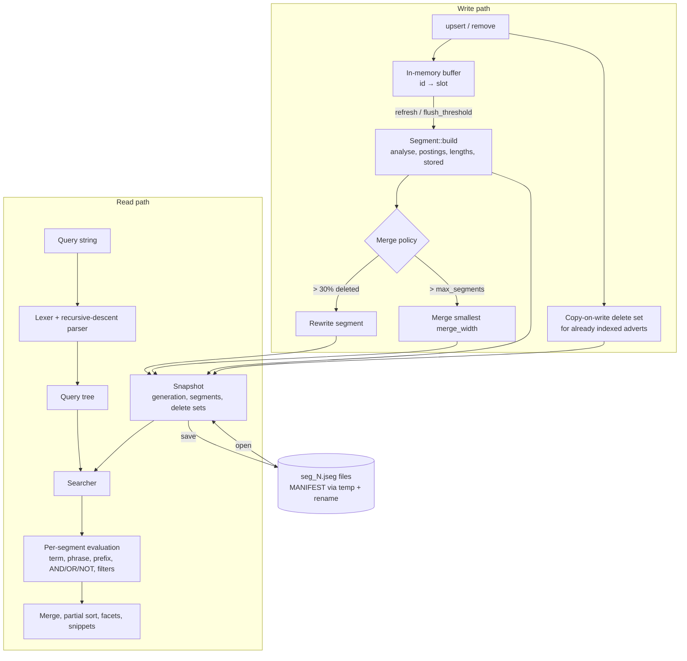

# Architecture

## Overview



### Layers

| Layer | Files | Responsibility |
|---|---|---|
| Analysis | `text.*` | Words, stop words (positions kept), stemming |
| Encoding | `codec.*`, `postings.*` | Varints, CRC-32, block postings with skip entries |
| Storage unit | `segment.*` | Immutable dictionaries, field lengths, stored adverts, binary format |
| Index | `index.*` | Writer, buffer, delete sets, snapshots, merge policy, manifest |
| Query | `query.*` | Lexer, parser, limits, canonical printing |
| Ranking | `searcher.*` | BM25F, boolean algebra, phrase matching, sort, facets, snippets |
| Data | `corpus.*` | Deterministic synthetic UK job adverts |
| Interfaces | `apps/main.cpp`, `bench/bench_main.cpp` | CLI and benchmark |

## Key design decisions

### 1. Immutable segments plus snapshots
**Chosen:** each flush creates an immutable segment. The index state is a `Snapshot` (a vector of segment and delete-set pointers) that is replaced, never changed in place. Readers take one short mutex to copy the `shared_ptr`, then run without locks.
**Rejected:** one mutable index behind a reader-writer lock. Long merges would block every search, and a search could see a half-applied batch.
**Trade-off:** each write publishes a new snapshot vector (O(segments) copy), and old segments stay in memory until the last reader lets go. Both are cheap at this scale, and they are what makes the four-thread speed-up near linear (1,723 → 6,140 queries/s).
**Why a mutex and not `std::atomic<std::shared_ptr>`:** libc++ (Apple clang) does not ship the C++20 atomic shared pointer yet. The lock is held for one pointer copy, so it is not a bottleneck.

### 2. Near-real-time writes
New and replaced adverts become visible on `refresh()` (or when the buffer reaches `flush_threshold`), as in Lucene and Elasticsearch. Deletes of indexed adverts are visible at once: a filled job should vanish straight away, while a new one can wait a moment. The trade-off is a small window where an edited advert is missing (old copy deleted, new copy buffered). The test `UpsertReplacesIndexedAndBufferedVersions` documents this.

### 3. Delete sets instead of rewriting segments
Removing an advert copies that segment's bit vector (copy-on-write) and marks one bit. Rewriting the segment on every delete would cost O(segment size). The cost is wasted space and slightly stale statistics, so a segment that is more than 30% deleted is rewritten on the next refresh.

### 4. Merge by re-analysis
A merge rebuilds a new segment from the live stored adverts instead of merging posting lists directly. This is simpler and obviously correct (one code path builds every segment), but it repeats the text analysis. At about 57k adverts/s that is fine for a job board, where adverts number in the hundreds of thousands. A larger engine would merge postings and remap doc ids.

### 5. BM25F, not BM25 per field
Per-field frequencies are weighted (title 3, body 1), length-normalised with per-field `b`, then summed, and saturated once with `k1`. Scoring each field separately and adding the scores would double-count a word that appears in both title and body and lets long bodies dominate. IDF uses the larger of the two fields' document frequencies, and it is computed over the whole snapshot. A test checks that scores are identical whether the index has 1 segment or 8.
**Known approximation:** document frequencies include deleted adverts until their segment is merged, as in Lucene.

### 6. Term-at-a-time evaluation with sorted match lists
Each query node evaluates to a doc-id-sorted vector of `(doc, score)`. AND, OR and NOT are linear sorted merges, intersected smallest-first. Phrases are the exception: they leapfrog through posting lists with `advance()`, led by the rarest term, so skip tables pay off where intersections are selective. Document-at-a-time with WAND or block-max pruning would be faster for top-k on huge corpora, but facets need every match counted anyway, which removes most of the benefit of pruning here.

### 7. Prefix queries are constant-score
`engin*` expands to up to 128 dictionary terms per segment and gives every match a score of 1. Scoring each expansion with BM25 would let a common expansion swamp the rest of the query. A cap on expansions keeps cost predictable.

### 8. File format and crash safety
Segments are written once and never modified. The manifest lists the live segments and their deleted doc ids, and is written to `MANIFEST.tmp` and then `rename`d over the old file, which is atomic on POSIX. Unreferenced segment files are only removed after the new manifest is in place. Every file ends in a CRC-32, and all decoding goes through a bounds-checked reader, so corrupt or truncated input raises `CorruptIndexError` rather than reading past a buffer (tests flip bytes at six offsets and truncate files).
**Not done:** `fsync` of the file and the directory. A power cut could still lose the latest manifest, though not corrupt the previous one.

### 9. A deterministic random generator
`std::uniform_int_distribution` and friends may give different sequences on libstdc++ and libc++. The corpus uses SplitMix64 with its own range functions, so the test data and the benchmark numbers match on GCC, Clang and Apple clang.

## Query language

```
expr    := or
or      := and ( "OR" and )*
and     := unary ( ["AND"] unary )*
unary   := ("-" | "NOT") unary | primary
primary := "(" expr ")" | phrase | field ":" phrase | word
word    := term | term "*" | field ":" term | filter
filter  := "salary>=" number["k"] | "location:" x | "contract:" x | "remote:" yes|no | "days:" n
```

Filters are non-scoring and apply to stored fields. A query that is only exclusions or filters starts from "all live adverts". Limits: 1,024 bytes, 64 clauses and 16 levels of brackets.

## Testing strategy

- **Unit:** tokeniser, stemmer (parametrised), varints at boundaries, a CRC test vector, postings round trips at block boundaries (1, 127, 128, 129, 256, 1000 docs), skip-table use, and a builder that rejects bad input.
- **Parser:** 20 grammar cases checked against canonical trees, and 11 error cases checked against exact byte positions.
- **Storage:** segment round trip (byte-identical re-encode), corruption at six offsets, truncation, a missing file, manifest corruption, removal of stale files, and reopening then writing without segment id clashes.
- **Index behaviour:** upsert/replace/remove in every state, snapshot isolation, merge bounds, rewriting heavily deleted segments, and force merge.
- **Ranking:** title beats body, phrases versus loose terms, field restriction, prefixes, filters, sort orders, facets over all matches, snippets, paging without overlap, IDF that does not change when the index is split into segments, and a brute-force cross-check against a plain scan.
- **Concurrency:** 4 reader threads checking that match-all equals each snapshot's live count while a writer upserts, deletes, flushes and merges.

All tests run in a Debug build with AddressSanitizer and UndefinedBehaviorSanitizer, on GCC and Clang in CI.

## Known limitations and next steps

- ASCII-only case folding and an English-only stemmer. Next: Unicode normalisation (for example `café`) and a Snowball stemmer.
- No synonyms (`HGV` = `LGV`, `dev` = `developer`). Next: a query-time synonym map.
- Segments are loaded fully into memory. Next: `mmap` with lazily decoded dictionaries for corpora larger than RAM.
- Top-k gathers every match before sorting. Next: block-max WAND when facets are not requested.
- No `fsync`. Next: fsync the segment, the manifest and the directory before acknowledging `save()`.
- No spelling correction or "did you mean". Next: a Levenshtein automaton over the term dictionary.
- Re-posted adverts are indexed as separate documents. Next: near-duplicate collapsing with SimHash on the body.
