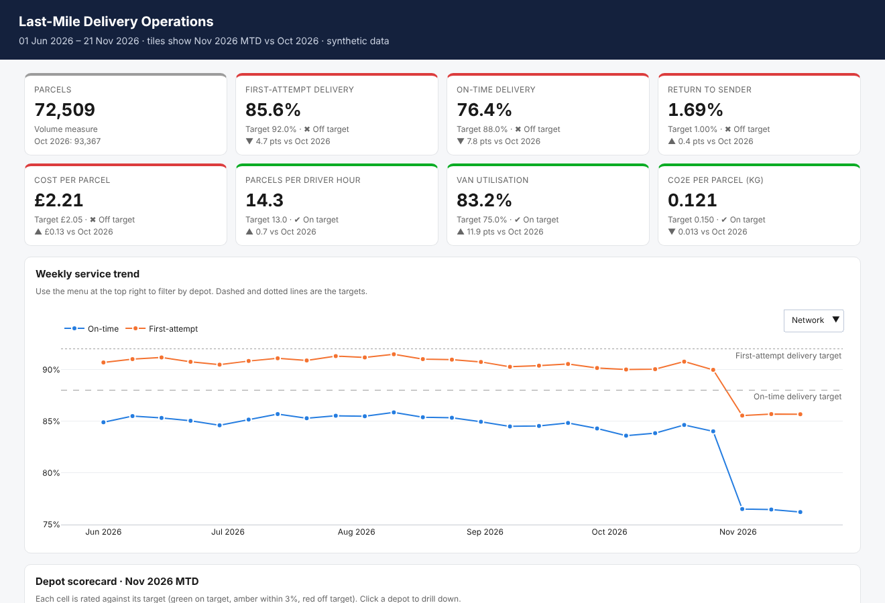
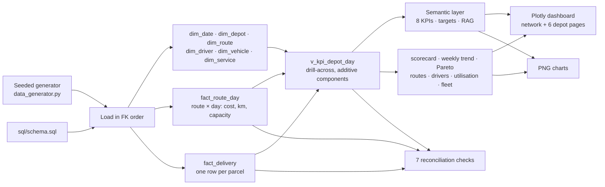
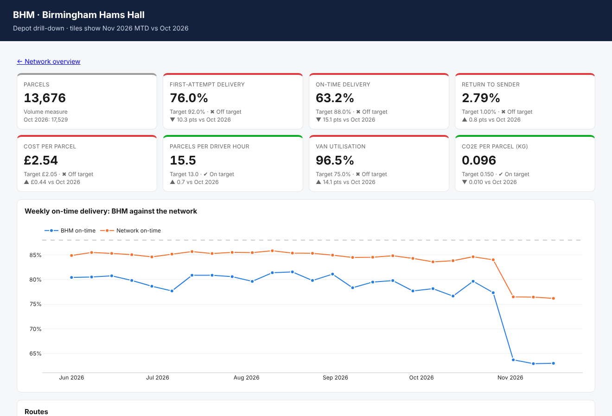
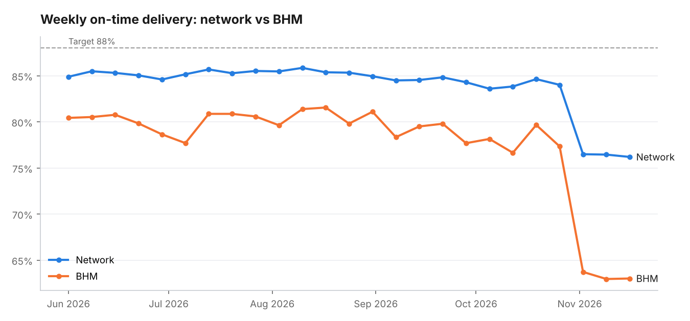
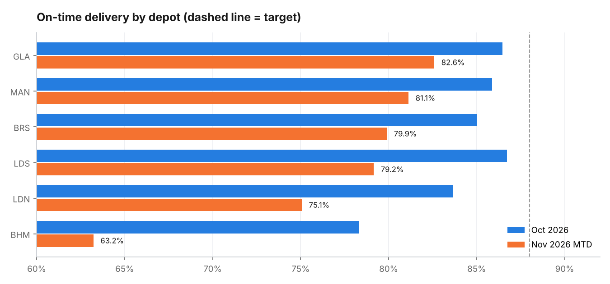
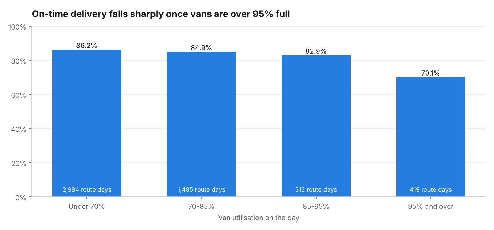
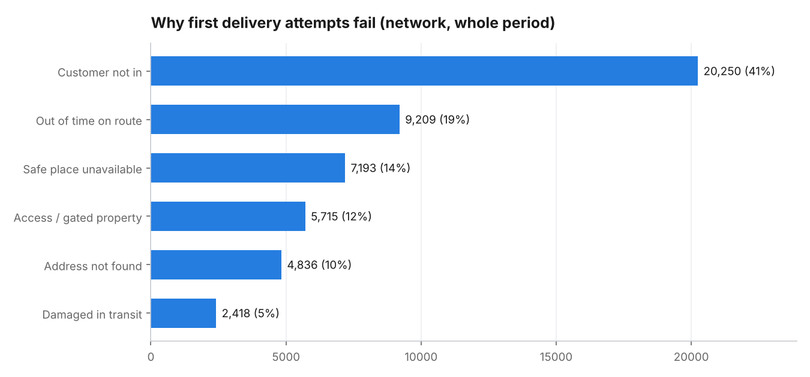

# 🚚 Last-Mile Delivery BI

[](https://github.com/Atharv1414/daily-projects/actions/workflows/tests.yml)


An operations BI solution for **Kestrel Parcels**, a fictional UK last-mile carrier with six
depots, 36 routes, 72 drivers and 48 vans. Half a million synthetic parcel deliveries and 5,400
route days are modelled as a DuckDB star schema with two fact tables at different grains.
Eight governed KPIs, each with a target and RAG rating, sit on top. They feed an offline
interactive Plotly dashboard with a depot filter and drill-down pages for each depot.

## 🧩 Business problem

The November peak is here and the operations director is getting complaints, but each depot
reports its own spreadsheet with its own definition of "on time". Finance can't say what a
failed delivery costs, and the fleet team wants to know whether the new electric vans pay off.
The business needs **one trusted set of KPI definitions**, a weekly view of service against
target, and enough drill-down to find *why* a depot is failing. That means routes, drivers and
failure reasons, not only *that* it is failing.



## 🎯 Skills demonstrated

- **Dimensional modelling.** A star schema with conformed dimensions and two fact grains
  (parcel and route-day), plus a drill-across view that avoids the fan-out trap.
- **Advanced SQL.** CTEs, `LAG` for month-on-month change, `RANK` and `NTILE` league tables,
  running-total Pareto windows, `GROUPING SETS` for network rows, and `FILTER` aggregates.
- **KPI definition and a semantic layer.** Each KPI is governed as `SUM(numerator) / SUM(denominator)`,
  so it rolls up correctly at any level. Targets drive RAG ratings, and a ceiling rule flags
  overloaded vans.
- **Dashboard design.** KPI tiles with target and change since last month, a depot filter, a
  linked depot drill-down, root-cause charts and a colour-blind-safe palette.
- **Data quality and reconciliation.** Seven automated checks tie the dashboard back to the
  facts, and tests prove the checks catch broken rows.
- **Turning data into recommendations.** Findings come with numbers and an action for operations.

## ✨ Features

| Area | What it does |
|---|---|
| Data generation | Seeded, reproducible generator (`data_generator.py`) with built-in business effects: a weaker depot, agency and rural penalties, a November peak and van overloading |
| Warehouse | `sql/schema.sql` builds 6 dimensions and 2 facts with primary keys, foreign keys and CHECK constraints, loaded in dependency order |
| Reporting views | 8 documented SQL views in `sql/views/`: drill-across KPIs, depot scorecard, weekly trend, failure Pareto, route performance, driver league, utilisation bands, fleet mix |
| Semantic layer | `metrics.py` defines 8 KPIs with targets, RAG rules (amber within 3%) and filters by depot and date |
| Dashboard | Static offline site: network page (tiles, filtered trend, scorecard, Pareto, utilisation and fleet charts) plus one drill-down page per depot (routes, driver quartiles, failure reasons) |
| Charts | 4 PNG charts for reports, rendered headless with matplotlib |
| Quality | 7 reconciliation checks run after every build (`delivery-bi check`) |
| Docs | KPI catalogue generated from code ([docs/KPI_DEFINITIONS.md](docs/KPI_DEFINITIONS.md)) and [docs/ARCHITECTURE.md](docs/ARCHITECTURE.md) |

## 🏛 Architecture



## 🚀 Quick start

```bash
git clone https://github.com/Atharv1414/daily-projects.git && cd daily-projects/last-mile-delivery-bi && pip install -e .
delivery-bi build        # generate data, build warehouse/delivery.duckdb, run quality checks
delivery-bi dashboard    # write dashboard/index.html and one page per depot
open dashboard/index.html   # or double-click it; it works offline
```

## 🖥 Example output

These are real outputs from `delivery-bi build`, `delivery-bi kpis --depot BHM --latest` and
`delivery-bi scorecard` (seed 42, 1 June to 21 November 2026):

```text
fact_delivery      493,620 rows
fact_route_day       5,400 rows
dim_route               36 rows
dim_driver              72 rows
dim_vehicle             48 rows
Warehouse written to warehouse/delivery.duckdb
[PASS] Parcel count reconciles to route plans: ok
[PASS] Every parcel matches its route day's depot, route, driver and van: ok
[PASS] Failure reason present exactly when the first attempt failed: ok
[PASS] On-time parcels are a subset of first-attempt deliveries: ok
[PASS] Drivers and vans only work routes in their own depot: ok
[PASS] Route cost equals labour plus vehicle cost: ok
[PASS] Drill-across view totals match the fact tables: ok

KPIs for BHM · Nov 2026 MTD
  Parcels                        13,676   target            none
  First-attempt delivery          76.0%   target    92.0%   red
  On-time delivery                63.2%   target    88.0%   red
  Return to sender                2.79%   target    1.00%   red
  Cost per parcel                 £2.54   target    £2.05   red
  Parcels per driver hour          15.5   target     13.0   green
  Van utilisation                 96.5%   target    75.0%   red
  CO2e per parcel (kg)            0.096   target    0.150   green

depot_code  parcels  first_attempt_rate  on_time_rate  on_time_rate_mom  on_time_rank  cost_per_parcel  vehicle_utilisation
       GLA    10359               0.898         0.826            -0.039             1            2.136                0.680
       MAN    12703               0.897         0.811            -0.047             2            1.960                0.842
       BRS    11070               0.875         0.799            -0.051             3            2.319                0.749
       LDS    11806               0.878         0.792            -0.076             4            2.098                0.868
       LDN    12895               0.850         0.751            -0.086             5            2.179                0.903
       BHM    13676               0.760         0.632            -0.151             6            2.541                0.965
```

Each depot drill-down page shows routes, driver quartiles and failure reasons:



| | |
|---|---|
|  |  |
|  |  |

## 📊 Key insights

All figures come from the seeded run above.

1. **The peak broke service levels.** Daily volume in November is 16% above October (4,028
   against 3,458 parcels a day). Network on-time delivery fell 7.8 points to **76.4%** (target
   88%), and first-attempt delivery fell from 90.3% to 85.6%.
2. **Overloaded vans, not the fleet size, are the problem.** On route days with a van at
   least 95% full, on-time delivery is **70.1%**, against 86.2% when the van is under 70% full.
   On those days, 13.9% of parcels fail because the driver runs out of time, against 0.3%
   otherwise. Yet average van utilisation across the network is only 68%, so capacity exists.
   It is in the wrong place.
3. **Birmingham (BHM) is the outlier.** 61% of its November route days ran vans at least 95%
   full, against 2% in Glasgow. Its on-time rate dropped 15.1 points to **63.2%**, and "out of
   time on route" accounts for 29% of its failed first attempts (19% across the network).
4. **Failed deliveries are expensive.** Redeliveries and returns cost **£251k**, 24% of the
   £1.03m total delivery cost. Agency drivers achieve 87.4% first-attempt delivery against
   91.2% for employed drivers, and they handle a third of all parcels.
5. **Electric vans cut emissions by three-quarters.** eVans emit 0.042 kg CO2e per parcel
   against 0.166 kg for diesel, and van running cost per parcel is 11% lower (£0.34 against £0.38).

**Recommendations:**
- Rebalance BHM loads across routes, or add a peak shuttle van, using a 92% loading ceiling.
- Make first-time-right coaching part of agency driver onboarding, starting with the Q4
  drivers on each depot page.
- Prioritise eVans for Glasgow (0.223 kg CO2e per diesel parcel, 15% of its fleet electric) and
  London East (0.192 kg), where diesel emissions per parcel are highest.

## 🛠 Usage

| Command | What it does |
|---|---|
| `delivery-bi build [--seed N]` | Generate data, rebuild the DuckDB warehouse, run the quality checks |
| `delivery-bi check` | Run the 7 reconciliation checks (exit code 1 on any failure) |
| `delivery-bi kpis [--depot BHM] [--latest]` | Print KPIs with targets and RAG status |
| `delivery-bi scorecard` | Latest monthly depot scorecard with change since last month and rank |
| `delivery-bi dashboard [--out dashboard]` | Write the interactive HTML dashboard |
| `delivery-bi charts [--out docs/images]` | Write PNG charts |
| `delivery-bi docs` | Regenerate `docs/KPI_DEFINITIONS.md` from the semantic layer |
| `--db PATH` | Use a different warehouse file (default `warehouse/delivery.duckdb`) |

`python -m last_mile_delivery_bi <command>` works too.

## 🗂 Project structure

```text
last-mile-delivery-bi/
├── src/last_mile_delivery_bi/
│   ├── __init__.py          # package version
│   ├── __main__.py          # python -m entry point
│   ├── cli.py               # delivery-bi command
│   ├── data_generator.py    # seeded synthetic star-schema data
│   ├── warehouse.py         # DuckDB build: schema, FK-ordered load, views
│   ├── metrics.py           # semantic layer: KPI registry, targets, RAG
│   ├── quality.py           # reconciliation checks
│   ├── dashboard.py         # Plotly static site with filter and drill-down
│   └── charts.py            # matplotlib PNG charts
├── sql/
│   ├── schema.sql           # 6 dimensions + 2 facts with PK/FK/CHECK constraints
│   └── views/               # 8 reporting views, created in file order
├── tests/                   # 44 pytest tests, 99% coverage
├── docs/
│   ├── ARCHITECTURE.md      # model, grain decisions, trade-offs
│   ├── KPI_DEFINITIONS.md   # generated KPI catalogue
│   └── images/              # dashboard screenshots and charts
├── pyproject.toml
├── LICENSE
└── README.md
```

## 🧪 Development

```bash
pip install -e ".[dev]"
ruff check . && ruff format --check .
pytest            # 44 tests with coverage
```

The tests build a smaller seeded warehouse once per session. They cover generator
determinism, constraints, every view against a recalculation from the facts, volume-weighted
roll-ups, RAG rules, the checks catching deliberately broken rows, dashboard structure and the CLI.

## 📄 License

MIT. See [LICENSE](LICENSE). All data is synthetic.
