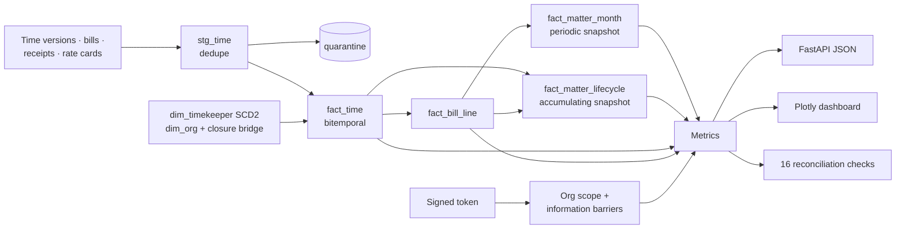
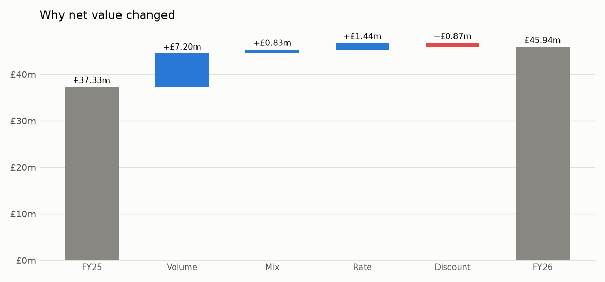
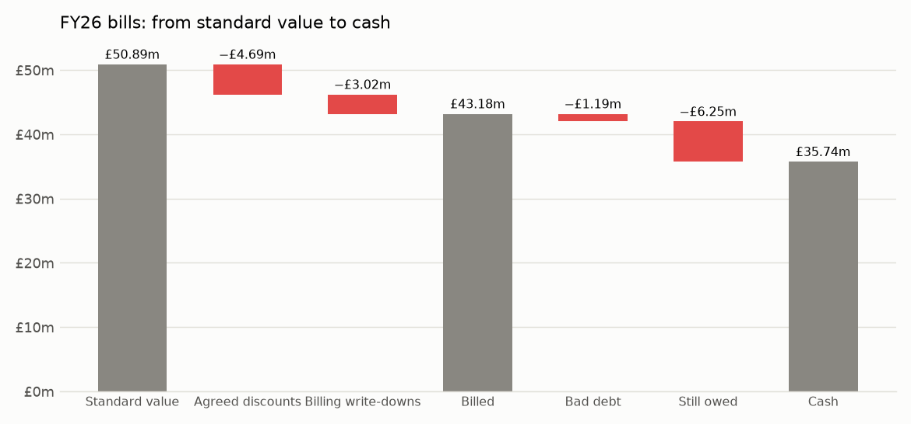
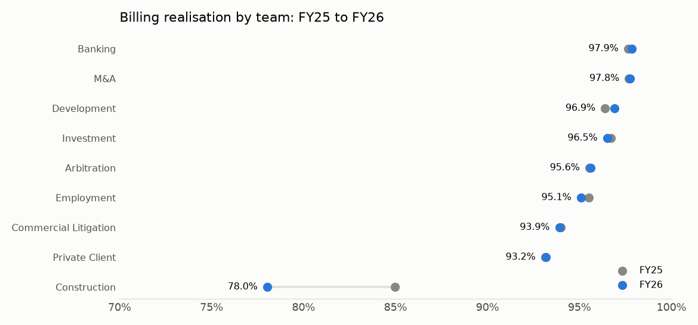
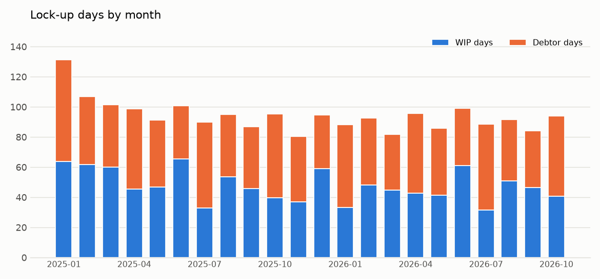

# ⚖️ Law Firm Profitability BI

A BI mart and secured dashboard for **Hartwell Pryce LLP**, a fictional UK law firm with 150 fee
earners. It turns 230,651 messy time-recording rows into a **bitemporal** DuckDB model that can
reproduce any past management report exactly, explain why the number has changed since, follow
every bill from standard value to cash, and split year-on-year growth into volume, grade mix,
rate and discount. Each user sees only their part of a ragged organisation tree, with
information barriers on confidential matters.

## 🏛 Architecture



The model, trade-offs and limitations are in [docs/ARCHITECTURE.md](docs/ARCHITECTURE.md).

**Role focus:** BI Developer · **Stack:** Python 3.11+, DuckDB SQL (bitemporal facts, recursive
CTEs, window functions), FastAPI, Plotly, matplotlib, pytest + Hypothesis, Docker

## 🧩 The problem

Partners receive a monthly profitability pack and distrust it. April looked weak at month end and
fine in June, and nobody could say why. Fees grew but margin slipped. Cash arrives three months
after the work. The firm needs numbers it can *reproduce as first reported*, *explain when they
move*, and *trace to cash*, without showing a team lead another team's matters.

## ✨ Features

- **Bitemporal time fact:** when work happened, and when the firm believed it. Corrections are new
  versions, so any past report can be rebuilt to the penny.
- **Restatement bridge:** late posting, corrected hours, matter transfers and voids, at any level.
- **Realisation waterfall:** standard value → discounts → write-downs → billed → bad debt → cash,
  following the *same* bills throughout.
- **Exact variance decomposition:** volume, mix, rate and discount always sum to the change
  (property-tested).
- **Three fact types:** transaction, periodic snapshot (WIP and debt roll-forward) and
  accumulating snapshot (matter milestones).
- **Ragged hierarchy** through a recursive closure table; one join filters any level.
- **Security:** HMAC-signed expiring tokens, unit scope applied inside every metric, identical
  errors for unknown and forbidden units, barred matters collapsed into one line and withheld
  below three.
- **Delivery:** JSON API with OpenAPI docs, drill-down dashboard, static export.

## 🚀 Quick start

```bash
pip install -e ".[dev]"
law-bi build            # seeded sources -> DuckDB mart
law-bi validate         # 16 reconciliation checks
law-bi kpis --user mp   # KPIs and variance
law-bi restate --unit EMP
law-bi serve --demo     # dashboard; prints a login link per user, API docs at /docs
law-bi export           # dashboard/*.html, docs/charts, docs/VALIDATION.md
```

Pre-rendered pages are in [dashboard/](dashboard/) (download and open; Plotly loads from its CDN).

## 📊 Key insights

Real output from the seeded data (financial years run November to October).

```text
raw 230651, duplicates 1903, quarantined 285
models built in 0.20s

metric                                FY25            FY26
net_value                     37,328,190.2    45,936,594.8
billed                        30,677,997.1    43,181,215.6
gross_margin_pct                      53.7            52.7
billing_realisation_pct               95.0            93.5
lockup_days                           95.4            93.9
```



1. **Growth is mostly volume.** Of the £8.61m rise, £7.20m is extra hours and £0.83m a richer grade
   mix. Rate rises added £1.44m, but deeper agreed discounts gave back £0.87m, or **60% of it**.
2. **Construction is the realisation problem.** It billed 85.0% of the work it cleared in FY25 and
   78.0% in FY26, while every other team stayed within about half a point. The fall is worth
   roughly £0.46m of fees.
3. **For each £1 of standard value billed in FY26, 85p reached an invoice.** 9.2% went on discounts
   and 5.9% on write-downs. 70p has been collected; 12.3% is still owed and 2.3% is bad debt.
4. **April 2026 was under-reported by 9.5%.** £3.45m at month end is £3.78m today, almost entirely
   late-posted time (£348,521). Employment's April moved by **20%**. Transfers net to only £1,250
   for the firm, and not to zero, since matters carry different discounts.





Caveat: the ledger starts in November 2024 with no opening WIP or debt, so FY25 billing and cash
are understated and should not be compared directly with FY26. Net value and realisation are.

## 🏗 Project structure

```text
src/law_firm_profitability_bi/
  datagen.py      seeded sources with realistic faults
  sql/            01 staging · 02 dimensions · 03 facts · 04 snapshots
  warehouse.py    transactional build
  security.py     users, signed tokens, unit scope
  metrics.py      metric catalogue and every query
  validation.py   16 reconciliation checks
  charts.py  dashboard.py  export.py   presentation
  api.py  cli.py  config.py            interfaces
tests/            83 tests
```

## 🎯 Skills demonstrated

- **Dimensional modelling:** three fact types, SCD2, bridge tables, ragged hierarchies
- **Temporal data:** reproducible as-reported numbers and explained restatements
- **Finance BI:** lock-up, realisation, price-volume-mix, WIP and debt roll-forwards
- **Governance:** metric catalogue, row-level scope, information barriers, reconciliation
- **Engineering:** API, tests, transactional builds, Docker

## 🧪 Running tests

```bash
pytest -q
ruff check . && ruff format --check .
```

83 tests cover model rules, property-based variance maths, six deliberate corruptions that the
checks must catch, access control over HTTP, and the CLI end to end.

## 📄 License

MIT
