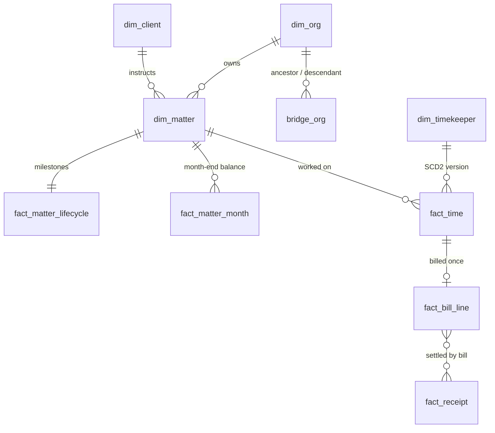

# Architecture

| Table | Type | Grain |
|---|---|---|
| `fact_time` | transaction, bitemporal | one version of one time entry |
| `fact_bill_line`, `fact_receipt` | transaction | entry on a bill; payment or write-off |
| `fact_matter_month` | periodic snapshot | matter × month |
| `fact_matter_lifecycle` | accumulating snapshot | matter |
| `dim_timekeeper` | SCD Type 2 | person × rate-card period |

## Key decisions

**Bitemporal rows instead of monthly copies.** `work_date` is business time; `[known_from,
known_to)` is knowledge time. "As reported on D" is a filter. Keeping a copy of each month-end pack
would also reproduce it, but could not explain the change entry by entry, and would freeze only the
dates someone remembered to save. Cost: every query on current data needs `v_time_current`.

**Restatements come from a full join of two knowledge dates.** Each entry falls into exactly one
reason, and value is scoped separately before and after. A transfer therefore leaves one unit and
enters another, and unit bridges add up to the firm's.

**Variance effects are exact by construction.** The order (quantity at base price, then rate at
base discount, then discount at new rate) leaves no unexplained residual. The order is a
convention: putting discount before rate would move the cross term. New grades have no base price,
so their value is volume and mix.

**The waterfall is a cohort.** It follows bills issued in the period to their own receipts. Dividing
cash received by fees billed in the same month mixes different work and can exceed 100%.

**Closure table for the hierarchy.** Private Client has no teams and Arbitration hangs off its
division, so fixed `level_1..n` columns would need padding. The bridge costs a few dozen rows.

**Scope lives in `Metrics`.** Each method resolves the unit against the user before querying, and
there is no unscoped entry point, so a new endpoint cannot forget it. Rejected: database-level
row policies, which DuckDB does not offer.

**Tokens are HMAC-signed and stateless.** Suitable for a demo behind SSO; they cannot be revoked
before expiry. Login links put the token in a URL once, so the server swaps it for an HttpOnly
cookie and logs paths without query strings.

## Validation

The 16 checks tie each layer to the one before: rows loaded + duplicates + quarantined = raw,
ledger balances, billed and cash totals to source, no double billing, hierarchy completeness, and
metric-level additivity. Tests damage the mart in six ways and assert the right check fails.

## Limitations and next steps

- Barred matters count towards unit KPIs. A user could estimate one by subtracting the listed
  matters from the total, so a stricter deployment would exclude or perturb them.
- Matter ownership is current, not historical: if a matter changes team its past moves with it.
- A full rebuild takes under a second here. Millions of entries would need incremental models
  keyed on `known_from`.
- Cost is a rate per hour; overheads and partner profit shares are not allocated.
- VAT, disbursements and client money are out of scope.
- A build is transactional, but the API process must be restarted to pick up a new file.
