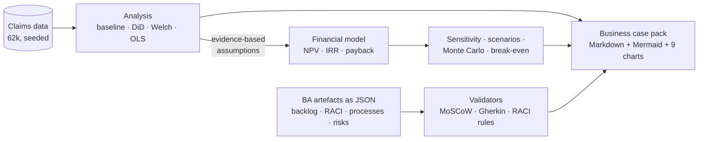
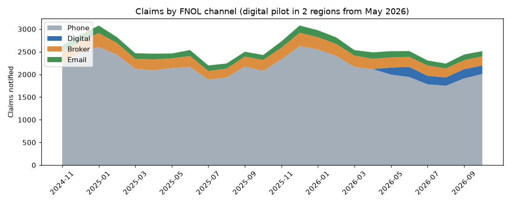
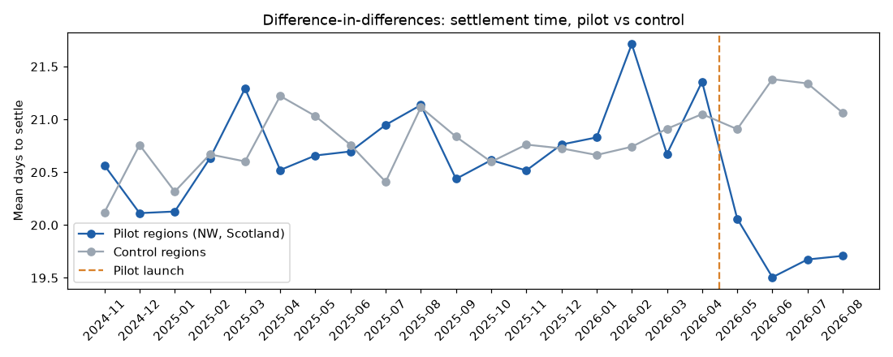
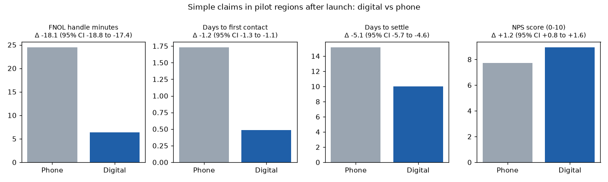
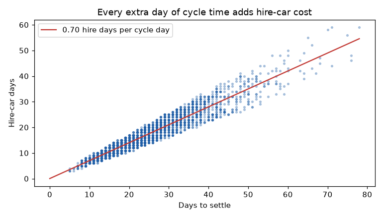
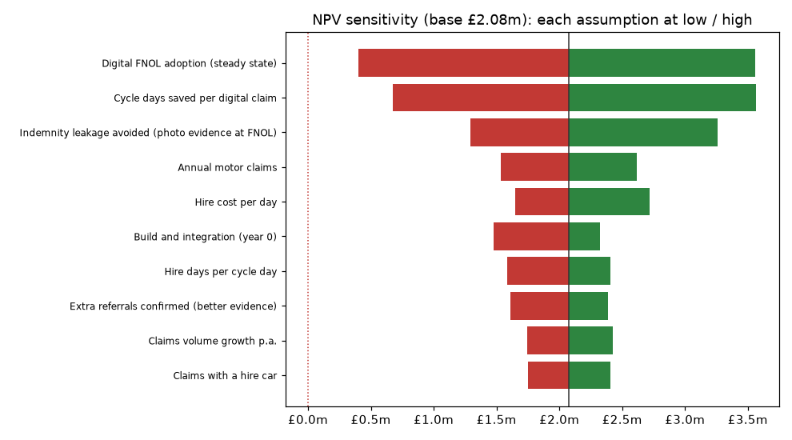
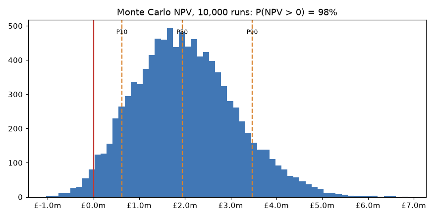
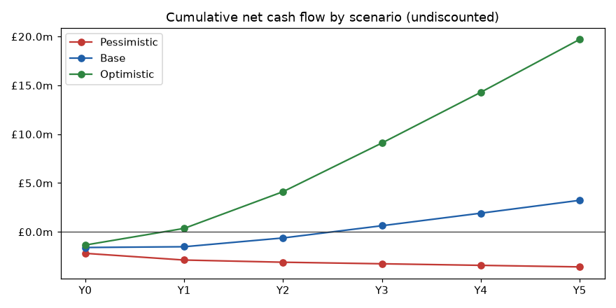
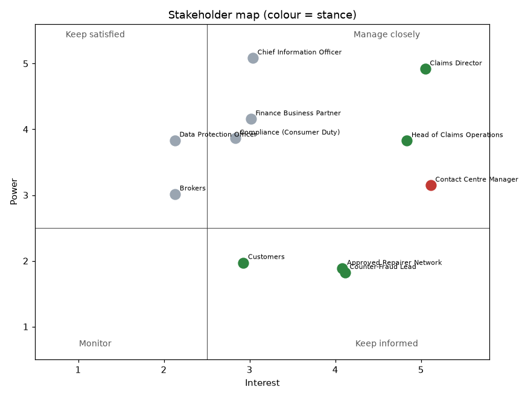
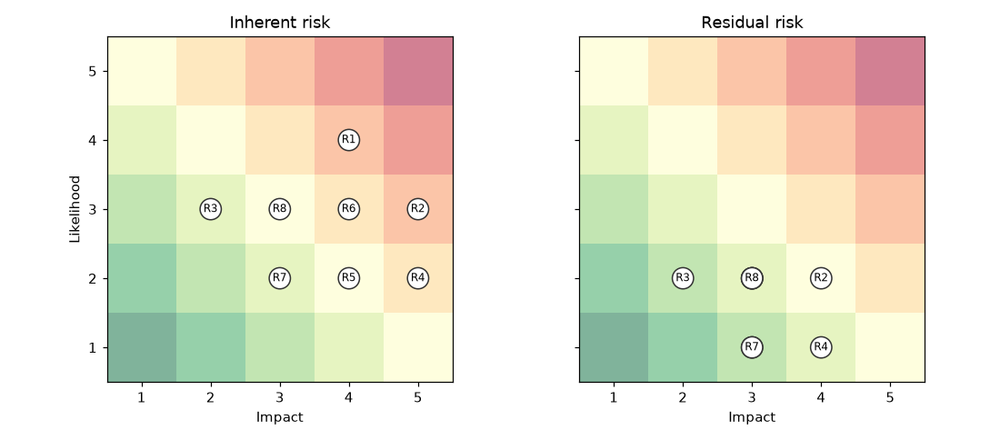

# 🚗 Motor Claims Digital FNOL Business Case

A complete, code-generated business case for **Albion Mutual**, a fictional UK motor insurer,
deciding whether to roll out digital first notification of loss (FNOL) nationally. It covers
current-state analysis of 62k claims, a causal evaluation of a two-region pilot
(difference-in-differences), current vs future process maps, stakeholder analysis and RACI, a
MoSCoW backlog with Gherkin acceptance criteria, a 5-year NPV/IRR model with tornado, scenario
and Monte Carlo analysis, a risk register, and an executive summary with a gated
recommendation. All of it regenerates from one command.

📄 **Read the output:** [docs/BUSINESS_CASE.md](docs/BUSINESS_CASE.md) ·
[docs/BACKLOG.md](docs/BACKLOG.md) · [docs/features/](docs/features/)

## 🏛 Architecture



Design decisions and limitations are in [docs/ARCHITECTURE.md](docs/ARCHITECTURE.md).

**Role focus:** Business Analyst · **Stack:** Python 3.11+, pandas, NumPy, SciPy (Welch t-tests,
OLS, bootstrap), Pydantic, matplotlib, Mermaid, Gherkin, pytest + Hypothesis

## 🧩 The problem

86% of Albion Mutual's ~31,000 annual motor claims are reported by phone, in a 24-minute call.
Claims take about 21 days to settle, and because 39% of claimants have a hire car for most of
that time, slow claims cost **£9.4m a year in hire charges alone**. A digital FNOL pilot ran in
the North West and Scotland from May 2026. The Claims Investment Committee wants to know: **did
it work, is a national rollout worth £1.6m, and what could go wrong?**

## ✨ Features

- **Current-state analysis:** a cleaning log (mis-keyed handle times, open claims, missing
  NPS), baseline KPIs, and the hire-days vs cycle-days relationship (OLS).
- **Pilot evaluation:** a difference-in-differences estimate with a bootstrap CI, a
  parallel-trends test, and a take-up-adjusted (Wald) effect per digital claim, plus Welch
  t-tests with CIs and Cohen's d for digital vs phone.
- **Financial model:** 21 assumptions, each with low/base/high, unit, source and direction.
  5-year cash flows with an adoption ramp; NPV, IRR (bisection), simple and discounted payback,
  ROI; a tornado; pessimistic/base/optimistic scenarios; 10,000-draw Monte Carlo;
  break-even solving; and a `what-if` CLI.
- **Process maps:** current and future state as data, rendered to Mermaid swimlanes, with lead
  time, touch time, process cycle efficiency and handoffs (probability-weighted over branches).
- **Stakeholders:** power/interest grid, register, and a RACI with automated gap analysis.
- **Requirements:** 12 user stories with MoSCoW, Fibonacci points, WSJF ordering,
  dependency-aware sequencing, DSDM effort rule, and Gherkin scenarios exported as `.feature`
  files.
- **Risk register:** likelihood × impact, RAG, owners, mitigations, residual risk, heatmaps.
- **Business case document** with an executive summary, recommendation, stage-gates and
  caveats, all filled in from computed values.

## 🚀 Quick start

```bash
pip install -e ".[dev]"
fnol-case report        # runs everything, writes docs/ (business case, backlog, features, charts)
fnol-case summary       # key numbers only
fnol-case what-if target_adoption=0.38 cycle_days_saved=2.66
```

## 📊 Key insights

Real output of `fnol-case report`:

```text
Baseline (12 months pre-pilot)
  claims 30,990 · phone share 85.8% · mean days to settle 20.8 · hire cost £9.37m · NPS -12
Pilot evaluation
  DiD days to settle -1.63 (95% CI -2.37 to -0.93) · take-up 37.2% · per digital claim -4.39 days · pre-trend slope +0.023 (p=0.34)
  FNOL handle minutes      digital   6.32 vs phone  24.45 (Δ -18.14, 95% CI -18.84 to -17.43, d=-2.75)
  Days to first contact    digital   0.49 vs phone   1.73 (Δ -1.24, 95% CI -1.35 to -1.14, d=-1.32)
  Days to settle           digital  10.01 vs phone  15.15 (Δ -5.14, 95% CI -5.68 to -4.60, d=-1.00)
  NPS score (0-10)         digital   8.94 vs phone   7.73 (Δ +1.20, 95% CI +0.79 to +1.62, d=+0.74)
  hire days per extra cycle day: 0.70 (R²=0.92)
Financial case (5 years, 8% discount rate)
  NPV £2.08m · IRR 38.6% · payback 2.5 yrs (discounted 2.8) · ROI 86%
  Monte Carlo (10,000 runs): P(NPV>0) 98.0% · P10 £623,136 · P50 £1.94m · P90 £3.47m
  break-even adoption 33.9% · break-even days saved 1.61
  top sensitivities: Digital FNOL adoption (steady state) (£399,821 to £3.56m); Cycle days saved per digital claim (£671,923 to £3.57m); Indemnity leakage avoided (photo evidence at FNOL) (£1.29m to £3.26m)
Process: lead time 88h -> 10h · PCE 0.9% -> 2.1% · handoffs 5 -> 2.4
Backlog: 12 stories, 1 validation notes · RACI: 6 gaps · Risks: 8
Wrote 22 files to docs/ in 1.4s
```

The downside case, where adoption and time savings both land at the bottom of their evidence
ranges (`fnol-case what-if target_adoption=0.38 cycle_days_saved=2.66`):

```text
NPV £2.08m -> -£492,408 · IRR 38.6% -> -1.2% · payback 2.5 yrs -> never
```

**What this means for the decision**

1. **The pilot worked, causally.** Settlement time fell **1.63 days per claim** in pilot regions
   relative to control (95% CI 0.93–2.37), with flat pre-launch trends. That is about **4.4 days
   per digital claim** at 37% take-up.
2. **Hire cars are the prize.** Each cycle day adds 0.70 hire days, so faster FNOL is mainly a
   hire-cost story (~60% of benefits). Handler-time savings are real (18 min per claim) but
   small in cash terms.
3. **The case is strong but adoption-dependent.** NPV is £2.08m, IRR 38.6% and payback 2.5
   years, and NPV is positive in 98% of simulations. But NPV turns negative if adoption stalls
   below **34%**, or if adoption and savings both disappoint (above). **Recommendation: approve,
   with a month-6 stage-gate on adoption and measured days saved.**
4. **Governance gaps to close first:** three activities have no Responsible owner, and three
   high-power stakeholders are missing from the go-live RACI. Musts are 65% of effort, above the
   60% DSDM guideline, so scope contingency is thin.











## 🏗 Project structure

```text
motor-claims-fnol-business-case/
├── src/fnol_business_case/
│   ├── datagen.py       # seeded claims with a built-in pilot effect and realistic mess
│   ├── analysis.py      # cleaning, baseline, Welch tests, DiD + bootstrap, OLS
│   ├── finance.py       # assumptions, vectorised cash flows, NPV/IRR/payback, MC, tornado
│   ├── requirements.py  # Pydantic user stories, MoSCoW/WSJF, dependency rules, Gherkin
│   ├── stakeholders.py  # power/interest, RACI validation and gap analysis
│   ├── process.py       # process metrics (lead time, PCE, handoffs), Mermaid swimlanes
│   ├── risks.py         # risk scoring, RAG, residual
│   ├── charts.py        # 9 matplotlib charts
│   ├── report.py        # assembles BUSINESS_CASE.md, BACKLOG.md, .feature files
│   └── cli.py           # fnol-case
├── data/                # backlog, stakeholders/RACI, processes, risks (JSON)
├── docs/                # generated business case pack + ARCHITECTURE.md
└── tests/               # 48 tests incl. Hypothesis properties
```

## 🎯 Skills demonstrated

- **Business case development:** a problem statement, options framed as a gated decision, an
  executive summary and recommendation for an investment committee.
- **Financial modelling:** NPV, IRR, payback, ROI, sensitivity (tornado), scenarios, Monte Carlo
  and break-even, with every assumption sourced.
- **Evidence-based analysis:** a causal pilot evaluation (difference-in-differences,
  parallel-trends check, bootstrap CIs), hypothesis tests with effect sizes, and a clear
  statement of selection bias.
- **Process improvement:** current vs future process mapping, lean metrics (process cycle
  efficiency, handoffs, waiting time) and swimlane diagrams.
- **Stakeholder management:** power/interest analysis, a RACI matrix with gap analysis.
- **Requirements engineering:** user stories, MoSCoW, WSJF, dependency management and testable
  Gherkin acceptance criteria.
- **Risk management:** a risk register with inherent and residual scoring, owners and
  mitigations.
- **UK insurance context:** FNOL, credit hire, claims leakage, counter-fraud, Consumer Duty,
  UK GDPR.

## 🧪 Running tests

```bash
pytest -q          # 48 passed
ruff check . && ruff format --check .
```

## 📄 License

MIT. See [LICENSE](LICENSE).
