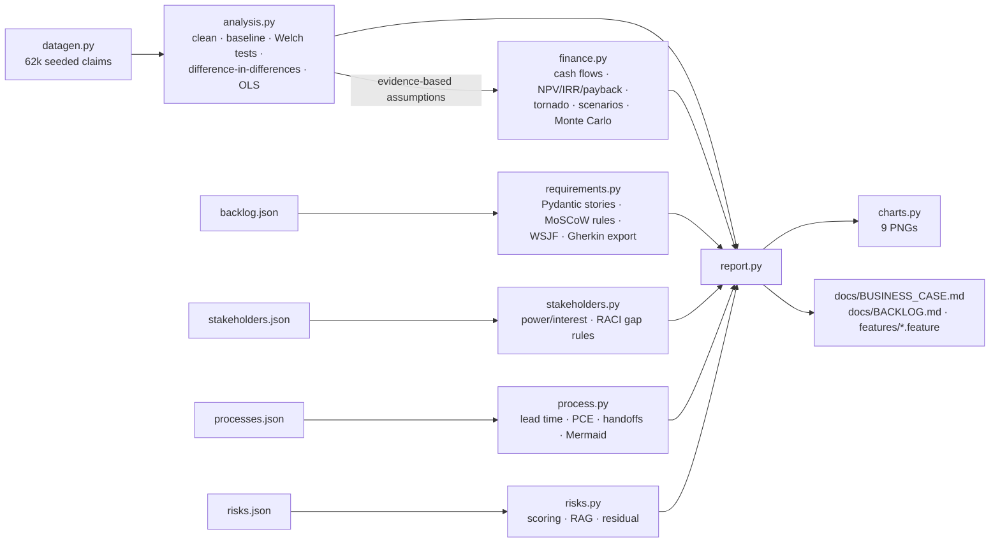

# Architecture

The business case is **generated by code**, so every number in it can be traced to data or to
a stated assumption, and the whole pack regenerates in about 1.5 seconds when an input changes.

## Key design decisions

**Assumptions are derived from evidence, with ranges.** `finance.from_evidence()` takes the
cycle-time saving from the pilot's difference-in-differences estimate, scaled by take-up. Its
low/high range is the bootstrap 95% CI. Handle-time savings come from the Welch CI, and hire
days per cycle day from an OLS slope. Judgement-based inputs (leakage, fraud uplift) say so in
their `source` field and get wide ranges. *Rejected:* single-point vendor benchmarks, which
can't support sensitivity analysis or an audit trail.

**DiD rather than a channel comparison for the causal claim.** Digital claims settle 5.1 days
faster than phone claims, but customers choose their channel (selection bias). The causal
estimate compares pilot and control regions before and after launch (1.63 days per claim, ITT)
and divides by take-up (37%) to get ≈4.4 days per digital claim (a Wald-style estimator). The
pre-period gap trend is tested for parallel trends. Post-launch claims are cut off at
22 Aug 2026 to limit right-censoring of open claims.

**One vectorised cash-flow function.** `cash_flows()` broadcasts over numpy arrays, so the
deterministic model, the tornado, the scenarios, break-even search and 10,000 Monte Carlo draws
all run the same code. A test checks that the vectorised and scalar results are identical.

**IRR and payback implemented, not imported.** Bisection IRR returns `nan` when there is no
sign change instead of a misleading number. Payback interpolates within the year and returns
"never" when cumulative cash stays negative.

**BA artefacts as validated data.** Stories are Pydantic models: Fibonacci points, at least one
Gherkin scenario, and a dependency rule (a Must cannot depend on a Should, and there must be no
cycles). Musts must be at most 60% of effort, following DSDM. The RACI is checked for exactly one
Accountable and at least one Responsible per activity, and for high-power stakeholders missing
from go-live. These checks found real problems while the pack was being written: a Must
depending on a Should, Musts without unhappy paths, and three activities with no Responsible.
The first two were fixed. The RACI gaps are reported as actions, because naming owners is a
decision for the sponsor.

**Expected-value process metrics.** The future-state map branches (60% straight-through, 40%
handler review). Lead time, touch time, process cycle efficiency and handoffs are computed per
path and weighted by branch probability.

## Limitations

- Synthetic data. The pilot effect is built into the generator, so the analysis demonstrates
  method rather than discovering facts.
- Monte Carlo draws are independent. In reality adoption and cycle-time saving are likely
  correlated (simple claims adopt digital first), which widens the distribution.
- Benefits ignore second-order effects (retention, reinsurance, claims inflation on hire rates)
  and tax. Costs exclude decommissioning.
- Calendar months are used for the pilot windows. Seasonality is handled by the control group,
  not modelled explicitly.

## Next steps

Correlated Monte Carlo (Gaussian copula); a synthetic-control check alongside DiD; a benefits
tracker reading live MI against the stage-gate thresholds; an export of the backlog to Jira CSV.
