# Business case: Digital FNOL for motor claims

*Albion Mutual (fictional UK motor insurer) · prepared for the Claims Investment Committee ·
all figures generated by `fnol-case report` from seeded data.*

## 1. Executive summary

**Recommendation: approve a phased national rollout of digital first notification of loss
(FNOL), with a stage-gate at month 6 on digital adoption (break-even 33.9%).**

- **Problem.** 85.8% of 30,990 annual claims are reported
  by phone (24.4 min per call). Claims take
  20.8 days on average to settle, and hire cars run for the whole
  cycle: 38.6% of claims have one, costing £9.37m a year.
  Claimant NPS is -12.
- **Evidence.** A digital FNOL pilot in two regions cut mean settlement time by
  **1.63 days per claim** against control regions (difference-in-differences,
  95% CI 0.93 to 2.37). With 37.2% take-up, that is
  **≈4.4 days per digital claim**. Digital FNOL also takes
  18 fewer handler minutes.
- **Value.** Over 5 years, NPV is **£2.08m** at 8%, IRR is **38.6%**, payback is
  **2.5 yrs** (discounted 2.8 yrs) and ROI is 86.1%.
  Benefits total £6.98m against costs of £3.75m.
- **Risk.** In 10,000 Monte Carlo runs, **NPV is positive in 98.0%**
  (P10 £623,136, P50 £1.94m, P90 £3.47m). The case is most sensitive to
  *Digital FNOL adoption (steady state)*. If every assumption lands at its unfavourable end at once, NPV is
  -£3.34m. That is why the rollout is gated.
- **Process.** Expected FNOL-to-repair-booking lead time falls from 88 h
  to 10 h, process cycle efficiency rises from
  0.9% to 2.1%, and handoffs fall
  from 5 to 2.4.

## 2. Current state analysis

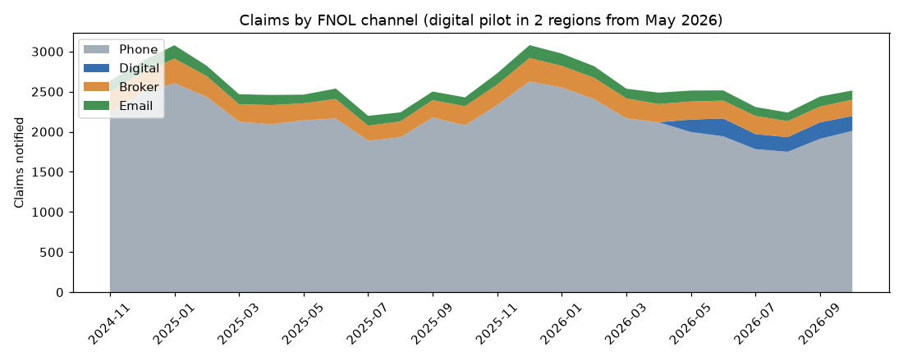

12 months before the pilot (May 2025 – Apr 2026):

| KPI | Value |
|---|---|
| Claims notified | 30,990 |
| Phone share | 85.8% |
| Phone FNOL handle time | 24.4 min |
| Mean / median days to settle | 20.8 / 18 |
| Claims with a hire car | 38.6% (mean 17.0 days at £46.01/day) |
| Annual hire-car cost | £9.37m |
| Mean indemnity (excl. total loss) | £3,270 |
| Complaint rate | 2.7% |
| Claimant NPS | -12 |

Cleaning log: rows received: 61,854; duplicate claim ids removed: 0; handle time > 180 min set to missing (mis-keyed seconds): 241; handle time missing (excluded from handle-time stats): 1,494; open claims (no settlement time; excluded from cycle-time stats): 1,702; total losses (kept; excluded from leakage baseline): 665; claims without an NPS response: 50,702.

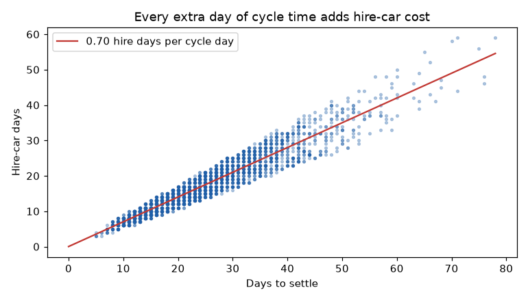

Each extra day of cycle time adds **0.70 hire-car
days** (OLS, R² = 0.92, n = 23,173). This is the link that turns
faster FNOL into cash.

## 3. Pilot evaluation

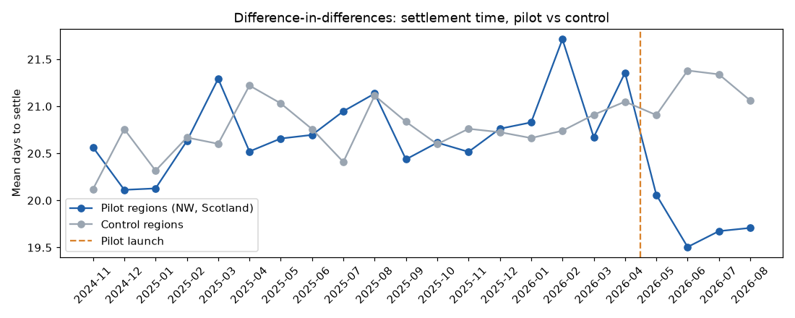

| Cell | Mean days to settle |
|---|---|
| Pilot regions, pre (Nov 25–Apr 26) | 20.97 |
| Pilot regions, post (May–Aug 26) | 19.70 |
| Control regions, pre | 20.80 |
| Control regions, post | 21.16 |
| **Difference-in-differences** | **-1.63** (95% CI -2.37 to -0.93) |

The pre-launch gap between pilot and control regions is flat (slope +0.023
days/month, p = 0.34), which supports the parallel-trends assumption. Post-launch
claims are cut off at 22 Aug 2026, so most have settled by the data date. The claim-level
comparison below is observational (customers chose the channel), so it is used only for handle
time, which the channel itself determines.

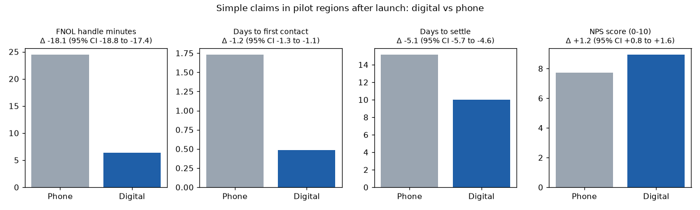

| Metric (simple claims) | Digital | Phone | Difference (95% CI) | p | Cohen's d |
|---|---|---|---|---|---|
| FNOL handle minutes | 6.32 | 24.45 | -18.14 (-18.84 to -17.43) | 1e-276 | -2.75 |
| Days to first contact | 0.49 | 1.73 | -1.24 (-1.35 to -1.14) | 3e-95 | -1.32 |
| Days to settle | 10.01 | 15.15 | -5.14 (-5.68 to -4.60) | 4e-69 | -1.00 |
| NPS score (0-10) | 8.94 | 7.73 | +1.20 (+0.79 to +1.62) | 4e-08 | 0.74 |

## 4. Process: current vs future state

Current state: 8 steps, 5 handoffs, lead time 88 h,
touch time 80 min, PCE 0.9%. Red = non-value-adding.

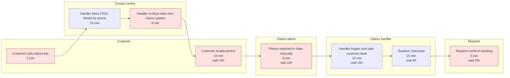

Future state (expected values with 60.0% of digital
claims routed straight through): lead time 10 h, touch time
18 min, PCE 2.1%.

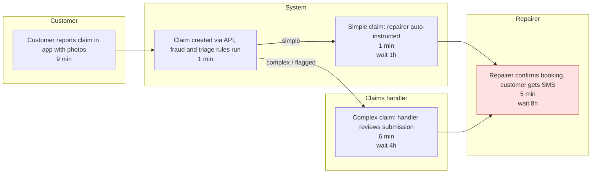

## 5. Stakeholders and RACI

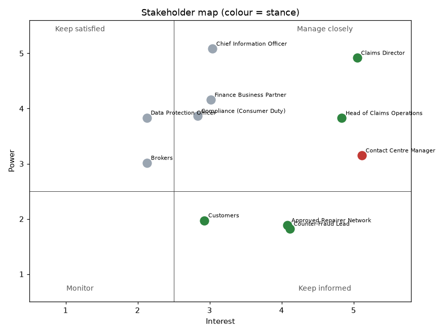

| Stakeholder | Role | Power | Interest | Quadrant | Stance | Key concern |
|---|---|---|---|---|---|---|
| Claims Director | Sponsor | 5 | 5 | Manage closely | Supportive | Cycle time and hire costs |
| Chief Information Officer | Technology owner | 5 | 3 | Manage closely | Neutral | Integration risk with the claims system |
| Head of Claims Operations | Business owner | 4 | 5 | Manage closely | Supportive | Handler workload during transition |
| Finance Business Partner | Benefits owner | 4 | 3 | Manage closely | Neutral | Benefits realisation evidence |
| Compliance (Consumer Duty) | Control owner | 4 | 3 | Manage closely | Neutral | Fair value and vulnerable customers |
| Data Protection Officer | Control owner | 4 | 2 | Keep satisfied | Neutral | Photo and location data |
| Contact Centre Manager | Impacted team lead | 3 | 5 | Manage closely | Concerned | Headcount and role changes |
| Brokers | Distribution partner | 3 | 2 | Keep satisfied | Neutral | Channel conflict |
| Counter-Fraud Lead | Subject expert | 2 | 4 | Keep informed | Supportive | Fraud rules at notification |
| Approved Repairer Network | External partner | 2 | 4 | Keep informed | Supportive | Job volumes and SLAs |
| Customers | End users | 2 | 3 | Keep informed | Supportive | Ease of reporting and updates |

| Activity | Claims Director | Head of Claims Operations | Contact Centre Manager | Chief Information Officer | Finance Business Partner | Counter-Fraud Lead | Data Protection Officer | Approved Repairer Network | Brokers | Customers | Compliance (Consumer Duty) |
|---|---|---|---|---|---|---|---|---|---|---|---|
| Approve business case | A | C |  | C | R |  |  |  |  |  |  |
| Define requirements |  | A | C |  |  | C |  |  | I | C |  |
| Build and integrate platform |  | C |  | A |  |  | C |  |  |  |  |
| Data protection impact assessment |  |  |  | C |  |  | A |  |  |  |  |
| Consumer Duty and vulnerability review |  | R |  |  |  |  |  |  |  | C | A |
| Handler training and change |  | A | R |  |  |  |  |  |  |  |  |
| Repairer onboarding |  | A |  |  |  |  |  | R |  |  |  |
| Benefits tracking | A | R |  |  | R |  |  |  |  |  |  |
| Go-live decision | A |  | I | R |  |  |  |  | I |  | C |

**RACI gap analysis** (automated checks: one Accountable per activity, at least one
Responsible, high-power stakeholders included in go-live):

- **Define requirements**: no one is Responsible; the Accountable person would be doing the work by default
- **Build and integrate platform**: no one is Responsible; the Accountable person would be doing the work by default
- **Data protection impact assessment**: no one is Responsible; the Accountable person would be doing the work by default
- **Go-live decision**: high-power stakeholder Head of Claims Operations is not consulted or informed
- **Go-live decision**: high-power stakeholder Finance Business Partner is not consulted or informed
- **Go-live decision**: high-power stakeholder Data Protection Officer is not consulted or informed

*Action:* name Responsible owners (a product owner, an IT delivery lead and a DPIA analyst)
before mobilisation.

## 6. Requirements

12 user stories across 6 epics, prioritised with
MoSCoW then WSJF. Musts are 45 of 69 in-scope points
(65%). Every story has Gherkin acceptance criteria. The full backlog is
in [BACKLOG.md](BACKLOG.md) and the executable `.feature` files are in [features/](features/).

Backlog checks: warning: Musts are 65% of in-scope effort; DSDM guidance is at most 60% so Shoulds/Coulds act as contingency.

## 7. Financial case

Key assumptions (data-backed where possible; ranges drive the sensitivity analysis):

| Assumption | Low | Base | High | Unit | Source |
|---|---|---|---|---|---|
| Annual motor claims | 2.79e+04 | 3.099e+04 | 3.41e+04 | claims | Claims data, 12 months pre-pilot |
| Claims volume growth p.a. | 0 | 0.02 | 0.04 | % | Planning assumption (book growth) |
| Digital FNOL adoption (steady state) | 0.38 | 0.55 | 0.7 | % of claims | Pilot take-up 37% in first 4 months; benchmark 60-70% |
| Handler minutes saved per digital FNOL | 17.4 | 18.14 | 18.8 | min | Pilot: digital vs phone handle time (Welch 95% CI) |
| Fully loaded handler cost | 25 | 28 | 32 | £/hour | £33k salary + 30% on-costs, 1,550 productive hours |
| Share of handling saving realised | 0.5 | 0.7 | 0.9 | % | Released via attrition and redeployment, not redundancies |
| Cycle days saved per digital claim | 2.51 | 4.388 | 6.38 | days | Pilot difference-in-differences / take-up (bootstrap 95% CI) |
| Hire days per cycle day | 0.594 | 0.6994 | 0.769 | days | OLS of hire days on cycle days, claims with hire |
| Claims with a hire car | 0.348 | 0.3863 | 0.425 | % | Claims data, 12 months pre-pilot |
| Hire cost per day | 40 | 46.01 | 55 | £/day | Claims data; credit-hire rates higher |
| Average indemnity (excl. total loss) | 2.94e+03 | 3,270 | 3.76e+03 | £ | Claims data; claims inflation risk |
| Indemnity leakage avoided (photo evidence at FNOL) | 0.002 | 0.006 | 0.012 | % of indemnity | Claims audit sample estimate; not measurable in the pilot yet |
| Fraud referral rate | 0.0159 | 0.01985 | 0.0238 | % | Claims data |
| Extra referrals confirmed (better evidence) | 0 | 0.06 | 0.1 | pp | Pilot directional only (small sample); counter-fraud team |
| Average saving per confirmed fraud | 4.5e+03 | 6,500 | 9e+03 | £ | Counter-fraud team |
| Complaint rate reduction on digital claims | 0 | 0.004 | 0.008 | pp | Pilot NPS and complaint trend |
| Cost per complaint | 400 | 600 | 900 | £ | Complaints MI incl. FOS case fees |
| Build and integration (year 0) | 1.35e+06 | 1.6e+06 | 2.2e+06 | £ | Vendor quotes + internal IT estimate, +15% contingency |
| Training and change (year 1) | 1.8e+05 | 2.5e+05 | 3.5e+05 | £ | Change team estimate |
| Run cost p.a. (licences, cloud, support) | 3.2e+05 | 3.8e+05 | 4.8e+05 | £/year | Vendor quote + support model |
| Discount rate | 0.06 | 0.08 | 0.1 | % | Group hurdle rate for change investments |

5-year cash flow, base case (£):

| Line | Y0 | Y1 | Y2 | Y3 | Y4 | Y5 | Total |
|---|---|---|---|---|---|---|---|
| handling | 0 | 46,349 | 84,045 | 107,158 | 109,301 | 111,487 | 458,339 |
| hire_car | 0 | 426,691 | 773,732 | 986,509 | 1,006,239 | 1,026,364 | 4,219,534 |
| leakage | 0 | 153,496 | 278,339 | 354,883 | 361,980 | 369,220 | 1,517,919 |
| fraud | 0 | 60,550 | 109,798 | 139,992 | 142,792 | 145,648 | 598,779 |
| complaints | 0 | 18,776 | 34,048 | 43,411 | 44,279 | 45,164 | 185,678 |
| benefits | 0 | 705,861 | 1,279,962 | 1,631,952 | 1,664,591 | 1,697,883 | 6,980,249 |
| capex | -1,600,000 | 0 | 0 | 0 | 0 | 0 | -1,600,000 |
| change | 0 | -250,000 | -0 | -0 | -0 | -0 | -250,000 |
| run | 0 | -380,000 | -380,000 | -380,000 | -380,000 | -380,000 | -1,900,000 |
| costs | -1,600,000 | -630,000 | -380,000 | -380,000 | -380,000 | -380,000 | -3,750,000 |
| net | -1,600,000 | 75,861 | 899,962 | 1,251,952 | 1,284,591 | 1,317,883 | 3,230,249 |
| discounted net | -1,600,000 | 70,242 | 771,572 | 993,840 | 944,213 | 896,929 | 2,076,795 |
| cumulative net | -1,600,000 | -1,524,139 | -624,176 | 627,775 | 1,912,366 | 3,230,249 |  |

| Scenario | NPV | IRR | Payback | Discounted payback | ROI |
|---|---|---|---|---|---|
| Pessimistic | -£3.34m | n/a | never | never | -72.5% |
| Base | £2.08m | 38.6% | 2.5 yrs | 2.8 yrs | 86.1% |
| Optimistic | £15.95m | 188.8% | 0.8 yrs | 0.8 yrs | 629.6% |

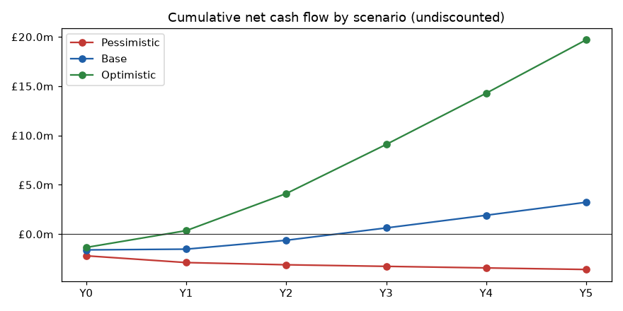
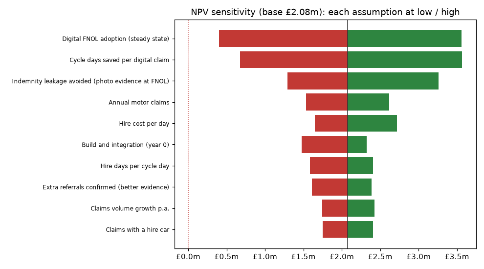
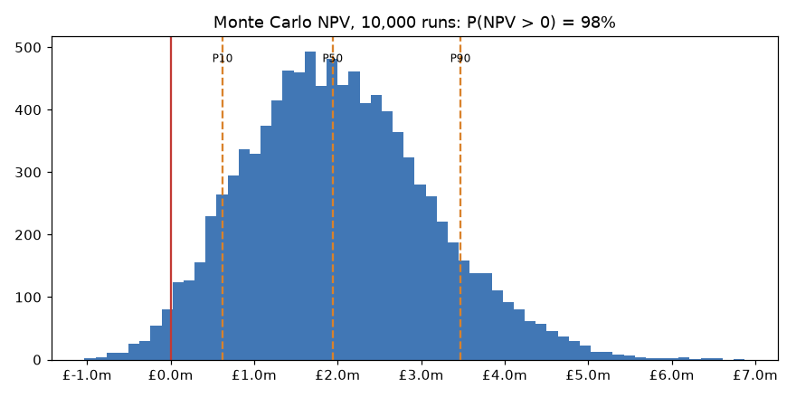

Break-even points (other assumptions at base): digital adoption **33.9%**;
cycle days saved per digital claim **1.61** (pilot estimate
4.39).

## 8. Risks

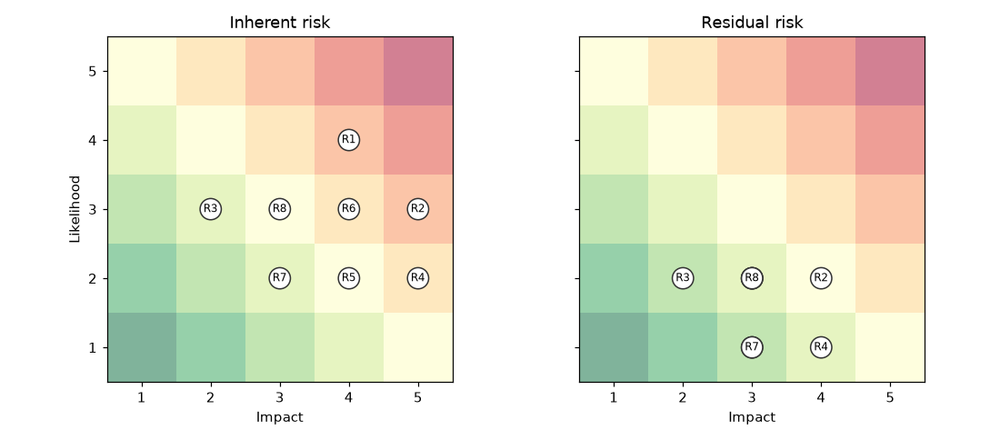

| ID | Risk | Category | L x I | Rating | Owner | Mitigation | Residual |
|---|---|---|---|---|---|---|---|
| R1 | Integration with the core claims system takes longer than planned | Delivery | 4x4=16 | Red | Chief Information Officer | API spike in sprint 0; vendor integration specialist on contract; queue-and-retry design | 6 (Green) |
| R2 | Digital adoption stays below the 34% break-even | Benefits | 3x5=15 | Red | Head of Claims Operations | Default digital link in every FNOL SMS; handler-assisted digital journey; stage-gate at month 6 | 8 (Amber) |
| R6 | Fraudsters exploit straight-through routing | Financial | 3x4=12 | Amber | Counter-Fraud Lead | Fraud score gates straight-through routing; £3k value cap; weekly rule tuning | 6 (Green) |
| R4 | Vulnerable customers disadvantaged by a digital-first journey (Consumer Duty) | Regulatory | 2x5=10 | Amber | Compliance (Consumer Duty) | Phone channel kept; vulnerability question routes to specialist team; outcomes testing by segment | 4 (Green) |
| R8 | Pilot effect overstated (pilot regions not representative) | Benefits | 3x3=9 | Amber | Finance Business Partner | Difference-in-differences with control regions; benefits tracked weekly from go-live | 6 (Green) |
| R5 | Photo metadata (location) breaches data minimisation | Regulatory | 2x4=8 | Amber | Data Protection Officer | DPIA before build; strip precise location after fraud scoring; 6-year retention job | 3 (Green) |
| R3 | Handling savings not realised because staff are not redeployed | Benefits | 3x2=6 | Green | Contact Centre Manager | Workforce plan using attrition (18% p.a.); retrain handlers for complex claims | 4 (Green) |
| R7 | Repairer network cannot absorb faster instructions | Operational | 2x3=6 | Green | Head of Claims Operations | Capacity agreement with top 40 repairers; SLA reporting | 3 (Green) |

Total exposure falls from 82 to 40 (51% reduction) after mitigation.

## 9. Recommendation and next steps

1. **Approve** £1.60m build plus
   £250k change budget for a national rollout in
   three waves.
2. **Stage-gate at month 6:** continue only if digital adoption is at or above
   33.9% and cycle-time savings are at least 1.6 days
   per digital claim, measured with the same difference-in-differences method.
3. **Before mobilisation:** close the RACI gaps, complete the DPIA, and agree the
   handler redeployment plan with the contact centre.
4. **Out of scope for phase 1:** AI photo estimating (FNOL-09, Won't), to be revisited when
   photo volumes exceed 20,000.

*Caveats:* the data is synthetic and seeded. Leakage and fraud uplift are judgement-based
ranges, not pilot measurements. Monte Carlo draws assumptions independently, which ignores
correlations such as adoption with cycle-time saving.
