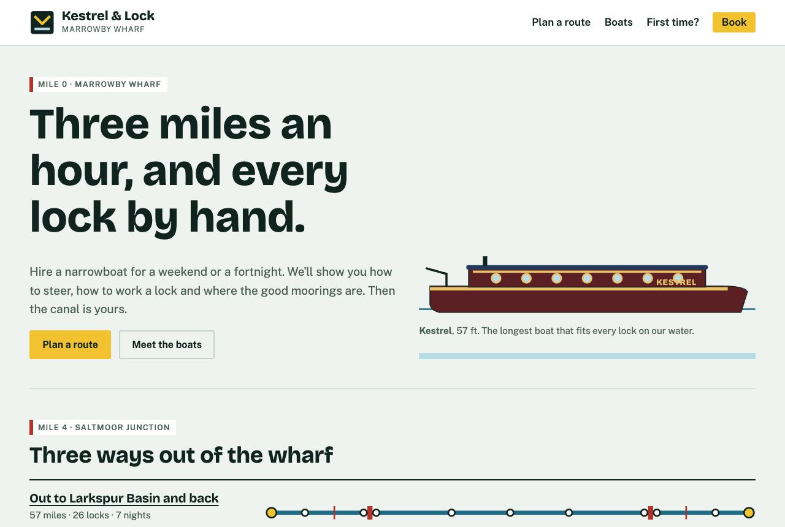
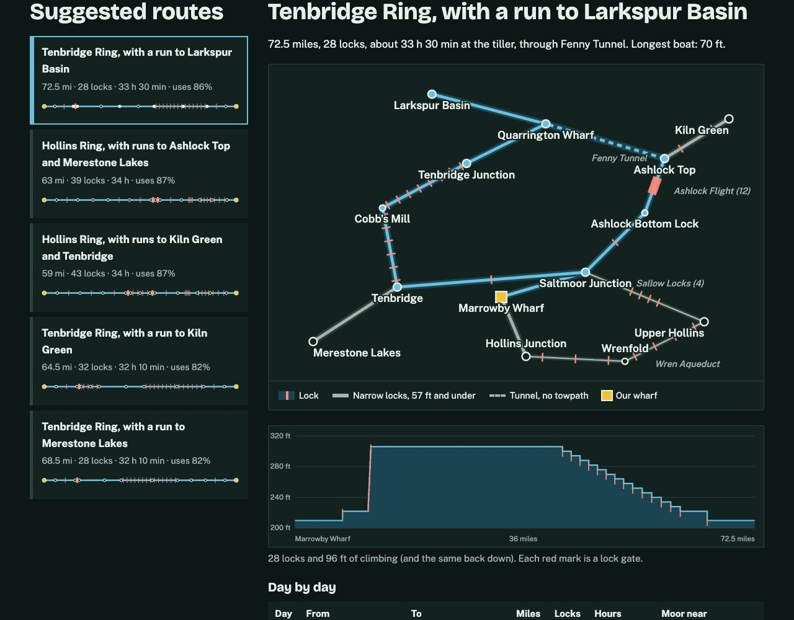
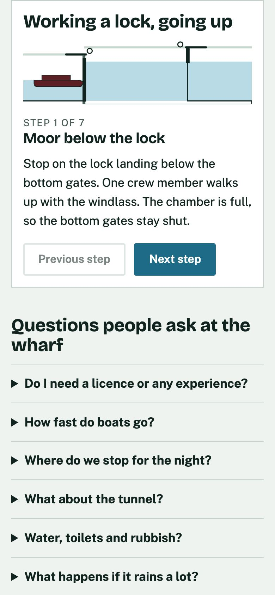
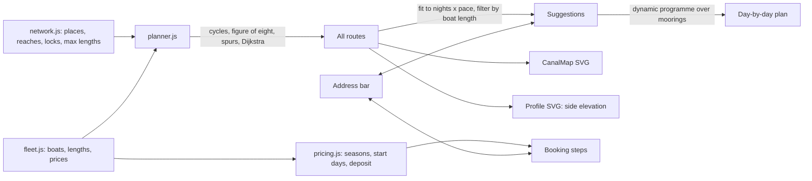

# ⛵ Kestrel & Lock: Narrowboat Holidays

A website for an invented narrowboat hire company on an invented English canal network. Visitors plan a holiday by the boaters' own rule of thumb (miles plus locks, divided by three), see which routes their boat is short enough for, get a day-by-day plan with every night at a real mooring, look at the climb through each flight of locks side-on, step through working a lock, and book a boat with dates, extras and crew details. The booking is a demo.







## 🏛 Architecture



Design decisions and trade-offs: [docs/ARCHITECTURE.md](docs/ARCHITECTURE.md).

**Role focus:** Front-End Engineer · **Stack:** React 19, JavaScript, SCSS (tokens, light and dark), hand-drawn SVG, Vite, Vitest + Testing Library, Playwright + axe

## 🧩 The problem

People booking their first canal holiday ask the same three questions: *how far can we get in a week?*, *is the boat we like allowed on that route?* and *where will we stop each night?* Hire sites usually answer with a PDF of suggested routes and a phone number. This site answers all three on the page, using the same reasoning a boater would, and then takes the booking.

## ✨ Features

- **Route planner** that finds every holiday starting and ending at the wharf (rings, a figure of eight where two rings share a junction, there-and-back trips that turn only at winding holes, and rings with up to three extra runs) and picks the ones that use 50 to 105% of your cruising time, aiming for 85%
- **Boat length matters:** the narrow Hollins Arm takes 57 ft at most, so longer boats never get those routes. The planner says how many routes that rules out, and the map hatches the reaches that are too short.
- **Day by day:** a small dynamic programme chooses an overnight mooring for each night, so days come out even, never end in the middle of a flight of locks, and include days moored up when a short route meets a long holiday
- **Side elevation** of the chosen route, in which a twelve-lock flight reads as a staircase, plus a schematic SVG map with locks, the tunnel, the aqueduct and flights marked
- **Shareable state:** planner and booking choices live in the address bar (never personal details)
- **Booking in four steps:** real start-day rules (weekend breaks on Fridays, midweek breaks on Mondays), seasons, extras, a 25% deposit or payment in full inside eight weeks, an error summary that takes focus and links to each field, and a reference number at the end
- **Lock guide:** an animated, keyboard-operable, step-by-step lock (paddles, gates and water level) with announcements for screen readers
- **Accessible and responsive:** works from 360 px, light and dark themes, reduced motion respected, focus moved to each new page's heading, axe-clean on every page

## 🚀 Quick start

```bash
npm ci
npm run dev        # http://localhost:5173
```

## 📟 Example output

What the planner suggests for a few holidays, from the real functions (`suggestRoutes`, `itinerary`):

```text
3 nights, gentle,  Kestrel (57 ft)  11 h available  → Out to Upper Hollins and back 9.3 h · Out to Tenbridge and back 8.0 h · Hollins Ring 11.0 h
4 nights, steady,  Heron (62 ft)    21 h available  → Out to Ashlock Top and back 17.0 h      (3 other routes ruled out: narrow locks)
7 nights, steady,  Kestrel (57 ft)  39 h available  → Tenbridge Ring, with a run to Larkspur Basin 33.5 h (uses 86%)
14 nights, steady, Water Vole (69 ft) 81 h available → nothing fills it: longest three offered, with days to spare

Tenbridge Ring with a run to Larkspur Basin, 7 nights steady:
  1 Marrowby Wharf → Ashlock Bottom Lock   4.0 h
  2 Ashlock Bottom Lock → Ashlock Top      4.5 h   (the twelve-lock Ashlock Flight)
  3 Ashlock Top → Larkspur Basin           5.3 h   (Fenny Tunnel and the Long Pound)
  4 Larkspur Basin → Tenbridge Junction    4.3 h
  5 Tenbridge Junction → Cobb's Mill       6.3 h
  6 Cobb's Mill → Tenbridge                5.0 h
  7 Tenbridge → Marrowby Wharf             4.0 h
```

Checks before pushing: `npm run lint` clean, 59 Vitest tests, `npm run build` (88 kB of JavaScript gzipped), and 8 Playwright runs (axe on 9 pages in light and dark, no sideways scrolling, and the plan-then-book journey, each on desktop and a phone).

## 🏗 Project structure

```text
src/data/        network.js (places, reaches, locks, heights), fleet.js (boats, liveries, prices)
src/lib/         planner.js (routes, suggestions, itinerary DP, elevation), pricing.js, booking.js, router.jsx
src/components/  CanalMap, Profile, StripMap, Boat (drawn to scale), LockDiagram, Layout
src/pages/       Home, Routes, Fleet + BoatPage, Book, FirstTime, NotFound
src/styles/      _tokens (light/dark), _base, _shell, _controls, _drawings, _pages
tests/           planner, pricing and booking logic; page and journey tests with Testing Library
e2e/             Playwright: axe in both schemes, layout, full booking on desktop and phone
```

## 🎯 Skills demonstrated

- Turning a domain rule of thumb into a real algorithm: graph search over cycles and spurs, Dijkstra, and a dynamic programme, with tests for the invariants (every route is connected, boats turn only at winding holes, days add up)
- Data visualisation written by hand in SVG: a schematic map, a side elevation and to-scale boat drawings that all work in light and dark
- Accessible forms: an error summary that takes focus, inline errors tied with `aria-describedby`, focus moved on step and page changes, live regions
- State design: shareable choices in the URL, personal details kept only in memory, and a tested router written for it
- Responsive layout problems found and fixed by testing, such as grid columns that grow to fit a 24 rem input on a 375 px phone

## 🧪 Running tests

```bash
npm run lint
npm test                          # 59 Vitest tests
PW_CHANNEL=chrome npm run e2e     # 8 Playwright runs (desktop and phone)
```

## 📄 License

MIT. Kestrel & Lock, Marrowby Wharf and every place, canal and boat here are invented.
