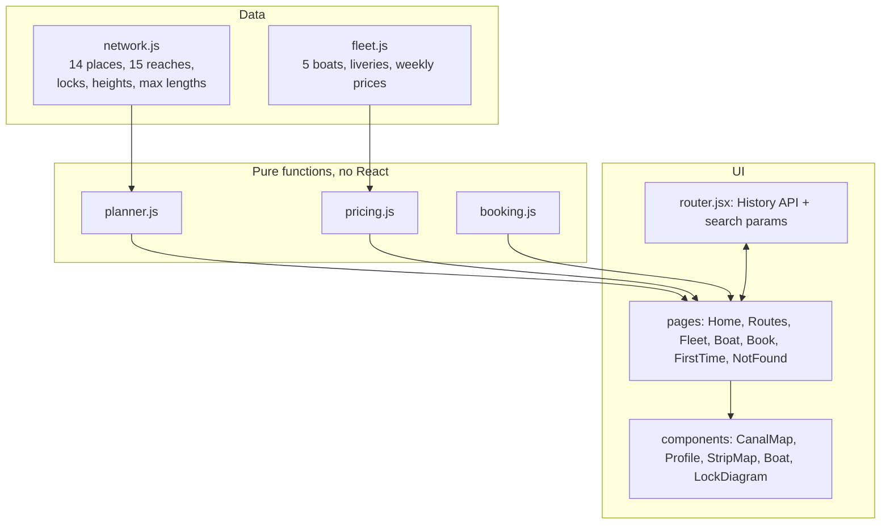

# Architecture

## Overview

All the reasoning lives in plain modules under `src/lib`, which have 47 tests that need no DOM. Components only draw what those functions return.

## How the planner works

1. **Enumerate holidays once, at load.** The network is small (14 places), so it is cheaper and easier to test to build every sensible route up front than to search per request.
   - *Rings:* every simple cycle in the graph, found by depth-first search from each place and de-duplicated by its set of reaches. A ring that doesn't pass the wharf is reached by the quickest path (Dijkstra on cruising hours) and left the same way.
   - *Figure of eight:* two rings that share exactly one place and no reach.
   - *There and back:* the quickest path to each winding hole and back. A boat 57 to 70 ft long cannot turn in an ordinary canal, so turning only happens at winding holes. A test checks this for every route.
   - *Rings with runs:* up to three short there-and-back runs added to a ring or the figure of eight, skipping combinations where one run already passes the other's turning point.
2. **Filter and rank.** Available hours = a three-hour first afternoon + (nights − 1) × the pace's hours. Routes the boat is too long for are dropped. The rest must use 50 to 105% of the time and are ranked by closeness to 85%, leaving slack for weather and the pub. If nothing reaches 50% (long holidays), the three longest routes are offered and the page says so.
3. **Plan each day.** A dynamic programme over (day, legs done) picks overnight stops. Cost = 10 × overrun² + 0.1 × underrun², with a small fixed cost for a rest day, and days may only end at a mooring. This gives even days and puts rest days where a route is short, which a greedy "go as far as you can" split got wrong. The first greedy version produced a 9-hour final day, which led to this rewrite.
4. **Draw it.** `profile()` turns the legs into a stepped elevation line, bunching locks in a flight and spacing them elsewhere. The map uses the same rule for its lock ticks, so the two drawings agree.

## Key decisions and trade-offs

| Decision | Chosen | Rejected, and why |
|---|---|---|
| Time model | Lock-miles ÷ 3, the rule boaters actually use | Separate speeds and per-lock minutes: more parameters, no more accuracy for a holiday plan, and harder to explain on the page |
| Route search | Enumerate once and filter | Search per request (A*, ILP): unnecessary for 14 nodes and harder to test for invariants |
| Day splitting | Small DP, O(days × legs²) | Greedy: tested and found to leave a 9 h last day |
| State | Planner and booking choices in the URL, replacing history for small edits; personal details only in React state | Everything in the URL would leak names and emails into history and logs. localStorage would keep personal data after the visit. |
| Routing | 60-line History API router with `useSearchState` | React Router: a 30 kB dependency for seven routes, and search-param state still needed custom code |
| Drawings | Hand-written SVG reading CSS custom properties | A chart or map library: heavy, hard to restyle for dark mode, and the brief rules out stock imagery |
| Styling | SCSS partials over design tokens; colour scheme from `prefers-color-scheme` | A CSS framework or UI kit: generic look, and the brief rules it out |

## Accessibility

- Every page has one `h1`. After client-side navigation focus moves to it, as a full page load would. Each booking step focuses its heading.
- The error summary takes focus, counts the problems and links to each field. Fields use `aria-invalid` and `aria-describedby` for hints and errors.
- The map and elevation are `role="img"` with a title and description that state the key facts, such as locks, climb and highest point. Wide drawings and tables scroll inside a focusable region rather than the page.
- The lock guide announces each step through `aria-live`. Transitions are switched off under `prefers-reduced-motion`.
- Colours were picked for both schemes. Buoy yellow only ever sits behind dark text. Axe runs on nine pages in light and dark, on desktop and a phone.

## Layout bug found in testing

On a 375 px phone the booking column grew to 400 px. A `display: grid` field sized its single column to the 24 rem date input, and `max-width: 100%` on the input referred back to that same column. Playwright's `scrollWidth − innerWidth` check missed it, because mobile emulation widened the layout viewport to match. The fix is `minmax(0, 1fr)` columns and `width: min(24rem, 100%)`, and the e2e check now also compares against `clientWidth`.

## Known limitations and next steps

- The network is fictional and small. A real operator would load reaches from a waterways dataset and recompute routes on a server or at build time.
- Prices go by the start date's season. A week that spans two seasons is charged at the first.
- There is no availability calendar. Every boat is assumed free on every valid start date.
- Times are a rule of thumb. Busy flights, river current and queues at locks are not modelled.
