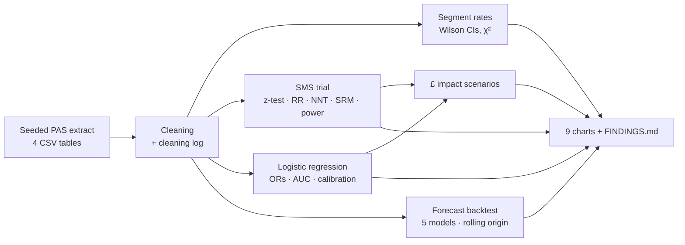
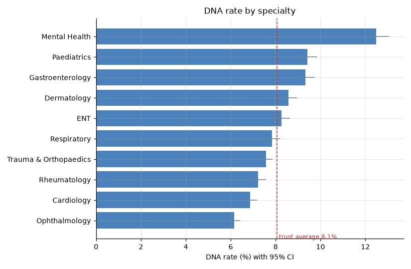
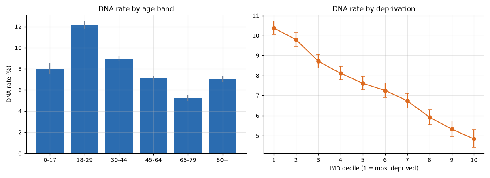
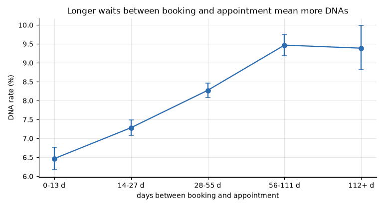
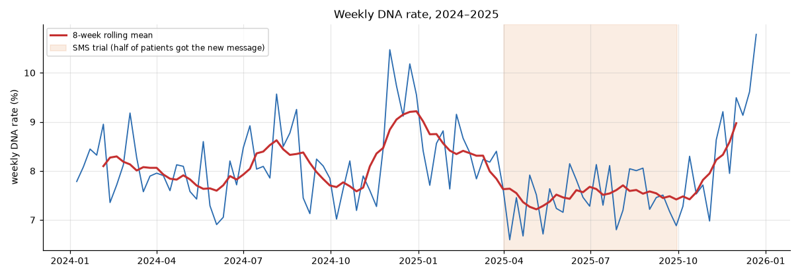
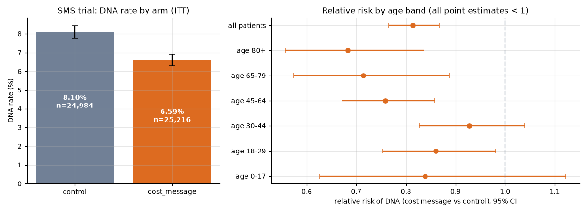
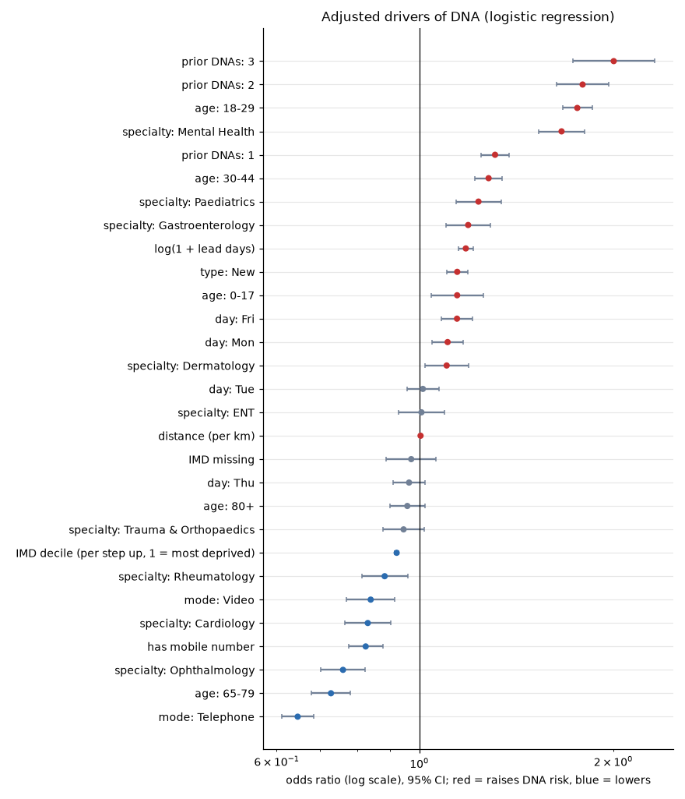
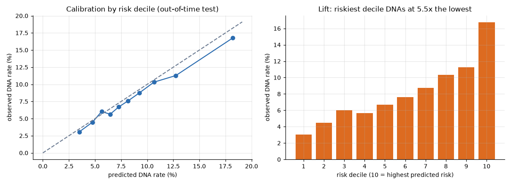
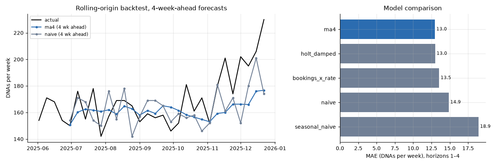
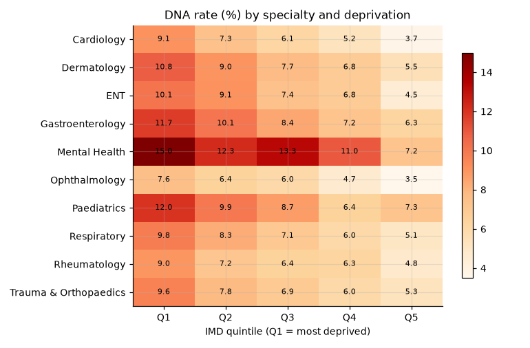

# 🏥 NHS Outpatient DNA Analysis

Why do patients miss hospital outpatient appointments, and what would reduce it? This is an end-to-end analysis of two years of synthetic outpatient data from a fictional NHS acute trust: 60,000 patients and about 260,000 appointments. It cleans a messy PAS extract, maps where "did not attend" (DNA) rates are highest, evaluates a randomised SMS reminder trial with proper effect sizes, builds an interpretable risk model validated out-of-time, backtests weekly DNA forecasts against baselines, and costs two interventions in £ with uncertainty ranges. The outcome is a clear recommendation with caveats.

## 🏛 Architecture



Analytical decisions and trade-offs (denominators, ITT vs per-protocol, out-of-time validation, leakage control) are in [docs/ARCHITECTURE.md](docs/ARCHITECTURE.md). The full generated write-up is [docs/FINDINGS.md](docs/FINDINGS.md).

**Role focus:** Data Analyst · **Stack:** Python 3.11+, pandas, SciPy, statsmodels (logit, Holt), matplotlib, pytest + Hypothesis, ruff

## 🧩 The problem

Missed outpatient appointments cost the NHS about £160 each and lengthen waiting lists. The trust's outpatient manager wants to know:

1. How big is the problem, and where is it concentrated (specialty, age, deprivation, waiting time)?
2. Did the trial of a new reminder SMS, which tells patients what a missed appointment costs the NHS, actually work? By how much, and is the result trustworthy?
3. Can we predict which appointments are at risk, so staff can phone those patients?
4. How many DNAs should clinic templates plan for in four weeks' time?
5. What is each option worth in £?

## ✨ Features

- **Data cleaning with an audit trail:** sync duplicates, 13 inconsistent status labels mapped to 4, bookings dated after the appointment, orphan clinic codes, impossible ages, missing deprivation. Every step is counted in a cleaning log that reconciles row totals (and a test checks it)
- **Feature engineering without leakage:** prior DNAs counted from *earlier* appointments only, plus lead time, age bands and IMD
- **Segment analysis** with Wilson 95% CIs, chi-square tests with Cramér's V, a specialty × deprivation heatmap and a high-risk profile deep dive
- **RCT evaluation:** ITT and per-protocol, two-proportion z-test, absolute difference CI, relative risk CI, Cohen's h, NNT, sample-ratio-mismatch check, achieved power and required n, subgroup forest plot
- **Risk model:** statsmodels logistic regression with 29 adjusted odds ratios, out-of-time validation, AUC (Mann–Whitney implementation), Brier score, calibration and lift by decile
- **Forecasting:** rolling-origin backtest (26 origins × 4 horizons) of naive, 4-week MA, seasonal naive, damped Holt and a booking-informed model that uses only information available at the origin
- **Financial model:** £ impact of each intervention, with the trial's confidence interval carried through to the savings range
- **Reproducible:** one command regenerates the data, 9 figures and `FINDINGS.md`. The statistics are cross-checked against statsmodels in the tests

## 🚀 Quick start

```bash
pip install -e ".[dev]"
dna-analysis generate     # 60k patients, 262k appointment rows (seeded, ~2 s)
dna-analysis run          # full analysis, 9 charts, reports/FINDINGS.md (~5 s)
```

Paths can be overridden with `DNA_DATA_DIR`, `DNA_FIGURES_DIR` and `DNA_REPORTS_DIR`.

```text
$ dna-analysis run
DNA rate 8.06% | 2025 DNAs 8,831 (£1,412,960)
SMS trial: 8.10% -> 6.59% (RRR 18.6%, p=9.8e-11, NNT 66)
Risk model: test AUC 0.639, top decile holds 20.8% of DNAs
Forecast: best=ma4 MAE 13.0/wk (12.8% better than naive)
SMS rollout saving £235,410/yr; targeted calls net £40,058/yr
9 figures, findings at FINDINGS.md (4.8s)
```

## 📊 Key insights

All numbers below come from the run above.

**1. 8.1% of appointments are missed: 8,831 in 2025, about £1.41m of wasted capacity.** Mental Health (12.5%), Paediatrics (9.4%) and Gastroenterology (9.3%) are highest. Ophthalmology (6.1%) is lowest.



**2. Deprivation and age are the strongest patient-level drivers.** The most deprived decile misses 10.4% of appointments against 4.8% in the least deprived. 18–29 year olds miss 12.1%.



**3. Longer waits mean more DNAs:** 6.5% when booked under 2 weeks ahead, 9.5% at 8–16 weeks.





**4. The cost-message SMS works.** In the randomised trial (n = 50,200 appointments that went ahead), DNAs fell from **8.10% to 6.59%**: a **−1.51 pp** absolute difference (95% CI −1.96 to −1.05), relative risk **0.814** (0.765–0.866), **p = 9.8×10⁻¹¹**, **NNT = 66**. The sample-ratio check passes (p = 0.16), and per-protocol agrees (RR 0.812).



**5. After adjustment, history matters most.** Three or more prior DNAs doubles the odds (OR 2.00, 1.73–2.32). Age 18–29 gives OR 1.76 and Mental Health OR 1.66. Telephone appointments lower the odds (OR 0.65).



**6. The risk model ranks well enough to target.** Out-of-time AUC is 0.639, with train at 0.633 (no overfitting). The riskiest decile DNAs at **5.5×** the rate of the lowest and holds **20.8%** of all DNAs.



**7. For planning, simple beats complex.** A 4-week moving average (MAE 13.0 DNAs/week, MAPE 7.4%) beats naive by 12.8%. Damped Holt ties it (13.0), and neither the booking-informed nor the seasonal model did better.





### 💷 Recommendation

| Option | DNAs avoided / yr (range) | Cost | Net value / yr (range) |
|---|---:|---:|---:|
| **Switch all reminders to the cost message** | 1,471 (1,056–1,861) | £0 | **£235,410** (£168,987–£297,810) |
| Phone the top-10% risk appointments (assumed effect, pilot first) | 363 (181–544) | £17,983 | £40,058 (£11,038–£69,078) |

1. **Roll out the cost-message SMS now.** It is proven by a randomised trial and costs nothing extra.
2. **Pilot targeted phone calls** for the riskiest decile as a randomised 3-month trial before scaling. The 30% effect is an assumption, not a measurement.
3. **Set overbooking from the 4-week moving average** and recalibrate the risk model after rollout, because the base rate will drop.

**Caveats:** the data is synthetic (generated from a known model, and the tests check the analysis recovers the true trial effect). £160 is a national average and mostly represents capacity, not cash. The trial ran over summer. IMD is area-level, not individual.

## 🏗 Project structure

```text
nhs-outpatient-dna-analysis/
├── src/outpatient_dna/
│   ├── datagen.py      # seeded PAS extract with known effects and realistic mess
│   ├── cleaning.py     # cleaning log, standardisation, leakage-safe features
│   ├── segments.py     # rates with Wilson CIs, high-risk profiles, heatmap matrix
│   ├── stats.py        # z-test, RR/NNT/Cohen's h, SRM, power, chi-square
│   ├── modelling.py    # logistic regression, ORs, AUC, calibration, lift
│   ├── forecasting.py  # 5 models, rolling-origin backtest, booking index
│   ├── impact.py       # £ scenarios with uncertainty ranges
│   ├── charts.py       # 9 figures
│   ├── analysis.py     # orchestration + headline metrics
│   ├── report.py       # FINDINGS.md writer
│   └── config.py · cli.py
├── tests/              # 35 tests: stats vs statsmodels, cleaning, model, backtest, end-to-end
├── docs/               # ARCHITECTURE.md, FINDINGS.md, figures/
├── data/README.md      # table dictionary (CSVs are generated)
├── Dockerfile · Makefile · pyproject.toml
```

## 🎯 Skills demonstrated

- **Data cleaning and validation:** a reconciled cleaning log, standardised categorical labels, referential integrity checks, handling of missing values
- **Experiment analysis:** RCT evaluation with ITT and per-protocol, effect sizes, confidence intervals, NNT, SRM and power, the full checklist an analytics lead expects
- **Statistical modelling:** interpretable logistic regression, out-of-time validation, calibration, and explicit care about leakage
- **Forecasting discipline:** rolling-origin backtesting against baselines, and reporting honestly when complex models don't win
- **Business communication:** quantified findings, £ impact with uncertainty, a prioritised recommendation and stated caveats
- **Reproducible analytics engineering:** a modular, tested pipeline in place of a one-off notebook; one command rebuilds everything

## 🧪 Running tests

```bash
pytest -q          # 35 tests, about 8 s
ruff check . && ruff format --check .
```

## 📄 License

MIT. See [LICENSE](LICENSE).
