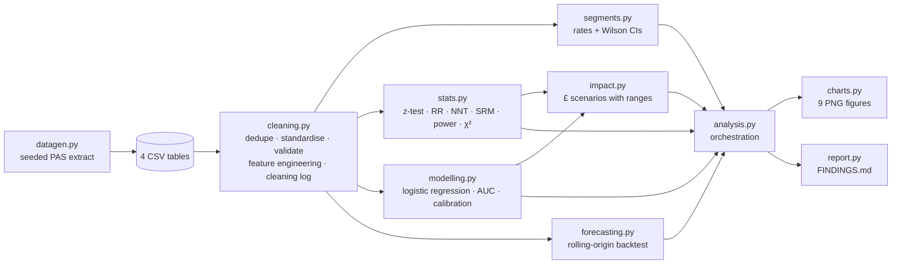

# Architecture

The analysis is a reproducible pipeline of small, tested modules (a notebook written as a
script). One command regenerates every number, chart and sentence in `FINDINGS.md`.

## Analytical decisions and trade-offs

| Decision | Chosen | Rejected and why |
|---|---|---|
| DNA rate denominator | attended + DNA (cancellations excluded) | All bookings, which would understate the rate and differ from NHS England reporting |
| Intervals for rates | Wilson score | Wald, which behaves badly for small segments and rates near 0 |
| Trial analysis | Intention-to-treat, with per-protocol as a sensitivity check | Per-protocol only, which is biased by who received the SMS |
| Trial validity | Sample-ratio-mismatch test before reading outcomes | Trusting allocation blindly |
| Effect sizes | Absolute difference, relative risk, NNT, Cohen's h | p-values alone, which tell you nothing about worth at n = 50k |
| Risk model | Logistic regression with odds ratios | Gradient boosting: slightly better AUC, but clinicians and managers need to see *why*, and ORs carry directly into policy |
| Validation | Out-of-time split (train < 1 Jul 2025, test after) | Random split, which leaks seasonality and the patient's own future visits |
| Prior-DNA feature | Cumulative count of *earlier* DNAs only | A whole-history count, which is target leakage |
| Forecast evaluation | Rolling origin, 26 origins × 4 horizons, MAE/MAPE/bias vs naive baselines | A single hold-out, which is one lucky or unlucky period |
| Forecast inputs | Only data available at the origin (bookings made by then) | Final weekly volumes, which leak the future |
| Financial ranges | Carry the trial's RR CI through to £; flag call effects as assumptions | Point estimates only, which hide the uncertainty from decision makers |

## Limitations

- The data is synthetic. Effects are realistic in size because they come from a known
  generating model, and the tests check that the analysis recovers them.
- The trial lasted 6 months over summer. Seasonal interaction is untested.
- AUC of about 0.64 limits targeting precision. Adding transport and appointment history
  from other trusts, or text from referral letters, would help.
- £160 per DNA is a national average. It is a capacity cost, not a cash saving.

## Next steps

- Recalibrate the risk model after the SMS rollout changes the base rate.
- A randomised phone-call pilot in the top risk decile to measure the assumed 30% effect.
- A per-specialty overbooking model that uses the forecast plus clinic slot capacity.
