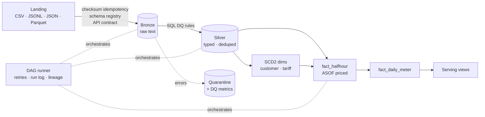
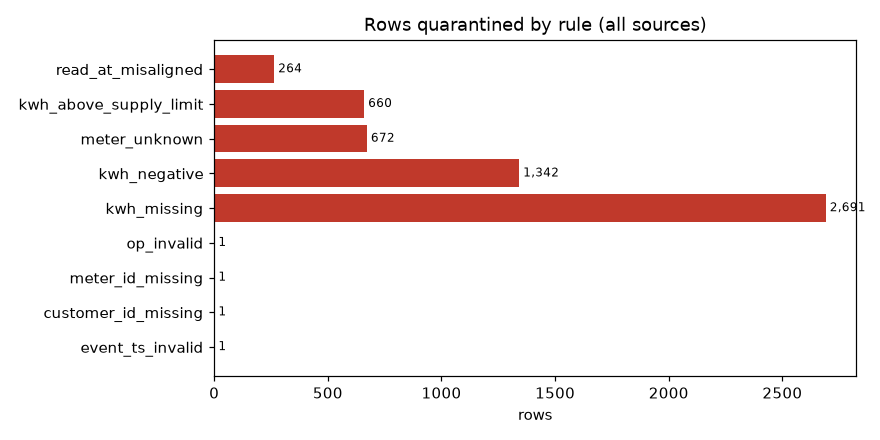
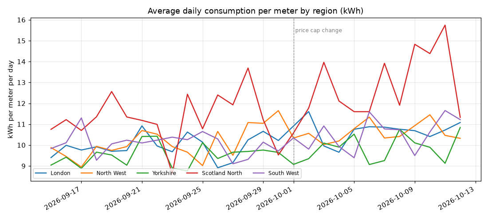
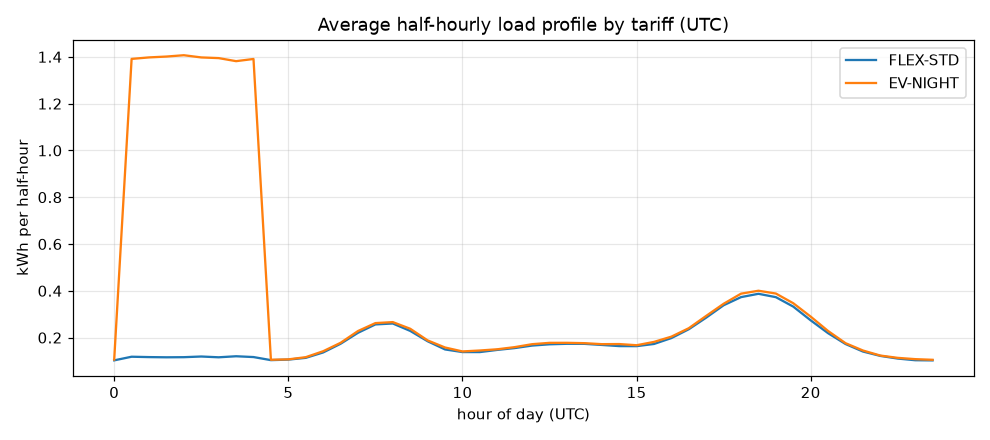

# ⚡ Smart Meter Lakehouse

An incremental data pipeline for a fictional GB electricity supplier. It takes in four messy feeds in four formats: half-hourly smart-meter reads (CSV), CRM change-data-capture events (JSON Lines), a tariff API (JSON) and weather (Parquet). These go through a bronze → silver → gold lakehouse on DuckDB. On the way the pipeline validates every row against declarative quality rules, quarantines failures, tracks customers and tariffs as SCD Type 2 dimensions, and prices each half-hour at the rate in force at that moment, including the 1 October 2026 price-cap change and off-peak EV rates. A small DAG runner orchestrates it all, with dependency resolution, retries with backoff, run metadata and lineage. Reruns are idempotent, and the incremental result matches a full reload exactly.

## 🏛 Architecture



The full design is in [docs/ARCHITECTURE.md](docs/ARCHITECTURE.md): layer-by-layer data flow, the task DAG, nine design decisions with the trade-offs considered, and limitations.

**Role focus:** Data Engineer · **Stack:** Python 3.11+, DuckDB (QUALIFY, ASOF JOIN, INSERT OR REPLACE), PyArrow/Parquet, Pydantic v2, matplotlib, pytest + Hypothesis, ruff, Docker

## 🧩 The problem

A supplier bills customers from half-hourly smart-meter data. The data is never clean:

- Head-end systems re-send files, deliver reads a day late, send corrections, mix UTC with UK local time, and changed their CSV layout on 1 October.
- The CRM emits change events out of order, duplicates them, and records tariff switches, home moves and change of tenancy.
- Prices change mid-period (the Ofgem price cap moved on 1 October) and EV tariffs have cheaper overnight rates.

Billing and analytics need one trustworthy answer: **what did each customer use, on which tariff, and what does it cost, for every half-hour?** It must be safe to rerun daily, and nothing bad can leak into the numbers.

## ✨ Features

**Ingestion (bronze)**
- File discovery by source and date with a `--through` cut-off to simulate daily runs
- **Idempotent by content checksum**: a re-sent file under a new name is skipped, and each file loads atomically along with its log entry
- **Per-source watermarks**, with late file deliveries flagged
- **Schema registry**: v1 (`kwh`) and v2 (`consumption_kwh` plus `reading_type`) map to canonical columns, additive columns are tolerated, and unknown layouts are rejected without stopping the pipeline
- **API contract** for tariff payloads with Pydantic: a payload that breaks the contract is rejected before it reaches bronze

**Quality and silver**
- 14 declarative SQL rules (error or warn), with failing rows quarantined as JSON and the reason recorded, plus per-batch rule metrics in `silver.dq_results`
- A **DQ gate**: if a batch's error rate is above the threshold, it isn't promoted. It waits in bronze and promotes cleanly on the next run
- UK local time converted to UTC (BST-aware), with **latest-delivery-wins** upserts for late reads and corrections
- CDC deduplication on `(customer_id, event_ts, op)`

**Modelling (gold)**
- **SCD Type 2** `dim_customer` rebuilt from the full CDC history (out-of-order safe, stable hashed surrogate keys) and `dim_tariff` from price periods
- `fact_halfhour` priced with **ASOF joins** (customer version and tariff period in force at the read time), including the off-peak window in local time
- `fact_daily_meter` with standing charges, completeness % and weather, plus serving views by region and tariff
- **Incremental rebuild** of only the affected dates (changed reads, or any date on or after a dimension change)

**Orchestration and ops**
- DAG runner with topological sort, cycle detection, retries with exponential backoff (transient errors only), skipping downstream of failures, run and task metadata, and table-level lineage
- Versioned schema migrations, env-driven config, a Markdown DQ report and charts, a Dockerfile and a Makefile

## 🚀 Quick start

```bash
pip install -e ".[dev]"
meterlake generate                                 # 1,000 meters x 28 days ≈ 1.4M reads
meterlake run --through 2026-09-21 --flaky 2       # first week; tariff API fails twice
meterlake run --through 2026-10-12                 # the rest: incremental
meterlake run --through 2026-10-12                 # rerun: no-op (idempotent)
meterlake report                                   # DQ report + charts in reports/
meterlake status                                   # watermarks, runs, lineage
meterlake query "SELECT * FROM gold.v_tariff_month ORDER BY 1, 2"
```

Or `make demo`. Configuration uses `METERLAKE_LANDING`, `METERLAKE_DB`, `METERLAKE_REPORTS`, `METERLAKE_MAX_ERROR_RATE` (default 0.05) and `METERLAKE_MAX_RETRIES` (default 3).

## 📟 Example output

Real output from the commands above.

First daily run. The tariff API returns 503 twice and the runner retries with backoff:

```text
WARNING smart_meter_lakehouse.dag: ingest_tariffs transient failure (attempt 1), retrying in 0.20s: tariff API returned 503 Service Unavailable
WARNING smart_meter_lakehouse.dag: ingest_tariffs transient failure (attempt 2), retrying in 0.40s: tariff API returned 503 Service Unavailable
run 20261121T105855-53cdde: SUCCESS
  ingest_weather    success    0.01s rows=224
  ingest_tariffs    success    0.63s rows=4 attempts=3
  ingest_customers  success    0.30s rows=1045
  ingest_readings   success    0.45s rows=337761
  ...
  ingest readings   loaded=7 skipped=1 rejected=0 rows=337,761
  silver customers  checked=1,045 rejected=1 (0.10%) upserted=1,038
  silver readings   checked=337,761 rejected=1,420 (0.42%) upserted=334,098
  gold   dates=7 halfhour_rows=334,098 daily_rows=7,000
  total 1.98s
```

The incremental run picks up the October schema change and the new tariff file. It also re-prices 21 September, because that day's late reads arrived in the next file:

```text
  ingest readings   loaded=21 skipped=8 rejected=0 rows=1,015,027
  silver readings   checked=1,015,027 rejected=4,206 (0.41%) upserted=1,003,898
  gold   dates=22 halfhour_rows=1,051,158 daily_rows=22,000
  total 3.17s
```

Rerunning the same day does nothing:

```text
  ingest readings   loaded=0 skipped=29 rejected=0 rows=0
  gold   dates=0 halfhour_rows=0 daily_rows=0
  total 0.07s
```

Point-in-time pricing in the serving view (`gold.v_tariff_month`): EV-NIGHT customers use 20.8% of their half-hours off-peak, and the October rows are priced at the new cap rates:

```text
month    tariff_code  kwh      energy_gbp  offpeak_share_pct
2026-09  EV-NIGHT     43799.7  6810.06     20.8
2026-09  FIX-12M-26   40825.6  9777.73     0.0
2026-09  FLEX-STD     62935.4  15645.74    0.0
2026-09  TRACKER      13482.0  2979.53     0.0
2026-10  EV-NIGHT     37386.8  6101.03     20.8
2026-10  FIX-12M-26   30978.8  7419.43     0.0
2026-10  FLEX-STD     48238.4  12590.22    0.0
2026-10  TRACKER      12083.5  2827.54     0.0
```

## 📊 Data quality results

From the generated [DQ report](docs/sample_dq_report.md):

| Measure | Value |
|---|---:|
| Bronze reads landed | 1,352,788 |
| Silver reads (clean, deduplicated) | 1,337,908 |
| Rows quarantined | 5,633 (0.42%) |
| Late-arriving reads applied to earlier days | 15,330 |
| Estimated reads flagged (warn) | 26,864 |
| SCD2 customer versions closed (tariff switch, move, change of tenancy) | 172 |
| Silver kWh vs gold kWh reconciliation | exact match (tested) |







The EV-NIGHT profile shows overnight charging inside the off-peak window, which is what the time-of-use pricing in `fact_halfhour` depends on.

**Performance:** a single full load of all 28 days (1.35M bronze rows through DQ, silver, SCD2 and both facts) takes **4.2 s** on an Apple Silicon laptop, about **320k rows/s**. Incremental runs process about 0.15–0.2 s per day of data.

## 🏗 Project structure

```text
smart-meter-lakehouse/
├── src/smart_meter_lakehouse/
│   ├── datagen.py     # seeded landing zone: 4 sources, 4 formats, realistic defects
│   ├── schema.py      # source schema registry + versioned migrations (DDL)
│   ├── warehouse.py   # DuckDB connection + migration runner
│   ├── ingest.py      # discovery, checksums, watermarks, loaders, API contract
│   ├── quality.py     # declarative SQL DQ rules + quarantine
│   ├── transform.py   # silver promotion, dedup, latest-wins upserts, DQ gate
│   ├── model.py       # SCD2 dims, ASOF-joined facts, incremental rebuild
│   ├── dag.py         # DAG, topological sort, retries, run log, lineage
│   ├── pipeline.py    # task wiring + flaky API simulation
│   ├── report.py      # run summary, DQ report, charts
│   ├── config.py · errors.py · cli.py
├── tests/             # 36 tests: unit, property-based, end-to-end integration
├── docs/              # ARCHITECTURE.md, sample DQ report, charts
├── Dockerfile · Makefile · pyproject.toml
```

## 🎯 Skills demonstrated

- **Pipeline design:** medallion architecture with clear layer contracts (raw text in bronze, typed and validated in silver, dimensional in gold)
- **Incremental and idempotent loading:** content checksums, watermarks, batch promotion state, and changed-date rebuilds proven equal to a full reload by a test
- **Data quality engineering:** declarative rules, quarantine with reasons, per-batch metrics and a promotion gate that never half-loads
- **Dimensional modelling:** SCD Type 2 from CDC, stable surrogate keys, point-in-time ASOF joins, conformed date dimension
- **Handling real-world mess:** schema evolution, late and corrected data, duplicate deliveries, timezone and BST conversion, out-of-order events, contract validation of API payloads
- **Orchestration:** dependency resolution, cycle detection, selective retries with backoff, run metadata and lineage
- **Advanced SQL:** window functions, `QUALIFY`, `ASOF JOIN`, upserts and transactional rebuilds in DuckDB
- **Testing data systems:** 36 tests including Hypothesis properties for DQ rules, failure-and-recovery scenarios and reconciliation checks

## 🧪 Running tests

```bash
pytest -q          # 36 tests, about 8 s
ruff check . && ruff format --check .
```

## 📄 License

MIT. See [LICENSE](LICENSE).
