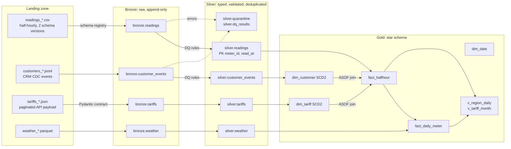
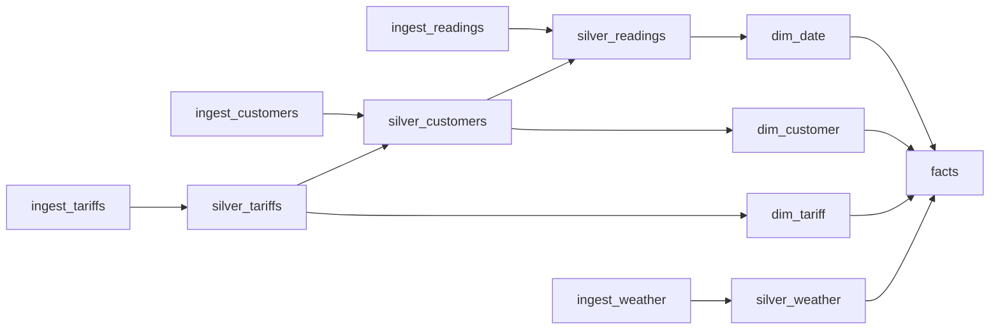

# Architecture

## Data flow

## Orchestration

`meterlake dag` prints this diagram from the live DAG definition. The runner records each
attempt in `meta.task_runs`, each run in `meta.dag_runs`, and table-level lineage in
`meta.lineage`.

## Modules

| Module | Responsibility |
|---|---|
| `datagen.py` | Seeded landing-zone generator (4 sources, 4 formats, realistic defects) |
| `schema.py` | Source schema registry and versioned warehouse migrations |
| `warehouse.py` | DuckDB connection and migration runner |
| `ingest.py` | File discovery, checksum idempotency, watermarks, bronze loaders, API contract |
| `quality.py` | Declarative SQL rules, quarantine, per-rule metrics |
| `transform.py` | Silver promotion per source, with dedup and latest-delivery-wins upserts |
| `model.py` | SCD2 dimensions, ASOF joins, incremental fact rebuild |
| `dag.py` | DAG definition, topological sort, retries, run metadata, lineage |
| `pipeline.py` | Wires the tasks together and simulates a flaky API |
| `report.py` | Run summary, DQ Markdown report and charts |
| `cli.py` | `generate`, `run`, `status`, `report`, `query`, `dag` |

## Key design decisions

1. **Bronze keeps everything as text.** Raw values (`"-0.31"`, `"15/09/2026 01:30"`, `""`) are
   kept exactly as delivered, so any silver bug can be fixed and replayed from bronze without
   asking the source to resend. *Rejected:* typing on load, which silently loses bad values.
2. **Idempotency by content checksum, not file name.** Re-sent files are skipped even under a
   new name. Corrected files (new bytes) are loaded and resolved in silver. Each file loads
   in one transaction together with its `ingest_log` row.
3. **Batches are promoted, not assumed.** `meta.batches` tracks `ingested → promoted` per
   source. If the DQ gate rejects a batch (error rate above `max_error_rate`), its bronze
   rows wait, and the next run promotes them once the issue is fixed. Nothing is ever
   half-loaded into silver.
4. **Latest delivery wins in silver.** `INSERT OR REPLACE` on `(meter_id, read_at)`, ordered
   by ingest time, file and line, handles late-arriving reads and corrections in one rule.
   *Trade-off:* re-delivering an old file with new bytes would override a newer correction.
   Real head-ends version their files, which is the next step.
5. **SCD2 is rebuilt from the full CDC history.** Out-of-order and late events then land
   correctly without merge logic. It costs O(events), which is tiny next to O(reads).
   Surrogate keys are `hash(customer_id, version_start)`, so they stay stable across
   rebuilds and facts never point at a key that no longer exists.
6. **ASOF joins for point-in-time correctness.** Each half-hour finds the customer version
   and tariff period in force at that moment. That is why a tariff switch or the 1 October
   price-cap change reprices exactly the right reads.
7. **Incremental gold by changed dates.** A timestamp mark in `meta.build_state` drives it:
   rebuild dates whose silver reads changed, plus every date on or after the earliest
   dimension change. Rebuilding a date is DELETE + INSERT in one transaction, so reruns are
   idempotent. A test checks that the incremental result equals the full load.
8. **Retry only what is transient.** `TransientSourceError` retries with exponential backoff.
   Any other exception fails fast and downstream tasks are skipped, because retrying a data
   bug just repeats it.
9. **DuckDB rather than Spark.** 1.35M rows load end to end in about 4 s on a laptop, and the
   SQL (QUALIFY, ASOF JOIN, INSERT OR REPLACE) carries over to Snowflake or Databricks.
   *Rejected:* pandas transforms, which run single-threaded with in-memory joins and are
   harder to review than SQL.

## Limitations and next steps

- Quarantined reads for unknown meters are not replayed automatically when the meter is
  registered later. A `replay-quarantine` task would re-check them.
- The tariff off-peak window is fixed at 00:30–05:30 local time. Real time-of-use tariffs
  need a window table.
- The DAG runs tasks one after another. Independent ingests could run in parallel.
- Weather is joined to daily facts only, not modelled as its own dimension.
