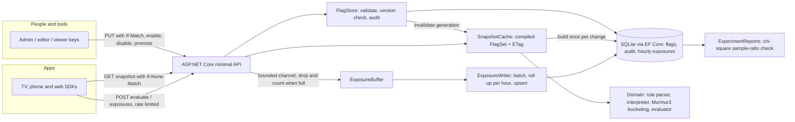

# 🎚 Streaming Feature-Flag Service

A feature-flag and gradual-rollout service for Corvid TV, an invented UK streaming platform. Product teams use it to switch features on for some viewers and not others: release a new video player to 1% of TVs and then everyone over a fortnight, run an A/B/C test on the autoplay countdown, or turn a broken feature off for every device within one poll. The service has its own small rule language, bucketing that gives every server and SDK the same answer, versioned writes with an audit trail, cached snapshots that SDKs poll with ETags, and a check that warns when an experiment's traffic split looks wrong.

## 🏛 Architecture



Design decisions and trade-offs: [docs/ARCHITECTURE.md](docs/ARCHITECTURE.md).

**Role focus:** Software Engineer · **Stack:** C# / .NET 10, ASP.NET Core minimal APIs, EF Core + SQLite (migrations, optimistic concurrency), System.Threading.Channels, built-in rate limiter, xUnit + WebApplicationFactory

## 🧩 The problem

A streaming service ships to tens of millions of devices it does not control. A bad TV build can't be rolled back quickly, so every risky change goes out behind a flag. Without a proper flag service, that goes wrong in three ways:

- **Inconsistent answers.** If a viewer is in the new-player group on their phone but not their TV, or moves in and out as the rollout widens, the experiment is worthless and support can't explain what anyone saw.
- **Unsafe changes.** Two people editing the same flag overwrite each other. Nobody can say who turned something on in production, or why.
- **Silent bad data.** An experiment whose split drifts from the configured 33/33/33 (because one variant crashes, or its exposures are dropped) gives confident but wrong results.

This service handles all three, and evaluation stays fast enough to run on every request.

## ✨ Features

- **Rule language:** a hand-written lexer and recursive-descent parser for rules like `plan == "premium" and semver(appVersion) >= semver("7.4.0")`, with `in`, `not in`, `contains`, `startsWith`, `endsWith`, dotted attributes and three allowed functions. Error messages give the exact character, and nesting depth and length are capped.
- **Deterministic bucketing:** MurmurHash3 into 100,000 buckets on `salt.flag.unit`, so allocations work to 0.001%, different flags bucket independently and no assignments are stored
- **Serving modes:** fixed variant, weighted split, and a **progressive rollout** on a schedule that only ever widens (tested: no unit goes back)
- **Evaluation order:** kill switch → prerequisites (memoised, cycle-checked, depth-capped) → target lists → rules in order → default, with a reason, rule id and bucket in every answer
- **Safe writes:** validation that reports every problem with a JSON path; `If-Match` versioning (428 if missing, 412 if stale); a race-safe commit; an append-only audit log with plain-English diffs
- **Least privilege:** hashed API keys; viewers read, editors change everything except production, admins release. Anyone on call can use the production kill switch. SDK keys are tied to one environment, which comes from the key and never from the URL.
- **SDK delivery:** each environment's snapshot is compiled once per change behind a generation counter, served with a strong ETag (`304 Not Modified` when nothing changed) and rate-limited per key
- **Exposure pipeline:** a bounded `Channel` (never blocks evaluation; drops and counts when full) → batched hourly roll-up → `INSERT … ON CONFLICT DO UPDATE` upserts
- **Experiment health:** a chi-square sample-ratio-mismatch test (my own regularised incomplete gamma, checked against published tables) with a verdict
- **Promotion:** copy targeting from staging to production while keeping production's on/off state
- **Ops:** health checks, OpenAPI, problem details (RFC 9457), structured logging, Dockerfile, Makefile, benchmark

## 🚀 Quick start

Needs the .NET 10 SDK.

```bash
make bench     # 200,000 synthetic viewers through the evaluator
make run       # API on http://localhost:5180 with the demo flags and demo keys
```

`make run` uses `appsettings.Development.json`, which seeds six Corvid TV flags into each environment and sets up demo keys (`demo-admin-key`, `demo-editor-key`, `demo-viewer-key`, `demo-sdk-production`, `demo-sdk-staging`). They are only for local use. Real keys go in configuration as SHA-256 hashes.

| Endpoint | Who | What |
|---|---|---|
| `GET /v1/environments/{env}/flags` | viewer+ | List, `?search=`, `?tag=`, keyset `?cursor=` |
| `GET /v1/environments/{env}/flags/{key}` | viewer+ | Definition; `ETag` is the version |
| `PUT /v1/environments/{env}/flags/{key}` | editor (admin in production) | Create, or replace with `If-Match` |
| `POST …/{key}/enable` · `…/disable` | editor+ · disable allowed in production | Kill switch, needs no version |
| `DELETE …/{key}` | editor+ | Archive with `If-Match`; refused while a prerequisite |
| `POST …/{key}/promote?to=production` | admin | Copy targeting, keep on/off |
| `GET …/{key}/history` · `…/experiment` | viewer+ | Audit trail · sample-ratio report |
| `GET /v1/sdk/snapshot` | SDK key | Compiled flags for the key's environment, `If-None-Match` → 304 |
| `POST /v1/sdk/evaluate` · `/v1/sdk/exposures` | SDK key | Server-side evaluation · exposure batches (202) |

## 📟 Example output

`make bench` on an Apple M2 (8 cores), Release build:

```text
Corvid TV flag service benchmark: 200,000 synthetic viewers, seed 42, 6 flags

Evaluation
  single thread           639 ns per flag   (1.57 M flags/s)
   8 threads               88 ns per flag   (11.30 M flags/s)
  rule parse            2,726 ns per rule (once per snapshot, not per request)

Bucketing (MurmurHash3, 100,000 buckets)
  20 bins: min 9,831, max 10,167, chi-square 20.4 on 19 df, p = 0.370

Progressive rollout of player.v2 (excluding the old-TV rule and staff)
  23 Nov  target     1%  actual   1.03%  (2,052 devices)
  25 Nov  target     5%  actual   5.09%  (10,189 devices)
  28 Nov  target    25%  actual  25.01%  (50,013 devices)
  02 Dec  target    50%  actual  49.92%  (99,835 devices)
  07 Dec  target   100%  actual 100.00%  (200,000 devices)
  devices that went back to the old player at a later step: 0

Sample ratio mismatch check on autoplay.countdown (kids' profiles are excluded by a rule)
  healthy:      s5 54,291 / s10 54,481 / s15 54,636  p = 0.575  mismatch: False
  3% s15 loss:  s5 54,291 / s10 54,481 / s15 53,024  p = 9.0e-6  mismatch: True
```

The last two lines matter most. Losing 3% of one variant's exposures is easy to miss by eye, but at this volume the check flags it clearly.

The running API (real responses, trimmed):

```text
$ curl -X POST localhost:5180/v1/sdk/evaluate -H "X-Api-Key: demo-sdk-production" -d '{"context":{"userId":"user-0042",
    "deviceId":"tv-8812","plan":"premium","appVersion":"7.4.1","country":"GB","device":{"platform":"smarttv","year":2017}}}'
autoplay.countdown       s15   fallthrough
downloads.max-quality    uhd   ruleMatch    premium-new-app
home.ad-tier-banner      off   fallthrough
kids.pin-lock            on    fallthrough
live.low-latency         on    fallthrough
player.v2                off   ruleMatch    old-tvs

$ curl -X PUT …/production/flags/kids.pin-lock -H 'If-Match: "7"' …
{"title":"Precondition Failed","status":412,"detail":"'kids.pin-lock' is at version 1, not 7. Reload it and apply
 your change again.","currentVersion":1}

$ curl -X POST …/production/flags/player.v2/enable  -H "X-Api-Key: demo-editor-key"   → 403
$ curl -X POST …/production/flags/player.v2/disable -H "X-Api-Key: demo-editor-key"   → version 2 on False by demo-editor
$ curl …/production/flags/player.v2/history
[{"version":2,"actor":"demo-editor","action":"disable","changes":["Turned off (kill switch)."]},
 {"version":1,"actor":"seed","action":"create","changes":["Created with 2 variants, 2 rules, on."]}]
```

## 🏗 Project structure

```text
src/Rollout.Domain/          rule lexer, parser and interpreter; values and semver; Murmur3 bucketing;
                             flag model, validator, diff; evaluator (FlagSet); sample-ratio statistics
src/Rollout.Application/     EF Core context and migration, FlagStore, SnapshotCache, exposure buffer,
                             writer and reports, demo flags
src/Rollout.Api/             minimal API endpoints, API-key auth and permissions, rate limiting, problem details
src/Rollout.Bench/           seeded synthetic viewers and the benchmark above
tests/Rollout.Tests/         unit, statistical, API, concurrency and rate-limit tests
```

## 🎯 Skills demonstrated

- Writing a small language properly: tokens, precedence, exact error positions and limits that keep user-written rules from hurting the host
- Consistency in a distributed system without shared state: a stable hash means every server and SDK agrees, and a progressive rollout never takes a feature away
- Concurrency control you can test: optimistic versions over HTTP (`If-Match`, 412, 428), a race that came up during testing (eight writers, exactly one wins) and a cache-invalidation scheme that can't serve a stale snapshot for good
- Back-pressure: a bounded channel that keeps the request path fast and counts what it drops
- Security by design: hashed keys with constant-time comparison, environment-scoped SDK keys, role rules that keep the kill switch available in an incident
- Statistics in production code: an experiment-health check with a numerical method tested against published values

## 🧪 Running tests

90 tests (46 test methods, with theories expanded), covering the rule language, semver, Murmur3 reference vectors, rollout monotonicity, validation, diffs, the chi-square tail, every API status path, concurrent writers and rate limiting:

```bash
dotnet test
```

## 📄 License

MIT
