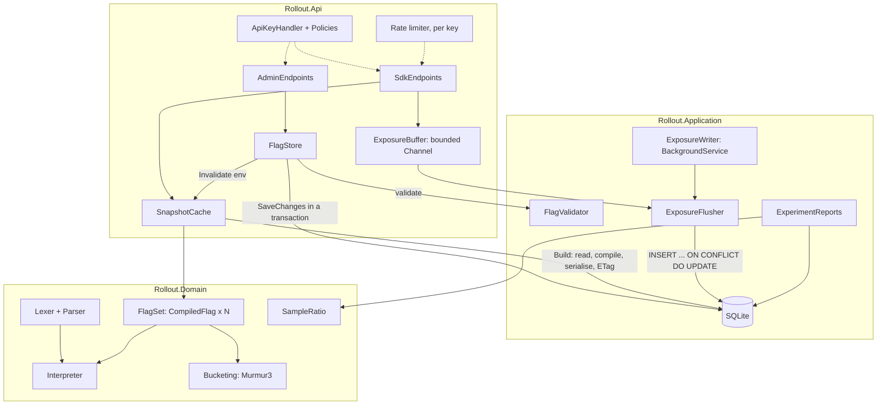
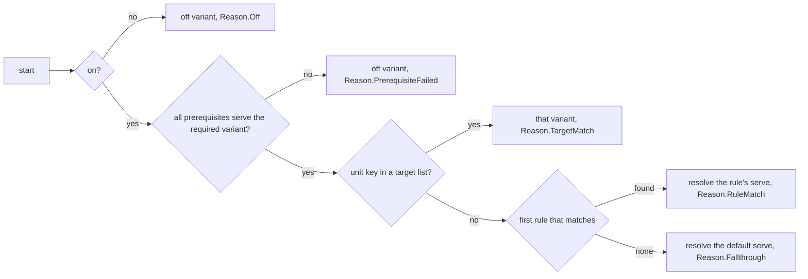

# Architecture

## Overview

### Evaluating one flag

"Resolve" means a fixed variant, a weighted split (bucket against cumulative weights) or a progressive rollout (bucket below `percent x 1,000` gets the new variant).

## Layers

| Project | Responsibility | Depends on |
|---|---|---|
| `Rollout.Domain` | Rule language, values, bucketing, flag model, validation, evaluation, statistics | nothing |
| `Rollout.Application` | Persistence, versioned writes and audit, snapshot cache, exposure pipeline, reports | Domain, EF Core |
| `Rollout.Api` | HTTP, authentication, authorisation, rate limiting, error mapping | Application |
| `Rollout.Bench` | Seeded synthetic viewers and measurements | Application |

The domain has no framework dependencies, so the evaluator that a real SDK would port can be tested on its own, and the server and the benchmark run exactly the same code.

## Key decisions and trade-offs

### 1. A small hand-written rule language, not C# expressions or JSON clauses
- **Chosen:** a lexer and recursive-descent parser for a deliberately small grammar (`or` < `and` < `not` < comparison), with three allowed functions.
- **Rejected:** compiling C# or using a scripting engine (an injection risk, slow to start, and impossible to port to a TV SDK); JSON clause arrays like `{"attribute":"plan","op":"in","values":[…]}` (easy to evaluate but painful to write and review, and nesting `or` inside `and` gets awkward).
- **Trade-off:** we own a parser. That's acceptable because the grammar is about 250 lines, every error carries a character position, and length (2,000 characters) and depth (32) are capped so a pasted rule cannot exhaust the stack.
- **Semantics:** evaluation never throws. A missing attribute is `null`. Comparing different types is `false`, and so is `!=` against `null`, so a typo makes a rule miss rather than take down the snapshot endpoint. Strings compare by ordinal, so results never depend on server culture.

### 2. Stateless bucketing with Murmur3
- **Chosen:** `bucket = murmur3("salt.flag.unit") mod 100,000`.
- **Why:** no assignment table to store or replicate, and any SDK can compute the same answer. Including the flag key means two experiments do not get the same viewers (tested: >90% of units land in different thousandths). A salt lets a team reshuffle on purpose.
- **Rejected:** `GetHashCode` (randomised per process in .NET), SHA-256 (correct but several times slower, with no benefit since this is not security), random assignment with storage (stateful, and harder to make consistent across devices).
- **Progressive rollouts** compare the same bucket with a rising threshold, so the set of units on the new variant can only grow. The validator rejects schedules that shrink, and the benchmark shows 0 devices moving back across 200,000.
- **Modulo bias:** 2³² mod 100,000 leaves a bias of about 2 × 10⁻⁵, far below the noise in any experiment.

### 3. Optimistic concurrency over HTTP
- **Chosen:** the flag version is both the HTTP ETag and the EF Core concurrency token. Updates must send `If-Match`: missing → 428, stale → 412 with `currentVersion`.
- **A race found during testing:** with eight writers sending the same version, the losing writes sometimes failed on the audit table's unique `(environment, flag, version)` index before EF reported the version-token mismatch, and returned 500. The commit now treats any `DbUpdateException` after which the stored version has moved as a conflict. The test checks that exactly one writer wins and seven get 412.
- **The kill switch is the exception:** `disable` needs no version and retries up to three times on conflict. In an incident nobody should have to reload a page first, and "set On to false" is safe to reapply.
- **Rejected:** last write wins (silent overwrites); pessimistic locks (SQLite has no row locks, and holding a lock across a human's edit is wrong anyway).

### 4. Snapshot cache with generations
- **Chosen:** one compiled `FlagSet` plus pre-serialised JSON per environment, behind `Lazy<Task<…>>` so 50 concurrent polls cause one build (tested). A write bumps the environment's generation after it commits. A cached snapshot is only served while its generation is current.
- **Why generations and not "remove the entry":** a build that read the database just before a commit could finish just after the invalidation and put stale data back into the cache. With generations, that build carries the old number and is discarded.
- **ETag:** a hash of `(key, version)` pairs, so it is strong, identical on every server, and changes exactly when content changes. SDKs poll with `If-None-Match` and get a 304 of a few bytes.
- **Trade-off:** each API instance builds its own snapshot. With several instances a change is visible on each at its next poll after the write. For a multi-node deployment the next step is a change notification (Postgres `LISTEN/NOTIFY` or Redis pub/sub) to bump generations everywhere.

### 5. Exposures: bounded, lossy and counted
- **Chosen:** `Channel.CreateBounded` in `Wait` mode with `TryWrite` only. When full, the write fails at once, so the item is dropped and counted (`/v1/ops/stats`). A background writer batches, rolls up to `(env, flag, variant, hour)` and upserts with `Count = Count + excluded.Count`.
- **Why lossy:** evaluation sits on a TV's start-up path. Waiting for an analytics write would make every viewer pay for a slow disk. Dropping is visible, measurable and also caught by the SRM check if it ever skews one variant.
- **Why upsert:** read-modify-write would lose counts when two flushes overlap. A single statement cannot.
- **Validation:** exposures for unknown flags or variants, or timestamps more than 5 minutes ahead or 2 days behind, are rejected and counted, because device clocks are often wrong.
- **Shutdown:** the writer drains what's left without the stopping token, so a deploy does not lose the last batch.

### 6. Sample ratio mismatch
- **Chosen:** chi-square goodness of fit against the configured weights, α = 0.001 (strict because it runs continuously), with fewer than 1,000 exposures reported as "too few".
- **Numerics:** the upper regularised incomplete gamma Q(k/2, x/2), using a series for small x and a Lentz continued fraction for large x, with Lanczos log-gamma. Tests check it against published critical values (3.841 → 0.05 on 1 df, 30.14 → 0.05 on 19 df).

### 7. JSON definitions in SQLite
- Flags are always read and written whole, and their shape changes faster than a relational schema would like, so each definition is one JSON column. The fields we query (environment, key, version, archived) are real columns with a unique index. Tag filtering happens in memory while paging by key, which is fine for hundreds of flags. At tens of thousands, tags would get their own table.

## Security

- API keys are stored as SHA-256 hashes and compared with `CryptographicOperations.FixedTimeEquals`.
- Roles: `viewer`, `editor` (not production), `admin`, `sdk`. SDK keys carry exactly one environment claim. SDK endpoints take the environment from the key, so a leaked staging key cannot read production.
- Rules can only call `semver`, `lower` and `len`, and cannot reach the host.
- Context input is capped at 64 attributes and 4 levels of nesting. Exposure batches are capped at 1,000.
- Per-key fixed-window rate limiting (600/min by default) on SDK endpoints, so one bad app build cannot starve everyone else.

## Known limitations and next steps

- Single-node cache invalidation (see decision 4). Add pub/sub to support several instances.
- Exposures are counted, not de-duplicated. SDKs should report once per session per flag, and HyperLogLog sketches per hour would give unique viewers.
- There are no streaming updates (SSE) yet. Polling with ETags is simple and cheap, but a change takes up to one poll interval to reach a device.
- There is no scheduled kill switch or automatic rollback on a guardrail metric. The SRM report is the first building block.
- SQLite suits a single instance. The EF Core model would move to PostgreSQL by changing the provider and regenerating the migration.
