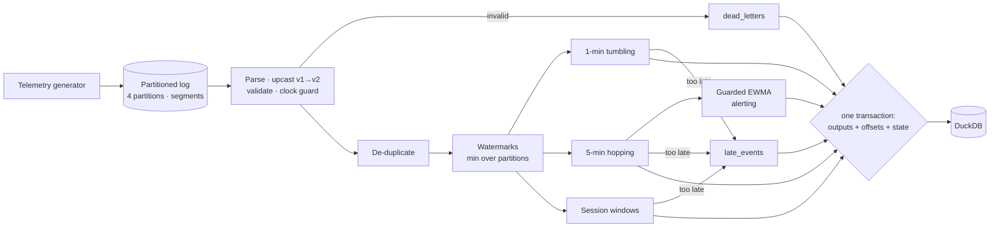
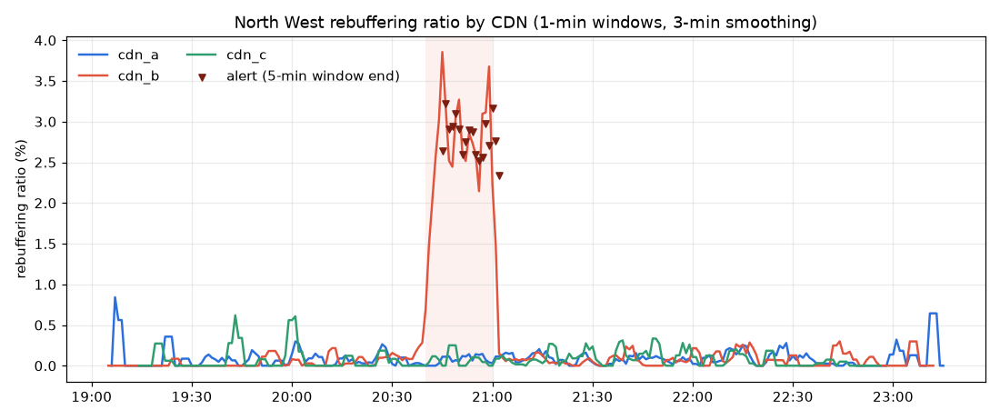
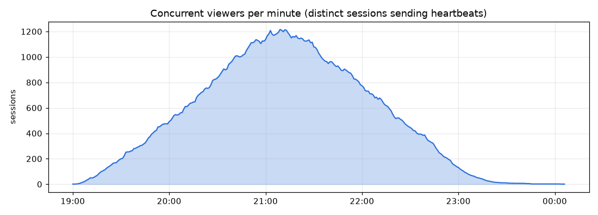
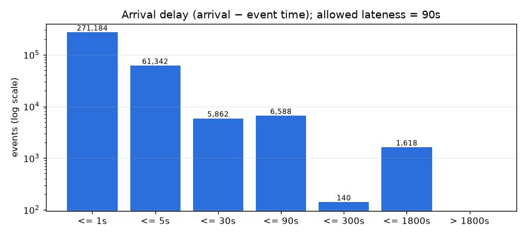
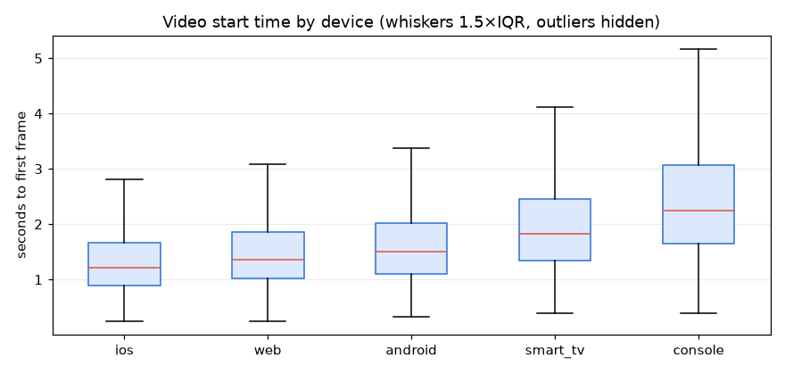
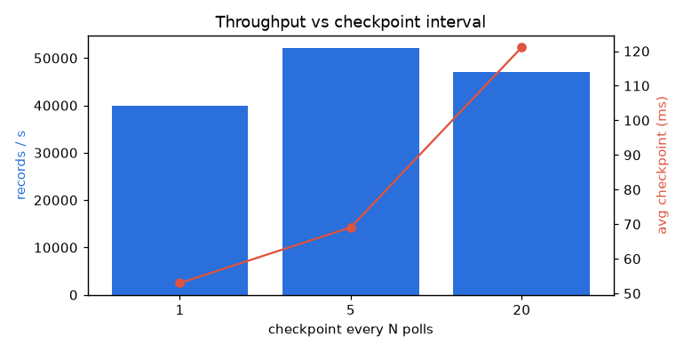

# 📺 Streaming QoE Pipeline

An event-time stream processor for the player telemetry of a fictional UK video-on-demand
service. It is pure Python and needs no cluster. A generator writes 353k messy, out-of-order
records from a Saturday evening of viewing (12,000 sessions on smart TVs, phones, browsers and
consoles) to a Kafka-style partitioned log. The processor consumes that log with
**per-partition watermarks**, **tumbling, hopping and session windows**, **allowed lateness with a
late-data side output**, bounded **de-duplication**, **schema-version upcasting** and a
**dead-letter queue**. It commits results to DuckDB **exactly once in effect**: outputs, consumer
offsets and operator state go into one transaction. It also finds the CDN incident hidden in the
data: `cdn_b` stalling in the North West from 20:40 to 21:00.

## 🏛 Architecture



Design decisions, trade-offs and limitations are in [docs/ARCHITECTURE.md](docs/ARCHITECTURE.md).

**Role focus:** Data Engineer · **Stack:** Python 3.11+, DuckDB, Pydantic v2, pandas, matplotlib,
pytest + Hypothesis, Docker

## 🧩 The problem

Viewers abandon a stream after a few stalls, so operations need per-minute quality metrics by
CDN, region and device, a summary per session, and an alert when one CDN fails one region. The
telemetry does not make this easy:

- Events arrive **out of order**. Most arrive within a second, but 3.5% are 5-60 s late and 0.5%
  are minutes late, flushed from offline buffers on reconnect.
- Clients **retry**, which creates duplicates. Old app builds send a **v1 schema**. Some records
  are **malformed**, and a few devices report timestamps **two days in the future**.
- The processor **will crash** at some point, and a restart must not double-count anything or
  lose the half-built windows held in memory.

## ✨ Features

- **Partitioned, segmented append-only log** keyed by session, with offset-addressed reads and corruption detection.
- **Versioned parsing.** v1 terse payloads are upcast to v2. Per-event-type payload contracts are enforced with Pydantic. Each failure becomes a dead letter with a reason and the raw record.
- **Event-time watermarks** with bounded out-of-orderness, the minimum taken across partitions, idle partitions handled, and a guarantee that the watermark never regresses.
- **Three windowed operators.** 1-minute tumbling by cdn × region × device (with concurrent viewers), 5-minute hopping with a 1-minute slide by cdn × region, and session windows with a 2-minute gap.
- **Allowed lateness.** Each window fires exactly once, at `end + 90 s`. Later events go to a side output, recorded per operator.
- **Clock guard.** Events stamped in the future are quarantined so they cannot drag the watermark forward.
- **Bounded state.** De-duplication ids and window state are evicted as the watermark advances. Nothing grows without limit.
- **Exactly-once checkpoints.** Outputs, offsets and compressed operator snapshots commit in one DuckDB transaction. A crash at any poll replays to identical results.
- **QoE metrics.** Rebuffering ratio, video start time (VST), exits before video start (EBVS), time-weighted bitrate, error rates.
- **Incident detection.** A guarded EWMA z-score is kept per (CDN, region), and SQL gaps-and-islands groups alert windows into incidents.
- **Operations.** Structured JSON logs, run statistics in `pipeline_runs`, schema versioning, `QOE_*` environment settings, a benchmark command, a Makefile and a Dockerfile.

## 🚀 Quick start

```bash
cd streaming-qoe-pipeline
pip install -e ".[dev]"
qoe generate                       # 12,000 sessions -> data/log (≈150 MB, not committed)
qoe run --crash-after-polls 23     # simulate the processor dying mid-stream
qoe run                            # resume from the last checkpoint
qoe report                         # incident, CDN, device and data-quality tables + charts
qoe bench                          # throughput vs checkpoint interval
```

`data/sample_events.jsonl` holds the first 60 raw records of partition 0 for inspection, mixing
v1 and v2 payloads.

## 📊 Key insights

All numbers below are real output from the commands above on an Apple-silicon Mac.

**Generation** (`qoe generate`):
```text
sessions=12,000 events=347,931 log_records=353,132
  duplicates                      5,201
  future_clock                      168
  malformed_bad_time                187
  malformed_missing_session         158
  malformed_negative                173
  malformed_truncated               181
  malformed_unknown_type            156
  malformed_v3                      174
  sessions_v1                     1,220
  sessions_v2                    10,780
```

**Processing** (`qoe run`, uninterrupted, checkpoint every 5 polls):
```text
{
  "polls": 47,
  "checkpoints": 10,
  "alerts": 18,
  "dead_letters": 1217,
  "dedup_evicted": 346734,
  "dlq_bad_timestamp": 192,
  "dlq_future_timestamp": 170,
  "dlq_invalid_json": 182,
  "dlq_schema_violation": 498,
  "dlq_unknown_schema_version": 175,
  "duplicates_dropped": 5181,
  "events_processed": 346734,
  "late_qoe_cdn_region_5m": 1447,
  "late_qoe_minute": 1447,
  "late_sessions": 729,
  "records_read": 353132,
  "schema_v1": 34017,
  "schema_v2": 312717,
  "elapsed_s": 7.45,
  "records_per_s": 47388,
  "avg_checkpoint_ms": 73.0,
  "max_checkpoint_kb": 767.8,
  "open_windows": 0,
  "open_sessions": 0,
  "dedup_ids": 0
}
```

Every record is accounted for: 353,132 read = 346,734 processed + 5,181 duplicates +
1,217 dead letters. The generator injected 5,201 duplicates. The other 20 were copies of
malformed or future-stamped records, so both copies went to the dead-letter queue. **Crash test:** killing
the processor after poll 23 and resuming produced row-for-row identical tables: 32,635 minute
windows, 10,007 hopping windows, 12,000 sessions, 3,623 late events, 1,217 dead letters and 18
alerts.

**Report** (`qoe report`):
```text

== incidents
  cdn     region        first_window     last_window_end  alert_windows  peak_rebuffer_pct  baseline_pct  peak_z
cdn_b North West 2026-11-21 20:40:00 2026-11-21 21:02:00             18               3.22          0.09    15.7

== cdn
    cdn  sessions  ebvs_pct  median_vst_ms  rebuffer_pct  watch_hours  avg_kbps
  cdn_a      4858      2.70         1589.0         0.074       1007.0    6240.0
  cdn_b      3800      3.58         1600.0         0.114        791.0    6160.0
  cdn_c      2122      2.69         1547.0         0.076        425.0    6195.0
unknown      1220      3.61         1678.0         0.079        239.0    5100.0

== device
  device  sessions  p50_vst_ms  p95_vst_ms  ebvs_pct  fatal_pct
smart_tv      4482      1818.0      3854.0      2.92      0.580
     ios      2327      1206.0      2569.0      2.49      0.559
 android      2227      1505.0      3198.0      3.59      0.584
     web      1720      1359.0      3045.0      2.97      0.814
 console      1244      2240.0      4543.0      3.86      0.482

== quality
                               item  records
           late (qoe_cdn_region_5m)     1447
                  late (qoe_minute)     1447
                    late (sessions)      729
      dead letter: schema_violation      498
         dead letter: bad_timestamp      192
          dead letter: invalid_json      182
dead letter: unknown_schema_version      175
      dead letter: future_timestamp      170

```

- **The incident was found automatically and only once.** 18 consecutive 5-minute windows on
  `cdn_b` / North West peaked at a **3.22% rebuffering ratio against a 0.09% baseline (z = 15.7)**.
  There were no false positives on any other CDN or region.
- **`cdn_b` is worse overall** (0.114% rebuffering vs 0.074% for `cdn_a`), but the difference is
  almost entirely that one regional incident. This is why the alerting is per (CDN, region).
- **Consoles start slowest** (p95 VST 4.5 s) and have the highest EBVS (3.9%). Start-up time is
  the lever for console abandonment.
- **v1 clients have no CDN field**, so 1,220 sessions (239 watch hours) cannot be attributed to a
  CDN. Finishing the v2 migration on Android and console is a data-quality action in its own right.







## 🏗 Project structure

```
streaming-qoe-pipeline/
├── src/streaming_qoe_pipeline/
│   ├── events.py         # Pydantic schema, v1→v2 upcasting, dead letters
│   ├── log.py            # partitioned, segmented append-only log
│   ├── windows.py        # tumbling/hopping assigners, watermark tracker
│   ├── operators.py      # dedup, keyed window aggregation, session windows, late output
│   ├── metrics.py        # QoE accumulators and session summaries
│   ├── alerts.py         # guarded EWMA z-score detector
│   ├── pipeline.py       # processor loop, routing, firing, checkpoints
│   ├── sink.py           # DuckDB schema, atomic commit, checkpoint restore
│   ├── generator.py      # realistic messy telemetry with an injected incident
│   ├── report.py         # analytical SQL (gaps-and-islands, quantiles) + charts
│   ├── config.py · observability.py · errors.py · cli.py
├── tests/                # 47 tests: unit, property-based, integration, crash/resume
├── docs/ARCHITECTURE.md · docs/charts/
├── data/sample_events.jsonl
└── Makefile · Dockerfile · pyproject.toml
```

## 🎯 Skills demonstrated

- **Stream processing fundamentals:** event time vs processing time, watermarks, allowed lateness, side outputs, tumbling, hopping and session windows. All are implemented from first principles, so each trade-off is visible.
- **Reliability engineering:** exactly-once in effect through atomic commits of outputs, offsets and state, deterministic replay, and crash tests at several points.
- **Data quality at ingestion:** schema evolution and upcasting, a dead-letter queue with reasons, de-duplication, and quarantine of skewed clocks that would otherwise corrupt watermarks.
- **State management:** bounded state with watermark-driven eviction, plus snapshots and restores for every operator.
- **Analytics engineering:** a DuckDB serving layer with keyed upserts and SQL for incidents (gaps-and-islands), quantiles and filtered aggregates.
- **Performance awareness:** about 50k records/s in pure Python, with a measured checkpoint-interval trade-off.
- **Testing:** 47 pytest tests, including Hypothesis property tests for window assignment and parametrised crash/resume equivalence.

## 🧪 Running tests

```bash
pip install -e ".[dev]"
ruff check . && ruff format --check .
pytest -q
```

## 📄 License

MIT. See [LICENSE](LICENSE).
