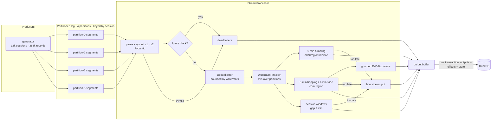

# Architecture: Streaming QoE Pipeline

## Context

A UK video-on-demand service collects player telemetry from smart TVs, phones, browsers and
consoles: play attempts, first frames, 30-second heartbeats, stalls, bitrate switches, errors.
Operations want per-minute quality-of-experience (QoE) metrics by CDN, region and device. They
want a summary per viewing session, and an alert within minutes when one CDN degrades in one part
of the country. The data is unbounded, arrives out of order and is messy.

## Processing loop

1. **Poll.** Read up to `poll_records_per_partition` records from each partition, starting at
   the committed offsets.
2. **Parse.** JSON → schema-version detection → v1 upcast → Pydantic validation, including the
   payload each event type must carry. Failures become `dead_letters` with a reason and the raw
   record.
3. **Guard the clock.** Events stamped more than 5 minutes after their arrival time are
   quarantined (`future_timestamp`).
4. **De-duplicate** on `event_id`.
5. **Advance per-partition watermarks.** The global watermark is the minimum across partitions,
   minus a 5 s out-of-orderness bound, and it is recomputed once per poll.
6. **Route each event** to three operators. An operator sends an event to `late_events` if the
   window it belongs to has already fired.
7. **Fire** every window whose `end + allowed_lateness ≤ watermark`, and every session whose
   `last_event + gap ≤ watermark`. Then evict de-duplication ids older than the horizon.
8. **Checkpoint** every *N* polls: outputs, offsets and an operator-state snapshot commit in one
   DuckDB transaction.

## Key design decisions

### Event time, not processing time
QoE is about what viewers experienced, when they experienced it. Processing-time windows would
put a heartbeat flushed from a phone's offline buffer 20 minutes late into the wrong minute and
blur any incident. Using event time requires watermarks and lateness handling. That cost is why
this project exists.

### Watermark = min across partitions
If each partition advanced its own windows, a partition lagging behind (a slow consumer, or a
partition with a burst of delayed traffic) would see its on-time data declared late. Taking the
minimum costs latency, since the slowest partition sets the pace, but it gains correctness. In
bounded replay mode, a partition that has reached its end offset is marked idle so it stops
holding the watermark back. A live deployment would use an idleness timeout instead.

### Fire once, after allowed lateness (rejected: early and updating firings)
Each window is emitted once, when the watermark passes `end + 90 s`. Downstream tables are then
final when written: no retractions, and no "the 20:41 number changed" conversations. The price is
about 95 s of extra latency. The alternative was Flink-style early firings plus late updates with
upserts. It gives fresher dashboards, but every consumer would have to handle restated numbers.
For an operations alert whose question is "is cdn_b failing?", 95 s is acceptable. The arrival
profile (`docs/charts/delay_profile.png`) shows 99.5% of events (345k of 347k) arrive within 90 s.

### Quarantine future clocks
One device with its clock set two days ahead would push its partition's watermark forward. The
global minimum would protect the other partitions only until that partition's real traffic
caught up. Rejecting events stamped well after their own arrival time is cheap and removes the
failure mode. `test_future_clocks_are_quarantined_not_watermarked` covers it.

### Exactly-once in effect via one transaction
Rejected: at-least-once writes plus idempotent upserts alone. Upserts make *replays* safe, but
after a crash the in-memory operator state (open windows, sessions, de-duplication ids, alert
baselines) would be lost. Windows that straddle the crash would be published with only half
their events. Instead, outputs are buffered between checkpoints and committed together with the
consumer offsets and a zlib-compressed JSON snapshot of every operator (largest about 768 KB at
the 21:00 peak). On restart the processor restores both and resumes, and poll boundaries line up
exactly, so recomputation is deterministic. The test suite crashes after polls 1, 3 and 6 and
asserts that all six output tables match an uninterrupted run row for row. On the full dataset,
a crash at poll 23 followed by a resume also matches exactly.

### Checkpoint interval is a throughput / recovery trade-off
| checkpoint every | checkpoints | records/s | avg checkpoint |
|---|---|---|---|
| 1 poll | 47 | 39,908 | 53 ms |
| 5 polls | 10 | 52,164 | 69 ms |
| 20 polls | 3 | 47,064 | 121 ms |

Checkpointing every poll costs about 25% of throughput. Every 20 polls gives fewer, larger
commits, a bigger output buffer, and more work to replay after a crash, with no further speed-up
here. Five polls (≈40k records) is the default.

### Guarded EWMA for alerting (rejected: static thresholds, plain EWMA)
Baseline rebuffering differs by region and CDN, so a single static threshold either misses
incidents in the quiet regions or floods alerts in the busy ones. Each (CDN, region) key gets its
own EWMA mean and variance instead. A plain EWMA failed on this data: the 5-minute hopping
windows ramp into the incident over five slides, the baseline absorbed the ramp, and the peak
reached only z ≈ 2. The detector now folds only windows with `z < 2` into the baseline, which
keeps it at 0.09% while the incident peaks at 3.2% (z = 15.7). A volume floor of 30 viewing
minutes per window stops tiny keys from alerting on a single stall.

### Session windows keyed by the client's session id
Players send a `session_id`, so sessions are keyed by it rather than re-derived from gaps per
viewer. The gap only decides when a session is complete. A late event for an already-closed
session goes to the late side output and does not create a second session.

## Data model (DuckDB)

| Table | Grain | Key |
|---|---|---|
| `qoe_minute` | 1-min × cdn × region × device | `(window_start, cdn, region, device)` |
| `qoe_cdn_region_5m` | 5-min hopping × cdn × region | `(window_start, cdn, region)` |
| `sessions` | viewing session | `session_id` |
| `alerts` | alerting hopping window | `(window_start, cdn, region)` |
| `late_events` | event × operator that dropped it | `(event_id, operator)` |
| `dead_letters` | log record | `(partition, offset)` |
| `consumer_offsets`, `operator_state` | checkpoint | `group_id` (+ `partition`) |
| `pipeline_runs`, `schema_migrations` | metadata | run id / version |

## Known limitations and next steps

- **Single process.** Partitions are consumed by one processor. Scaling out would assign
  partitions to workers and key state by partition, as Kafka consumer groups with Flink keyed
  state do. The design already keys sessions to partitions.
- **Full snapshots.** Every checkpoint serialises all state. Incremental (changelog) checkpoints
  would cut the 768 KB peak to the delta since the last one.
- **Late data is reported, not reconciled.** 0.4% of events (1,447 of 346,734) arrive after their minute window fired.
  A nightly batch job could recompute those windows from the log and restate them, which is the
  classic lambda/kappa reconciliation.
- **The local log is a stand-in for Kafka/Kinesis.** The reader interface (`read(partition,
  offset, n)`) maps directly onto a real consumer.
