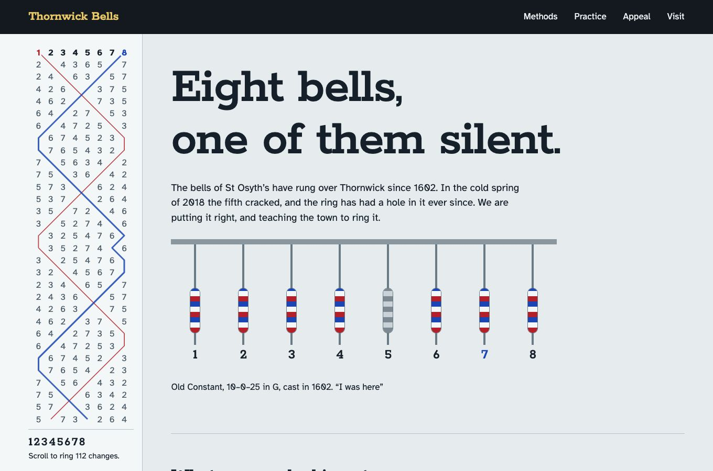
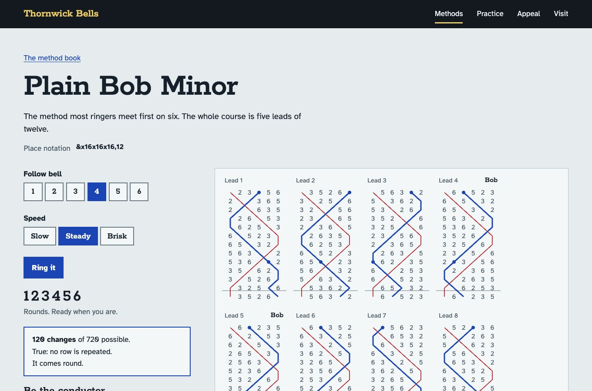
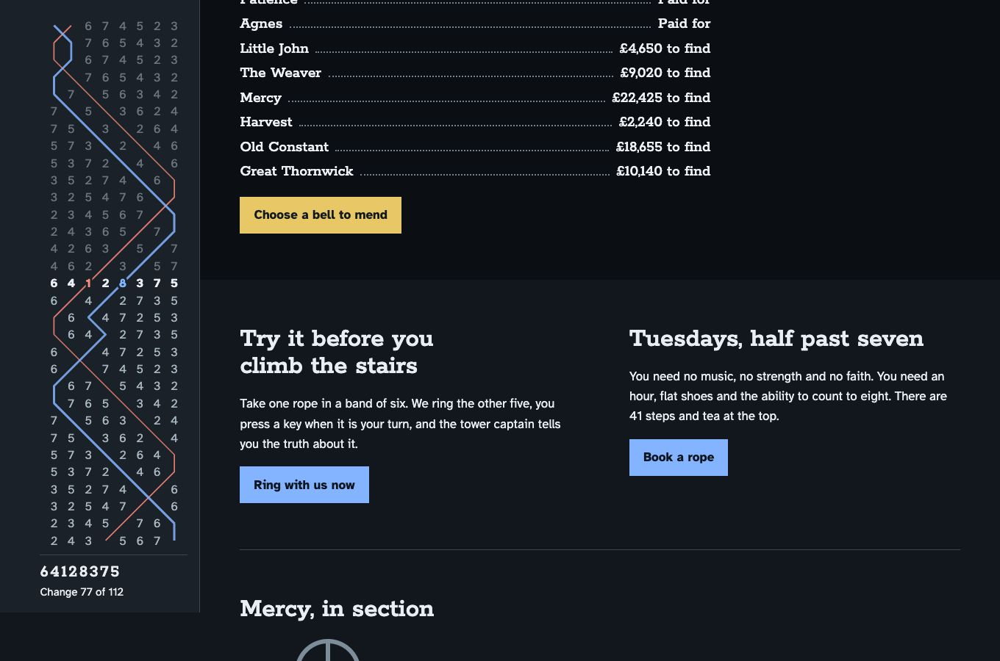
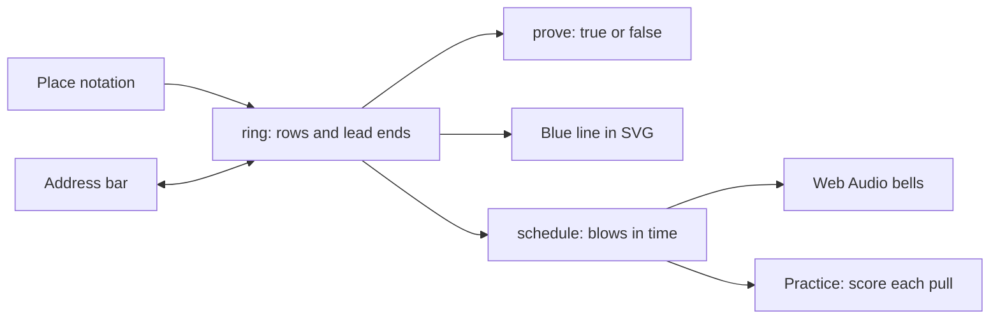

# 🔔 Thornwick Bells

A website for an invented charity that is mending a ring of eight church bells and teaching its town to ring them. Visitors can draw real ringing methods, hear them, call their own touches, ring along with one bell, pledge to a repair and book a first evening.







## 🏛 Architecture



Design decisions and trade-offs: [docs/ARCHITECTURE.md](docs/ARCHITECTURE.md).

**Role focus:** Front-End Engineer · **Stack:** React 19, JavaScript, SCSS, SVG, Web Audio, Vitest, Playwright + axe

## 🧩 The problem

Change ringing is hard to explain in words. Every bell can only swap with its neighbour, so ringers make patterns of rows instead of tunes. A charity that needs new ringers and £67,130 has to let people *see and hear* that before asking for anything.

## ✨ Features

- **The page is a course.** Scrolling the front page moves through 112 changes of Plain Bob Major, and the bells come round at the foot
- **Method book:** 13 traditional methods from place notation, filtered in the address
- **Be the conductor:** call bobs and singles; the page says whether the touch is true, and which row repeats if it is not
- **Sound without files:** each bell is seven tuned partials, scheduled ahead so a busy page cannot upset the rhythm
- **Ring along:** press Space in your place, then see how many milliseconds early or late you were, and some advice
- **Appeal:** eight bells with their own faults and funds, and a Gift Aid calculator for all three tax bands
- **Booking:** evenings, ropes, and an adult for under-18s
- Works from 360px, by keyboard, in light and dark, and with reduced motion

## 🚀 Quick start

```bash
npm ci
```
```bash
npm run dev
```

## 📟 Example output

From the method engine:

| Method | Plain course | First lead head |
|---|---|---|
| Plain Bob Minor | 60 changes | 135264 |
| Grandsire Triples | 70 changes | 1253746 |
| Plain Bob Major | 112 changes | 13527486 |
| Cambridge Surprise Major | 224 changes | 15738264 |

It also proves the bundled 720 of Plain Bob Minor: every possible order of six bells, once each. Production build: 84 kB of JavaScript and 5 kB of CSS, gzipped.

## 🏗 Project structure

```text
src/ringing/      notation, touches, proof, timing, scoring, audio
src/lib/          router, Gift Aid and form rules, evenings
src/components/   blue line, scrolling spine, bells, form fields
src/pages/        home, methods, method, practice, appeal, visit
src/styles/       tokens, base and one layer per area
tests/            unit and component tests
e2e/              browser tests on desktop and phone
```

## 🎯 Skills demonstrated

- Designing from a subject: the colours, type and main interaction all come from bell ringing
- A domain model with no React in it, tested against known results
- Precise audio timing in the browser
- Accessible forms, focus management and shareable state without a router or UI library
- Automated accessibility checks on every page in both themes

## 🧪 Running tests

100 unit and component tests, and 16 browser tests:

```bash
npm test
```
```bash
npm run e2e
```

## 📄 License

MIT. The charity is invented. The ringing methods are traditional.
