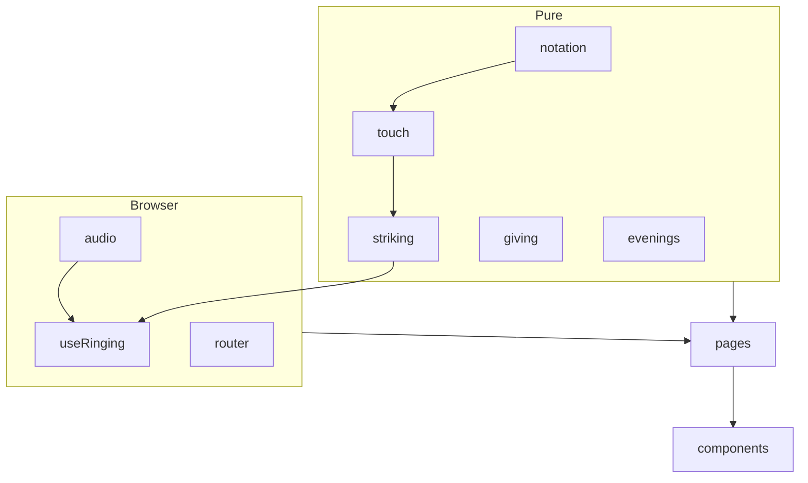

# Architecture

## Decisions

### Methods are stored as place notation, not rows
Thirteen methods fit in a page of text, and the engine has to prove itself. Tests compare course lengths, lead heads and truth with the known values for each method. Storing rows would be simpler to draw but would hide any mistake.

### Time comes from the audio clock
`setInterval` drifts and stalls when the page is busy. It is used only to look ahead 150 ms and hand the blows to Web Audio with exact times. The highlighted row and the learner's pulls are read from the same clock, so what is scored is what was heard.

**Not handled:** output latency on Bluetooth headphones, which makes a learner look late. A calibration step would fix it.

### Scoring pairs pulls with blows in order
Each blow takes the nearest unused pull within 0.6 s. One pull never counts twice, so drumming on the key costs marks. This is greedy rather than optimal; at one pull per row the two agree.

### The address holds anything worth sharing
Followed bell, calls, speed, filters, chosen bell and rope are in the query string, and are validated on the way in. Personal details never are.

### A router of 50 lines
There are six pages and one parameter. A library would be larger than the problem. It handles back and forward, modified clicks, focus and titles.

### Scroll position, not scroll events, drives the spine
The current row is a function of how far down the page you are, computed once per frame, so it cannot get out of step and needs no animation. On phones the diagram becomes one line.

### Colour means something
Red is the treble and blue is the followed bell, because that is how ringers draw them. They keep those meanings in both themes, and lines also differ in width, so colour is never the only signal.

## Accessibility

Diagrams have text labels and the current work ("hunting up", "dodging") is given in words. Striking results are sentences first and marks second. Error summaries take focus. Every page runs through axe in light and dark.

The practice game depends on hearing and timing. The moving marker under each figure lets it be played by eye.

## Known limits

- Calls replace the lead-end change only, so Grandsire and Stedman are rung as plain courses.
- Touches are limited to 60 leads.
- Nothing is sent: pledges and bookings end at a demonstration message.
