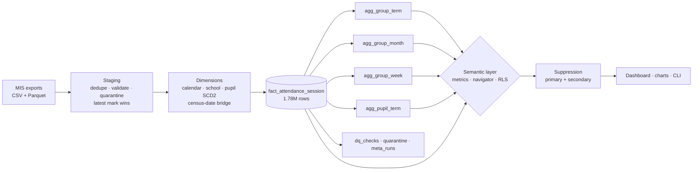
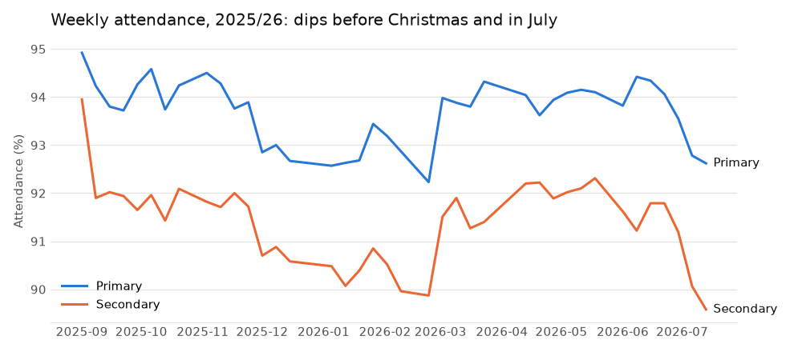
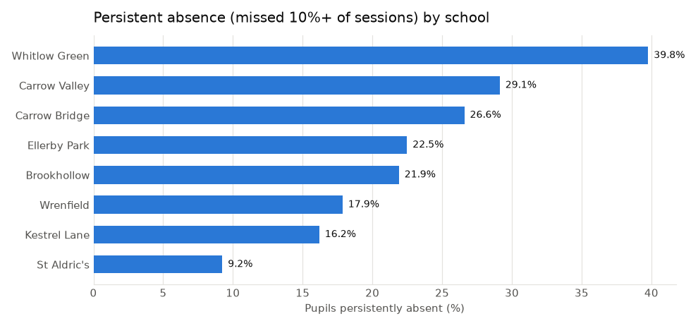
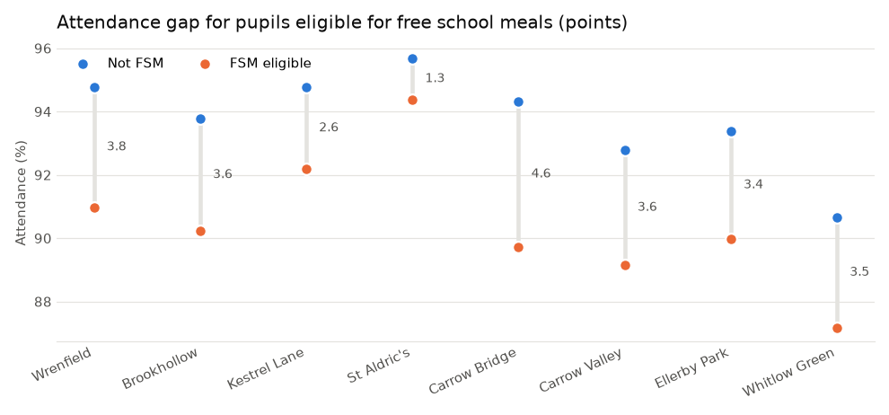
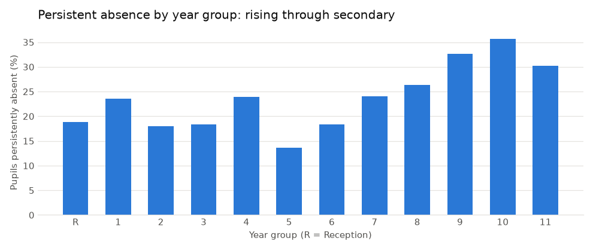
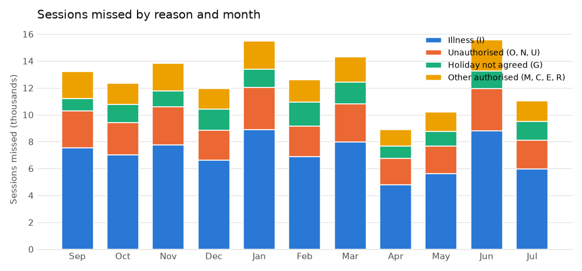
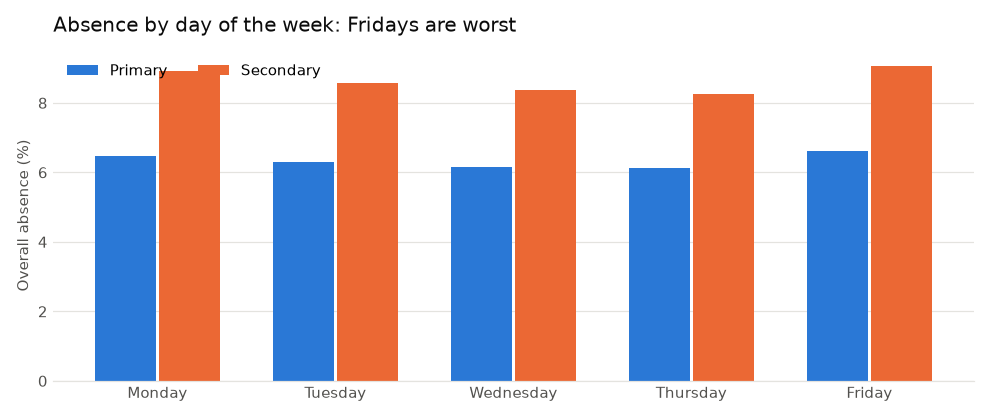

# 🎓 Multi-Academy Trust Attendance BI

An attendance BI mart for **Carrow Valley Academy Trust**, an invented trust of five primary and three secondary schools. It turns a year of register marks (1.84 million raw rows from the schools' information systems, including the amendments, duplicates and faults you would expect) into a dimensional model in DuckDB. It adds a governed metrics layer with an **aggregate navigator**, **row-level security** for head teachers and year leads, and **DfE-style small-number suppression** on every published table. Outputs are a multi-page Plotly dashboard and six briefing charts.

## 🏛 Architecture



Design decisions, trade-offs and limitations are in [docs/ARCHITECTURE.md](docs/ARCHITECTURE.md).

**Role focus:** BI Developer · **Stack:** Python, DuckDB SQL (window functions, `QUALIFY`, SCD Type 2, point-in-time joins), pandas, Plotly, matplotlib, pytest + Hypothesis

## 🧩 The problem

Since 2024, trusts in England have been expected to monitor attendance closely and act early on persistent absence: pupils missing 10% or more of their sessions. The trust board wants one version of the numbers. Head teachers want their own school and nobody else's. Year leads want their year group. Any table that leaves the trust must not identify a child: "three pupils with an EHCP in Year 5 at Brookhollow" is a person, not a statistic. The raw data is messy: absences are entered as N ("no reason yet") and corrected days later, exports get re-run, and pupils who have left still get the odd mark.

## ✨ Features

- **Academic calendar dimension:** 190 teaching days in 2025/26, with terms, half-terms, INSET days, the early-May bank holiday, school weeks and the three census dates.
- **Staging with a quarantine:** exact duplicates are removed, and every row is validated (code, pupil, school day, on roll, school) *before* "latest mark wins", so a corrupt late row can never overwrite a good earlier one. Rejected rows are kept with a reason.
- **DfE attendance codes as reference data:** present, authorised, unauthorised, not possible (Y, exceptional closure) and missing ("register not taken"), with the possible-session rules applied in one place.
- **SCD Type 2 pupil dimension** for free school meal (FSM) and special educational needs (SEN) status, with a **census-date bridge** that fixes each pupil's characteristics per term, as DfE statistics do. Every aggregate therefore adds up to the same totals.
- **One session-grain fact table and four aggregates** (term, month and week by group, plus pupil by term), all reconciled to the fact on every build.
- **Semantic layer:** ten governed metrics (attendance, overall, authorised and unauthorised absence, persistent and severe absence, head count, sessions, amended-mark share), each with a definition. The **aggregate navigator** answers each query from the smallest table that is *correct*. Additive rates come from any aggregate holding the dimensions; head counts and persistent absence need one row per pupil, so they come from the pupil table or the fact.
- **Row-level security** built into the query compiler: `trust`, `head:<school>`, `year_lead:<school>:<year>`. Asking outside your scope raises `AccessDenied`. Filters are bound parameters, never pasted into the SQL.
- **Statistical disclosure control:** primary suppression of groups under 5 pupils, then iterative secondary suppression, so no hidden cell can be recovered from totals by subtraction. Counts can be rounded to the nearest 5.
- **Dashboard:** trust overview with KPI tiles, a weekly trend and a term picker; a pupil-groups page (FSM and SEN); one page per school built *as that head teacher*; and a data-quality page (checks, quarantine, build history).
- **Data-quality gate:** nine checks per build, six of them blocking (uniqueness, reconciliation, SCD2 integrity). Each run is recorded in `meta_runs`.

## 🚀 Quick start

```bash
pip install -e ".[dev]"
trust-bi all          # generate data, build the warehouse, charts, dashboard, benchmark
open reports/dashboard/index.html
trust-bi query --metrics attendance_rate,persistent_absence_rate,pupils --by year_group,sen --role head:S02 --suppress
```

## 📊 Key insights

All figures are from a real run (`trust-bi all`, seed 26). The data is synthetic, but the patterns are modelled on published English attendance statistics.

| Measure (whole year, 4,928 pupils) | Value |
|---|---|
| Attendance | **92.13%** (primary 93.67%, secondary 91.37%) |
| Overall absence | 7.87% |
| Persistent absence (10%+ missed) | **26.28%** of pupils (primary 19.23%, secondary 29.79%) |
| Severe absence (50%+ missed) | 0.32% |
| FSM v not FSM attendance | 89.22% v 93.28%: a **4.1-point gap** |
| FSM v not FSM persistent absence | 39.11% v 20.79%: nearly **twice the rate** |
| SEN: EHCP / SEN support / none | 88.00% / 90.23% / 92.58% attendance |

| School | Attendance | Persistent absence | Pupils |
|---|---|---|---|
| St Aldric's CE Primary | 95.57% | 9.24% | 238 |
| Kestrel Lane Primary | 94.17% | 16.19% | 315 |
| Wrenfield Primary | 94.16% | 17.86% | 420 |
| Ellerby Park Academy | 92.68% | 22.48% | 1,050 |
| Brookhollow Primary | 92.66% | 21.90% | 210 |
| Carrow Bridge Primary | 92.33% | 26.59% | 455 |
| Carrow Valley Academy | 91.74% | 29.13% | 1,380 |
| **Whitlow Green Academy** | **89.20%** | **39.77%** | 860 |

**What the trust should act on**
1. **Whitlow Green Academy** has two in five pupils persistently absent and attendance 2.9 points below the trust average. It also has the highest unauthorised absence (3.25%). This is the first place for an attendance-support officer.
2. **Years 9 and 10** are the peak (32.7% and 35.7% persistently absent, against 24.0% in Year 7). Transition work belongs in Year 8, before the rise.
3. **Disadvantage:** FSM-eligible pupils are nearly twice as likely to be persistently absent. The gap is widest at Carrow Bridge (4.6 points) and narrowest at St Aldric's (1.3 points); St Aldric's practice is worth sharing.
4. **Timing:** Friday absence (8.25%) is the highest of the week, the spring term is the worst (30.2% persistently absent within the term), and attendance falls sharply in the last fortnight of July, when unauthorised holidays cluster.

**Caveats:** persistent absence is measured per pupil over the period asked for, so it is not additive. Pupils whose FSM status changed between terms appear in both FSM groups (3,622 + 1,524 > 4,928), which the semantic layer marks as non-additive.








## 📟 Example output

```text
$ trust-bi build
built warehouse data/warehouse.duckdb in 1.58 s: raw_marks=1,838,854, stg_marks=1,775,770, quarantine_marks=210,
  dim_pupil=5,386, bridge_pupil_term=14,277, fact_attendance_session=1,775,770, agg_group_week=16,789,
  agg_group_month=4,746, agg_group_term=1,301, agg_pupil_term=14,277
9 data-quality checks, 0 failed

$ trust-bi query --metrics attendance_rate,persistent_absence_rate,pupils --by year_group,sen --role head:S02 --suppress
table: agg_pupil_term (14,277 rows) - smallest of 2 tables with ['school', 'sen', 'year_group']; pupil-level metrics need one row per pupil; 2.2 ms
year_group         sen attendance_rate persistent_absence_rate pupils
         R        None           93.19                    16.0     25
         R SEN support           81.79                    60.0      5
         1        None           89.38                   34.78     23
         1 SEN support           89.36                   42.86      7
         2        None               c                       c      c     <- secondary: protects the row below
         2 SEN support               c                       c      c     <- primary: fewer than 5 pupils
         3        EHCP               c                       c      c
         3        None           95.16                     8.0     25
         ...

$ trust-bi bench   (attendance and unauthorised absence by school and term)
  agg_group_term                  1,301 rows  median    1.10 ms   <- navigator's choice
  agg_group_month                 4,746 rows  median    1.22 ms
  agg_group_week                 16,789 rows  median    1.69 ms
  agg_pupil_term                 14,277 rows  median    1.51 ms
  fact_attendance_session     1,775,770 rows  median    5.06 ms
```

The navigator answers from 1,301 rows instead of 1.78 million: 4.6× faster here. DuckDB scans the fact table quickly, so the bigger win is that the same query costs the same on a slower warehouse or across many years. A test proves that every capable table returns identical numbers.

## 🏗 Project structure

```text
trust-attendance-bi/
├── src/trust_attendance_bi/
│   ├── calendar.py      academic year: terms, half-terms, INSET, census dates
│   ├── generate.py      seeded MIS exports with amendments, duplicates and faults
│   ├── warehouse.py     runs the SQL layers, records runs, enforces blocking checks
│   ├── sql/00_raw.sql · 10_staging.sql · 20_dimensions.sql · 30_facts.sql · 40_aggregates.sql · 50_quality.sql
│   ├── semantic.py      metrics, dimensions, aggregate navigator, compiler, row-level security
│   ├── disclosure.py    primary + secondary suppression, rounding
│   ├── dashboard.py     multi-page Plotly site (per-school pages built as that head)
│   ├── charts.py        six PNG briefing charts
│   └── cli.py           trust-bi build | query | charts | dashboard | bench | all
├── tests/               44 pytest tests (incl. Hypothesis properties)
├── docs/                ARCHITECTURE.md, charts
├── data/                generated raw files and warehouse (git-ignored)
└── Makefile, pyproject.toml
```

## 🎯 Skills demonstrated

- **Dimensional modelling:** a session-grain fact, a conformed calendar, SCD Type 2 with a point-in-time census bridge, and aggregate tables designed around which measures are additive.
- **Advanced SQL:** `QUALIFY` with `row_number()` for latest-wins, `lead()` for SCD2 ranges, range joins, `GROUP BY ALL`, and reconciliation checks written in SQL.
- **Semantic layer and governance:** one definition per metric, an aggregate navigator that knows the difference between additive and distinct measures, and generated, parameterised SQL.
- **Security and privacy:** row-level security enforced in the compiler rather than the UI, and statistical disclosure control (primary and secondary suppression) checked with property-based tests.
- **Data quality:** quarantine with reasons, blocking v advisory checks, run metadata, and dashboard figures reconciled to source in tests.
- **Communicating to non-technical leaders:** KPI definitions in plain English, findings ranked by what to do next, and honest caveats.

## 🧪 Running tests

```bash
ruff check . && ruff format --check .
pytest -q        # 44 tests: calendar, generator, staging, SCD2, census bridge, navigator,
                 # cross-table reconciliation (Hypothesis), RLS, suppression properties, outputs
```

## 📄 License

MIT. See [LICENSE](LICENSE). Carrow Valley Academy Trust, its schools and its pupils are invented.
